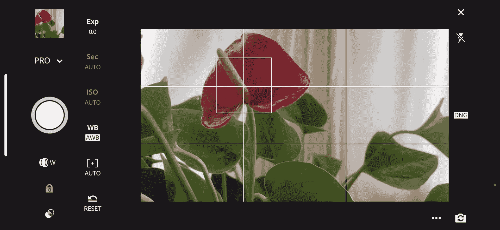
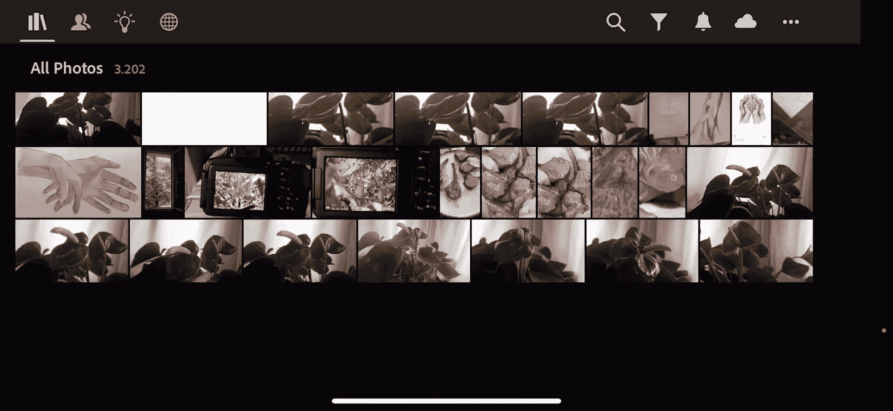
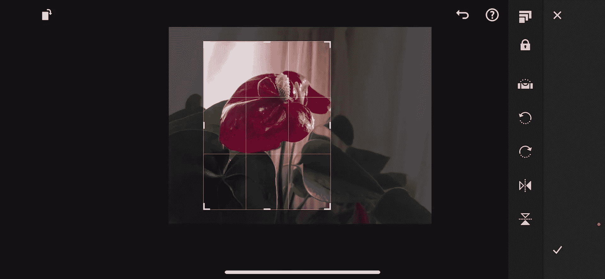
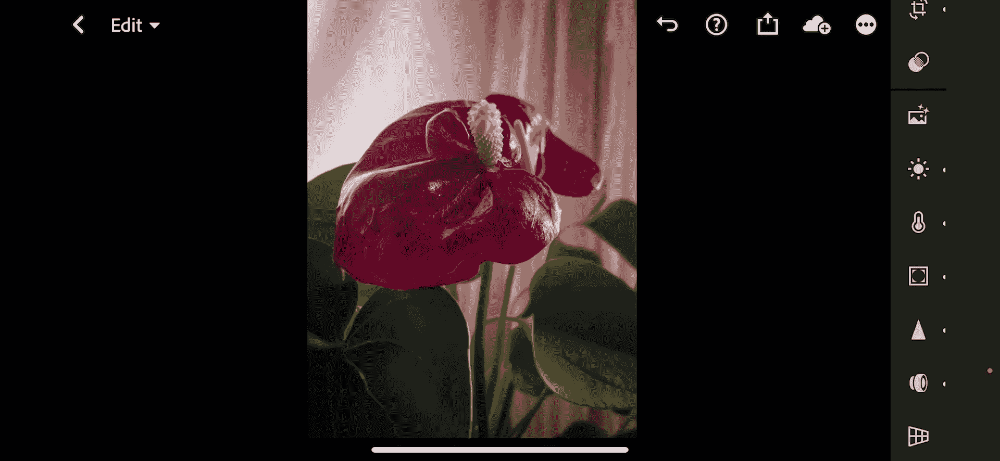
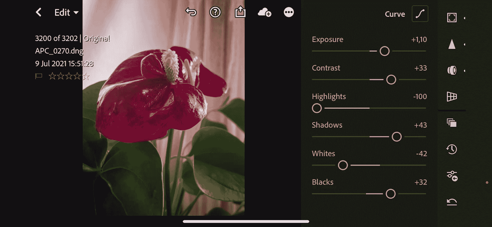
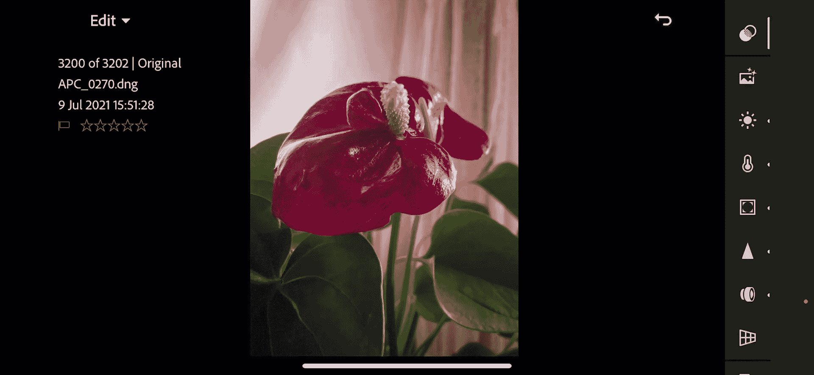
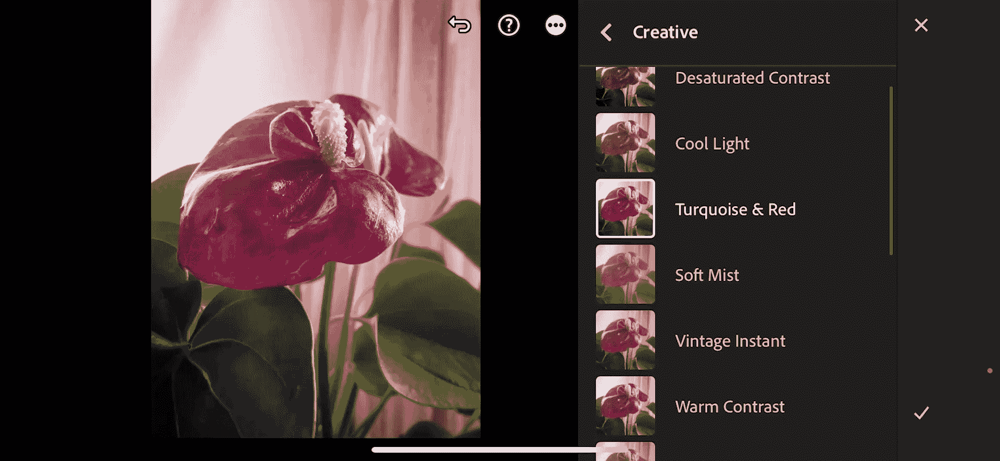
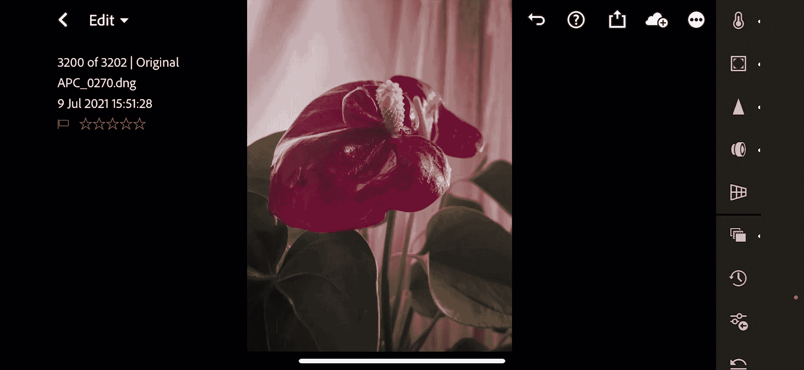

# Adobe Lightroom 完全教程：第 53 课：拍摄照片 📸


在本节课中，我们将学习如何使用手机相机拍摄照片，并了解不同拍摄角度和焦点设置对最终画面的影响。我们会先讲解对焦点的选择方法，再介绍曝光锁定的具体操作，接着演示如何拍摄普通照片、特写照片以及超广角照片。之后我们会把拍摄好的图片导入 Lightroom 开发模块，进行基础的光线和色彩调整，最后对比编辑前后的效果，为下一节课打好基础。


上一节课我们介绍了相机界面中的各种滑块和标签页，以及如何调整调整量。本节课我们来看看如何实际拍摄图像，以及如何拍摄不同类型的图像。我们继续使用同一朵花作为拍摄对象。


以下是拍摄前需要考虑的对焦位置选择：

- 可以对焦在这朵花上
- 可以对焦在另一朵花上
- 可以对焦在背景上的某一片叶子上
- 可以不对焦花朵，而是营造模糊的背景效果

在决定对焦位置之前，请先观察画面中的光线情况。因为我们尚未锁定曝光，所以当你在屏幕上移动对焦点时，画面的明暗会随之变化。


以下是曝光锁定的操作步骤：

- 在屏幕右下角或左下角找到带有太阳图标的锁定按钮
- 点击该按钮，按钮会变为黄色，表示曝光已锁定
- 锁定后，无论你在屏幕哪个位置点击对焦，曝光数值都保持不变

你可以将曝光锁定在背景上，也可以锁定在花朵上，具体取决于你希望画面哪部分保持原有的亮度。锁定曝光的目的是防止在切换对焦点时，光线发生不必要的变化。

```
曝光锁定状态 = 锁定按钮点亮（黄色）
任意位置点击对焦 → 曝光数值保持不变
```

接下来我们先拍摄一张普通照片。这是第一张图片，用于记录基础构图。拍摄完成后，我们会拍摄多张不同角度的图片，以便在下一节课进行编辑，并发布到 Lightroom 社区。


拍摄完普通照片后，我们可以尝试拍摄特写照片。特写照片也叫微距照片，主要表现方法是将被摄对象靠近镜头，或者将镜头靠近被摄对象。

以下是拍摄特写照片的具体做法：

- 将花朵移近镜头，或者你自己靠近花朵
- 切换到对焦标签页，将对焦模式从自动改为手动
- 在屏幕上拖动对焦点，直到绿色对焦线覆盖到你想要清晰呈现的花瓣部分
- 轻微后退或前移微调对焦范围
- 按下快门拍摄

拍摄完成后，你会发现前景中的花朵清晰，而背景中的花朵出现模糊，这就是景深效果。如果你希望只有这一朵花清晰，其他部分都模糊，可以调整被摄对象和镜头之间的距离。把主体稍微后移，再把前景的花稍微前移，然后在对焦条上选择你喜欢的对焦位置，拍摄一张照片即可。


除了普通镜头，我们还可以尝试使用超广角镜头拍摄。超广角镜头的特点是视野非常广阔，适合拍摄长街道、市场摊位等场景。

以下是使用超广角镜头时需要注意的问题：

- 对于单朵花这种近距离小型主体，超广角镜头效果通常不佳
- 超广角镜头可能不提供对焦选项，无法手动选择对焦点
- 画面边缘可能出现鱼眼变形

在这种情况下，我们可以直接拍摄一张照片，虽然没有手动对焦，但自动对焦效果通常也能满足基本需求。


如果当前拍摄位置的特写效果不理想，我们可以更换拍摄位置，改变相机和被摄对象的相对位置。

以下是改变位置后的拍摄思路：

- 在背景和前景之间创造一定的距离
- 先对焦背景，再锁定曝光
- 回到主体位置构图，避免背景过曝
- 在阳光强烈或存在逆光的情况下，这种方法特别有用



接着将花朵靠近镜头，注意遮挡住自己的手，然后拍摄照片。检查效果后，如果画面显得过于普通，可以尝试换一个角度再次拍摄。




当你拍摄完多张同一主体的照片后，就可以进入 Lightroom 的开发模块进行编辑了。你需要向下滑动到底部，找到刚才拍摄的图片。选择一张细节最丰富的照片，最好是以 DNG 格式保存的图片，因为 DNG 文件包含更多像素信息，为后期编辑提供更大的操作空间。


如果你想进行快速编辑，可以先尝试自动设置。Lightroom 会自动分析图片并应用一组参数。如果不喜欢自动效果，可以撤销，然后手动调整。

以下是基础光线调整的步骤：

- 进入光度面板
- 修正曝光值，使画面亮度适中
- 降低对比度，使明暗过渡更柔和
- 调整高光、阴影、白点和黑点，平衡画面明暗层次
- 适当提高阴影，恢复暗部细节

光度面板中的这些滑块虽然初始可能是自动设置，但你可以根据实际效果逐一微调。


完成基础光度调整后，我们可以继续使用色调曲面进一步塑造画面的明暗对比。

色调曲面可以用公式表示：

输出亮度 = 输入亮度 × 曲线调整系数

具体操作是创建一个 S 型曲线。S 曲线的作用是提高亮部亮度、降低暗部亮度，从而增加整体对比度。创建完成后点击完成，进入下一步。


接下来处理白平衡和颜色混合。我们希望图片呈现暖色调，因此可以调高色温，并添加一点紫色色调。接着适当提高自然饱和度，但不要过度提高饱和度，因为图片已经有足够的色彩强度。

以下是颜色混合面板的调整方法：

- 进入颜色混合面板
- 将花朵颜色改为偏红或偏紫的色调
- 稍微降低饱和度，避免颜色过于刺眼
- 调整明度，但要注意背景中如果包含红色窗帘，过高的明度会产生噪点，建议控制在加七左右
- 对绿色部分，可以保持色调偏绿，适当提高饱和度，明度保持不变

调整完成后，我们进入效果面板。


以下是效果面板中的常用调整项：

- 清晰度：适当增加，增强中间色调的对比感，但不要过多
- 纹理：提高纹理数值，让花瓣细节更明显
- 暗角：添加深色暗角，画面四个角变暗，可以把视线拉回画面中央
- 锐化：增加锐化量，例如设为六十一，半径保持默认
- 噪声降低：放大图片查看噪点情况，适当降低色彩噪点和亮度噪点，并通过细节滑块保留图像细节

如果图片中没有色彩噪点，则不需要处理色彩噪点。






完成效果调整后，我们可以检查光学校正和几何设置。

光学面板中可以启用镜头校正。启用后，图片可能会产生鱼眼效果，使花朵看起来更靠近。如果不喜欢这个效果，可以撤销。几何面板通常不需要进行特殊调整。

接着我们可以裁剪图片。选择原始自定义尺寸，改为竖构图，裁剪到合适位置，使主体位于画面中央，整体显得更紧凑。




如果你想给图片添加预设，可以进入资料库，找到创意面板。创意面板中包含多种艺术风格配置文件，你可以浏览并选择喜欢的预设。



不过在本例中，我们直接添加一个配置文件。进入艺术类别，选择一个合适的颜色配置文件，然后降低强度，避免效果过重。




编辑完成后，你可以按住图片查看编辑前的效果，松开后查看编辑后的效果。按住即为之前，松开即为之后，这样可以直观对比调整前后的差异。

通过本节课的学习，我们成功拍摄了一张简单的花朵照片，并运用之前学习的基础编辑技巧完成了后期处理。


下一节课，我们将拍摄另一张照片，尝试不同的拍摄风格，并进行编辑。到时候见。




本节课中，我们一起学习了如何选择对焦点、如何锁定曝光、如何拍摄普通照片和特写照片、超广角镜头的使用注意事项、如何改变拍摄位置优化构图、如何将图片导入 Lightroom 开发模块，以及如何进行光线、色调曲面、白平衡、颜色混合、效果、光学校正、裁剪和配置文件的调整。希望这些内容能帮助你掌握基础的拍摄和编辑流程。
