# Adobe Lightroom 照片编辑从入门到精通：第 52 章：批量编辑 🖼️

在本节课中，我们将学习如何一次性对多张图片应用相同的编辑设置，而不需要在每一张照片上重复浪费时间。批量编辑的核心可以用下面这个公式来概括：

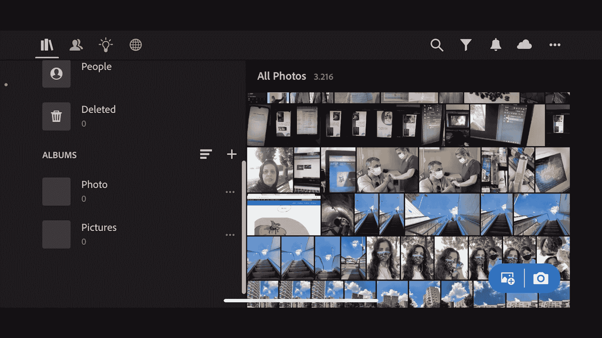

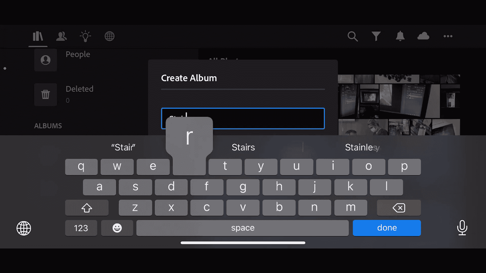

编辑参数 = 参考图片的调整内容 ← 复制 → 批量粘贴到其他照片

简单来说，就是先把一张图片调好，然后把这些参数“复制”并“粘贴”给其他图片即可。这个方法听起来比实际操作要简单得多，非常适合处理拍摄场景统一的照片系列。接下来我们就开始正式演示，一步步看看怎么做。

## 创建专辑并整理图片 📁

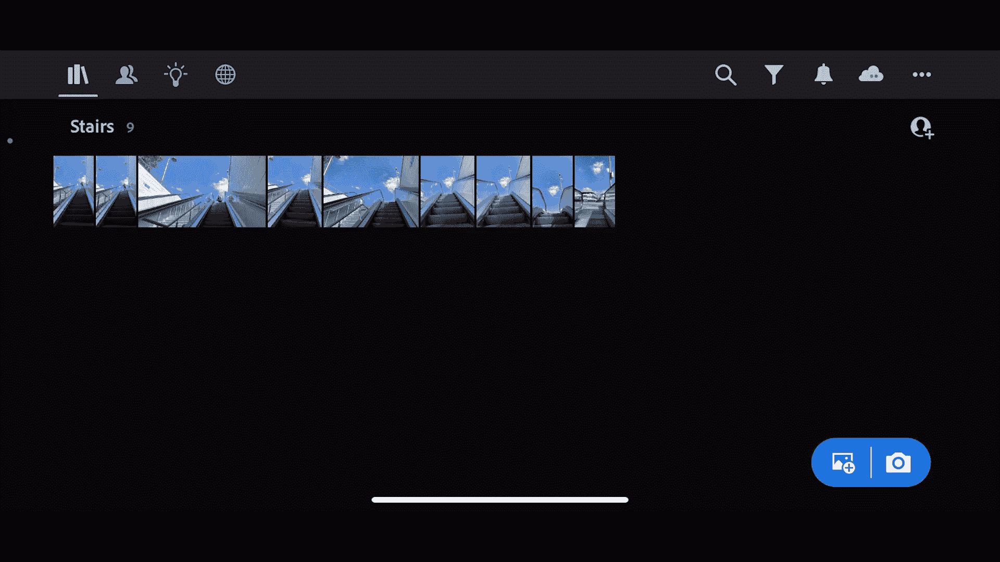

在开始批量编辑之前，我们需要先把想要处理的照片放在一个专辑里，方便统一管理。以下是具体的操作步骤：

- 点击左上角的书架图标，新建一个专辑，并命名为“stairs”。
- 点击加号按钮，确认创建新专辑，输入名称“stairs”后点击确定。
- 返回媒体库，按住第一张楼梯照片，然后一次性选中所有需要编辑的楼梯图片。
- 点击底部的“添加到”按钮，在右上角选择刚才创建的“stairs”专辑，确认添加。

这样一来，9 张照片就被复制到了 stairs 专辑中。我们不再需要在杂乱的图片库里寻找，所有要编辑的照片都整齐地集中在同一个地方，操作起来会更加清晰和高效。

## 对单张图片进行基础调整 🎨

接下来我们需要挑选一张代表性的照片来制定编辑方案。以下是基础调整的具体流程：

- 选一张白天拍摄的楼梯照片，不要把夜景照片混进来，因为不同光线下的调整参数不一样。
- 从光线面板开始，增加对比度，降低高光部分。
- 进入色调曲线面板，完成调整后点击完成。
- 接下来调整白平衡，稍微提高色温让画面偏暖，并添加少量色调。
- 进入颜色混合器，调整天空颜色，让其偏青色而不是紫色，提高饱和度并降低亮度。
- 调整橙色和红色的色相，让人物肤色看起来更自然。
- 适当降低去雾值和清晰度，最后稍微增加锐化，基础编辑就完成了。

到这里，这张参考图片的所有调整参数就已经确定下来了。我们可以把这些设置看作一个整体，准备把它应用到其他照片上。

## 复制并粘贴设置到多张图片 📋

如果你不想把这些设置保存成永久预设，也可以直接使用复制粘贴的方式。以下是具体操作：

- 点击编辑界面右上角的三个点，选择“复制设置”。
- 在弹出的窗口中确认所有选项都已勾选，但要禁用几何选项和工具选项，因为这些设置通常是每张图片独特的。
- 返回媒体库，按住想要应用设置的图片，选择除了第一张以外的所有照片。
- 点击底部的“粘贴设置”，系统会提示将设置应用到 8 张照片，点击确定。

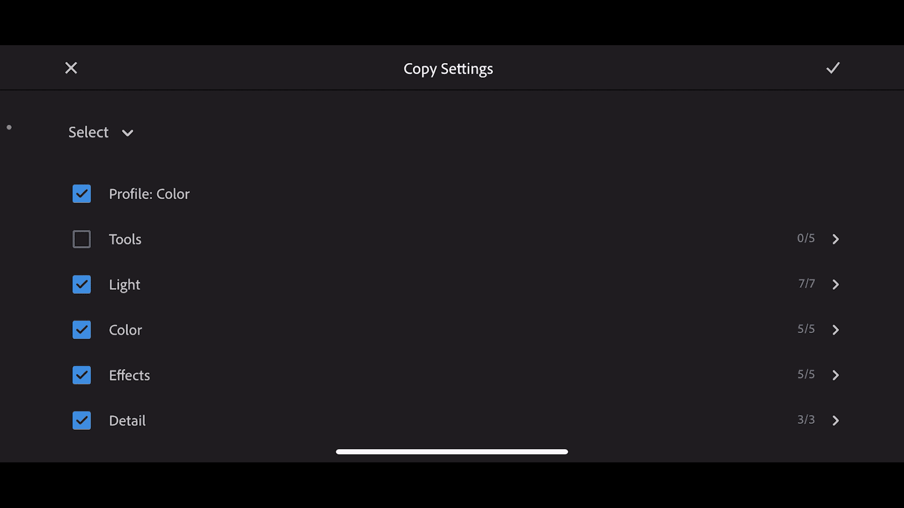

Lightroom 会立即开始渲染和生成预览，所有图片都会拥有统一的色调范围。你可以长按某张照片查看编辑前后的对比，确认效果一致即可。

## 添加配置文件并再次粘贴设置 🔄

除了刚才的基础调整之外，你还可以给图片添加一个配置文件，然后再次粘贴设置，从而叠加不同的风格。以下是操作方法：

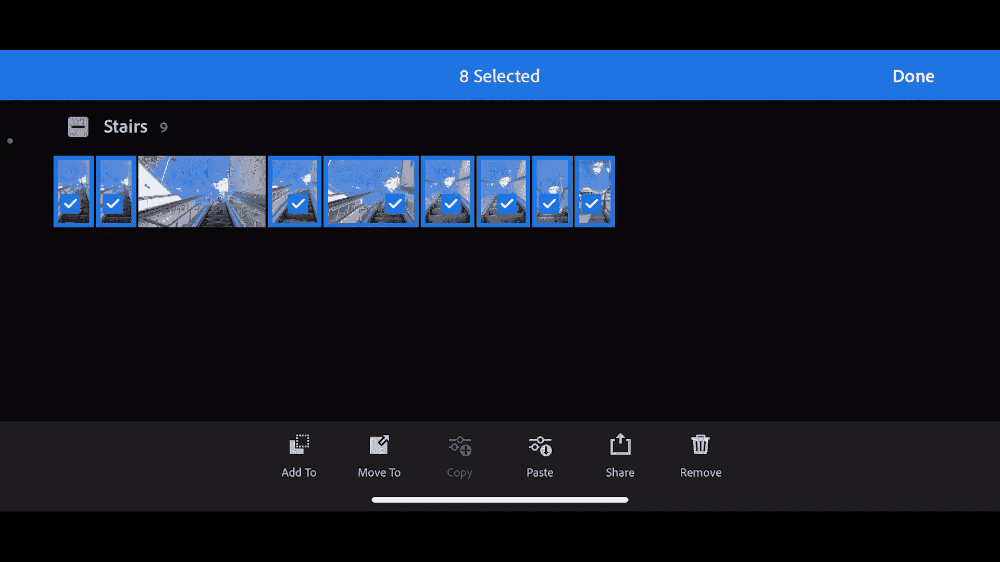

- 进入预设面板，添加一个配置文件，比如选择“艺术 4”这种偏蓝色的风格。
- 点击对勾确认，再次点击“复制设置”。
- 返回媒体库，按住一张图片，选择除了已编辑照片以外的所有图片。
- 再次点击“粘贴设置”，完成渲染后，所有图片都会呈现出偏蓝的艺术效果。

这样一来，你就在第一次调整的基础上，叠加了另一层风格，得到完全不同的视觉效果。整个过程其实就是按钮的重复使用，关键是要知道每个按钮的作用，以及在什么时候使用它们。

## 批量编辑的实际应用场景 💡

批量编辑在很多实际拍摄场景下都非常有用。以下是几个常见的例子：

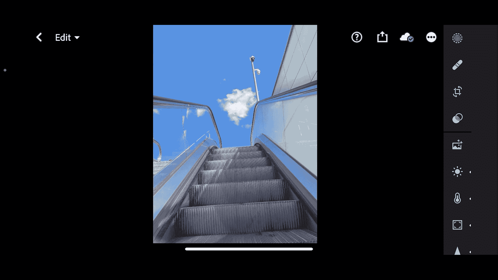

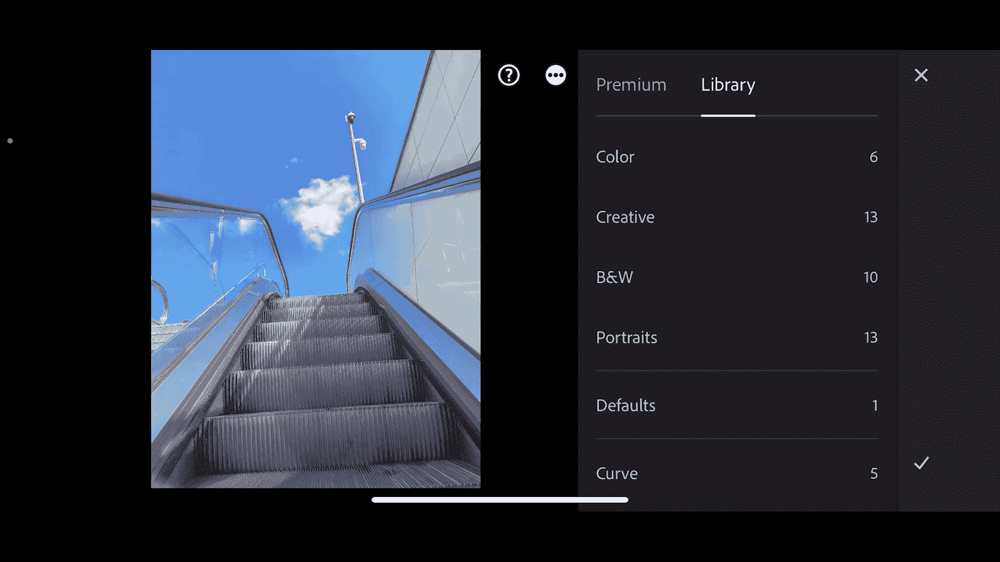

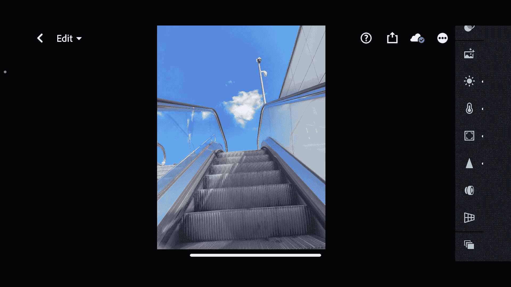

- 生日派对或婚礼现场，大量照片拍摄于同一光源、同一背景下，人物可能不同，但光线和颜色基本一致。
- 在公园或室内场馆拍摄的一组照片，主体颜色相近，适合使用同一套参数。
- 旅行途中同一时间段拍摄的风景照片，光线条件相似，可以快速统一色调。

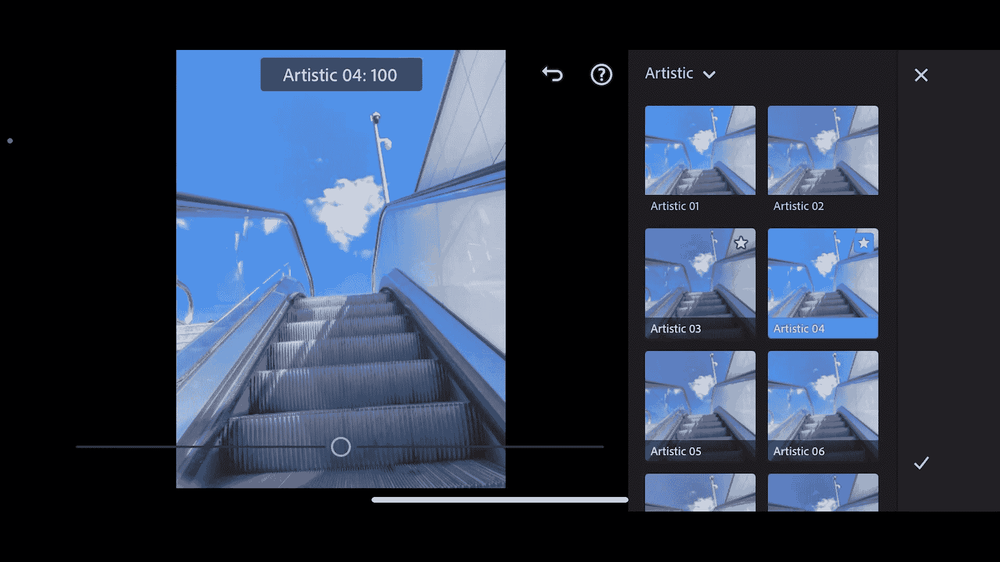

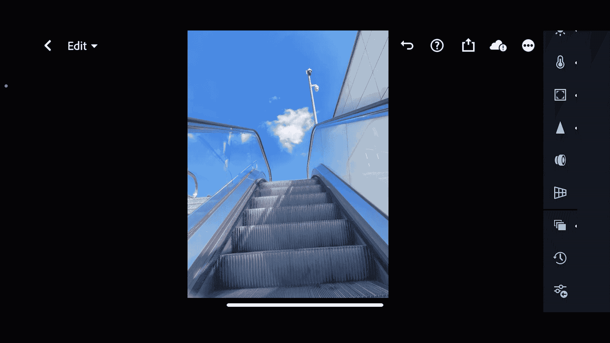

通过批量编辑，你可以一次性处理几十张甚至上百张照片，节省大量时间，避免逐张重复调整带来的低效劳动。

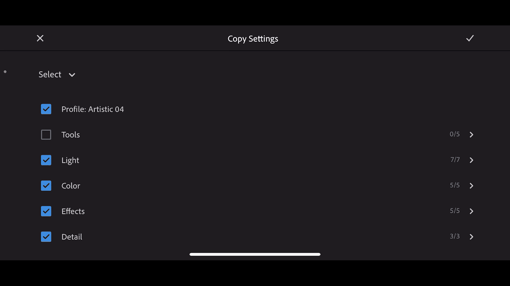

## 总结 📝

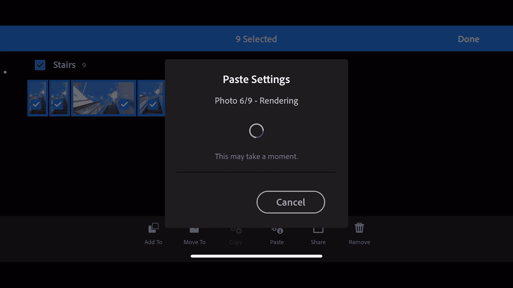

本节课中，我们一起学习了如何在 Adobe Lightroom 中进行批量编辑。核心流程可以用下面这个简单的代码逻辑来表示：

选择参考图片 → 调整参数 → 复制设置 → 批量粘贴 → 查看效果

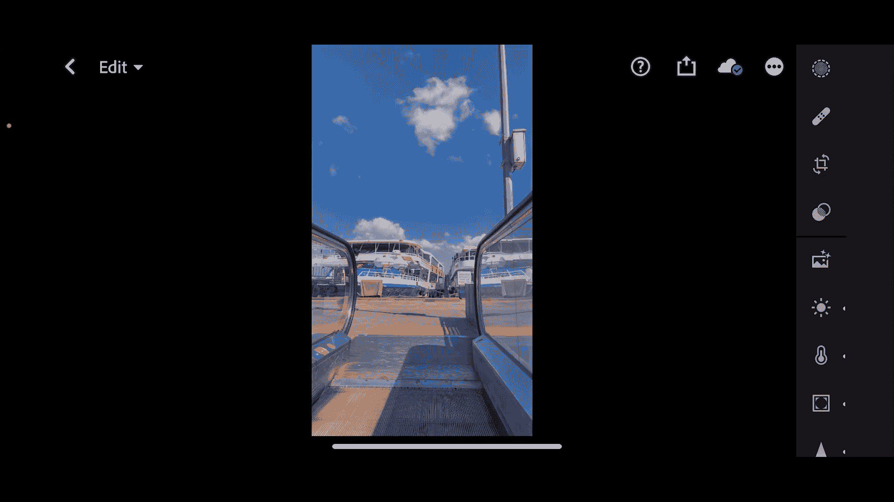

我们先创建了专辑来整理图片，然后对一张代表性照片进行了基础调整，接着复制设置并粘贴到其他照片上，最后还尝试添加了配置文件并再次应用。通过这种方式，你可以轻松地给大量图片应用相同的设置，而不需要浪费时间在每一张照片上。下节课我们再见。

