# 📸 Adobe Lightroom 摄影后期完全教程：058：批量编辑、预设与配置文件


在本节课中，我们将学习如何在 Adobe Lightroom 中对多张照片进行批量编辑，如何复制和粘贴编辑设置，如何导入和导出预设，以及预设与配置文件之间的区别。这些技能能帮助你在面对大量照片时快速完成后期工作，节省时间并保持风格统一。

## 一、为什么需要批量编辑

拍摄结束后，你可能需要处理五百张甚至更多的照片，而交稿时间往往很紧张。如果一张张地单独调整，效率会非常低，容易错过交付 deadline。Lightroom 提供了批量编辑功能，允许你一次性将同一套参数应用到多张照片上，从而快速完成初步修图。

我们先来看一组拍摄角度和光线相似的照片。这些照片包含特写和远景，但整体光线条件比较一致。面对这类照片，主要有三种处理方式：

以下是三种批量编辑的常见选择：

- 方法一：复制某张已编辑图片的设置，再粘贴到其他照片上。
- 方法二：使用自己已有的预设，一次性应用到所有照片。
- 方法三：从互联网下载预设，直接套用到整组图片。

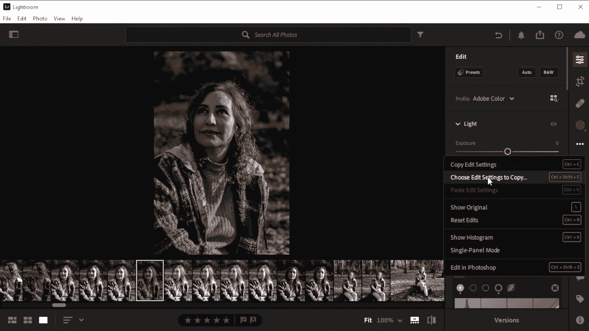

接下来，我们先从第一种方法开始，看看如何把一张图片的编辑结果复制到多张照片中。

## 二、复制并粘贴编辑设置

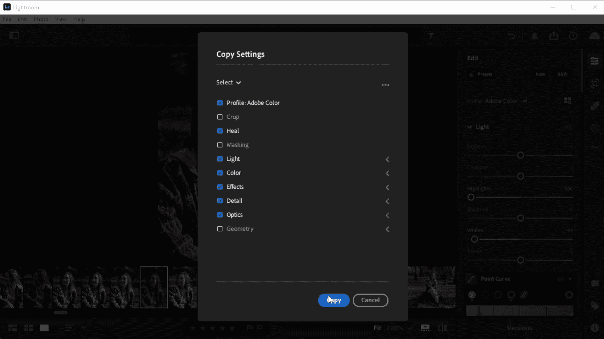

假设你已经对一张照片完成了编辑，现在想把相同的参数应用到另外三张或四张照片上。第一步是重置其他照片的编辑状态，避免之前的参数干扰。你可以按下 Control + R 来重置编辑；如果这些照片还没有做过任何调整，则可以跳过这一步，直接选中需要重置的图片。

找到已经编辑好的那张图片，点击右上角的三个小点，选择“复制编辑设置”。在弹出的窗口中，你可以选择只复制某个面板，也可以全部勾选。建议先全选，然后根据需要取消不需要的部分，例如几何变换或裁剪。你会看到“无”“默认”“全部”“已修改”这几个选项。如果选择“已修改”，系统只会勾选你实际调整过的参数，没有动过的曝光或对比度会被排除。你也可以选择“全部”，然后手动取消几何变换、裁剪或修复等不需要的选项，确保只复制真正有用的设置。

以下是具体的操作流程：

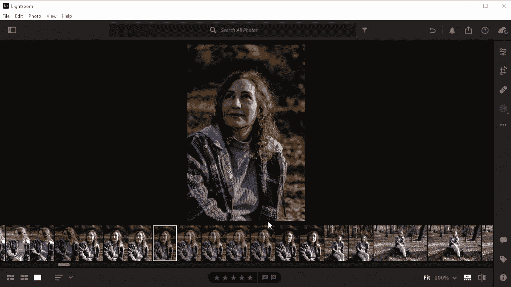

```text
选中参考图片 → 点击三个小点 → 复制编辑设置 → 勾选所需参数 → 按住 Shift 选中目标照片 → 编辑 → 粘贴
```

复制完成后，按住 Shift 键，先点击第一张目标照片，再点击最后一张目标照片，选中中间的所有图片。接着进入“编辑”菜单，选择“粘贴”，或者直接使用 Control + V。这样，你之前复制的所有设置就会被应用到这组照片上。粘贴后，你可能需要针对个别照片稍微调整几个参数，因为光线或构图可能存在细微差别。

操作完成后，你会发现这四张照片现在拥有完全相同的编辑参数。切换到不同的视图并全选这四张图片，再次执行“编辑”中的“粘贴”，系统会进行同步。这时你可能会看到右下角有一个蓝色的圆点在转动，这表示 Lightroom 正在将照片同步到云端，与你的编辑操作无关，只需等待同步完成即可。就这样，你把第一张图片的设置应用到了另外四张拍摄角度和光线相同的照片上。

## 三、使用预设快速编辑

有时候你甚至没有时间先编辑好一张照片，只想直接套用一个预设，快速完成处理。Lightroom 自带了一些预设，比如“户外秋日风格”，点击一下就可以将整套参数应用到当前照片。

以下是使用内置预设的简要流程：

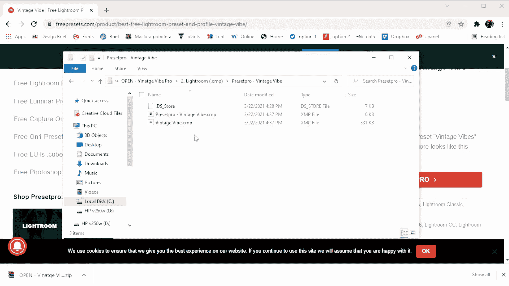

- 进入“预设”面板。
- 选择你喜欢的预设，例如“户外秋日风格”。
- 一键应用到当前照片。

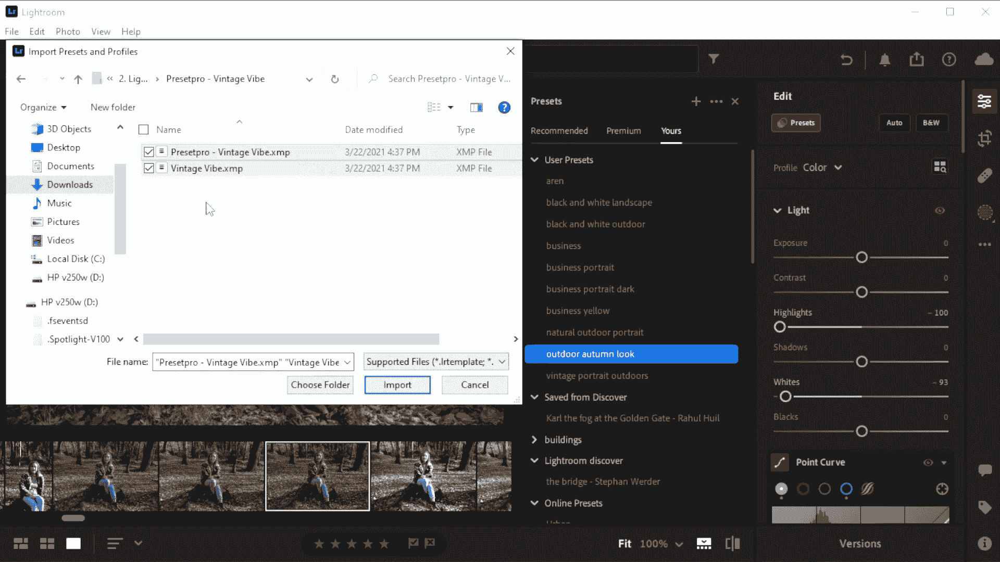

如果你想把这个预设应用到更多照片，仍然可以使用“复制编辑设置”和“粘贴”的方法，将同一组参数批量应用到五张或更多图片上。这样你就可以一次性完成大量照片的处理，而不需要逐张调整。

## 四、从互联网导入预设

除了自带的预设，你也可以从互联网下载免费或付费的预设文件。例如访问某个免费预设网站，下载一个名为“复古氛围”的预设包。下载后通常是压缩文件，解压后你会得到以 XMP 为后缀的预设文件。Lightroom 的预设格式就是 XMP。

以下是导入预设的步骤：

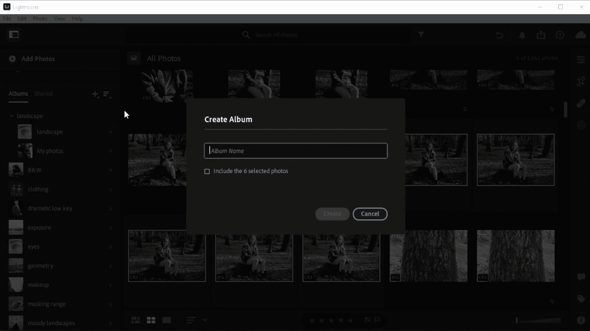

1. 解压下载的预设文件夹。
2. 打开 Lightroom，进入“预设”面板。
3. 点击三个小点，选择“导入预设”。
4. 在文件选择窗口中，找到刚才解压的 XMP 文件。
5. 如果不确定导入哪一个，可以全部选中并导入。

导入完成后，新预设会出现在预设列表中，例如“预设专业 复古擦拭”。你可以将这个预设应用到任意数量的照片上，无论是十张还是五百张，操作逻辑都相同。应用后，照片可能会变得更亮，同时右下角的蓝色同步点会提示 Lightroom 正在将这些照片同步到创意云端。

为了更好地管理大量照片，你还可以创建专门的相册。例如新建一个名为“公园”的相册，将选中的六张或更多照片加入其中。以后处理这组照片时，直接在相册里操作，不需要从全部照片标签页里逐一挑选，这样能让你的素材更有条理。

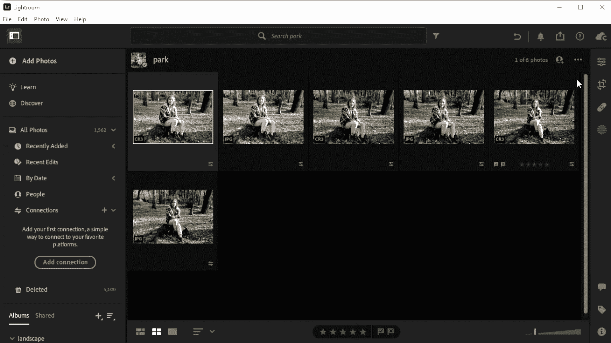

## 五、导出自己的预设

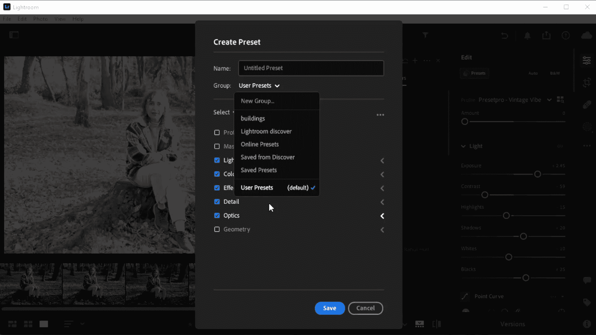

当你调制出满意的参数组合，可以将其保存为自己的预设，供日后使用或分享给他人。

以下是导出预设的步骤：

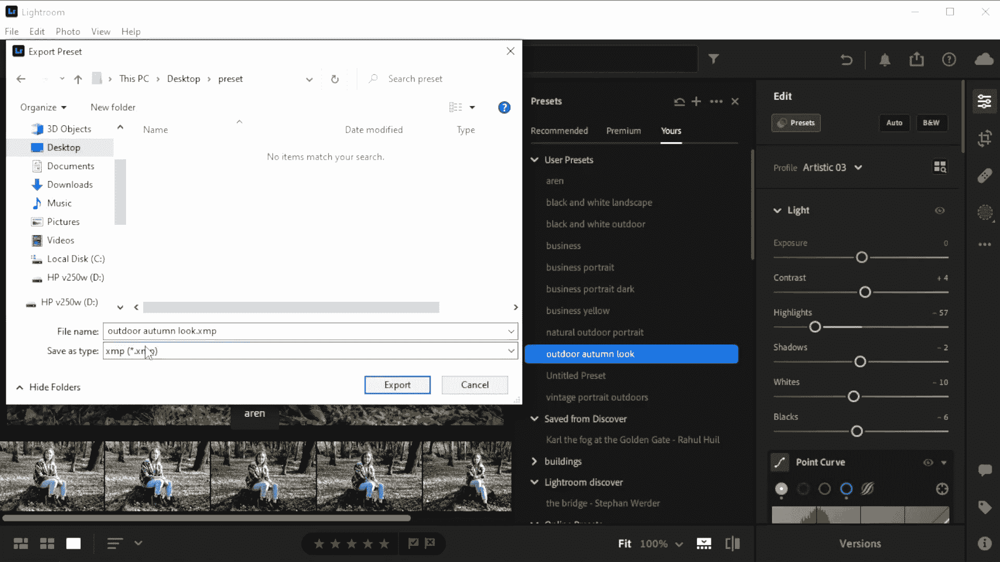

1. 进入“预设”面板。
2. 选择你想要导出的自定义预设。
3. 右键点击该预设，选择“导出”。
4. 选择保存文件夹，为文件命名，确认文件格式为 XMP。
5. 点击导出。

如果你不记得如何制作自己的预设，可以先随便调几个参数，点击加号，选择“创建预设”，选择要包含的配置文件，再选择预设分组，最后点击保存。默认会被命名为“无标题预设”，你也可以自己改名，比如“户外秋日风格”。

你也可以使用“使用当前设置更新”功能。比如你希望这个预设多加一点曝光，先调整好曝光参数，再更新预设，新的曝光值就会被写入该预设中。导出后的预设文件可以发送给朋友，上传到互联网，甚至出售。Lightroom 预设市场很受欢迎，很多人希望直接套用预设来修图，而不想花太多时间手动调整。你的预设无论是免费分享还是付费出售，都能帮助其他用户提高效率。

## 六、预设与配置文件的区别

Lightroom 还有一个相关功能叫配置文件，你可以把它理解为滤镜。配置文件不会给你具体的参数面板，只能调整一个“强度”滑块。例如选择“黑白”配置文件后，你只能改变强度大小，无法单独调节高光、阴影等细节参数。如果你想重新调整，需要先按 Control + R 重置图片，再回到配置文件面板选择其他配置文件。此时你会发现，除了强度滑块之外，没有其他可调参数。

以下是两者的核心区别：

- 预设：包含具体的编辑参数，可以修改曝光、对比度等，适合需要精细调整的场景。
- 配置文件：只提供整体风格滤镜效果，只能调节强度，适合快速套用统一视觉风格。

如果你想对配置文件进行批量编辑，仍然可以先复制某张图片的编辑设置，然后在网格视图中选中多张照片，右键选择“编辑”并“粘贴”。不过需要注意，使用配置文件时，你无法看到用来实现该效果的具体参数，只能调整强度这一项。相比之下，预设更好，因为你可以修改其中的参数，增加对比度或其他设置，让结果更符合自己的需求。

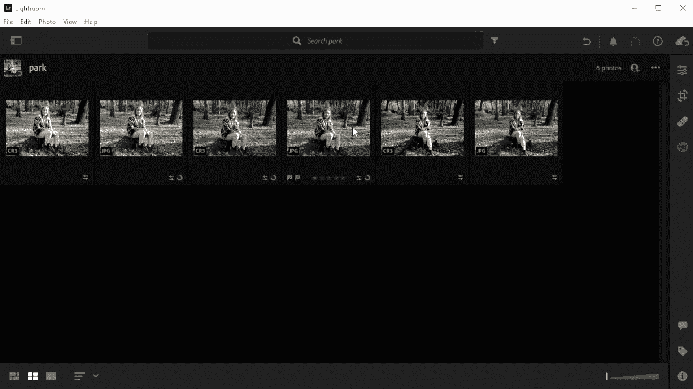

## 七、课程总结

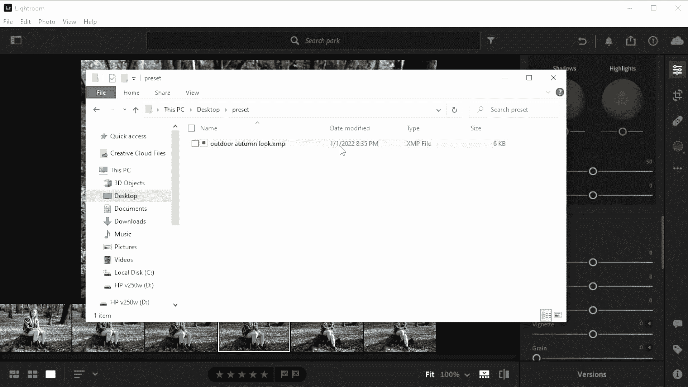

本节课中，我们一起学习了如何在 Lightroom 中进行批量编辑，如何复制和粘贴编辑设置，如何导入和导出预设，如何利用相册整理大量照片，以及预设与配置文件的区别。掌握这些方法后，你可以一次性处理一百张甚至五百张照片，大幅提升后期效率，同时保持图片风格的一致性。希望这节课对你有帮助，我们下节课见。
