Adobe Lightroom 照片编辑从入门到精通：第54课：照片合并功能（全景与HDR）🖼️

在本节课中，我们将要学习 Lightroom 中的照片合并功能，重点介绍全景图合并和 HDR 合并两种主要工具。这两个功能分别用于把多张照片拼接成一张宽幅图片，以及把不同曝光的照片融合成一张高动态范围图片。即使你以前从未使用过这些工具，也完全不需要担心，我们会一步步演示操作过程，并展示最终效果长什么样。课程会先介绍全景图，再讲解 HDR，最后介绍两者的组合功能，确保你能够掌握每一个步骤。


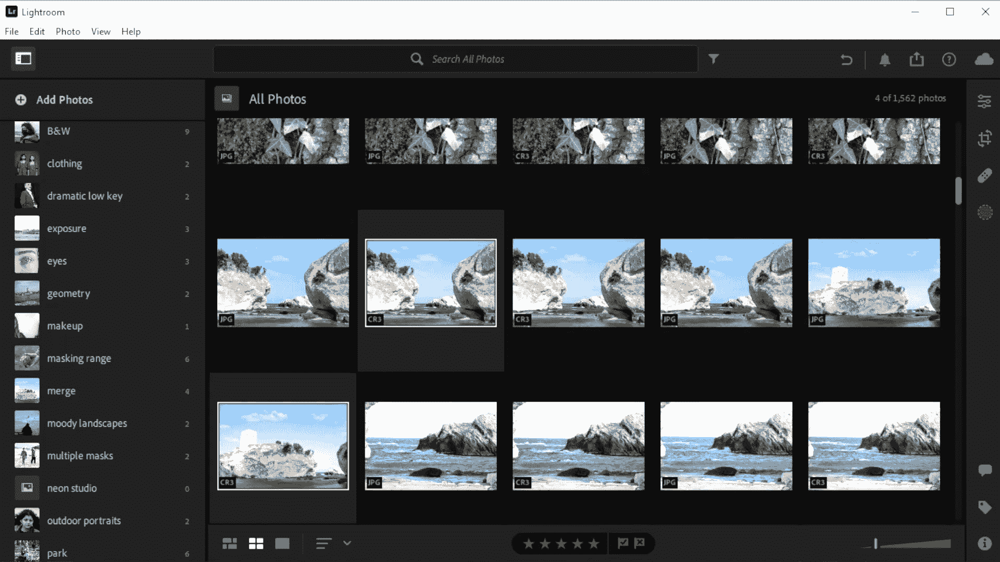

什么是全景图以及如何拍摄

全景图本质上是一张拍摄范围非常宽的风景照片，有时候里面也会出现人像，而很多时候则是山脉、城市天际线之类的场景。简单来说，就是把视野里的内容尽可能全部记录下来，形成一张又长又宽的照片，让观众一次性看到完整的场景。

以下是拍摄全景照片的基本思路：

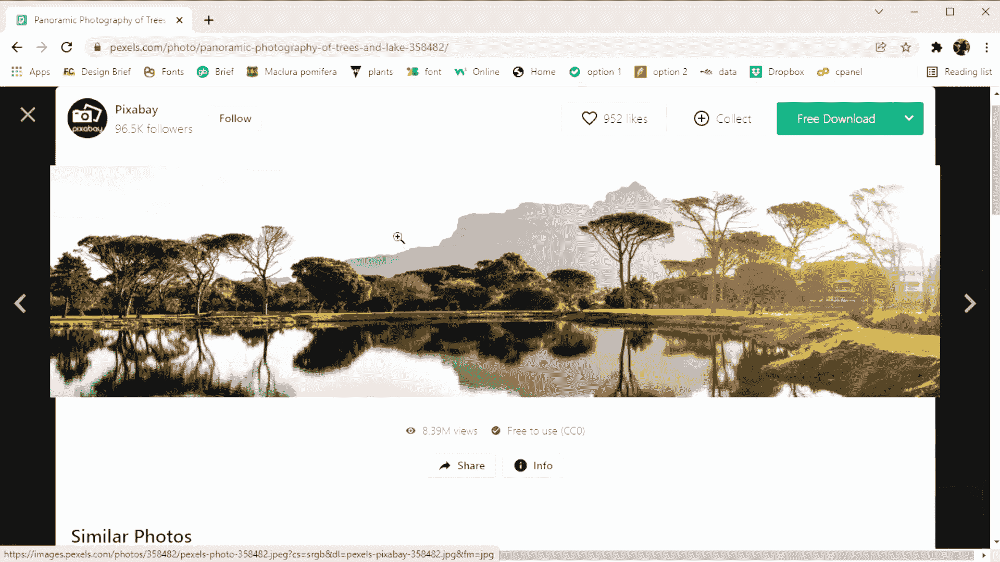

- 选定拍摄地点，比如风景优美的户外场所
- 用相机把场景分成五到六部分，甚至更多，具体数量取决于场景有多大
- 确保每张照片的拍摄方向保持一致，全部横向或全部纵向，不要混用
- 将拍摄好的多张照片导入 Lightroom，再使用合并工具把它们缝合在一起

拍摄时方向一致非常重要，因为横向照片和纵向照片很难拼接出平滑的结果，最终效果可能会很别扭。

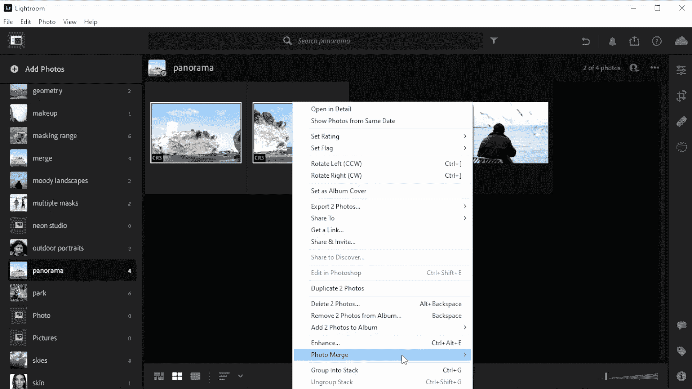

核心概念可以用下面的公式来理解：

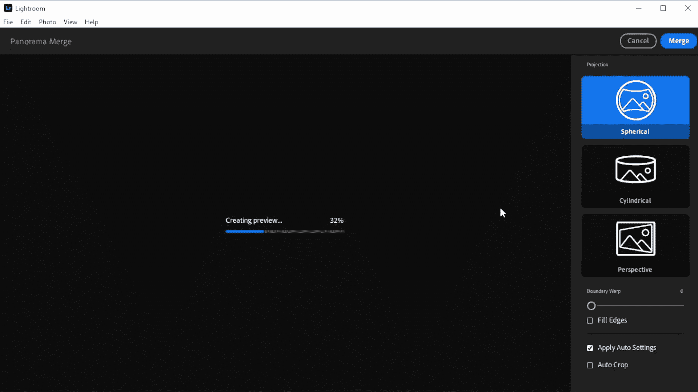

`全景合并 = 多张重叠照片 → 自动拼接 → 一张宽幅全景照片`

在 Lightroom 中制作全景图

现在我们知道了全景图是什么，以及如何拍摄，接下来进入 Lightroom 实际操作，看看这个功能是怎么工作的。

以下是制作全景图的具体步骤：

1. 在 Lightroom 中选中你想要合并的所有照片
2. 右键点击选中的照片
3. 选择“照片合并”，然后点击“全景合并”，或者使用快捷键 Control M

实际操作的菜单路径如下：

```
照片 > 照片合并 > 全景合并
```

Lightroom 会生成一个粗略的预览图，这个过程可能需要一点时间，请耐心等待。预览出来之后，右侧面板会出现几种投影选项，我们可以根据照片内容挑选最合适的一种。需要注意的是，这个功能在 Lightroom Classic 和 Lightroom CC 中都可以使用。

以下是三种常见的投影方式：

- 球面投影：Lightroom 会把照片放在一个球体里处理，画面会呈现一定的圆弧感，底部和顶部可能会有些剪裁，适合大多数全景照片
- 圆柱投影：这种方式能保持直线不变形，不会把画面拉圆，适合对直线要求较高的场景
- 透视投影：适合画面中有天空、鸟类或角落元素的照片，能让透视关系看起来更自然

选择投影方式后，继续看下方的“边界包裹”选项。边界包裹的数值默认为零，适当增加可以填充图片边缘的空白区域，避免出现白边。但数值不能太高，否则图片会被过度拉伸，显得不自然。一般来说，大约设为 16 左右比较合适。之后还可以开启“填充边缘”，Lightroom 会利用人工智能自动补全边缘缺失的部分，效果通常非常逼真。

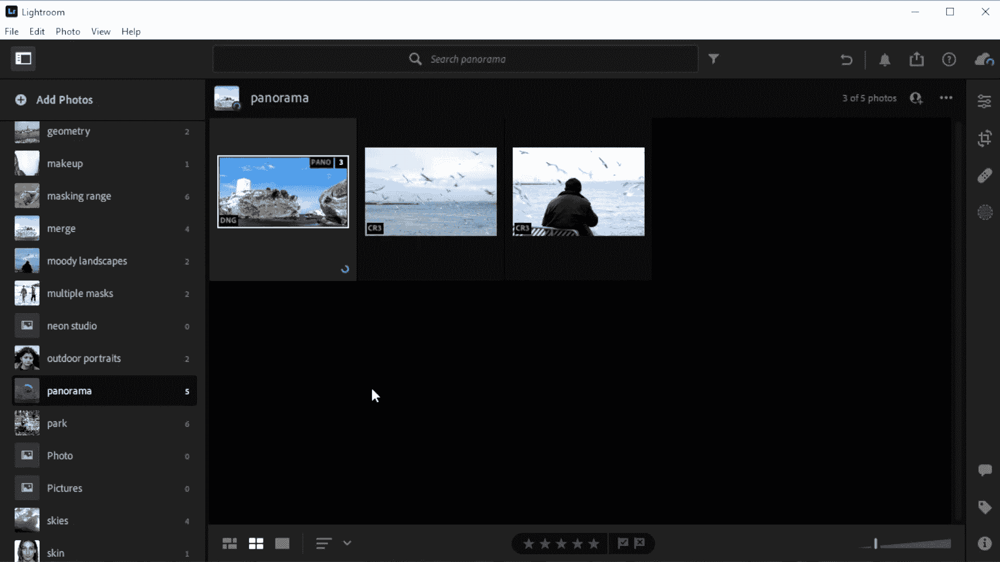

合并完成后，你还可以应用自动设置，也就是对最终生成的照片应用之前的编辑参数。如果原始照片已经做过调整，Lightroom 会把这些编辑保留下来。点击合并按钮后，软件就会开始生成全景图。

全景合并的适用条件

使用全景合并功能时，照片之间必须有相关性，不能随便拼凑两张毫无关系的图片。

以下是几种不适合全景合并的情况：

- 把两张完全不相关的照片合并，比如一张水果照片和一张森林照片
- 把一张房子照片和一张风景照片合并，边缘内容不匹配，结果会很奇怪

如果你想获得好的全景效果，建议亲自拍摄五到六张相邻的风景照片，或者使用同一地点拍摄、天空和光线相似的多张照片。只有照片内容有足够的重合度，Lightroom 才能正确分析边缘并缝合在一起。

什么是 HDR 合并

说完了全景图，我们再来看看 Lightroom 里的另一个合并功能，也就是 HDR 合并。

HDR 是高动态范围的缩写，核心意思是把多张曝光不同的照片合并在一起，形成一张既保留亮部细节，又保留暗部细节的照片。和全景合并不同，HDR 不是把照片并排拼接，而是把所有画面融合成一张图片，让暗部和亮部都看得清楚。

核心公式如下：

`HDR 合并 = 不同曝光的多张照片 → 像素融合 → 一张高动态范围照片`

以下是制作 HDR 照片的步骤：

1. 选中所有想要合并的照片，通常建议拍摄时就对同一主题使用不同曝光设置
2. 右键点击，选择“照片合并”，然后点击“HDR 合并”，或者使用快捷键 Control H
3. Lightroom 会生成预览图，右侧会出现“自动对齐”、“应用自动设置”、“去鬼像数量”和“去鬼像叠加”等选项

对应的菜单路径如下：

```
照片 > 照片合并 > HDR 合并
```

去鬼像功能用于处理照片中半透明或移动的区域，比如两张照片里烟囱的位置略有不同，增加去鬼像数量可以让这些重叠部分更好地融合在一起。如果照片中没有这种问题，就不需要调整这个数值。

使用 HDR 合并时，照片格式最好保持一致，建议都是原始格式，比如佳能相机的 CR3 格式。这样合并后的结果仍然是原始格式，也就是 DNG 文件，保留所有像素细节，方便后续进行高质量编辑，不会降低照片分辨率。

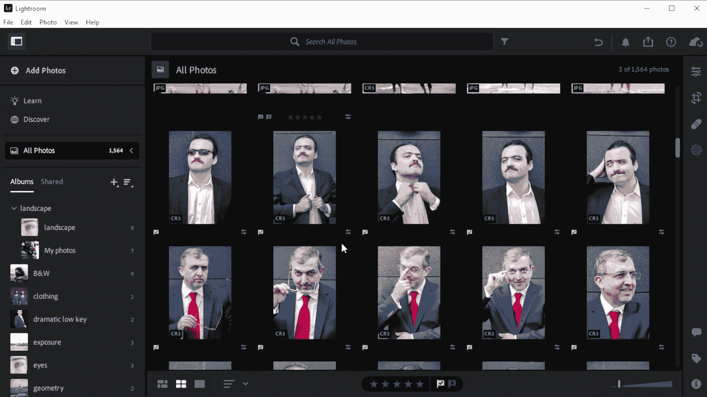

HDR 合并的适用条件

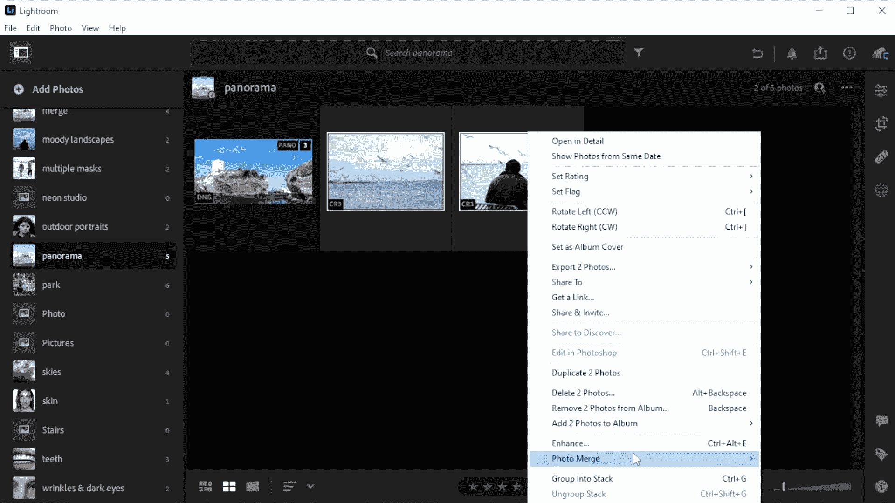

HDR 合并也要求照片内容具有相同的主题，不能随意合并两张不同的照片。

以下是几种不会成功的情况：

- 一张照片里有人，另一张照片里没有任何人物
- 两张照片拍摄对象完全不同，哪怕天空和鸟类相似，也缺乏足够的匹配内容

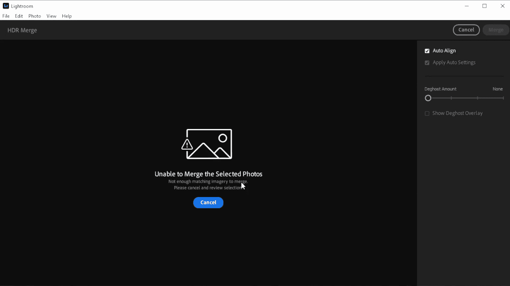

如果你想尝试 HDR 合并，建议在拍摄时就连续拍摄同一主题的多张照片，比如风景场景，使用连拍模式拍摄几十张。如果画面中有下雨或下雪等细微元素，这些元素会被合并在一起，营造出雪景或雨景更浓的效果。但如果照片内容不匹配，Lightroom 会提示无法合并，提示内容大致是没有足够的匹配图像，请取消并重新选择。

HDR 全景合并

除了单独的全景合并和 HDR 合并，Lightroom 还提供了 HDR 全景合并功能，也就是把两者结合在一起使用。

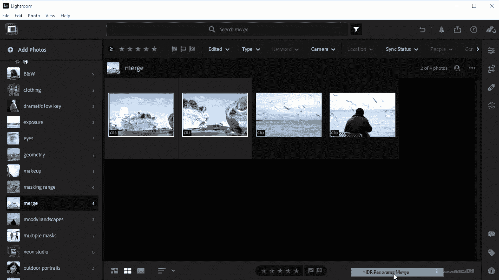

以下是操作路径：

1. 选中两张或多张照片
2. 右键点击，选择“照片合并”，然后点击“HDR 全景合并”

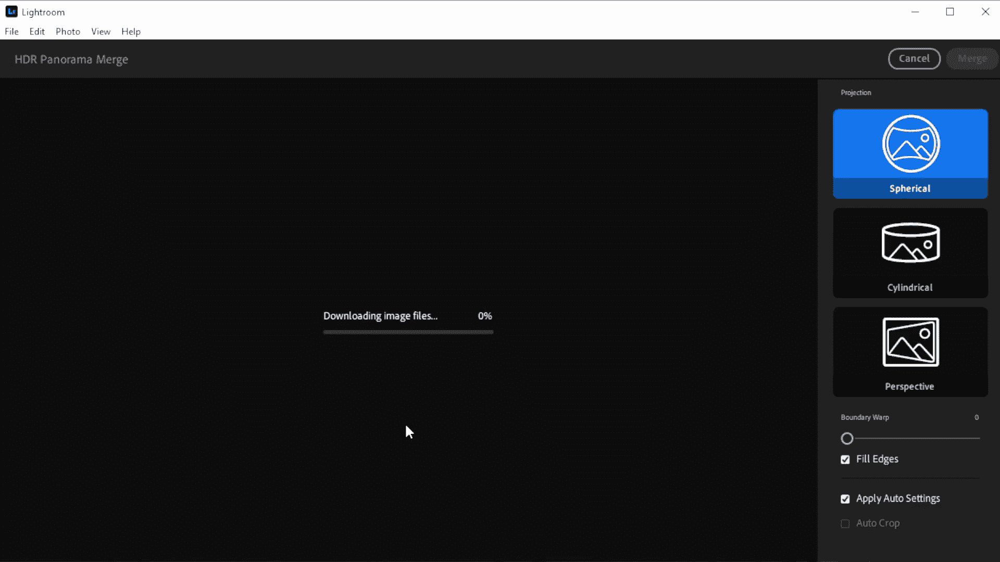

这个功能会尝试同时进行拼接和曝光融合，既把照片放在一起，又合并画面元素。不过和之前一样，照片必须有足够的相关内容才能成功。如果照片不适合制作全景，或者缺乏共同意象，这个工具也会报错。

所以如果你想使用这三种合并工具中的任何一种，都要提前确保照片内容合适。最好的做法是在拍摄时就知道自己会用这些工具，有意识地拍摄同一主题的多张照片，或者为 HDR 合并拍摄不同曝光的同一场景。

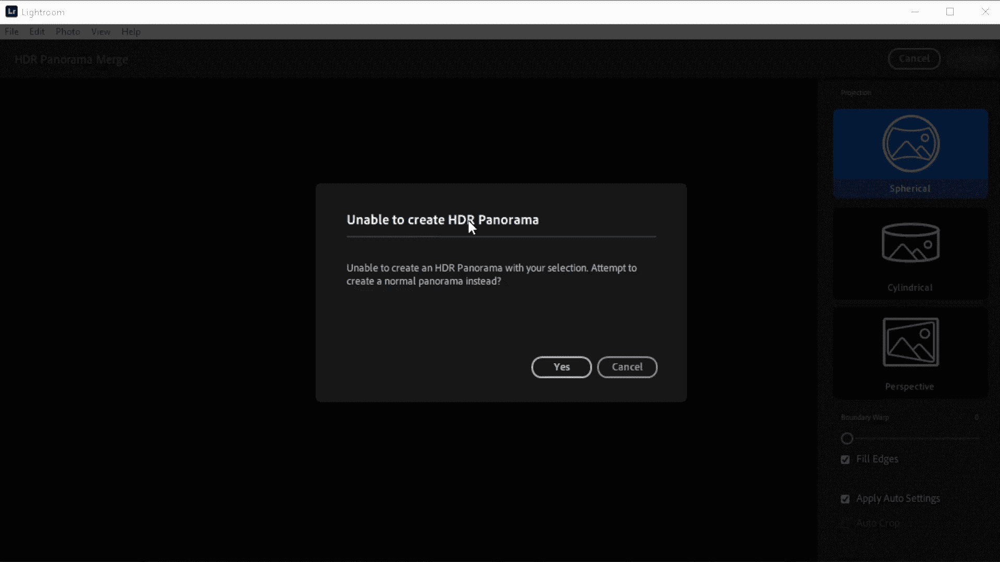

课程总结

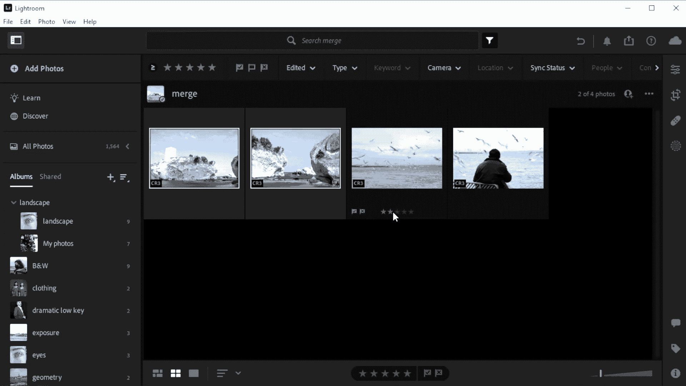

本节课中，我们一起学习了 Lightroom 的照片合并功能，包括全景合并、HDR 合并以及 HDR 全景合并三种工具。全景合并适合把多张重叠的风景照片缝合成一张宽幅照片，HDR 合并适合把不同曝光的同一场景融合成高动态范围图片，而 HDR 全景合并则是两者的结合。使用这些功能时，关键在于照片内容要有足够的相关性，拍摄方向要一致，格式最好统一为原始格式。合并后的照片依然保留原始细节，可以继续进行后期编辑。希望你喜欢这节课，我们下节课见。
