# 完整 Adobe Lightroom 大师课：第60节：Lightroom 社区与发现面板 🖼️

在本节课中我们将学习 Lightroom 社区的使用方法。具体来说，我们会了解发现面板在左侧边栏中的位置，学习如何重混、点赞和保存他人的预设，以及如何从其他摄影师的作品中获得灵感。本节课适合初学者，会用大白话把每一个操作步骤讲清楚，让你轻松上手。

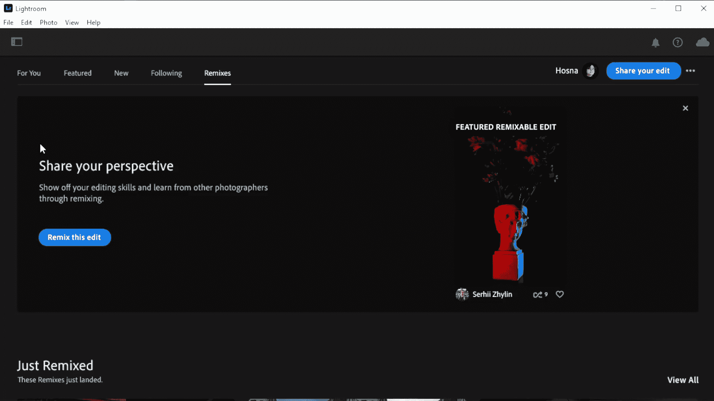

## 进入发现面板

上一节我们介绍了 Lightroom 的基本编辑面板，本节中我们来看看发现面板。当你在资料库模块时，可以进入发现面板。这就是发现面板，你可以先关闭其他不需要的面板，这样界面就只剩下发现面板。这里有几个标签页，其中“为你”标签页显示推荐图片。推荐的图片可能是你关注的人发布的内容，你可以从这里开始浏览。

`访问发现面板 = 左侧边栏 > “发现”标签`

将鼠标悬停在推荐图片上时，你会看到编辑者为该图片采取的编辑步骤。只需用光标悬停，系统就会自动显示前后对比。请记住，使用发现面板必须联网，否则无法加载这些内容。

## 浏览推荐图片与保存预设

在了解了发现面板的位置后，我们接着看里面的推荐内容和预设保存方式。我们在 Lightroom 移动端课程中学到过，可以保存他人的预设。这些预设在编辑时会保存在你的在线预设文件夹中。你可以浏览图片，找到喜欢的一张，然后保存它并用于自己的编辑。

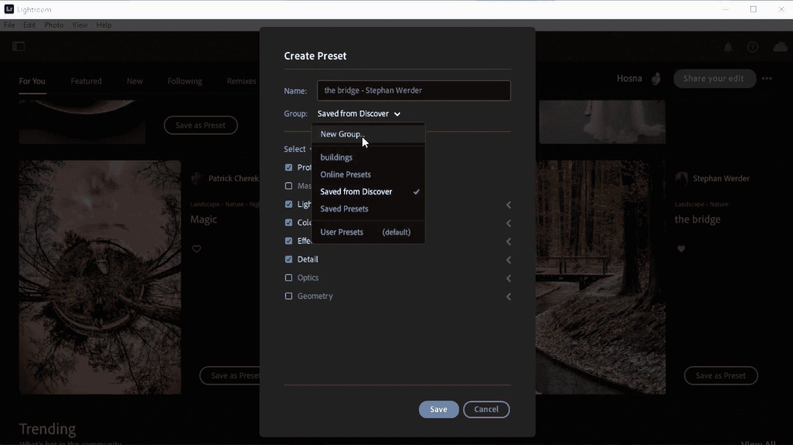

以下是保存他人预设的基本步骤：

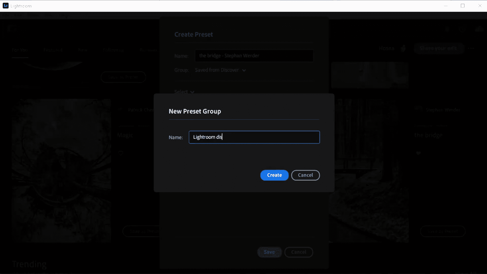

- 先点赞，再点击“保存为预设”。
- 系统会要求命名，你可以保留编辑者的名称作为分组名。
- 默认已有“在线预设”“已保存预设”和“来自发现的保存”等分组，也可以新建分组。

## 创建预设分组与自定义设置

保存预设之后，我们需要把预设分类整理，避免和自己的预设混在一起。默认分组里可能已经包含一些系统预设，但你也可以建立自己的分组，比如我这里创建了一个名为“Build”的分组。你也可以把预设加到“用户预设”中，不过我不推荐这样做，因为“用户预设”是你制作自己预设的地方。最好对预设进行分类和分离，以免混淆。

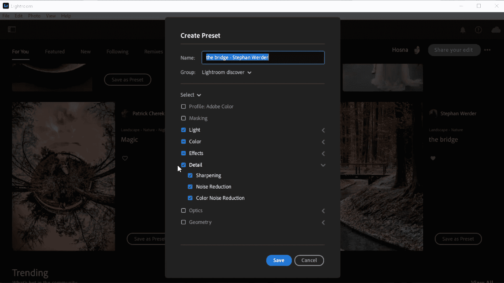

当你想创建新分组时，可以为其命名，比如命名为“Lightroom 发现”，然后保存，预设就会进入这个分组。

保存预设时，你可以选择包含哪些编辑设置。核心逻辑如下：

`保存的预设 = 勾选的编辑面板设置（光线、色彩、效果、细节等） - 取消勾选的设置`

例如，这个人的设置里有光线面板、色彩面板、效果面板和细节面板的内容，但没有使用光学或几何面板。因此光学和几何不会被包含。你可以取消勾选不需要的设置，这不会影响原图作者的照片。

我会保留他们的光线设置，但关闭色彩分级和效果面板，因为我只是要根据自己的需求自定义这些设置。至于细节，我也会关闭，因为我的图片可能不需要细节增强。保存之后，预设就保存到了我的预设文件夹中。

## 查看摄影师主页与前后对比

学会保存和分类预设之后，我们来看看发现社区里的个人主页功能。社区里的每个人都有自己的主页，类似于 Lightroom 发现个人资料。你可以添加 Instagram 账号、居住地、封面照片等信息。当你将光标悬停在某人的照片上时，会看到编辑前的原图和编辑后的效果，这样你就能清楚地看到这个人为拍出精彩照片所做的全部工作。

这里还有一个重混标签页，你可以在上面给他人的照片加上自己的风格，向他们展示你会如何编辑。有些人还没有进行过重混，但你可以查看他们关注的人，也可以看看他们的动态。如果你愿意，可以关注他们，当然也可以查看这个人的粉丝。

这个社区有点像 Instagram，但是经过筛选并专为编辑者打造，所以内容很棒。你甚至可以按类别搜索。例如，如果你是风景摄影师，就会进入风景类别，从里面的风景图片获取灵感。

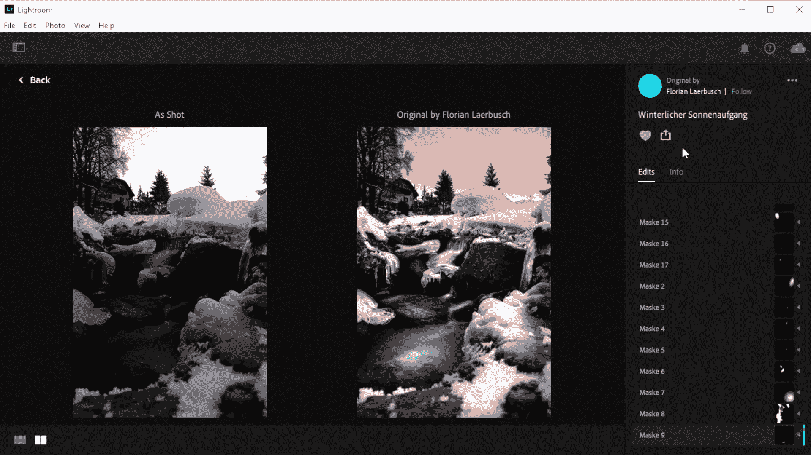

## 重混图片与社交互动

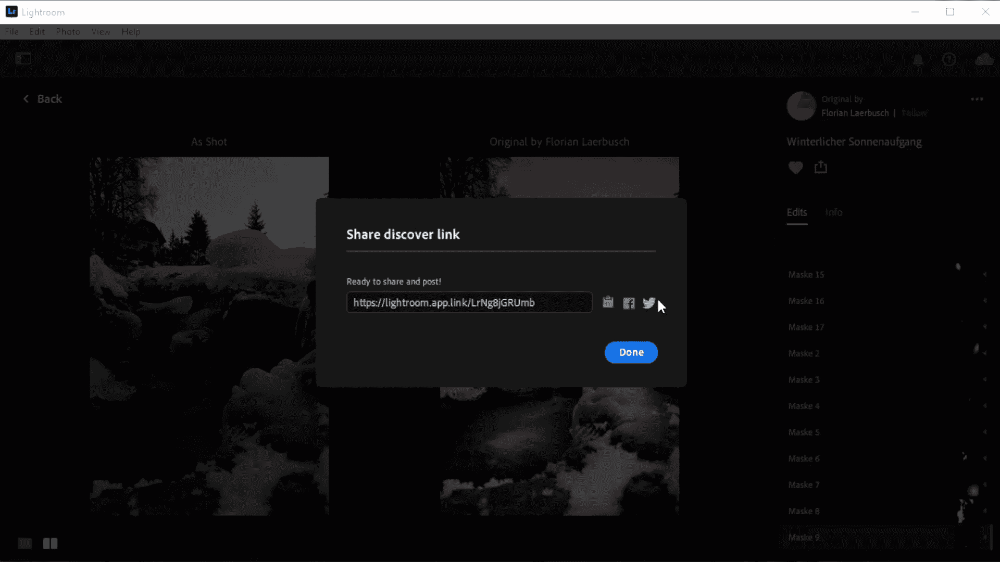

了解了个人主页和分类搜索之后，接下来重点看重混功能的使用条件。作为社区成员，你可以重混图片，但请记住，并非所有照片都能重混，因为创作者有时不允许。

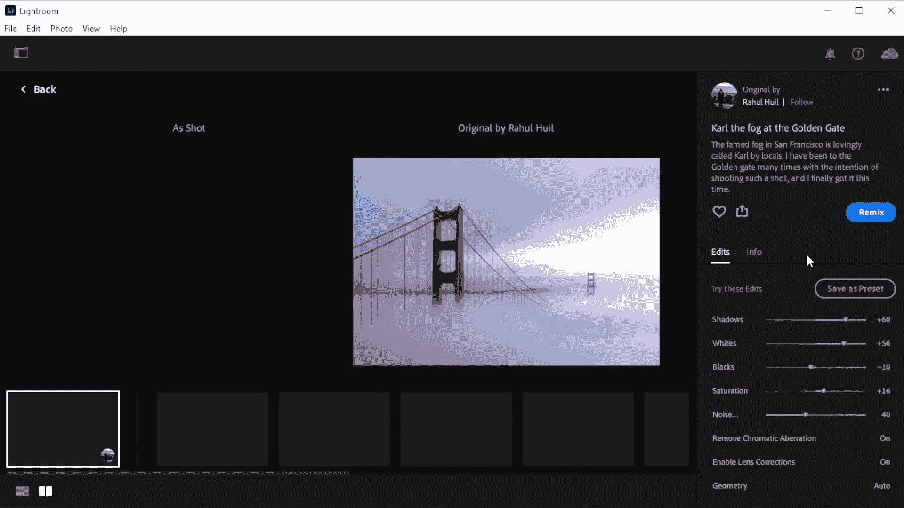

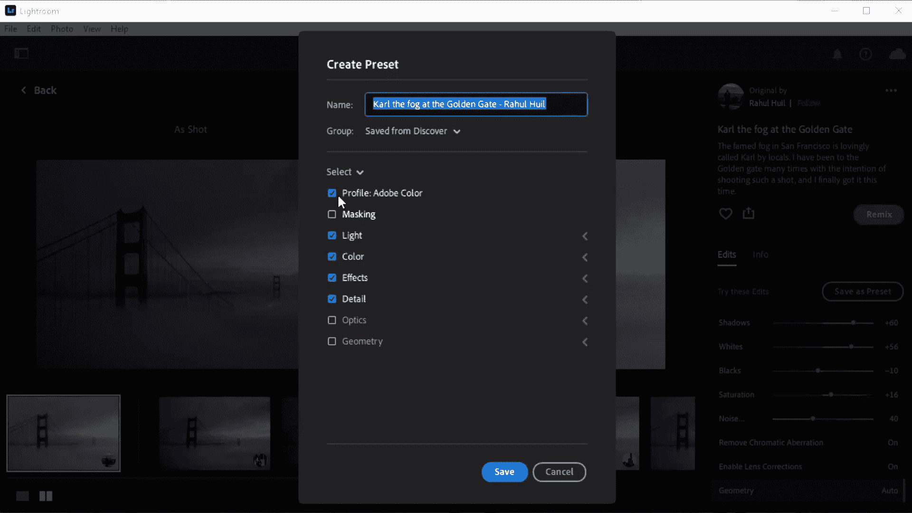

判断是否可以重混的方法很简单：查看爱心图标旁边是否有重混选项。之前那个人没有开启允许重混，所以没有这个选项；而这个人开启了，所以我们可以看到重混按钮。

`可重混 = 创作者在导出时开启了“允许重混”复选框`

在将图片导出到发现面板时，会有“允许重混”复选框。如果创作者没有打开这个选项，我们只能查看该人采取的编辑步骤，以及他如何一步步得到最终图片，包括不同的遮罩设置。你可以点击屏幕暂停，查看前后对比的两个版本。

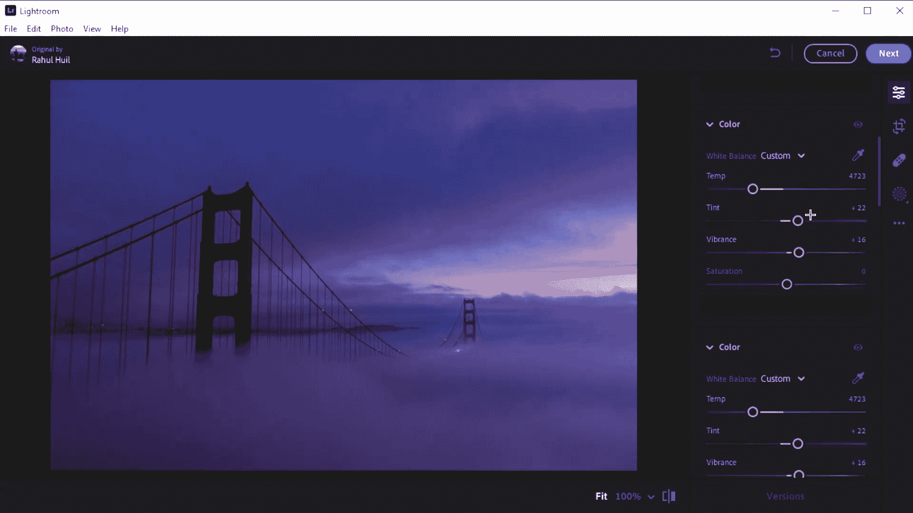

如果你喜欢这张图片，可以点赞，也可以分享为链接，或者直接分享到某个平台。

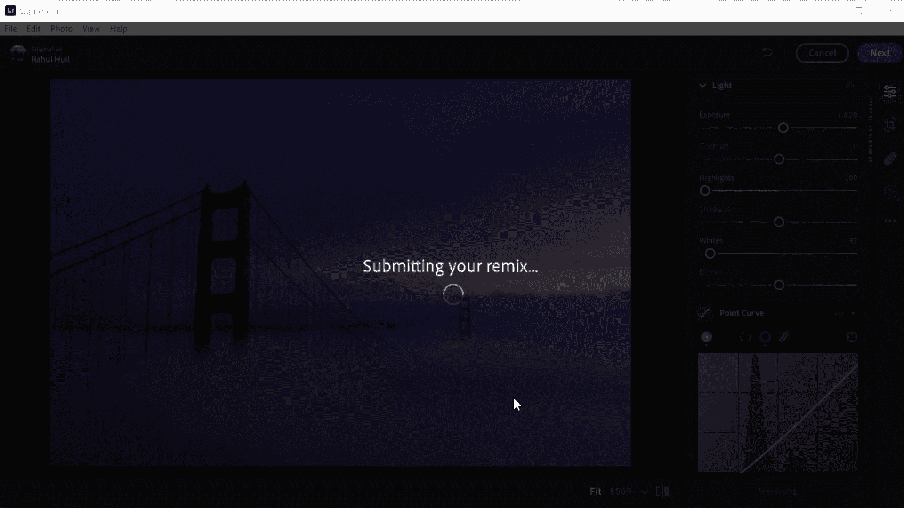

## 发布自己的重混作品

找到可重混的图片之后，我们来实操一次重混并发布。找到允许重混的图片后，保存为预设，关闭细节面板，然后开始重混这个人的图片。你会看到上面显示了这个人的名字，并且得到了原始图片。此时你拥有常规的编辑面板，可以添加我自己的一个预设，比如“新天”，让图片看起来像夜景。当然，你也可以进行自己的编辑，或者只是添加一个预设。

编辑完成后，点击下一步，可以添加评论。你可以对对方说：好图片，这就是我会怎么编辑。也可以加入一些建设性批评，随你喜好。拍得真好。发布重混后，这张作品也会出现在你的个人主页上。

现在，和所有这些人一起，我的头像和我的图片也出现在那里。这个人会收到通知，知道我编辑了他们的图片，他们可以点赞我的版本，也可以什么都不做。这就是重混的方式，并不复杂。

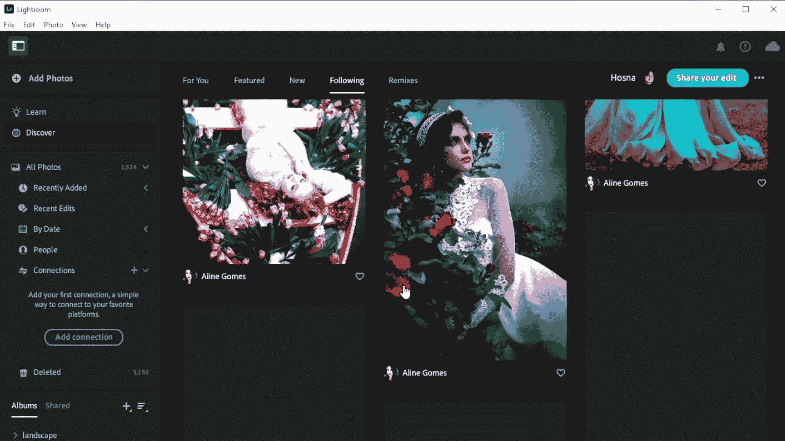

如果你进入自己的个人主页，会发现只有这一张图片有重混选项，因为之前制作这些作品时，重混功能还不存在。进入我的重混面板，我现在就有了这张图片。这样它就会应用到你的个人主页，所以请确保你的重混作品做得好。

就像 Instagram 一样，你有一个“为你”页面，里面是你关注的人和他们分享的图片。你可以查看信息，比如他们使用的相机，不过有些人可能没有开启相机信息的显示。如果需要，还可以举报。好了，这就是 Lightroom 发现社区。

在本节课中我们一起学习了 Lightroom 发现社区的使用方法。我们了解了如何进入发现面板，如何保存并分类他人的预设，如何查看摄影师主页和前后对比，以及如何重混图片并发布自己的作品。希望你能把这里当作另一个作品集，发布最好的作品，同时通过重混他人的作品看到自己的进步。我们下节课见。
