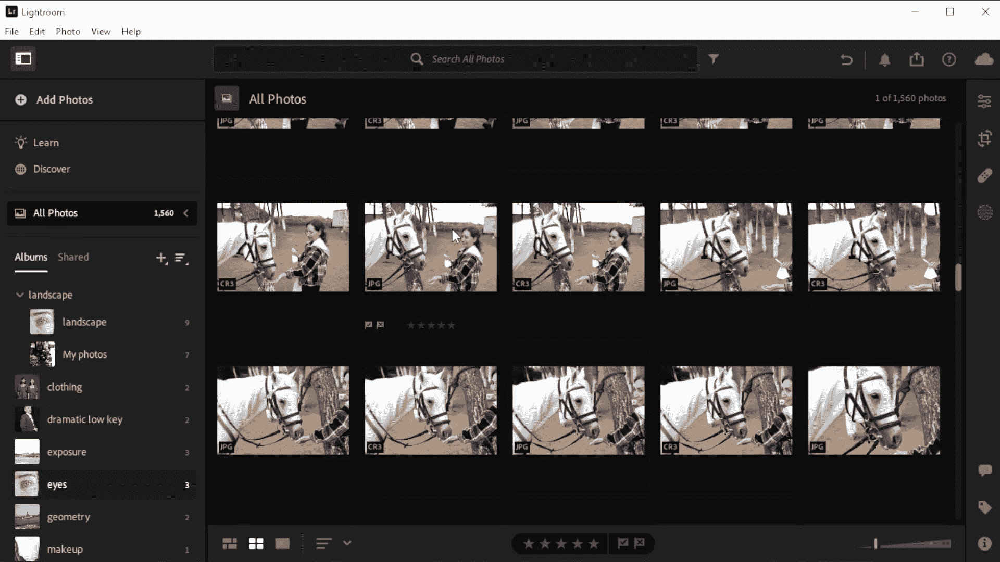
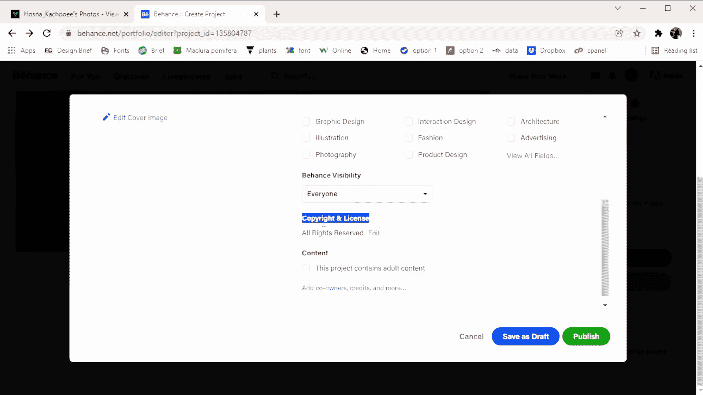
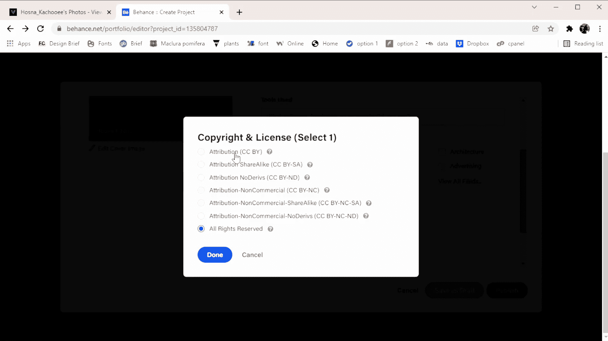
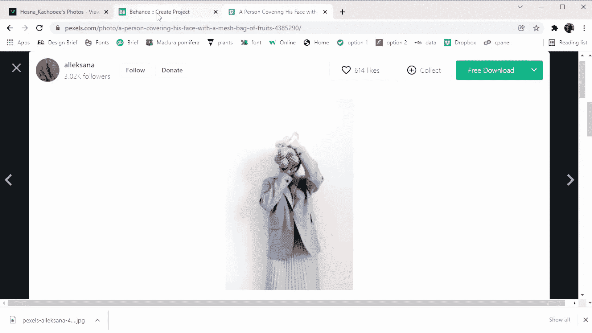
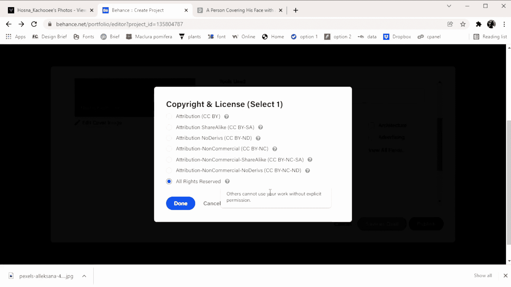
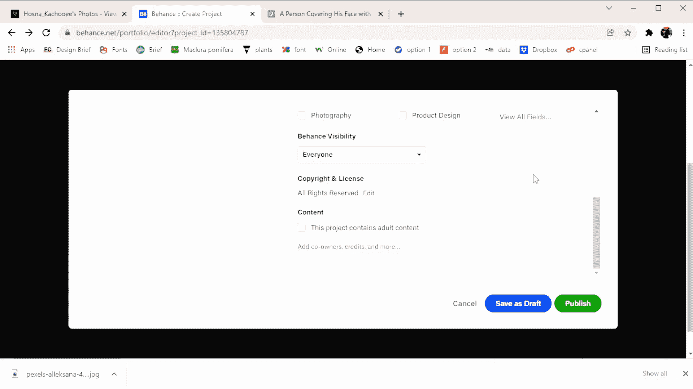

# 📸 Adobe Lightroom 照片编辑从入门到精通：第 61 节：网上分享你的照片（上）


在本节课中，我们将要学习关于网上分享照片时的版权基础知识，了解授权、许可和使用协议的基本概念，并认识到不同平台对图片保护的差异。最后我们会简单看看如何用 Lightroom 把照片准备好用于网上发布。


在我们开始具体操作之前，先来聊聊为什么版权在摄影领域非常重要。摄影版权法律比较严格，当你刚进入这个行业时，花些时间做研究会非常有帮助。你需要知道如何保护自己的图片，如何正确使用他人的图片，以及如何在分享作品时避免不必要的麻烦。接下来的内容就是围绕这三个核心问题展开的，希望能给你提供一些实用的参考。

下面这部分我会讲解在这些场景中经常出现的专业术语。我不是律师，所以不能提供法律建议，但我会把你在进入摄影和照片编辑世界之前应该了解的基础知识讲清楚，包括使用他人作品和在网上分享自己作品时需要注意的基本事项。

这些建议在你继续摄影或照片编辑学习的过程中都值得记住。接下来，我们先从版权是什么开始说起。


版权的核心作用是证明一张照片的归属权。当你拥有一张照片的版权时，就意味着这张图片是你拍摄的，是你自己的作品。Lightroom 也提供了一些版权相关的选项，我们在后面会详细介绍。你可以把版权理解成这样一个简单的关系：

```
版权 = 照片所有权证明 = 我拍摄的图片属于我自己
```

有了版权，你就拥有了这张照片的控制权，决定谁可以使用它以及如何使用。


接下来我们要认识一个叫作授权许可（License）的概念。简单来说，授权就是我允许别人在他们的作品中使用我的作品。举个例子，假设我创作了一段音乐，我的朋友想要制作一段广告。他可以得到许可，把我的音乐用在他的广告里。但仅仅因为他付钱给我，并不代表这段音乐就属于他了。这很像你在 iTunes 上花 99 美分买一首歌，付了钱并不代表你拥有那首歌的所有权，你只是获得了听歌或者在派对上播放的使用权。

需要注意的是，在你自己的作品中使用音乐的授权方式，和 iTunes 或 Spotify 等平台上的授权方式是不一样的。那些平台的具体授权类型你可以自行查阅，但总的来说，你要记住授权就是使用许可，这种许可可以是短期的，也可以是长期的，或者仅限一次使用。

```
授权许可 = 使用许可 = 短期使用 / 长期使用 / 一次性使用
```

下面是授权许可的几个关键要点：

- 授权是允许他人使用作品的许可
- 授权期限可以是短期、长期或一次性
- 购买使用权不等于获得所有权




有了授权许可的基础，我们再来看看使用协议（Usage Agreement）。如果我作为摄影师受雇于某家公司或其他客户，我就需要和客户签署一份合同。合同里就是使用协议，我要在其中说明我给予客户什么样的许可或授权，让他们用我的照片。比如客户能不能只下载自己用，能不能在公司内部分享，他们到底能对这些照片做什么。所有这些使用条款都写在使用协议里，也就是你和公司或客户之间的合同内容。

有时候，你是为某个人或某家公司制作和拍摄照片的。在这种情况下，就意味着你在创作独家内容。假设我为麦当劳拍摄一组照片，而他们要求独家内容。那意味着我是专门为他们拍照，不能把这些照片卖给其他人，因为麦当劳要求独家内容，他们希望自己是唯一拥有这些照片的人。

了解完这些基本术语后，我们可以继续看看这些概念在网上世界和网上社区中是如何运作的。


现在我们进入网络部分。我现在在 Adobe Stock 网站上。这是摄影师和其他创作者分享作品的地方，平台允许授权购买。你可以看到我有授权的选项。这意味着平台上的创作者已经提供了他们的图片和作品，供像我这样的人去授权和购买。但同样，这并不代表我拥有这张图片，我只是获得了临时使用的许可。

点击授权选项后，你可以看到我拥有许可权限。另外，说到图片格式，网上的图片通常都是 JPEG 格式。我们稍后会介绍如何用 Lightroom 导出适合这些平台的图片。

在网上平台上，你几乎总是只能下载 JPEG 图片，很少能下载到原始图片（RAW）或 PNG 文件。所以你应该预期得到的只有 JPEG。如果你想了解标准授权和扩展授权的区别，每个平台都有授权信息供你查阅。比如标准授权可能不允许我拥有超过 500 份副本或 500 次浏览量，但如果我购买扩展授权，就有这个权限。同时，我也没有权限在打算出售的项目中使用这张作品，我只能自己使用，不能从中获利。

下面是标准授权和扩展授权的简单对比：

```
标准授权：使用次数 ≤ 500，不可用于盈利项目
扩展授权：使用次数 > 500，可用于更多商业场景
```

每个网站都有自己的协议，建议你自行进入这些平台查看并了解更多细节。


除了购买授权的平台，还有其他一些你用来分享自己作品的平台。比如说 Viewbug。在这些平台上，你的照片通常比较安全。意思是，如果我上传一张 PNG 或大文件，且没有添加水印，我不需要担心有人试图下载或偷走我的图片。因为如果你右键点击，会发现没有下载选项。而且你可以看到这张照片的版权归 Onakachii 所有。Viewbug 或 Behance 等平台会采取很大措施，确保他人作品不会在其平台上被盗用。

与此同时，也有一些平台会故意降低图片质量，来保护你的作品不被他人盗用。这取决于具体的平台。Viewbug 或 Behance 这类网站不仅会保存你的版权信息，还会保持高画质。但像 Instagram 这样的平台，会降低你图片的质量，不过其他人仍然可以把你的图片当作转发内容来使用。这种做法在 Instagram 等平台上比较常见。

下面是几类平台的保护机制对比：

- 版权保护型平台：Viewbug、Behance，保留高画质并禁止随意下载
- 质量压缩型平台：Instagram，降低画质但允许转发
- 授权交易型平台：Adobe Stock，允许购买使用许可


如果你想在网上分享图片，这是一张全尺寸图片，我上面没有加任何水印。上传时，你可以查看版权和授权选项。几乎每个网站在发布前都会提供这些选项，建议你花点时间查看。我们来编辑这些设置，你会发现有很多版权选项可供选择。



点击每个选项，你可以看到它允许他人分享、重新混编、修改并基于你的作品进行创作，甚至可以用于商业用途，前提是他们要为你的原始创作署名。署名（Attribution）是一个非常常见的概念，在我们经常使用的一个平台——Pixels 上尤其常见。

在这些平台上，摄影师分享自己的作品，你可以看到免费的素材图片。但当你想下载某个内容时，必须给予署名。也就是说，你需要标明这位艺术家的名字。这种授权和署名授权是一样的，你可以随意选择，也可以选择“保留所有权利”。保留所有权利的意思就是，其他人未经你明确许可，不能使用你的作品。



下面是几种常见的版权选项及其含义：

- 允许分享与改编：他人可分享、重混、修改并基于你的作品创作，甚至用于商业，但需署名
- 署名授权：使用者必须标注原作者
- 保留所有权利：他人不得使用，除非征得明确许可




如果有人想在这个平台上使用我的照片，他们需要先联系我并征得我的许可，我需要和他们签署合同。记住，除非你已经签署了协议，否则绝不要把照片分享给客户或其他人。



那么，我们先到这里。一旦你决定好了版权设置，就可以发布了。现在让我们看看如何用 Lightroom 把照片准备好用于网上世界。




本节课中，我们一起学习了摄影版权的基础知识，理解了授权许可、使用协议和独家内容的含义，认识了 Adobe Stock 等授权平台以及 Viewbug、Instagram 等分享平台的保护差异，还了解了上传前的版权选项和署名机制。希望这些内容能帮助你在网上更安全地分享自己的摄影作品。

