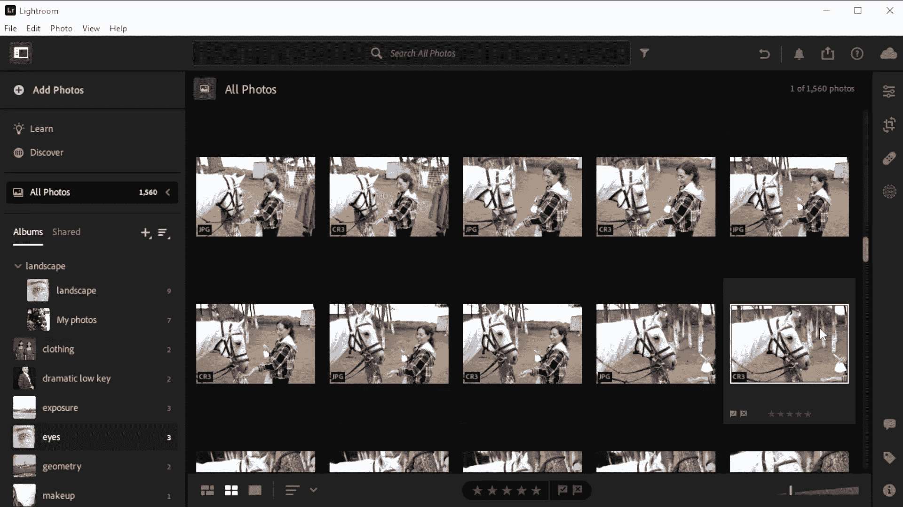
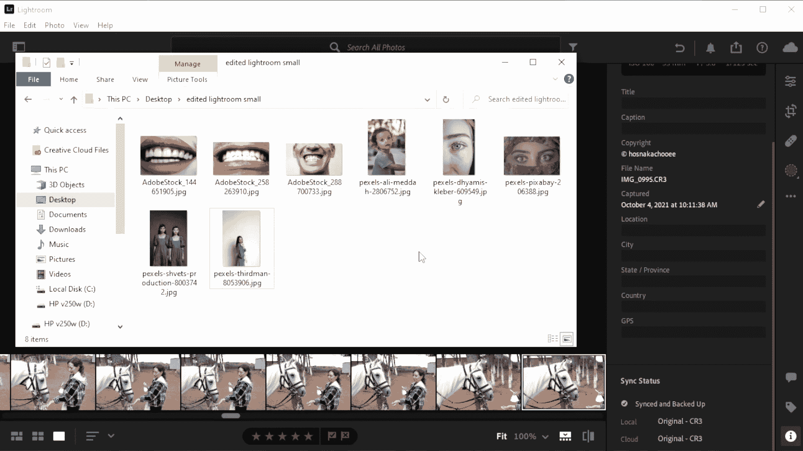

# Adobe Lightroom 照片编辑全攻略：第57章：在线分享照片（第2部分）📸


在本节课中我们将要学习如何在 Adobe Lightroom 中安全地将照片分享到互联网上。本节内容承接上一节关于导出基础的介绍，重点放在原始图像处理、版权元数据设置、导出参数调整以及不同平台的分享策略上。我们会用大白话把每一个设置选项都讲清楚，让初学者也能快速上手，确保自己的作品在网络上不被盗用或滥用。



## 一、确认图像是否为原始格式

在导出之前，我们需要先确认照片的格式。当你拍摄照片时，绝大多数相机默认会保存为原始图像，也就是 raw 格式。如果你的照片不是 raw 格式，那么需要在相机设置里把它改成 raw。为了方便演示，本节我们就选一张 raw 图像作为例子，来讲解后续的导出和分享步骤。

## 二、为照片添加版权元数据

上一节我们介绍了如何选择要导出的图像，本节中我们来看看怎么给照片加上版权信息。

在 Lightroom 的信息图标那里，你可以输入自己的版权声明。这里填写的内容会成为这张作品的元数据的一部分。元数据就是附在图片文件里的隐藏信息，无论你的图片后来经历了什么，这些元数据都会一直保留在文件中。

以下是添加版权的操作步骤：
1. 选中任意一张图片。
2. 在信息栏输入你的名字，或者如果你有工作室，就输入工作室名称。
3. 输入完成后点击空白处，这样版权信息就会成为图片元数据的一部分。

接着我们来进行元数据同步。选中一张图片，这里我们继续使用刚才的 raw 图像作为示例。

## 三、设置适合线上社区的导出参数

上面我们完成了元数据的设置，本节中我们来看看导出时该如何选择参数。

点击导出面板中的自定义设置，把图片导出成适合线上社区的格式。Lightroom 里自带一些导出预设，这里我们先选 JPEG small。具体选哪个，还要看你要分享的平台对文件大小有没有限制。

以下是导出参数的选择建议：
- 如果平台对文件大小有限制，就选择 JPEG small。
- 如果平台没有大小限制，就保持文件较大，这样能保证作品画质更好。
- 文件类型一定要选 JPEG，因为分享链接时，大多数平台只接受 JPEG，选这个最稳妥。
- 图片尺寸可以选小尺寸、原始尺寸或自定义尺寸。如果有文件大小限制，就选小尺寸。

比如我们把尺寸改成小之后，文件体积会明显变小。换成原始尺寸后，文件体积会变大，可能会达到 11 MB 左右。

关于画质设置，核心公式如下：

画质数值 ≤ 50

如果你希望其他人不能轻易拿你的图片去商业使用，建议把画质调到 50 或更低，千万不要超过 50。这样做的意思是，即使有人未经你允许使用了你的照片，他拿到的也是低质量的版本，用不了多大作用，大概率也就不会继续使用。例如原来 11 MB 的图片，把画质降到 50% 之后，体积可能会掉到 2.3 MB 左右。

像素网（我们常用的那个分享平台）上的几乎所有图片，格式都是 JPEG，文件体积也都很小。这就是因为它们在上传前都做了同样的处理，目的是确保就算有人想冒充这张作品的作者，拿到的也只是低质量素材，对对方几乎没有实用价值。

如果你愿意，还可以添加水印。水印可以是你自己制作的 logo，也可以是你的名字，把不透明度调低一些放在图片上即可。加不加水印完全看个人喜好，没有强制要求。

## 四、元数据的高级选项

水印设置完成后，本节中我们来看看导出面板里更多的选项。

每张图片的元数据，根据你的相机设置，会包含快门速度、光圈值、曝光值以及拍摄时的所有相机参数。如果你不希望别人看到这些拍摄参数，可以把元数据选项设为仅版权。

以下是两种元数据设置的对比：
- 全部元数据：包含拍摄日期、程序名称、版权、相机型号、光圈、快门速度、闪光灯等所有信息。
- 仅版权：只保留你输入的版权信息，相机参数、拍摄日期等其他内容都不会显示。

为了让你直观感受差别，我们分别导出两张图：一张带全部元数据，一张只带版权信息。

文件名也可以加上你自己的名字，比如课程名称、创作者名字等。像素网上的图片文件名通常也是这样命名的。

## 五、导出两张图片并对比属性

上面讲解了元数据的两种选项，本节中我们来看看实际导出后的效果差异。

先导出一张带全部元数据的图片，选择文件夹后开始导出。然后再导出一张只带版权信息的图片，其余设置保持不变，都是 50% 画质、原始尺寸、JPEG 格式，只把元数据改成仅版权。导出完成后，我们会得到两张图片。

这两张图片的尺寸和体积非常接近，第一张大约 2.25 MB，第二张大约 2.24 MB。体积差别很小，主要是因为第一张包含更多元数据。

接下来我们右键点击带全部元数据的那张图片，选择属性，再点击详细信息。作为下载图片的人，你能看到拍摄日期、程序名称、版权信息、相机型号、光圈值、快门速度、闪光灯模式等所有内容。也就是说，如果你选择全部元数据，和这张照片相关的所有信息都会保存在图片文件里。

如果你取消全部元数据，只保留版权信息，再次导出并查看属性，你会发现只能看到作者名字，而相机参数、程序名称、拍摄日期这些信息全部消失。别人从这张图片里能得到的唯一信息，就是你的版权声明。

核心设置示例如下：

```
导出设置示例：
文件类型：JPEG
画质：50% 或更低
尺寸：原始尺寸或小尺寸
元数据：全部元数据 / 仅版权
```

## 六、真实案例：素材平台与创意平台的差异

刚才我们对比了不同的元数据设置，本节中我们来看看真实平台上的图片是怎么处理的。

以 Adobe Stock 为例，下载的一张带合法授权的图片，文件体积小于 1 MB。这说明平台已经刻意降低了画质。查看这张图片的详细信息，你可以看到标签、标题、版权信息，甚至还有 Adobe 素材的评分，下方还列出了所有相机参数。这位创作者把全部元数据都开了，让其他人可以查看。

再看看另一个创作者在素材平台上的分享方式。这张图片没有任何版权标记，这非常危险。证明这张照片是他拍摄的唯一方式，就是文件名里带有他的名字，但文件名很容易被修改。向下滚动查看，这位创作者没有开启任何元数据，所以连相机参数都看不到，唯一能看到的只是使用的程序。

如果唯一能证明你拍了这张照片的东西只是文件名，那么别人把名字改掉，这张照片就很容易被盗用。不过这里也有个好处，因为这位创作者没有分享原始大图，查看属性会发现文件体积小于 1 MB。就算有人想偷这张图片，也没什么用，因为这不是全尺寸图片，低质量的图片无法用于大多数场合。他也无法声称自己拍了这张照片，因为原始拍摄者或摄影师手里握着 raw 原图，而对方只展示了一个 833 KB 的小文件。

这就是为什么在网上分享照片时，开启版权、输入你的名字、选择合适的元数据选项非常重要，这样才能让你的照片在互联网上更安全。

## 七、版权保护与法律建议

如果你发现有人未经允许使用了你的照片，你有权提出投诉，通常这会导致法律程序，有时候双方沟通理解后也能解决。侵权人需要为偷走你图片的行为承担赔偿责任，不过整个过程有时会很麻烦。所以当你在网上分享照片，或者把照片发给客户、朋友时，一定要尽力保护自己的作品，最好达成协议，并把协议写下来，即使对方是你很熟的人，也要确保图片以最安全的方式分享。

## 八、本节总结

本节课中我们一起学习了如何在 Lightroom 中安全地在线分享照片。我们先确认了图像应该使用 raw 格式，然后学习了在元数据中添加版权信息的方法。接着详细讲解了导出时的文件类型、尺寸、画质设置，并给出了画质不超过 50 的保护建议。我们还对比了全部元数据与仅版权两种导出方式，查看了文件属性的实际差异，并分析了素材平台和创意平台不同的分享策略。最后讨论了版权保护的重要性以及相关的法律建议。



现在我们已经知道如何处理版权和保护图片，可以开始编辑一些照片了。
