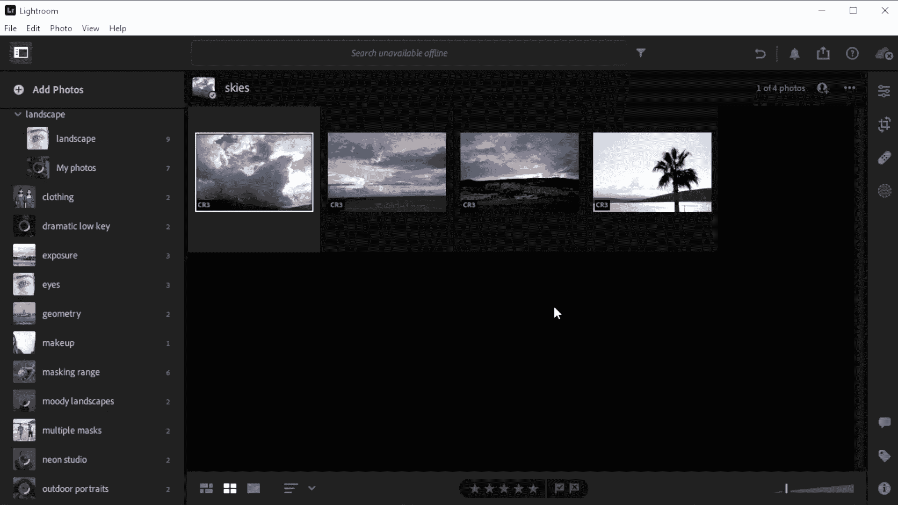
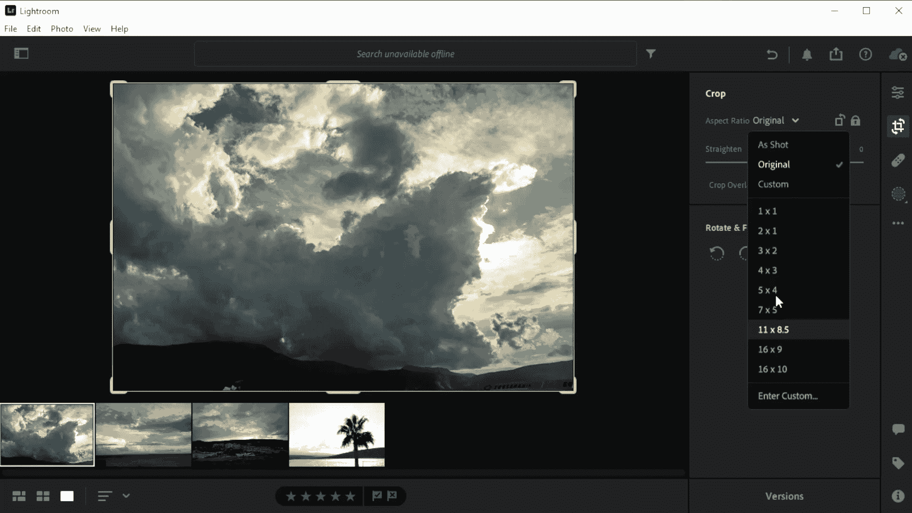
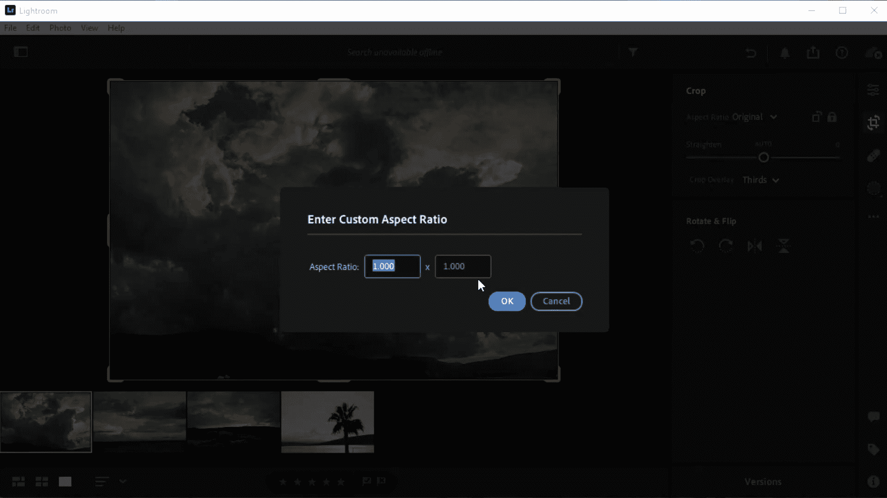
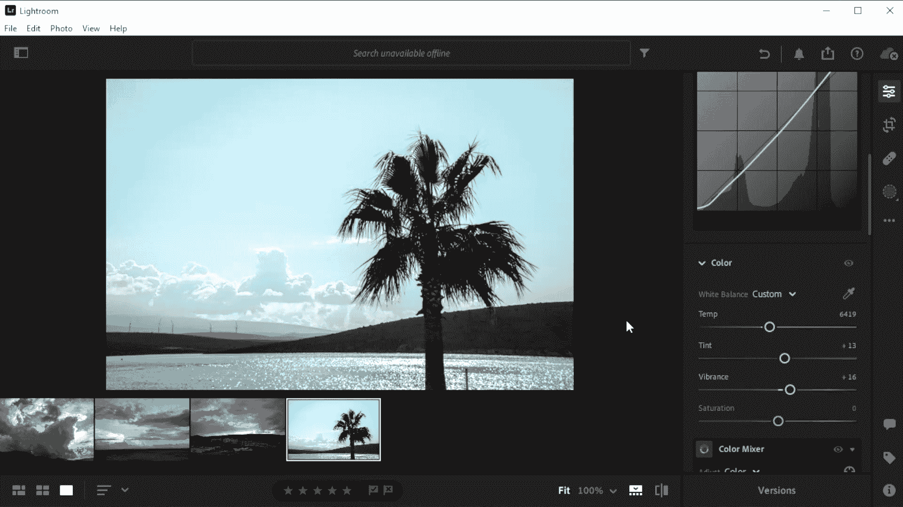

📸 Complete Adobe Lightroom Megacourse：從初學者到專家級照片編輯：01：雲朵後期處理基礎

在本節課中，我們將學習如何在 Adobe Lightroom 中後期處理雲朵天空照片，從基礎的光線調整到色彩分級，最後使用遮罩工具進行局部修飾，讓雲朵的細節與層次更加突出。

拍攝天空本身並不困難，但進入後期修圖階段時，尤其是剛開始學習的朋友，常常會覺得有些困惑。因此，在本節課中，我們將學習不同類型天空的特點，以及如何在編輯過程中保留相機捕捉到的自然顏色與雲朵細節。

這裡共有四張參考照片供我們練習。第一張是午後時分拍攝的彩色多雲天空，雲層較為濃密且帶有深色調；第二張是日落時分的天空，色彩豐富；第三張則是幾乎沒有雲朵、只有背景中出現少量雲層的場景。以下是這幾種常見天空類型的簡要說明：

- 午後多雲天空：雲層濃密，顏色較深，適合突出雲朵的輪廓與形狀。
- 日落天空：色彩過渡明顯，帶有暖色與冷色的混合。
- 晴朗天空：雲朵稀少，主要集中在背景，重點在於增強整體氛圍。

無論場景如何，我們的目標都是保留雲朵的所有細節，並讓邊緣更加清晰可見。

上一節我們介紹了常見的天空類型與照片選擇，本節我們來看看如何針對第一張午後多雲照片進行光線與對比度的基礎調整。

我們先打開那張午後多雲天空的照片。從畫面上可以看到，雲朵層層疊疊，幾乎遮蓋了後方的天空。這類照片的重點在於展現雲朵的宏大氣勢，因為它們形狀各異、分佈廣泛。為了達成這個效果，我們需要保留所有細節，並把雲朵的邊緣表現得更加鮮明。

以下是具體的光線調整步驟：

- 曝光：保持不變，無需大幅調整，因為畫面本身已經足夠明亮，我們能清楚看到雲朵與下方的山脈。
- 高光：調低。這樣可以挽回雲朵中原本過亮而丟失的細節。
- 陰影：調低。因為我們的焦點在雲朵而非山脈，適當降低陰影能讓雲朵層次更分明。
- 白色：調低。
- 黑色：調低。

調整完成後，對比度也需要提升。對比度的公式可以簡單理解為：`對比度 = 亮部與暗部之間的亮度差距`。增加對比度之後，雲朵的邊緣會變得更加鮮豔可見，整體畫面也會從平淡變得更有立體感。

完成基礎光調整後，本節我們將使用音調曲線進一步細化雲朵的明暗層次與色彩平衡。

進入色調曲線面板，選擇點狀曲線。我們要製作一條簡單的 S 曲線。具體做法是將曲線的中間點向右下方拖動，使中間調變暗，同時把陰影部分稍微往上提，讓陰影變得平緩一些；高光部分則向左移動，讓高光更加飽滿，不會顯得褪色。

接著切換到藍色通道，將曲線稍微向右移動。這樣可以抵消畫面中過多的藍色，讓色調更加自然。對比使用曲線前後的效果，你會發現雲朵的細節與色彩層次有了明顯提升。

調整完曲線後，回到光線面板，把陰影稍微提升一些。因為剛才使用了曲線工具，重新微調陰影能讓整體亮度更加平衡。

光線與曲線調整完成後，本節我們進入色彩調整階段，為雲朵增添更生動的色彩表現。

進入顏色混合器，選擇藍色。如果你不確定要調整哪個顏色，可以使用目標調整工具，直接點擊畫面上的某個區域，然後向左或向右移動，根據你想要的效果來決定。這裡我們主要調整飽和度，當然也可以改變色調。例如，將目標調整工具向左移動，可以讓顏色偏紫；向右則偏青色。亮度方面，向右移動會讓顏色變亮，向左則變暗。透過目標調整，我們可以同時處理兩種顏色，而不需要逐一嘗試找出每種顏色的名稱，直接針對雲朵進行修正即可。

接下來是色彩分級面板。先處理陰影部分，選擇藍色，並調整亮度與飽和度。如果你想進行非常細微的調整，可以選中那個圓圈，然後按住 Shift 鍵，這樣就能更精確地控制飽和度。我們選擇一個適合的藍色，並降低其飽和度。中間調部分則加入一些黃色或橘色，同樣按住 Shift 鍵來降低飽和度。高光部分也要設為溫暖色調，因為原本的畫面偏冷。顏色混合的比例大約設為 30 點左右。這樣就能營造出太陽在巨大雲朵後方的氛圍感。如果你不喜歡溫暖色調，也可以移除黃色，專注於冷色調。

回到色彩面板頂部，檢查白平衡。這裡保持溫度不變，維持原本設定的白平衡，並稍微增加自然色相，讓色彩更鮮豔。僅在色彩標籤頁中，我們就完成了許多調整。對比修圖前後，畫面從原本偏白偏藍的狀態，轉變為加入黃色並將藍色轉為青色的效果，整體看起來更加莊嚴、有力，甚至帶有一種王室般的氣場。

色彩調整告一段落後，本節我們來處理畫面的構圖與幾何校正，確保地平線與雲朵的位置更加端正。

進入裁剪工具，將照片稍微旋轉，直到不再看到畫面邊緣的干擾元素。如果你想讓主體雲朵居中，可以把主體移到畫面中央。裁剪工具也提供垂直與水平鏡像選項，調整完成後點擊空白處或按 Enter 鍵確認。

關於長寬比，有兩種模式。鎖定長寬比時，裁剪框會按照圖片原本的比例縮放；解鎖後，你可以自由裁剪，不受固定比例限制。我們選擇解鎖，隨意裁剪直到滿意為止。

接著進入幾何面板，適當旋轉圖片並開啟限制裁剪，直到畫面看起來正直為止。這樣就能修正因拍攝角度而產生的傾斜問題。

前面幾節我們針對第一張午後多雲照片完成了完整的後期流程，本節我們將同樣的思路套用到第二張照片上。

第二張照片是一張海邊白天的天空，雖然與第一張不完全相同，但拍攝時間同樣是在白天，畫面中也帶有一些黃色調。與第一張濃密雲朵不同，這張照片的天空較為晴朗，雲朵較少，因此我們需要稍微多花一點心思進行調整。

首先回到光線面板，降低陰影，增加對比度，降低白色調，並將黑色調稍微提升。接著進入點狀曲線，稍微加深陰影並強化高光。你也可以使用目標調整工具，在任意位置點擊並拖動，讓某個區域變亮或變暗，完全依照你的喜好來決定要使用顏色混合器還是不同的通道。

進入顏色混合器，再次選擇藍色，改變其色調，使畫面看起來更像日出或日落。接著進入色彩分級面板，因為這是海邊場景，我們希望保留溫暖色調，給高光加入橘色，並用藍色冷卻陰影，中間調則選擇黃色。這樣就得到了三種不同的顏色，根據需要進行融合，並適當降低整體平衡值。

在效果面板中，我們可以添加一點 vignette 效果，將邊緣變暗，設定為負八左右，營造出懷舊感。最後回到幾何面板，參考輔助線與山脈線條旋轉圖片，直到地平線筆直，並開啟限制裁剪。調整完成後，雲朵變得清晰可見，畫面從原本平淡變得像一個充滿個性的海邊晴天，給人愉快的回憶感。

針對第二張照片的整體調整完成後，本節我們將進階一步，使用遮罩工具針對天空區域進行局部修飾。

進入遮罩面板，選擇線性漸變，從畫面頂端開始向下拉動，直到漸變覆蓋到松樹頂端。這樣就能只針對上方天空進行調整，而不影響下方的景物。我們可以讓頂端天空顏色更冷，並隨著向下逐漸淡出。如果需要，也可以開啟尋找調整工具，改變色調並降低飽和度，讓效果更有趣。

對比使用遮罩前後的效果，你會發現後方天空與水面都變得更冷一些。如果覺得調整過強，可以適度降低強度。整體來說，這樣處理後，天空與水面的色調更加協調，當然也可以根據個人喜好保留原狀。最後把色調稍微朝綠色方向調整，關閉遮罩預覽，這樣第二張照片的後期調整就告完成了。

至此，我們已經完成了白天雲朵照片的完整後期處理流程，也學習了如何將同樣的步驟應用到不同的場景中。

無論雲朵是濃密強烈，還是僅有少量殘留，這套步驟都能幫助你改變圖片的情緒，並把雲朵的細節完整表現出來。對於這張照片，我們也可以進一步使用遮罩面板，讓天空與水面的色調更加統一。

下一節課，我們將進入傍晚雲朵的編輯，也就是包含日落場景的照片。屆時我們會處理更多色彩過渡，包括太陽完全落下後留下的冷色調與殘餘的暖色調。我們下一節課見。

本節課中我們一起學習了如何在 Lightroom 中編輯白天雲朵天空照片，包括光線與對比度調整、音調曲線運用、顏色混合器與色彩分級、裁剪幾何校正，以及使用線性漸變遮罩進行局部修飾。希望這些內容能幫助你讓雲朵照片更具層次與氣勢。

