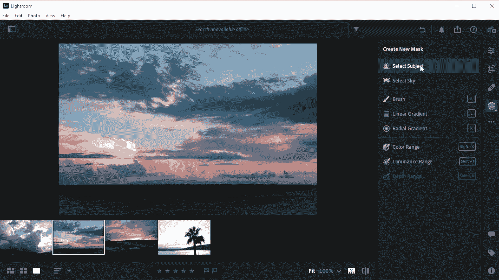
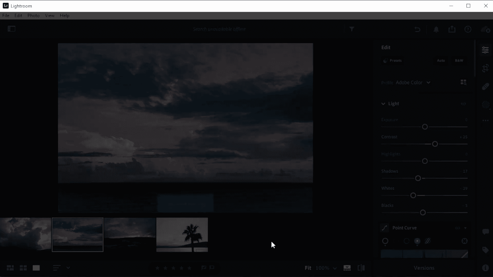
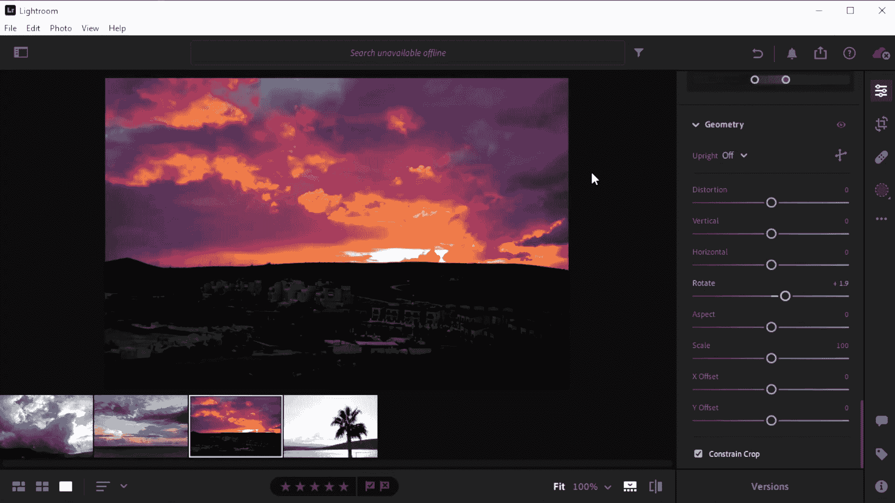

# Adobe Lightroom 零基础到精通照片编辑：64：傍晚云朵后期处理（第二部分）🌅

在本节课中，我们将继续学习云朵的后期处理。上一节课我们讲解了白天云朵的调色思路，本节课我们将把目光转移到傍晚时分的云朵上，学习如何在 Lightroom 中处理日落照片，让天空的颜色更加出彩，同时去除画面中不需要的杂物。

首先，我们需要把图片导入 Lightroom，进入编辑面板。你可以跟着我一步一步操作，这样就能看清楚整个编辑流程。打开图片后，你可能会发现画面里有一些干扰元素，比如画面里的某个人，或者下方某个微小的东西，这些都会影响最终效果。因此，在正式开始调色之前，建议先使用修复笔刷把这些杂物清理掉。

修复笔刷的使用方法很简单。以下是具体的参数设置：
- 羽化：调到最大
- 不透明度：100%

把羽化拉满，不透明度设为 100，然后在画面上画一条线，Lightroom 就会自动帮你检测并修复该区域。如果需要，你可以多处操作，把不需要的两个东西都去掉。鼠标移动到这里，你就能看到修复后的效果。点击空白处，这两个干扰物就消失了，就这样完成了初步清理。

有时候修复笔刷可能不够理想，这时候可以用克隆工具。克隆的含义可以用这个公式表示：
`克隆 = 图片的一部分 -> 复制到 -> 图片的另一个位置`

把模式改为克隆，参数和修复笔刷一样。本质上，你就是把图片中的某一块区域复制，然后贴到别的地方。比如这里有一条黑线，通过克隆顶部的内容，黑线就被遮盖住了。这时候我们就可以继续接下来的调色步骤了。

接下来进入几何选项卡，把画面里的直线修正过来。几何面板的作用可以简单理解为：
`几何调整 = 画面旋转 + 直线修正`

我们只有一条直线作为参考，所以不能使用自动引导线功能，因为那个功能需要两条线才能工作。不过在旋转图片时，可以参考屏幕上的引导线，尽量让画面保持水平。旋转完成后，画面就比较端正了，我们就可以开始正式调色。

首先从光线面板开始。调光的核心思路是突出云朵的颜色，所以先降低高光和白色区域。水面在原图里并没有太多细节，可以适当把水面暗下去，这样不会对画面造成伤害，也能让观众的注意力更集中在云朵上。

以下是光线面板的常见调整顺序：
- 高光：降低
- 白色：降低
- 对比度：增加
- 阴影：适当恢复
- 黑点：微幅降低

调整完基础光线后，进入点曲线面板。点曲线的逻辑可以表示为：
`点曲线 = 高光微增 + 中间色调抬升 + 阴影抬升 + 黑点减少`

高光稍微提亮一点，再增加一个中间色调点，把阴影抬高一些，这样画面会呈现出一种褪色的质感。

然后切换到蓝色通道。如果你的照片偏蓝，可以在阴影部分把曲线点向右偏移到黄色一侧，高光部分也可以做同样的操作。这样颜色就会显得更加平衡。下面是调整前后的对比，调整后云朵的边缘和蓬松感会更加清晰可见。

接着来到颜色面板。先处理白平衡，可以尝试选择“多云”这个预设，效果通常比较自然。如果需要，也可以手动调整色温。接下来增加一点自然饱和度。

此时你可能会发现水面看起来有点绿。这时候可以使用目标调整工具，选择色相，在水面上点击然后向左移动。饱和度可以稍微提升一点。

再回到点曲线，把偏黄的部分稍微降低，避免出现绿色，可以让颜色变成深蓝色，这样也可以。画面中有些黄色区域，你可以把它们改成红色，这样云朵会像棉花糖一样，或者保持黄色也可以。我倾向于让它稍微偏红一点，然后增加饱和度。

关于色相和亮度的调整，可以用这个简单关系表示：
`色相向左 + 亮度降低 = 更接近橙色`

把色相向左移动，可以得到不错的橙色效果。再使用目标调整工具选择 H，稍微向左移动一点，同时降低一点饱和度。这样一来颜色就比较协调了。

接下来进入色彩分级面板。色彩分级是指对画面不同亮度区域分别上色。以下是各区域的含义：
- 阴影：画面中较暗的部分，比如水面和深色云朵
- 高光：画面中较亮的部分，比如天空
- 中间色调：介于阴影和高光之间的部分

我们可以给阴影加上漂亮的蓝色，先选饱和度最高的蓝色，再降低饱和度。高光部分可以选择粉紫色，同样降低饱和度。中间色调可以选一点橙色，然后也降低饱和度。最后把选好的颜色混合在一起，并调整一下均衡滑块。

如果觉得高光不够，可以把之前重置的高光稍微拉回来，这样画面里的颜色会更明显。

然后来到效果面板。这里可以对图片进行去雾处理，清晰度只加一点点，目的是让边缘更明亮，画面边缘会出现一些颜色。如果有些地方需要修复，可以继续调整。当你的圆圈变成绿色时，说明只在特定区域生效，其他区域不会变绿。增加一下数量，这样就能让之前橙色的线条变得不那么明显，变成去饱和的效果。放大看，调整前是橙色的，调整后变成了去饱和状态。

离开效果面板，我们已经讲过几何选项卡了。下面来看调整前后的对比。调整前是原始样子，调整后呈现出一种魔幻的感觉，颜色你可以根据自己的喜欢随意更改。

接下来进入蒙版面板。蒙版的作用是只对局部区域进行调整。以下是操作思路：
- 选择线性渐变
- 从底部向天空方向拉出一条渐变
- 逐渐淡化，让水面稍微雾化一点

这样水面看起来就不会太暗了。回到这个蒙版，稍微增加它的尺寸，让水面看起来更柔软。这是没有蒙版的样子，这是有蒙版的样子，这是一个你可以选择尝试的可选步骤。

第一张图的编辑到此结束。下面看看调整前后的效果。

第二张图的颜色和第一张图比较相似，所以我们可以直接复制同样的设置。点击那三个小点，选择“编辑设置”来复制。可以关闭光学和细节面板，只保留这四个面板。复制后，进入下一张图片，使用控制 V 粘贴。

粘贴后的效果如下。调整前和调整后对比，现在我们已经有了一个不错的起点。接下来可以继续处理阴影，这样黑色会稍微深一点。降低高光，然后来到这里，画面会出现一些蓝色。把中间色调向黄色方向移动，画面就会出现绿色，再把它降低到紫色那边，这样就能和上方的天空颜色相互衬托。

回到颜色面板，这里已经有了上一张图的设置。我想再增加一点自然饱和度，因为这张图的颜色比之前那张更丰富。你可以来到这里，现在我们可以处理紫色，因为上一张图里紫色不多。可以改变紫色的色相，让它稍微偏红一点，增加饱和度。另一个紫色区域可以让它偏蓝一点，也增加饱和度。处理橙色，把它向黄色方向移动，增加饱和度。

接着来到色彩分级。阴影部分我觉得还是用蓝色，看起来不错。高光部分我想走暖色调，比如橙色。这是高光部分的颜色，降低一下强度。中间色调可以做成紫色。然后到这里把颜色混合均匀，这次增加一下均衡。去雾的极性，让边缘变暗。放大检查是否有噪点，如果有，就增加色彩降噪，把画面变得更柔和一些。不过不需要把每个细节都磨平，我们只想要一种不那么生硬的效果。再稍微带回一点色彩噪点，降低一点，这样就不会丢失云朵的细节。

回到几何面板，旋转这张图片。查看引导线，开启约束裁剪。旋转完成后，再次进入蒙版面板，这次使用同样的线性渐变蒙版，不过方向是从上到下。稍微雾化一下天空，只加一点点。然后我会复制这个蒙版，点击三个小点选择复制蒙版。反相这个蒙版，这样就能处理地面而不是天空了。地面的去雾程度可以比天空更高，再加一点清晰度，降低这个区域的曝光度。

接下来回到裁剪工具。我会裁掉这个区域，这样只保留建筑物，因为那部分有点分散注意力。锁定宽高比，这样尺寸就保持一致。你也可以解锁它，尝试风景构图，但我不打算那样做。按下回车确认。我觉得这样更好。这里所说的风景构图是指解锁宽高比后，你有选择把画面做得更长，但我暂时不需要。按下控制 Z 撤销，然后把裁剪框向这边移动，把那个小山也裁进去。确认裁剪。这就是处理傍晚照片的方法。

处理傍晚照片时，重要的是把天空的颜色都处理出来，让它们突出。可以增加饱和度，如果你想要不同的风格，也可以改变色相。一旦所有颜色都调好了，操作就很简单了。你只需要让天空成为画面的主角，也就是降低阴影，保留高光，而高光就是天空。下面是调整前的样子，这是调整后的样子。颜色的强度由你自己掌控，可以随意调整。

本节课中，我们一起学习了傍晚云朵照片的完整编辑流程，包括去除杂物、修正几何、调整光线与点曲线、颜色面板微调、色彩分级、效果处理、蒙版局部增强、设置复制以及裁剪构图。希望大家喜欢这节课，我们下一节课见。
