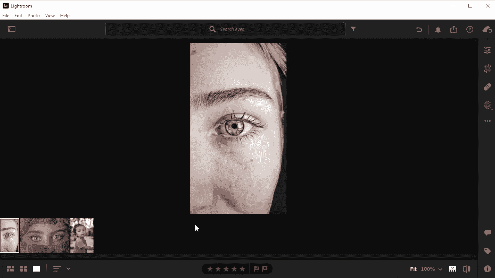

# Complete Adobe Lightroom 从入门到专家照片编辑：第65节：眼睛颜色修改 👁️


在本节课中，我们将学习如何在 Adobe Lightroom 中修改人物眼睛的颜色，以及如何让颜色较深的眼睛变得更明亮，反之亦然。这是人像后期处理中非常实用的一项技能，无论是为了满足模特的特殊要求，还是在特写照片中让眼睛更有神，都能派上用场。本节教程使用了三张示例图片，它们都包含在配套的资源包里，建议你先下载这些素材，然后导入 Lightroom，这样就可以跟着教程的步骤一起练习，边看边操作，效果会更好。


我们先来看第一个例子，这张照片中的眼睛颜色本身就比较亮，属于比较好处理的情况。在这个例子里，我们的目标是把蓝色的眼睛改成绿色或者其他颜色，让你看到亮色眼睛在后期修改时的便利之处。


以下是处理亮色眼睛的具体步骤：

- 进入 Lightroom 的遮罩属性面板，选择画笔工具，在键盘上按下 E 键调出抓手工具，然后把视图移动到眼睛位置，方便后续精确涂抹。
- 回到遮罩面板再次选取画笔，开始在眼睛虹膜区域进行涂抹，涂抹范围只包括虹膜，不要涂到人物脸部的其他地方，避免影响皮肤色调。
- 涂抹时记得适当增加羽化，这样边缘过渡会更自然，不会出现生硬的色块边界。
- 涂抹完成后，可以暂时调高曝光数值，检查是否有遗漏的小点，如果有就用画笔补上，确保整个虹膜都被选中，不要漏掉任何细微区域。
- 检查无误后，双击曝光滑块将其重置，然后应用增强眼睛预设，你会发现眼睛变得稍微明亮了一些，基础亮度已经提升。
- 如果想进一步改变颜色，可以调节色相滑块，把眼睛变成绿色、红色或紫色等任意你喜欢的颜色，根据创作需求自由选择。
- 对于紫色或红色这类不自然的颜色，建议开启彩色功能，再选取紫色，这样效果会更自然；而对于比较自然的颜色，可以直接使用色相选项卡，操作更直接。
- 如果颜色太深，可以先把饱和度全部调高，让颜色显现出来，然后再降低曝光，把眼睛调成棕色，达到自然的深色眼眸效果。
- 此外，还可以配合阴影、黑度、白度等滑块微调，稍微调暗这些数值，让棕色眼睛看起来更真实，避免出现浮在表面的感觉。


眼睛颜色的修改可以用下面这个简单公式来理解：

```text
最终眼睛颜色 = 基础颜色 + 色相调整 或 彩色化
亮度提升 = 曝光增加 + 阴影调整
```


就像给头发染色一样，如果你想从黑色头发变成紫色，通常需要先漂白，在明亮的基础上再上色。眼睛也是同样的道理，原本眼睛颜色越亮，后期修改颜色就越容易。因此，对于亮色眼睛，我们可以直接改色；而对于深色眼睛，就需要先把眼睛调亮，再改成想要的颜色，这个逻辑贯穿整个教程。


第一个例子演示完毕，我们已经知道了如何把蓝色眼睛改成绿色，并掌握了调整饱和度和曝光的基本方法。接下来，我们进入第二个例子，这次的基础颜色是棕色，而不是蓝色，处理思路会略有不同。


以下是处理棕色眼睛的具体步骤：

- 使用和第一个例子相同的方法，选取画笔工具，开启自动遮罩功能，让 Lightroom 自动协助辨认边缘，提升涂抹效率。
- 放大眼睛区域，再次选取画笔，确保羽化功能已经打开，这一点非常重要，能让遮罩边缘更柔和，避免出现明显的修改痕迹。
- 沿着虹膜边缘进行涂抹，把整个虹膜区域都选进去，即使这张照片的基础颜色偏橙色而不是纯棕色，也能正常处理，不用担心基础色偏差。
- 放大眼睛另一侧，同样围绕虹膜进行涂抹，确保所有需要的区域都被包含在内，左右眼睛保持一致的选区范围。
- 尝试改变色相，把棕色眼睛变成蓝色，你可以根据需要增加或降低饱和度，找到最合适的色彩强度。
- 为了让新颜色更明显，建议适当提高曝光，让颜色更突出，使蓝色在棕色基础上更容易显现。
- 回到遮罩设置，关闭自动遮罩，因为眼球表面有很多纹理，自动遮罩容易遗漏某些区域，手动涂抹更准确，能覆盖到每一个细节。
- 开启彩色功能，选择蓝色，如果颜色看起来有斑块，可以选用较淡的蓝色，然后稍微降低饱和度，再适当降低曝光，获得更自然的蓝色眼睛，避免过于艳丽。
- 当然，你也可以把眼睛改成绿色，或者做成科幻风格的红色，但不要把数值调得太高，否则会显得不真实，数值越接近中间位置，效果越自然，越符合真实人眼特征。


通过上面的步骤，我们成功把棕色眼睛改成了蓝色，也可以根据喜好调整成绿色或其他颜色。接下来，我们来看第三个例子，这次面对的是一双并不明亮，而且几乎看不清虹膜细节的眼睛，难度会稍大一些。


以下是处理深色或无细节眼睛的具体步骤：

- 选取画笔工具，调整合适的尺寸，直接在眼睛区域进行完整涂抹，开启羽化功能，沿着边缘涂抹一圈，确保整个眼球区域都在选中范围内。
- 把曝光数值提升大约 33%，让原本暗淡的眼睛先变亮一些，为后续改色打下基础，否则深色基础很难上色。
- 应用增强眼睛预设，眼睛会稍微变亮，但由于原图缺乏细节，直接看起来可能会有点奇怪，这时候不要着急，继续后续调整。
- 尽管如此，我们仍然可以把眼睛改成不同的颜色，比如蓝色，先选取遮罩，再调整到蓝色，即使原图细节不足也能改变整体色调。
- 开启使用精细调整选项，增加阴影数值，这时候眼睛已经呈现出蓝色，但由于原图没有虹膜细节，可能会显得有点诡异，需要适当降低强度。
- 如果色相调整不起作用，可以借助彩色选项卡，混入另一种颜色，这样能给眼睛增加更多色素，而且看起来更自然，弥补原图细节不足的问题。
- 最终，模特的眼睛就从原来的深色变成了蓝色，对比前后效果就能很明显地看出变化，深色眼睛也能通过先提亮再改色实现理想效果。


除了用画笔手动涂抹之外，还有一种替代方法可以用来改变眼睛颜色，适合那些不想花太多时间在周围区域做遮罩的情况，能节省大量时间。


以下是使用颜色范围功能的步骤：

- 回到带有细节的那只眼睛，删除之前建立的遮罩，重新开始，给自己留出足够的操作空间。
- 选择颜色范围功能，点击并拖动眼睛区域，利用颜色差异来分离出虹膜颜色，让 Lightroom 自动识别目标色域。
- 对遮罩进行细化处理，尽量只保留深色虹膜部分，排除周围不需要的区域，让选区更精准。
- 应用增强眼睛预设，这时候眼睛已经变得更亮，基础亮度问题得到解决，可以进行颜色调整。
- 颜色范围功能在颜色容易区分时效果很好，如果不想花太多时间用画笔选周围区域，可以优先考虑这种方法，尤其是在对比度较高的图片中。
- 如果不小心把头发等区域也选进去了，可以用画笔减去这些误选部分，关闭自动遮罩，并开启显示遮罩功能，这样就能清楚地看到需要涂掉的区域，避免误伤。
- 只需稍微处理一下头发边缘，这种方法就会更简单快捷，但前提是图片中的颜色差异足够明显，否则需要用画笔进行大量的减去操作，耗时较长。


颜色范围的选择逻辑可以用下面这个代码块来表示：

```text
遮罩区域 = 颜色范围选择(虹膜颜色) - 误选区域(画笔减去)
```


使用颜色范围之后，我们可以继续为眼睛添加其他颜色，开启精细调整，就这样，眼睛颜色修改就完成了。你可以根据实际情况，选择改变眼睛亮度、调整色相、或者使用彩色化， whichever works well for you，不同工具适合不同场景，灵活选择即可。


整个修改过程其实并不复杂，非常适合用于人像后期。如果客户希望改变眼睛颜色，或者你拿到一张特写照片想让眼睛更明亮，都可以直接应用这些技巧，无需复杂的插件，Lightroom 自带功能就足够。




本节课中，我们一起学习了如何在 Lightroom 中修改眼睛颜色，涵盖了亮色眼睛、棕色眼睛以及深色无细节眼睛三种不同情况的处理方法，还掌握了画笔遮罩和颜色范围两种主要选区方式，并了解了色相调整与彩色化的适用场景。希望这节快速教程对你有所帮助，我们下节课见。


