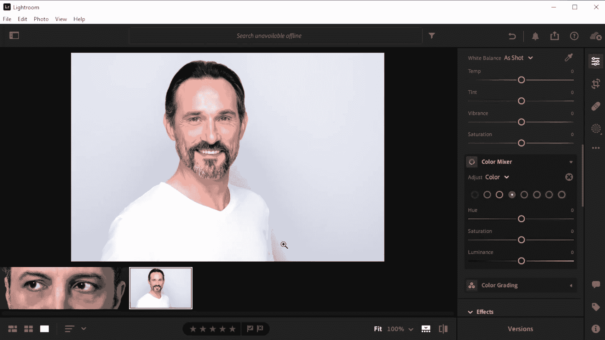

Complete Adobe Lightroom Megacourse： Beginner to Expert Photo Editing：01：认识黑眼圈与面部细节修复的基本原则 🧴


在本节课中我们将要学习如何在Adobe Lightroom里处理成人模特照片上的黑眼圈和皱纹。这是后期修图里非常常见的需求，因为很多商业照片需要让模特看起来精神一些，但又不能失去成年人应有的真实感。如果处理过度，照片就会出现塑料感，失去说服力。因此我们要先建立正确的认知，再进入具体的操作步骤。

原文里出现了两张图片，一张是有明显黑眼圈的成人模特，另一张是没有黑眼圈但脸上有很多皱纹的模特。我们这次主要操作的是带有黑眼圈的那张图片，同时也会顺带提到如何处理单纯的皱纹问题，让你对整个修图流程有完整的概念。

核心原则可以用下面这个简单公式来理解：

`修图原则 = 去除疲劳感 + 保留皮肤真实纹理`

也就是说，我们的目标不是把脸完全磨平，而是让黑眼圈变浅，让皱柡变淡，同时保留毛孔和细纹，确认模特依然看起来像一个成年人。如果完全抹平所有细节，一个看起来像成年人的模特就会变成小孩，这就很不自然，也不是我们想要的效果。我们要追求的是逼真度，让皮肤看起来柔和但不失去质感。


Complete Adobe Lightroom Megacourse： Beginner to Expert Photo Editing：02：第一步：用画笔蒙版平滑皮肤纹理 🖌️

上一节我们介绍了修图的基本原则，本节中我们来看看如何用画笔蒙版先给面部做初步的平滑处理。具体来说，我们要针对有明显黑眼圈和眼部皱纹的那张图片进行操作，为后续的针对性修正打好基础。

开始操作之前，先打开Lightroom的蒙版面板，选择画笔工具。以下是需要设置的关键参数：

```
流量（Flow）：调高一些
羽化（Feathering）：调高，边缘过渡自然
密度（Density）：调到最大
```

在开启“显示叠加层”后，用画笔把整个脸部都涂上蒙版，但是要注意避开眼睛、眉毛以及睫毛下缘。这些部位保留原始纹理非常重要，否则眼睛会失去神采，整张脸会显得死板。涂完蒙版之后，我们可以尝试使用平滑皮肤的预设，但通常只靠预设是不够的，还需要手动再加强一些。

此时可以适当降低清晰度（Clarity）和纹理（Texture），让皮肤看起来更细腻。不过要控制好力度，如果把纹理降得太低，放大后依然能看到毛孔和细纹，这时候就要把一部分纹理调回来，避免过度平滑。我们不是要消除所有东西，只是要让皮肤稍微光滑一点点，保留成年人应有的皮肤质感。


Complete Adobe Lightroom Megacourse： Beginner to Expert Photo Editing：03：第二步：针对眼下黑眼圈进行局部提亮 👁️

完成整体皮肤的初步平滑后，本节中我们要专门处理眼下的黑眼圈区域。这是整个修图流程中最关键的部分，因为黑眼圈直接影响模特的精神状态。

新建另一个画笔蒙版，这次我们要采用不同的参数设置。以下是具体数值：

```
羽化（Feathering）：保持较高
流量（Flow）：大约70%
密度（Density）：大约19
```

开启“显示叠加层”，这样可以清楚看到自己正在涂抹哪些区域。用画笔把眼下那个半圆形的黑眼圈区域完全覆盖，范围要延伸到另一侧，但依然要避开睫毛下缘，同时尽量涂到睫毛下方。另一只眼睛也要用同样的方法处理，确保左右对称。

对于眼周某些比较敏感的小区域，我们不希望受到太强的影响，因此可以先降低画笔的流量，控制在50%左右，密度也要保持比流量更高。这样在这些区域上涂抹时，调整效果会更轻柔，不会造成不自然的色块。

涂完之后，关闭“显示叠加层”，就能看到实际效果了。接下来进入蒙版的调整面板，开始修正眼下的暗沉：

- 曝光（Exposure）：适当提高
- 阴影（Shadows）：提高
- 黑级（Blacks）：适当增加
- 对比度（Contrast）：降低
- 色调：增加暖色调，因为原本偏紫的冷色调可以用绿色来抵消品红
- 开启精细调整，偏向橙色一侧
- 色温（Temperature）：稍微降低，营造一点冷色调效果
- 饱和度（Saturation）：适当提高
- 去雾（Dehaze）：向左滑动，数值变小
- 清晰度（Clarity）：降低

调整完这些参数后，眼下的深色斑点就会明显变浅，但眼部纹理仍然保留。这时候千万不要把饱和度降下去，否则肤色会变得不自然。我们要保持一个正常的肤色，让修改后的区域和周围皮肤融合在一起，而不是形成一块明显的白斑。


Complete Adobe Lightroom Megacourse： Beginner to Expert Photo Editing：04：第三步：添加淡化叠加层增强过渡效果 🎨

上一节我们完成了眼下黑眼圈的重点提亮，本节中我们来看看如何再叠加一层淡化蒙版，让整体过渡更加自然。单靠一次调整有时候不够细腻，加上第二层轻薄的蒙版可以让效果更柔和。

新建一个画笔蒙版，再次涂抹眼下同样的区域，但这次流量要调得很低，密度控制在20左右，流量保持在40左右。以下是参数对照：

```
密度（Density）：20
流量（Flow）：40
效果：非常淡，仅作轻微过渡
```

开启“显示叠加层”对比可以看到，这次的叠加层颜色非常浅，只是一种很淡的效果。我们不会做任何剧烈的调整，只需要轻轻覆盖那些小区域即可。在涂抹过程中，可以调整画笔大小，甚至稍微超出之前画过的区域，把边缘融合得更自然。

涂完之后关闭叠加层显示，再进入调整面板稍微降低纹理，稍微提高对比度，增加阴影，并且再把去雾数值调低一些。第三层蒙版带来的变化虽然很轻微，但把所有层叠加在一起之后，最终效果会明显更好。对比前后图片，你会发现只用了几次简单的画笔涂抹，就能去掉大部分眼袋和眼周暗沉。

如果你觉得到这里已经足够，也可以直接停止。不过有些人眼窝较深，眼下会有一条比较明显的线条，如果想进一步去除，就需要用到修复画笔工具了。


Complete Adobe Lightroom Megacourse： Beginner to Expert Photo Editing：05：第四步：使用修复画笔处理深眼窝线条 🧽

上一节我们添加了淡化叠加层，本节中我们来看看如何用修复画笔处理那些深眼窝里的顽固线条。修复画笔可以采样附近的皮肤纹理，把深色线条修补得更平滑，但同样要注意不要过度处理。

使用修复画笔时，建议把不透明度调低，控制在79左右，同时增加羽化，把笔刷尺寸调大。键盘按E键，把视图缩放到大约66%，这样可以近距离观察正在处理的区域。涂抹那些深眼窝的线条时，Lightroom会自动选择一个采样区域，通常这个选择是可以接受的，但如果采样位置不合适，可以手动把采样点稍微下移，避免带入睫毛等不需要的纹理。

如果不小心涂错了，可以删除本次笔触重新来过。由于不透明度较低，效果会比较淡，这正是我们想要的，因为我们不想把所有东西都抹平。如果自动选择的采样区域不理想，也可以换一个位置，只要看起来自然就行。处理完一侧之后，另一侧也要用同样的方法操作，但要注意两侧的光线不同，深色一侧需要保持一致的亮度，不能修得比另一侧更亮或更暗。

处理完之后关闭修复面板，因为我们之前已经设置了低不透明度和高羽化，这样得到的结果更自然。这时候模特眼周的深线条就会减轻很多，不再有那种深深的凹陷感。这时模特看起来已经精神很多了，但皮肤上依然保留着真实的纹理，不会出现假面具的感觉。


Complete Adobe Lightroom Megacourse： Beginner to Expert Photo Editing：06：第五步：基础面板整体亮化与收尾 ✨

完成局部修复后，本节中我们来看看如何在基础编辑面板里做最后的整体亮化，让整张照片更有气氛。前面的步骤主要针对眼部区域，而这一步是对整张图片的光影做微调。

进入基础编辑面板的光线部分，可以适当提高阴影，把眼周和面部较暗的地方提亮一点，数值控制在17左右。然后增加对比度，把自然的肤色调出来。如果模特原本肤色比较苍白，可以适当增加饱和度，但在这个例子中，我们可以保持现状，不需要额外调整。

最后再回到曝光设置，稍微增加一点曝光值，因为之前的图片略微偏暗。调整完成后，对比修图前后的效果，你会发现模特的面部已经完全焕然一新。但请记住，我们故意保留了一部分皮肤纹理，因为模特不是孩子，每个成年人的皮肤上都应该有毛孔和细纹。

在整个过程中，请非常注意流量、羽化和不透明度这三个参数。如果设置不当，很容易把人的脸抹平，失去真实感。下面用一个简单公式总结一下：

`最终效果 = 原始皮肤纹理 × (1 - 过度平滑程度)`

只要控制好这个平衡，就能在去除黑眼圈和皱纹的同时，保留成年人应有的真实质感。这才是专业修图应该追求的效果，而不是把所有人都磨成一个样子。




本节课中我们一起学习了如何在Adobe Lightroom里去除黑眼圈和眼部皱纹。我们先确立了不要把脸完全磨平的原则，然后分步骤使用画笔蒙版平滑皮肤、针对眼下黑眼圈做局部提亮、微调蒙版参数还原自然肤色、添加淡化叠加层增强过渡、用修复画笔处理深眼窝线条，最后在基础面板做整体亮化收尾。下一课我们将继续学习如何处理脸部其他部位的皱纹，我们下期再见。

