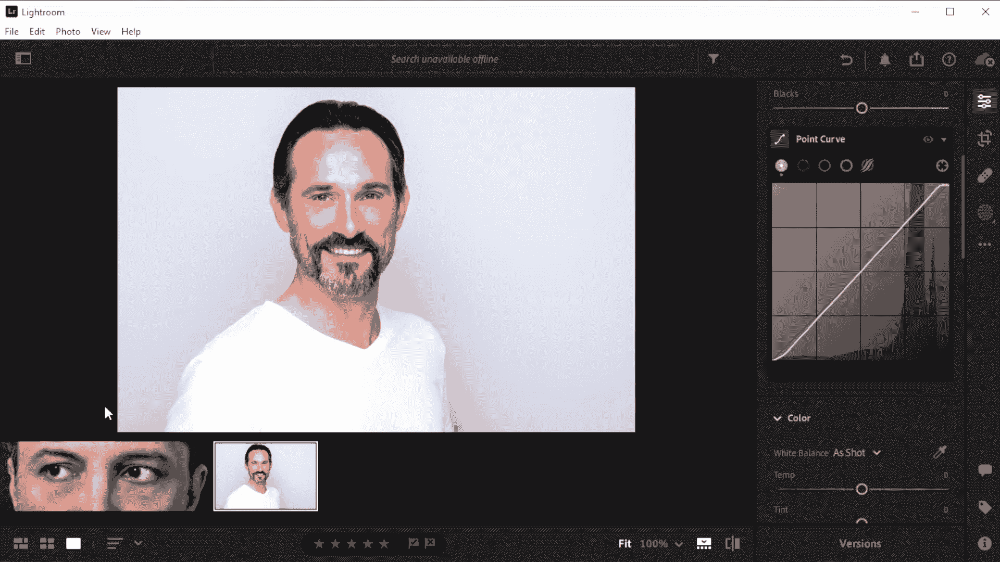

完整 Adobe Lightroom 大师课：第62课：面部皱纹修复 📸

在本节课中我们将要学习如何使用 Adobe Lightroom 来减少模特脸上的皱纹。我们的目标不是让皮肤完全变得平滑，而是在保留自然细节的同时，让面部看起来更年轻一些。下面我们会一步步介绍具体的操作方法，包括使用蒙版、画笔和平滑工具，以及最后的修复画笔操作。即使你是初学者，跟着这个流程也能快速上手。

# 为什么不完全去除所有皱纹

上一节我们介绍了眼睛周围的皱纹处理方法，本节中我们来看看如何处理脸部其他部位的细纹。在开始之前，我们要先明确一个核心理念：修图的目的不是把脸抹成一张白纸，完全没有任何细节。

每个人脸上都会有皱纹，尤其是在微笑或者眯眼的时候，这些线条是非常自然的。如果我们试图把所有线条都彻底消除，最终效果会显得很假，而且一眼就能看出做过不好的修图工作。因此我们只需要把那些比较明显的线条稍微减轻一些，保留少量细微线条，这样才能获得自然的年轻感。

# 使用蒙版对皮肤进行初步平滑

好了，现在我们进入实际的操作步骤。在使用修复工具之前，我们先通过蒙版把皮肤整体平滑一点，这样后续的修图工作会更容易一些。以下是具体的画笔设置和操作顺序：

- 打开蒙版面板，新建一个画笔蒙版。
- 将流量（Flow）调低，这样绿色覆盖层不会太浓，涂抹起来更温和。
- 羽化（Feather）保持在 100，让边缘和周围皮肤自然融合。
- 密度（Density）设置在 88 左右。
- 开启“显示覆盖层”，并选择一个与肤色明显不同的颜色，比如避免使用红色，以免和皮肤色调混淆。
- 使用滚轮或键盘上的括号键调整画笔大小，涂抹眼周和面部需要处理的区域。
- 避开头发、眉毛和睫毛，只在应该处理的区域上涂抹。

涂抹完成后，给这个蒙版命名，比如“眼睛平滑”，因为后面会有好几个蒙版，命名方便我们区分。然后确保蒙版被选中，周围显示蓝色边框。

# 调整平滑效果的参数

刚才涂抹的蒙版已经创建好了，接下来我们要调整其中的效果参数，让平滑效果看起来更自然。以下是具体的参数调整建议：

- 添加“平滑皮肤”预设，观察 Lightroom 的处理结果。
- 如果预设效果不对，比如肤色变白，我们需要手动调整。
- 降低纹理（Texture），再次降低清晰度（Clarity）。
- 记住这个公式：纹理应该高于清晰度，也就是 Texture > Clarity。
- 稍微提亮阴影（Shadows）和黑阶（Blacks），这样深色的细纹会变得不那么明显。

调整完成后，对比一下修图前后的效果。你会发现原来那些很明显的线条已经变淡了，但皮肤上依然保留着一些细微的纹理，并没有被抹得完全平平。这就是我们想要的自然效果。

# 使用修复画笔逐条去除皱纹

现在我们有了一个不错的基础，接下来可以使用修复画笔来处理剩下的皱纹。这一步比较细致，需要我们一条条地处理。以下是具体的操作方法：

- 确保修复画笔的模式设置为“修复（Heal）”，而不是“仿制（Clone）”。
- 放大眼睛区域，把画笔尺寸调小，羽化调高，不透明度保持较低，比如 64。
- 点击并拖动画笔，让 Lightroom 自动检测合适的参考区域。
- 如果某个参考点位置不合适，可以点击并拖动到其他纹理相似的区域。
- 每处理完一处，Lightroom 会在画面上生成一个蓝色的参考点。
- 如果不小心涂错了，可以选中那个蓝色点，按退格键删除，而不需要重新做整个蒙版。

不要把画笔做得太大，否则可能会把旁边不该处理的部分也带过去。我们的目标是逐条去除细纹，但保持低不透明度，这样效果看起来才自然。Lightroom 会自动从亮部或暗部提取纹理，并匹配当前区域的亮度，你只需要告诉它哪里需要处理，剩下的交给 Lightroom 完成。

# 处理面颊和额头的皱纹

眼睛处理完成后，我们需要继续处理面部其他部位。因为脸部不同区域的亮度和纹理不同，比如额头通常比脸颊和眼睛更亮，所以我们要为每个部分创建独立的蒙版。以下是面颊和额头的具体处理步骤：

- 面颊部分：新建一个画笔蒙版，避开胡须等需要保持锐利的区域。
- 只关注脸颊，不要涂抹到脸部其他地方。
- 降低纹理和清晰度，去除那些微小的线条细节。
- 使用修复画笔去除脸颊上明显的两条线条，但保留看起来像酒窝的细微凹陷。
- 如果某处不小心涂过了，可以删除对应的蓝色点，而不是整个选区。
- 额头部分：额头是脸上最亮的区域，皮肤细节本来就不多，可以跳过平滑步骤，直接使用修复画笔。
- 额头上的皱纹通常是连续的横纹，直接沿着这些线条涂抹即可。
- 如果觉得额头需要进一步平滑，可以降低流量，使用大画笔轻轻涂抹一次。流量越低，效果越淡，可以通过多次涂抹来叠加强度，覆盖层越深颜色，效果越强。

# 调整亮度并进行全局优化

局部修图完成后，我们还需要处理整体的亮度平衡，让面部看起来更有精神。以下是亮度调整的具体做法：

- 新建一个画笔蒙版，将流量调得更低，比如 26，羽化调高。
- 开启“显示覆盖层”，涂抹眼周、鼻子、额头等较暗的区域。
- 提亮阴影，稍微增加曝光，例如 +0.15。
- 检查额头是否有遗漏的地方，用最后一个蒙版补涂。
- 边涂抹边开启蒙版可见性，确保边缘和眉毛周围也有更亮的效果。

完成局部亮度调整后，我们可以切换到主编辑面板，对整张图片进行全局调整。你可以适当降低高光，因为模特的衬衫可能太亮，导致身体轮廓不明显。然后增加对比度，适当找回一些高光，并提亮阴影。如果需要，也可以进行简单的色彩分级。对比一下修图前后的效果，你会发现模特的脸部不仅更亮了，整个人看起来也年轻了许多。

# 本节课总结

本节课中我们一起学习了如何在 Lightroom 中去除模特脸上的皱纹和黑眼圈。我们先用蒙版对皮肤进行初步平滑，保留自然细节而不把脸抹平；然后使用修复画笔逐条去除眼周、面颊和额头的皱纹，控制不透明度和流量让效果更自然；最后通过亮度调整和全局参数优化，让整张照片看起来更有年轻感。

如果你遇到的是痘痘而不是皱纹，可以用修复画笔以点状方式处理，而不是拖拽涂抹。这些技巧可以应用在大多数人像修图场景中，帮助你的模特获得更年轻、更自然的外观。本节课就到这里，下节课见。
