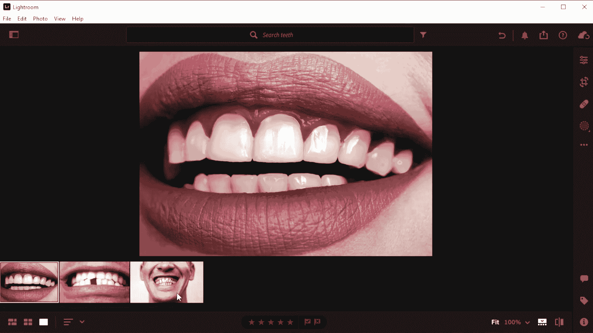

# 完整Adobe Lightroom大课：p68第63课：牙齿美白与修复（第一部分）🦷

本节课中我们将学习如何让牙齿变白，以及如何去除牙齿上的不必要瑕疵。我们将使用三张图片进行演示，分为简单、中级和困难三个难度等级。每个等级都会在上一个基础上增加新的编辑难度。今天我们先从最简单的一张图片开始，循序渐进地掌握牙齿修饰技巧。


## 一、三个难度等级介绍

上一节我们介绍了 Lightroom 的基础面板操作，本节中我们来看看如何针对牙齿进行局部修饰。

我们一共有三张图片，分别对应三种不同的处理难度。简单级别只需要让牙齿变白，中级别需要用修复画笔去除斑点，困难级别则需要美白并为缺失的牙齿进行克隆修复。使用 Lightroom 的修复画笔和遮罩属性，我们就能完成这些操作。

以下是三个难度等级的具体对比：

- 简单：仅需让牙齿变白  
- 中级：美白牙齿并使用修复工具去除斑点  
- 困难：美白牙齿并为缺失的牙齿进行克隆  

## 二、简单级别：纯粹的牙齿美白

在本节中我们先处理简单级别的图片，目标只是让牙齿颜色变白，不需要处理其他复杂瑕疵。

让我们进入遮罩面板，选择画笔工具。如果你记得在 Lightroom Classic 中，画笔旁边有下拉菜单，可以直接选择牙齿美白、眼睛增强和皮肤磨皮等预设。在当前的 Lightroom 版本中，这个选项依然存在，但操作顺序相反。你需要先确定区域，生成遮罩，然后才能选择预设。Lightroom 会自动移动几个滑块，但预设并不是必须的。

核心操作流程可以用这个简单的公式表示：

```
遮罩区域 = 画笔涂抹范围 + 自动遮罩开关
```

首先我们已经创建了一个遮罩。调整画笔大小，可以使用滚轮来放大或缩小，选一个合适的尺寸。添加少量羽化，不要太多，流量保持在 83 左右，不要太小也不要太大。然后我就在所有牙齿上涂抹，注意避开牙龈和其他部分。

如果开启了自动遮罩，画笔不会越过牙齿边缘。如果不小心涂到了不该涂的区域，可以在画笔上点击减号，或者直接使用橡皮擦工具对现有遮罩进行修改。确保自动遮罩已开启，这样不会丢失牙齿的部分区域。这样就能很容易地选中牙齿。

请确保覆盖每一个部分，那些发黄的部分可能与牙龈颜色混在一起，所以要仔细涂抹，因为 Lightroom 会很难区分相近的色调。

遮罩显示为蓝色是因为我们手动设置了覆盖颜色，可以打开天空遮罩显示叠加层，如果颜色不合适，可以在小色框中自行更改。

选择好区域后，关闭显示叠加层。回到遮罩 1，开始进行基本编辑。

首先提亮阴影。下面是前后对比：

- 之前：牙齿阴影较暗  
- 之后：阴影变亮  

请确保选中了遮罩。如果不选中遮罩，编辑不会只作用于牙齿。稍微增加一点曝光度，否则会影响整张照片。在编辑过程中，你可能会发现有些地方没涂到，可以返回去修补。

接下来重置高白调，改为增加曝光度，数值设为 4.70。牙齿现在变白了，为了去除多余的黄色，稍微增加黑色调。然后调整色温，向冷色方向移动，以抵消牙齿原本的黄色色调。



核心参数设置如下：

```
曝光度 = 0.70
色温 = -63
黑色调 = 略微增加
```

再次选中遮罩，进行最终调整。将色温调到大约 -63，曝光度设为 0.70，把牙齿调宽一些。如果发现遮罩有遗漏，可以返回去用画笔添加到选区，确保所有牙齿都在选区内，这样才能对所有牙齿产生影响。注意细节部分，也要涂到牙龈周围。Lightroom 会把牙齿的黄色和牙龈的粉色混淆，所以要仔细处理边界。

完成这些调整后，可以返回检查并修复遗漏的地方。最终效果是牙齿变亮了。如果觉得太亮，可以随时返回降低曝光度，或者让阴影稍微暗一点，让牙齿看起来更自然。

这就是简单级别的处理方式，我们只是选区并涂抹，把牙齿从黄色一侧带到冷色一侧，并提亮了它。我再稍微增加一点曝光度，现在我对此比较满意。

## 三、中级别：去除牙齿斑点

现在我们来看看第二张图片，也就是中级难度。这张图片不仅牙齿发黄，还有一些斑点需要去除。让我们放大到大约 50%，以便看清牙齿细节。此刻我们扮演牙医的角色。

选择修复画笔，确保模式设为“修复”，因为我们不想克隆任何内容。调整合适的尺寸和不透明度，确保不透明度为 100。然后逐一点击那些斑点，因为我们需要复制周围的皮肤纹理。也许可以使用侧面的区域作为参考。不要一次选太大的区域，有时候可能会选到牙齿外面的部分，不用担心，Lightroom 会自动检测正确区域。

核心设置如下：

```
修复画笔模式 = 修复
不透明度 = 100
```

我们逐一处理斑点，不要做大的选区。如果选到了牙齿外面的东西，Lightroom 会帮我们识别正确区域。然后把它拖到这里。就这样，在牙齿上涂抹，去除这些斑点。

我们去掉了这个斑点，前后对比很明显，虽然还有点斑驳，但可以修复。让我们再次处理这些区域，放大一点看得更清楚。我要去掉这些斑点，那里有一些细小的斑点。确保所有部分都处理了，不要遗漏，否则编辑完成后会出现深色斑点，破坏整体效果。

使用修复画笔去除这些斑点，之后可以随时移动修复点，修复任何你想调整的地方。点击适应视图，现在斑点消失了。之前有斑点，之后通过多个修复点轻松去除了，如你所见。

## 四、颜色修正与深色区域处理

去除斑点后，牙齿某些部分仍然有颜色不均匀的问题，有些地方比其他地方更暗。我们可以在遮罩面板中修复这一点，点击进入遮罩面板，选择画笔。

放大查看我们的工作，这样能看得更清楚。对于这种情况，可以使用颜色范围遮罩。尝试颜色范围，选取牙齿中常见的黄色色调。这样就能选中大部分那些区域。你会看到我们选中了大部分区域，但也选到了牙齿外面的一些部分，只选中了那些深黄色部分。

如果有遗漏，可以看到这里漏掉了一些，可以点击添加，使用画笔，确保自动遮罩已开启，把那些斑点添加到选区中。我们可以返回颜色范围，点击它，来到上方，添加到细化选项卡中。这样会添加到你之前做的选区，从而获得更广泛的黄色区域选取。

选择第一个遮罩，首先降低饱和度，去除那些黄色部分。同时给牙齿增加冷色调。在这一步稍微增加一些曝光度，输入 0，从小开始，逐步调整。我打算设为 65。

现在牙齿变白了，但遮罩还需要一些修正。使用我们制作的画笔，设置合适的羽化效果。效果开启后，很容易看出差异，可以涂到边缘上。因为这些阴影不会改变，我们只改变牙齿的色调和色温。沿着线条涂抹，处理那些有黄色色调的小裂缝，要把这些去掉。再次提醒，牙龈部分很重要，一定要涂到正确位置。即使没有变化，那也是因为自动遮罩的原因，但如果涂几次，Lightroom 会明白你需要这些部分被影响。就这样，我们改变了牙齿的颜色。

去除那些黄色斑点后，出现了另一个问题，有些部分变灰了。你可以看到，随着靠近牙龈上方，牙齿开始变灰，这是受损牙齿常见的问题。到目前为止，这是之前的状态，这是之后的状态，亮度有点过高。我们可以把曝光度调到 0.50 左右。记得先选中遮罩，选中遮罩后设为 0.50。这样就好多了。

接下来我要为那些灰色区域再做一个遮罩。但我们可以先尝试提亮阴影，设为 100，效果还不错。不过还需要更多工作。你可以看到，即使阴影调到了 100，还是有点暗。所以我需要为这些部分单独做一个遮罩。把阴影调回原来的样子，因为我要为这些部分做独立的遮罩。

点击添加，这次选择亮度范围。我们需要选取最暗的部分。把控制点拖到这里，这样就能选中那些小裂缝。不要在意牙齿的其他部分，这些是细化选区的参数。如果你想要更少的高白调，就把控制点拉回来。我只想增加黑色调，所以把天空控制点拖到这里，因为主要在黑色调一侧，这样就选中了大部分那些区域。

核心逻辑如下：

```
亮度范围选区 = 最暗区域 - 无关区域
```

好了，这就是之前有黑色斑点的地方。选中这个遮罩，我打算增加阴影。100 太多了，调低一点。在做这个之前，先打开显示遮罩，因为我们选到了一些不需要的位置，选区里有太多不需要的点。我用画笔把不需要的部分从选区中减去。你可以关闭自动遮罩，因为这里不需要 Lightroom 自动检测区域，我们只是在擦除不需要的部分，不需要精确，所以关掉自动遮罩也没关系。这样就只会得到那些深色部分。

你也可以直接手动涂抹那些深色部分，但使用亮度范围的好处是它会自动软化边缘。所以使用亮度范围选取更好。这样我们就可以用画笔去除这些部分，更简单。处理嘴唇时要非常小心，可能也会选到一点牙齿。也不要忘了牙龈，这些是牙龈部分。用非常小的画笔在牙齿间涂抹，确保不要把牙龈选进去。

好了，现在我们只选中了牙齿的深色部分，没有其他东西。可以继续去除灰色部分。下面，选择这个遮罩，关闭叠加显示。来到阴影滑块，简单增加一些数值。调得太多了，调低一点。好的，有些部分会变黑，那是因为牙齿重叠产生的阴影，会有阴影，但我们要去除这些深色区域。降低这个数值，主要处理黑色调。

接下来用画笔处理，因为有些部分选到了白色区域。打开叠加显示，确保没有奇怪的选区，否则看起来会很奇怪。好了，我们的患者牙齿修复完成了。我返回主遮罩，也就是遮罩 1，稍微降低高白调。

点击适应视图，我们的客户牙齿已经修复好了。这是之前的状态，这是之后的状态。你可以随意调整光线和颜色，但一般原则是增加曝光度，给牙齿一个较冷的色温，如果有需要，比如在这张图里，就为阴影部分再做一个遮罩。第一张图没有这个问题，第二张图有，所以我们要做两个遮罩，而不是像这里做一个。

## 五、总结与下一课预告

现在让我们把所学的知识综合起来，应用到第三个例子中，那个人缺了一颗牙齿。作为牙医，我们需要为这个人提供一颗新牙齿。下一课见。

在本节课中我们一起学习了如何在 Lightroom 中美白牙齿，如何使用修复画笔去除牙齿斑点，以及如何通过遮罩和颜色范围来修正牙齿的颜色和深色区域。掌握这些技巧后，你就能为照片中的人物打造更整洁、更自然的笑容。
