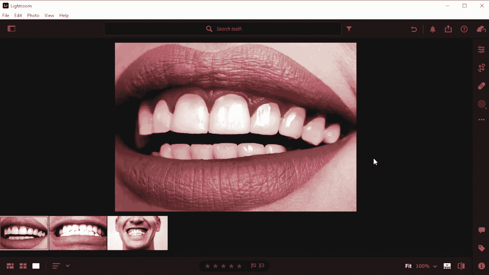

# Complete Adobe Lightroom 从入门到专家照片编辑：第 64 章：牙齿美白与修复（下）🦷

在本节课中，我们将继续学习如何在 Adobe Lightroom 中美白与修复牙齿。这是“牙齿美白与修复”部分的第二节，我们会把上一节学到的所有方法整合在一起，通过实际操作让照片中人物的牙齿看起来更亮、更自然。你将学会使用克隆工具补上缺失的牙齿，学习如何用蒙版画笔精准地调整牙齿颜色，同时还会了解如何修正牙龈和嘴唇的细节，使整体效果协调统一，不出现违和感。

在上一节课中，我们讲解了两个需要让牙齿变亮的具体例子。在第二个例子里，我们不仅让牙齿变亮，还去掉了图片中不想要的痕迹，并修复了深色斑点。本节课中，我们将把所有内容整合在一起，为这个人打造一副漂亮的牙齿，不仅要让牙齿变亮、去掉黄色污渍，还要补上一颗牙齿，让整体笑容更完整。

以下是使用克隆工具添加新牙齿的详细步骤：
- 转到修复画笔工具，并将模式从“修复”改为“克隆”。这样做是因为我们不希望 Lightroom 在选中区域后自动分析并修复那部分，而是直接复制另一部分牙齿。
- 将不透明度设为 100%，羽化程度调低，不要完全羽化，只是稍微触碰边缘，这样边界会更自然。
- 大小设置为大约 50%，这样可以清楚地看到牙齿缺口，并获得合适的画笔尺寸。
- 在新牙齿应该出现的位置进行选择，只选需要的区域，不要选多。因为使用修复画笔时，我们无法从选区中减去部分，选多了很难修改。
- 像给这个人画一颗新牙齿一样填充选区，系统会自动选择旁边的牙齿作为克隆来源，这样通常能获得更好的效果。

接下来，我们需要调整克隆牙齿的位置和形状，让它看起来更自然，不像是后来硬加上去的：
- 尝试把克隆区域放在合适的位置，可以先放在大概位置，再逐步微调，直到与周围牙齿对齐。
- 把选区羽化一下，使其与周围牙齿融合，避免出现生硬的边界或明显的修痕。
- 在中间区域寻找可以复制的牙齿部分，把它移近当前位置，再次羽化，让边缘更柔和自然。
- 如果颜色暂时不匹配也不用担心，先建立一个基础，之后我们会再处理颜色和光线问题，现在最重要的是形状和位置。

牙齿形状大致完成后，我们需要处理嘴唇和牙龈区域，使其与新牙齿协调，不出现色差或边界突兀的情况：
- 用画笔在想要影响的区域画一条较大的线条，沿着嘴唇线条进行，不需要画到嘴唇下方，尽量连接起来，形成一个连贯的选区。
- 系统可能会自动选择上方区域，我们可以尝试选择更靠近目标区域的下方部分，再添加一些羽化使边缘融合。
- 如果牙齿尖端还需要修整，可以再复制一部分嘴唇来修复，让整体轮廓更顺畅。
- 此时牙齿的位置可能还不够完美，但这通常就是那个人牙齿的自然形状，不一定完全平直，这也很正常，不必强行修得太规整。

现在可以开始美白牙齿并调整颜色了，具体操作如下：
- 移到蒙版面板，这次使用画笔工具，因为我们需要覆盖所有牙齿区域，而不是只选其中一部分。
- 打开自动蒙版功能，先删除之前的设置重新开始，开启自动蒙版可以避免影响到牙龈或嘴唇等多余区域。
- 只画在牙齿上，注意不要碰到牙龈。如果不小心画到了牙缝，可以随时从蒙版中减去，这样就不会把嘴巴内部的缝隙也变亮，保持真实感。
- 既然这组牙齿只是稍微发黄，可以直接用温度滑块来修正，先不着急使用预设。

关于预设和手动调整，具体情况如下：
- Lightroom 为这个蒙版等级提供了“美白牙齿”预设，它会将曝光设为 40，并降低饱和度，代码表示为 `exposure = +40`, `saturation = -60`。
- 你可以先对比一下使用预设前后的效果，预设通常已经做得不错，不需要像前两个例子那样做太多调整，适合快速处理。
- 如果觉得牙齿变得太白或太灰，可以不使用预设，手动操作：将曝光降到 0.30 左右，饱和度设为 -50，再把色温稍微向右调一点，代码表示为 `exposure = 0.30`, `saturation = -50`, `temperature = toward warmer`。
- 这样手动调整后，牙齿颜色会更贴合原图光线，不会显得突兀。

在完成基本美白后，需要检查是否有遗漏，确保每一颗牙齿都被均匀处理：
- 加上效果后，我们可以清楚地看到之前没涂到的地方，这时候再用画笔加上自动蒙版补上那些点，避免留下亮斑或暗斑。
- 总是建议先仔细看一下牙齿，再用画笔把遗漏的部分加入选区，这样最终效果才会更均匀专业。

牙齿处理完之后，我们再回头处理嘴唇的阴影部分，让它与牙齿融合得更好：
- 关闭自动蒙版，这样可以把嘴唇的每一部分都涂到，让颜色融合得更好，不会留下未处理的边缘。
- 将羽化程度调到 100%，在边缘周围轻轻画一下，让过渡更自然，不出现明显的修改痕迹。
- 如果牙龈部分看起来比嘴唇其他地方暗，可以适当提高阴影数值，让它融入整体，与周围肤色协调一致。

关于 Lightroom 与 Lightroom Classic 的区别，你需要知道以下几点：
- 在 Lightroom Classic 中，进入画笔工具后，预设通常在上方，可以直接选择“美白牙齿”、“改变眼睛颜色”等选项，操作比较直接。
- 而在这个版本的 Lightroom 中，预设位于蒙版面板里，包括增强眼睛、平滑皮肤、美白牙齿、变亮、变暗、更暖、更冷等选项，代码表示预设路径为 `蒙版面板 → 预设 → 美白牙齿`。
- 根据图片情况，你可以选择其中一个预设，也可以手动调整，因为有时候预设效果太强或太弱，需要自己确保效果完美，不能完全依赖预设。

除了牙齿，牙龈颜色也需要修正，否则整体看起来不健康：
- 有些牙龈没有健康的粉色，而是带有黄色或偏橙色的色调，这在牙齿状况不佳的照片中很常见，需要特别处理。
- 使用画笔，打开自动蒙版，选中牙龈区域，注意不要选中牙齿，也不要选中嘴唇，因为我们要保留嘴唇原本的颜色，只改变牙龈。
- 将色温调向冷的一侧，去除其中的黄色，饱和度不需要动，代码表示为 `temperature = toward cooler`, `saturation = unchanged`。
- 打开蒙版遮罩显示，可以清楚看到自己正在涂的地方，放大后在牙齿之间的细小区域也要处理到，确保没有遗漏。

在另一个例子中，也有类似问题，可以用同样的方法解决，具体操作如下：
- 如果牙龈上有一些小凸起，可以使用修复工具，将模式改为“修复”，降低羽化程度，点击一下那个小凸起，再重新定位，让表面更平整。
- 牙齿上的一些黄色部分也可以处理，新建一个画笔蒙版，打开自动蒙版，沿着牙齿画一圈，然后将色温调向冷色一侧，去掉多余的黄色。
- 对比前后效果，牙齿之前有点黄，处理后看起来更好，整体更清爽自然。

本节课中，我们一起学习了如何在 Lightroom 中修复牙齿，包括使用克隆工具补上缺失牙齿、用画笔和蒙版美白牙齿、调整牙龈颜色以及修整嘴唇细节。你也可以先尝试使用预设，如果效果不理想，再手动移动滑块，就像本节课中我们所做的那样。现在你可以用几个简单的滑块，就能让自己照片里的牙齿看起来更亮更自然。下节课我们将学习如何修复图片中可能出现的其他问题，我们下节课见。
