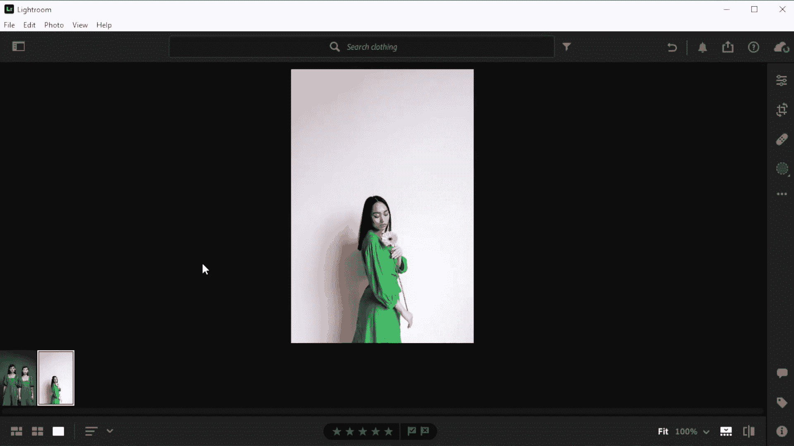

# 完整Adobe Lightroom大课程：P70：服装与颜色调整 🎨

在本节课中我们将要学习如何使用Adobe Lightroom的颜色范围遮罩功能，来改变照片中衣物的颜色。本节内容分为两个实例，第一个实例难度较低，适合初学者快速上手；第二个实例难度较高，因为画面中存在多种相近的蓝色，需要更精细的遮罩操作。通过本节学习，你将掌握如何独立选择服装区域，如何排除背景和皮肤干扰，以及如何调整色相、饱和度和曝光度来获得理想的衣物颜色效果。


## 第一部分：认识颜色范围遮罩 🎯

颜色范围遮罩是Lightroom中用于根据颜色选择特定区域的工具。简单来说，它的作用是让你告诉软件：“请选出所有和这个颜色相近的区域”。如果只选择一种颜色，遮罩效果往往不完整，可能只能覆盖衣物的一小部分。因此，正确的做法是给软件一个颜色范围，让它在该范围内自动识别相关像素。

颜色范围遮罩的核心逻辑可以用下面这个公式来理解：

颜色遮罩区域 = 点击目标颜色 + 拖拽覆盖较大区域 + 细化边缘

在实际操作中，首先需要进入蒙版面板，然后选择“颜色范围”选项。之后你可以在画面中点击并拖拽衣物的大面积区域，让Lightroom了解你想要选取的颜色分布。这样做的好处是避免只抓到天空的一部分，或者只抓到裙子的一小块，而无法覆盖整件衣服。


以下是颜色范围遮罩的基本操作步骤：

```
颜色范围遮罩逻辑：
1. 进入蒙版面板
2. 选择“颜色范围”
3. 在目标区域点击并拖拽
4. 用画笔添加或减去选择区域
5. 开启或关闭自动遮罩
```

- 打开蒙版面板
- 选择“颜色范围”工具
- 在衣物上点击并拖拽，选取大面积颜色区域
- 使用画笔工具进一步细化选择范围
- 根据需要开启或关闭自动遮罩功能


## 第二部分：示例一——简单情况的服装换色 👗

上一节我们介绍了颜色范围遮罩的基本概念，本节中我们来看看如何在简单场景下应用它。这里的第一张图片属于简单模式，因为蓝色连衣裙与背景颜色差异明显，很容易区分出来。

首先打开第一张图片，进入蒙版面板，然后选择颜色范围工具。这时候不要只点击一种颜色，否则只能得到衣物的一小部分区域，而无法覆盖整件连衣裙。为了让选取范围更清楚，可以把叠加层颜色改成绿色，这样蓝色区域会更显眼。

你会发现，如果只随便点一下，可能会把天空也选进去，或者只选到裙子的一小块。这就是为什么这个功能叫做“颜色范围”，因为你需要提供一个颜色范围，而不是单一颜色点。删除刚才的遮罩，重新建立一个颜色范围遮罩，这次直接在连衣裙的大面积区域点击并拖拽，这样软件就能把整件衣服都覆盖到。

此时虽然遮罩已经覆盖了整件衣服，但可能还包含了一些多余部分，比如天空或者模特身后的阴影。我们需要用画笔工具把这些不需要的部分减去。在处理天空和背景阴影时，可以暂时关闭自动遮罩，因为这些区域比较大，不需要精细的边缘检测。

当你靠近衣物边缘或者需要更精确的选择时，就必须开启自动遮罩功能。放大图片，观察衣物边缘，把画笔尺寸调整到合适的比例，这样可以在近距离查看主体的同时，只清除不属于连衣裙的部分。继续用画笔去除多余区域，这次要开启自动遮罩，这样软件能够很好地区分连衣裙和背景，避免误触到衣服本身。

同时也要把头发、脸部、手部以及花朵等不属于连衣裙的部分从选区中排除。缩小画笔尺寸，把所有不需要的地方都涂掉。为了更清楚地看到自己正在处理哪些区域，可以适当提高曝光度，这样手指等细节也能看得更清楚。再进一步放大，检查手部和花朵是否已经完全从选区中分离出来。

选区确定无误后，关闭“显示叠加层”选项，这样就能直接看到颜色变化的效果。先做一个简单测试，降低曝光度，你会发现对比度发生了变化，但只影响了连衣裙，没有影响到其他部分。这是一个重要的检查步骤，确保选区准确，否则可能会把皮肤部分也选进去，导致肤色异常。

仅仅通过降低曝光度，连衣裙就已经呈现出了不同的颜色。接下来我们可以进一步使用“着色”功能，将颜色调整为粉色，并增加饱和度。关闭微调功能后，你可以自由地在色相选择器中移动，找到自己喜欢的亮粉色。不断调整这些设置，直到得到满意的颜色为止。

如果想尝试其他颜色，也可以选择黄色、橙色或者绿色。例如，选择绿色后，可以调整成一种明亮的柠檬绿。一旦确定了颜色，就可以关闭当前设置。


以下是改变衣物颜色的关键参数调整：

- 曝光度：用于测试选区是否准确，降低曝光可看到选区范围
- 着色：为选中的衣物区域赋予新的基础颜色
- 饱和度：控制新颜色的鲜艳程度
- 色相：微调颜色色调，获得更鲜艳或更柔和的效果


接下来我们需要处理背景，使其与新的衣服颜色协调。创建新的蒙版，选择天空区域。当主体在画面中比较独立时，也可以使用“选择主体”功能，然后反选该选区，这样就能只选中背景而不包括人物。将这个蒙版命名为蒙版三，然后执行反选操作。

这样一来，就可以给天空或墙壁添加曝光度，让背景更加突出。调整到合适的程度后，我们就成功改变了主体的颜色。放大图片，关闭显示叠加层，检查是否有多余区域被选中。如果发现有些部分变成了绿色，可以用画笔再次修正。只要这些部分没有变成绿色，就说明处理正确。

至此，第一个示例完成了。下面是修改前后的对比，你可以自由尝试不同的颜色组合，找到自己喜欢的效果。


## 第三部分：示例二——复杂情况的服装换色 👯‍♀️

上一节我们完成了简单情况下的服装换色，本节中我们来看看更复杂的场景。第二张图片中，模特穿着蓝色连衣裙，背景也是蓝色，纹身和眼影也含有蓝色成分，画面中有大量相近的蓝色，这增加了选择难度。

首先，依然可以使用“选择主体”功能，帮助Lightroom确定主体与背景的边界。软件通常能比较准确地找到主体。接下来，针对选中的主体，我们要减去一部分，使用颜色范围工具，在连衣裙上绘制一个小框，以便获取不同深浅的蓝色色调。

开启颜色范围遮罩后，你会发现最初只选中了部分裙子。这时候需要反转这个遮罩，因为之前的操作选中了除了连衣裙以外的所有区域，现在皮肤已经被排除，只剩下连衣裙。除此之外，再次选择蒙版一，再次进行减去操作，这次重点处理头发部分，因为之前可能也选进了一些眼影颜色。

可以关闭显示叠加层，然后重新开启它，清除掉头发以及所有不属于连衣裙的部分。开启自动遮罩功能，在处理中间区域时要确保自动遮罩已开启。如果某些部分属于连衣裙，就只需处理手部、手臂，以及那些也带有一点蓝色的纹身。

进行测试时，可以提高曝光度，观察双手是否仍然完好无损，然后去除中间多余的小部分。这样我们就只对连衣裙应用设置，不会影响头发或其他区域。


以下是复杂场景下的遮罩处理步骤：

- 使用选择主体功能初步锁定人物
- 利用颜色范围选取不同深浅的蓝色
- 反转遮罩，排除皮肤和背景
- 再次减去头发和眼影等干扰区域
- 开启自动遮罩，精确处理手臂、手部和纹身
- 提高曝光度检查选区准确性


在调整颜色时，因为这次处理的是较深的蓝色调，而不是浅色，所以色彩理论就显得尤为重要。例如，加入红色可以使颜色变成紫色，加入绿色可以产生青色，加入紫色则能让颜色更紫。我决定保持当前选择，同时结合上面的色相标签页来获得想要的颜色。

使用色相标签页可以获得更鲜艳的颜色效果。之后可以回到下方设置，降低强度，获得合适的绿色色调。如果我们希望颜色偏向青色一侧，可以相应调整。如果颜色太深或太强烈，随时可以降低饱和度来减弱。

我决定使用这个颜色。选择颜色后，还可以通过增加或降低饱和度来改变该颜色的亮度。我尝试制作一种鼠尾草绿色，虽然不完全是标准的鼠尾草绿，但通过调暗刚才选择的绿色，可以得到一个比较满意的结果。

现在需要处理背景。进入蒙版一，点击三个小点选择复制。在复制的蒙版中，我们只需要反转它，这样就能得到除了人物以外的所有区域。在蒙版一的副本中，删除除了主体以外的所有内容，也就是删除颜色范围和画笔设置，这样就只保留人物，然后简单地反转遮罩。

点击反转按钮后，现在只选中了天空，没有选中模特。因为之前复制时设置已经被应用，现在画面中出现了两名穿着绿色连衣裙的人，站在绿色背景前。不过我们可以简单地通过改变色相，以及调整下方的颜色范围，把颜色改成紫色，并稍微调整一下色相，获得更鲜艳的紫色效果。

就这样，我们得到了紫色，成功使用Lightroom提供的蒙板功能，改变了三件连衣裙的颜色。


## 第四部分：前后对比与总结 📸

关闭面板，查看前后对比。之前的图片是蓝色调，而现在的图片变成了绿色和紫色。在这个过程中，我们没有影响到模特的肤色或妆容。在这张图片中，操作相对容易，因为能够清晰地区分连衣裙和背景。

这就是如何使用Lightroom改变衣物颜色的方法，同样的技巧也可以应用到其他场景中。


本节课中我们一起学习了如何使用颜色范围遮罩来更改衣物颜色。首先掌握了颜色范围遮罩的基本原理，了解了为什么不能只选择一种颜色，而需要提供一个颜色范围。接着通过简单示例，学习了如何选取连衣裙大面积区域，如何使用画笔和自动遮罩精细修剪边缘，以及如何调整曝光、着色、饱和度和色相来获得目标颜色。然后通过复杂示例，掌握了在多种相近颜色存在时，如何结合选择主体、反转遮罩和多次减去操作，分离出衣物区域。最后还学习了如何复制蒙版并反转，来单独处理背景颜色，使整体画面更加协调。




希望你能在下一节课中继续跟随学习，届时我们将探讨如何改变其他物体的颜色，下节课见。

