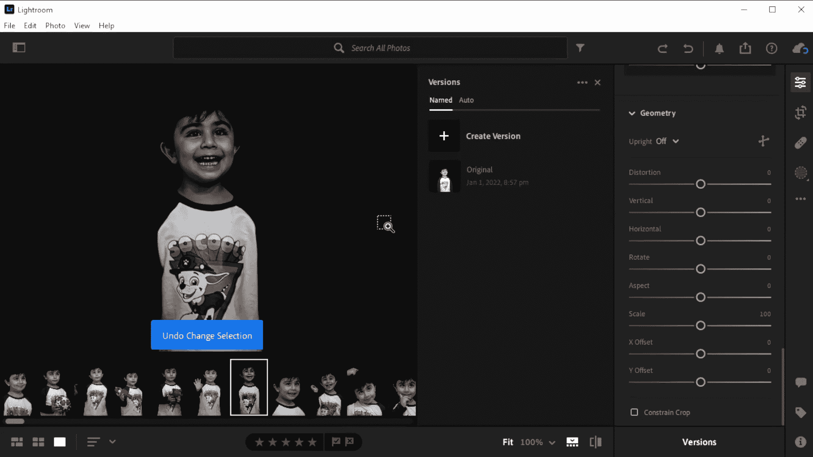
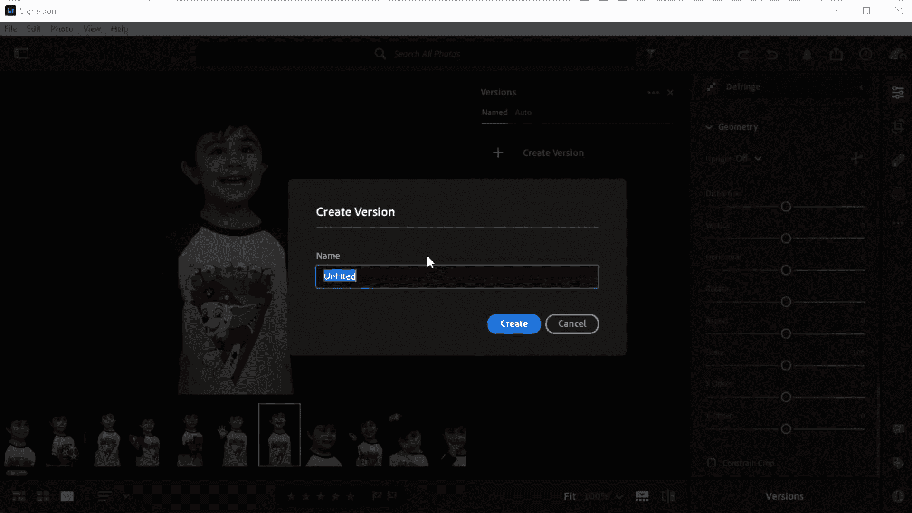
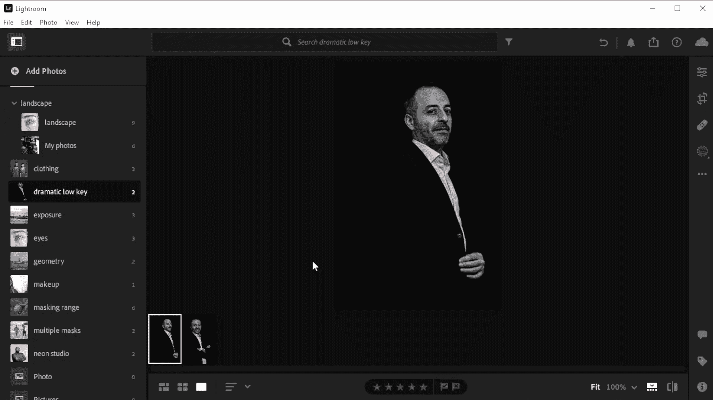

# Complete Adobe Lightroom Megacourse： Beginner to Expert Photo Editing：66：戏剧性低调人像编辑 🎭

## 本节课概述

在本节课中，我们将学习如何使用 Adobe Lightroom 把一张普通人像照片编辑成戏剧性低调风格。戏剧性低调人像的核心思路是把画面整体调得很暗，只保留模特身上的高光部分，同时通过清晰度、纹理等参数把面部细节、皱纹和胡茬都表现出来，营造出严肃、深沉、充满张力的视觉效果。这种风格非常适合商业人像或需要严肃氛围的场景。我们会从一张工作室拍摄的黑底照片开始，逐步调整光影、颜色和细节，最后对比编辑前后的效果。

## 什么是戏剧性低调人像 🖼️

在开始实际操作之前，我们先来聊聊什么是低调摄影，以及戏剧性低调有什么不同之处。普通低调照片通常非常暗，只有模特的高光部分被保留，画面其他区域几乎全黑。而戏剧性低调则在此基础上更进一步，不仅保留高光，还特意强调人物脸上的细节，比如皱纹、皮肤纹理和胡茬，让这些细节在暗背景下格外显眼，从而产生强烈的明暗对比和戏剧张力。

核心逻辑可以用下面的公式来理解：

**戏剧性低调 = 极暗整体曝光 + 仅保留主体高光 + 强化面部纹理与细节**

以下是这种风格的主要特点：

- 画面整体很暗，背景细节可以忽略不计
- 只有模特的高光部分清晰可见
- 面部皱纹、皮肤纹理等细节被刻意突出
- 适合营造严肃、专业或严肃的商业氛围

了解了这些概念之后，我们就可以打开 Lightroom，开始实际编辑第一张照片了。

## 开始编辑第一张照片 🛠️

我们将使用一张在工作室拍摄的照片，拍摄时使用了工作室灯光，背景是一块黑色布料，模特正对着镜头。因为背景很暗，后期编辑时背景里的细节其实并不重要，重点都在人物本身。

以下是具体的编辑步骤：

- **转为黑白**：首先去掉所有颜色，因为戏剧性低调人像通常使用黑白效果。在配置文件面板中选择 Adobe 单色配置文件，图片会立刻变成黑白。你也可以尝试其他配置文件，但默认的 Adobe 单色通常是最合适的选择。
- **降低整体光照**：拖动曝光或光照滑块，让整张图片变暗，直到能清楚分辨手臂和背景的边界为止。
- **调整高光与暗部**：高光不要调得太亮，否则会看不到脸部的细节，需要适当降低。阴影、黑色和白色都要再调暗一些，这样画面会有更多层次感。
- **处理背景**：背景不需要保留细节，只有模特本身重要。背景越暗越好，因为它会自然融入阴影中。
- **点曲线**：在点曲线面板中，再次压暗高光和阴影，让对比关系更强烈，画面更具戏剧感。

调整完基础光影之后，我们需要进一步细化人物细节，这时候就要用到黑白混合器和效果面板了。色温可以保持 Lightroom 自动确定的数值，对黑白照片影响不大。

以下是细节强化的操作要点：

- **黑白混合器**：黑白模式下不再是彩色通道，但仍可以针对不同原始颜色调整明暗。红色对应肤色，可以稍微调暗；橙色是脸部的主要颜色，建议不要碰；如果模特穿蓝色衣服，可以用蓝色滑块把衣服调暗，以突出人物轮廓。
- **效果面板**：跳过色调分级，因为图片已经是黑白的了。增加除雾参数，设为正值 8。然后增加纹理和清晰度，把脸上的胡茬、皮肤纹理都表现出来。注意这会带来一些噪点，但暂时可以接受，后面再处理。
- **细节面板**：增加噪点降低，把大部分噪点去掉。细节参数设为 100，保留效果面板中保留的纹理细节。最后稍微增加一点对比度，画面就会更有冲击力。
- **光学面板**：启用镜头校正，修复镜头畸变。在几何面板中稍微旋转图片，让模特正对着镜头。开启受限裁剪，去掉边缘可能出现的白色区域。

经过这些步骤，一张戏剧性低调人像就完成了。对比编辑前后的效果，你会发现原本普通的照片变得严肃而富有张力，这就是通过改变颜色和细节强度所达到的效果。

## 批量应用设置与第二张照片 📋

有了第一张照片的参数之后，如果第二张照片是在同样的灯光、同一个位置、同一个角度和距离拍摄的，我们不需要重新一步步调整，可以直接复制粘贴设置，节省大量时间。

以下是快速复制设置的方法：

- 在编辑好的照片上按住 Ctrl 键并按 C（Mac 用户按 Command+C）复制设置
- 切换到第二张照片，按 Ctrl+V（Mac 用户按 Command+V）粘贴设置
- 粘贴后只需微调几个地方，比如根据第二张照片的亮度适当提升脸部高光，稍微降低整体亮度
- 几何设置不会自动复制，因为每张照片的构图不同，需要手动旋转并开启受限裁剪

使用这种方法，即使模特在笑或者画面原本氛围比较轻松，这种编辑风格依然可以使用，不需要模特始终保持严肃表情。

## 为什么不适合给儿童照片使用 👶

虽然这种编辑方法效果不错，但并不是所有照片都适合。特别是儿童照片，不建议使用戏剧性低调风格。即使把成人照片的参数复制到儿童照片上，效果通常也不会好。

原因如下：

- 儿童照片的目的通常是展示欢快、年轻、好奇和充满活力的一面
- 儿童脸部没有明显的皱纹或胡茬，强化纹理的效果不明显
- 加上戏剧性黑白处理后，孩子会显得很老，丧失了原本的童真感
- 除非你有特别的创意概念，否则不建议在儿童照片上使用这种风格

如果你想保留儿童照片的活力，建议保持原有的色彩，特别是当孩子穿着有颜色的衣服时，彩色效果会更好，能更好地展现孩子的朝气和能量。

## 使用版本功能对比效果 🔄

最后，分享一个实用的小技巧。在 Lightroom 中，你可以为同一张照片创建不同的编辑版本，方便随时对比。

你可以保留原始版本，也可以保存当前的戏剧性低调版本，然后尝试另一种风格，最后对比看看哪个效果更好。这样可以避免反复撤销和重做，让创作过程更加灵活高效。

## 本节课总结

本节课中，我们一起学习了如何在 Adobe Lightroom 中编辑戏剧性低调人像。从转为黑白、调整整体光照与高光暗部、使用黑白混合器和效果面板强化细节，到启用镜头校正和几何调整，每一步都围绕着让画面更暗、更有对比、更突出人物纹理这一核心目标。我们还学习了如何复制粘贴设置来批量处理照片，以及为什么这种风格不适合儿童照片。这种方法主要适用于工作室黑底拍摄的照片，如果是彩色背景，只需要多处理一下背景即可。希望这些内容能帮助你掌握这种严肃而富有张力的编辑风格，在实际创作中灵活运用。

