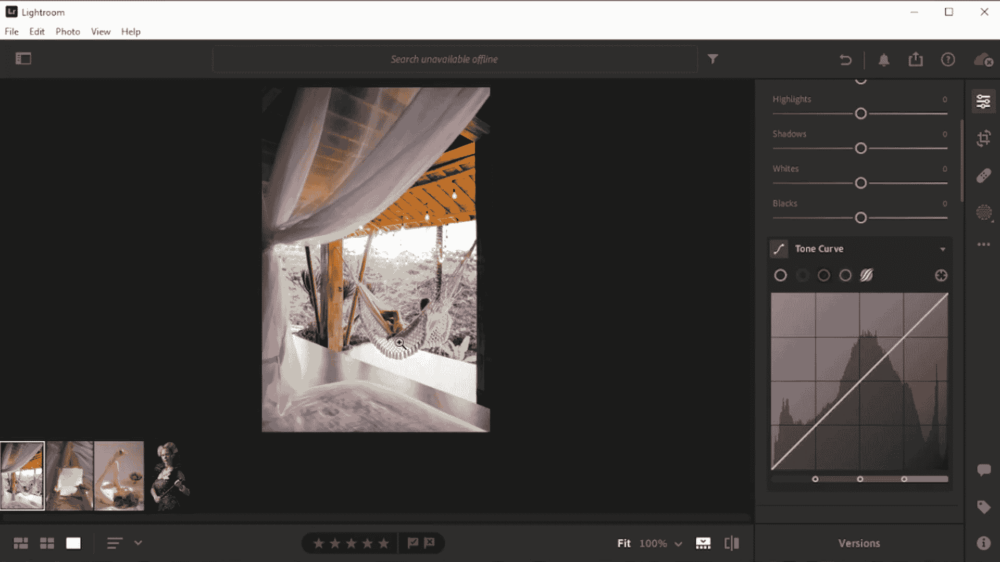

# 🎬 完整Adobe Lightroom大课程：从初学者到专家级照片编辑：p72：Indie Film 风格照片编辑

在本节课中我们将要学习如何使用Adobe Lightroom给照片制作Indie Film风格，也就是独立电影风格。这种风格通常带有褪色的视觉效果，边缘比较柔和，整体看起来像是一段美好的回忆。我们会先介绍Indie Film的基本特征，然后通过两张实际图片演示完整的调色流程，包括光面板、点曲线、颜色混合器、颜色分级以及效果面板的操作。学完这一节，你就能为自己的照片增加怀旧感和电影质感。

首先，我们要明白Indie Film风格到底长什么样，这样才能在调色时有明确的目标。

Indie Film风格的照片通常具有几个明显的特点。首先，图像整体呈现出褪色效果，阴影部分不会太深，亮部也比较柔和，给人一种梦幻的感觉。其次，这类电影往往追求怀旧氛围，所以色彩不会过于锐利，对比度相对较低，整体亮度较高。在调色逻辑上，我们可以用一个简单的公式来表示：

`Indie Film 风格 = 高亮度 + 低对比度 + 柔和阴影 + 暖色调 + 颗粒感`

这意味着我们在Lightroom中不需要刻意加深阴影，也不需要提高清晰度，反而要让画面显得轻盈、通透，像一段美好的回忆一样。

了解了风格特征之后，我们进入实际操作。先来看看如何处理第一张图片的光影部分。

打开Lightroom的编辑面板，选择第一张图片。我们先处理光面板。因为Indie Film风格追求褪色效果，所以我们需要先提亮阴影，让暗部细节可见，同时适当降低对比度，避免画面过于生硬。具体操作如下：

以下是光面板的调整步骤：
- 提亮阴影，使暗部细节清晰可见。
- 微调高光，避免过度曝光。
- 降低对比度，获得褪色的视觉效果。
- 适当增加白色和黑色级别，建立基础色调。

接下来处理点曲线。点曲线可以进一步细化亮部和暗部的表现。我们需要把高光部分稍微压低，让画面更柔和；把暗部稍微提升，避免纯黑出现。操作如下：

以下是点曲线的调整方法：
- 将高光点向右移动，降低亮部亮度。
- 将阴影点稍微下调，保留暗部层次。
- 整体营造出淡出的视觉效果。

光影调整完成后，颜色是Indie Film风格的灵魂，接下来我们处理颜色部分。

Indie Film风格喜欢使用绿色和红色来营造复古感。我们在颜色混合器中先建立基础，然后在颜色分级面板中完成主要效果。

以下是颜色混合器的调整建议：
- 将中间色调稍微偏向绿色，不要过度。
- 将阴影部分也偏向绿色，增加复古色调。
- 将阴影部分偏向红色，平衡整体色彩。
- 根据需要微调紫色，避免出现不自然的紫色边缘。

颜色分级是这套调色方案的核心。我们可以把颜色分级理解为给阴影、高光和中间色调分别上色的过程：

以下是颜色分级的具体参数：
- 阴影：色调介于红色和紫色之间，降低饱和度，提高亮度。
- 高光：色调介于黄色和橙色之间，饱和度适中，亮度调高。
- 中间色调：使用纯红色，降低饱和度。
- 混合和平衡：适当调整混合和平衡滑块，让三种颜色自然融合。

使用颜色分级后，照片会从冷色调变为温暖的怀旧色调，这正是Indie Film风格想要表达的情感。

颜色调好之后，还需要处理图像的纹理和边缘，让整体更加梦幻。

效果面板中的清晰度和去雾是关键。因为Indie Film风格追求梦幻感，所以我们需要降低清晰度，让照片看起来不那么锐利。梦境中没有完美的锐边，照片也不应该太清晰。

以下是效果面板的调整操作：
- 降低清晰度，建议在-50到0之间。
- 降低去雾，避免画面过于锐利。
- 添加颗粒，绿色颗粒是Indie Film常见的选择，数值大约22左右。
- 添加轻微的暗角，暗化边缘，聚焦主体。

光学校正和几何面板通常不需要太多调整。如果照片没有元数据，可以手动选择镜头配置文件，或者直接跳过。几何面板如果图片构图已经合适，也可以保持默认。

完成所有调整后，我们来看看第一张图片的前后对比，然后将同样的思路应用到第二张图片上。

调整完成后，对比一下调整前和调整后的效果。你会发现图片变得更加褪色、梦幻，带有一种独立电影的氛围。这就是Indie Film风格的典型表现。

对于第二张图片，我们不需要从头开始，可以直接复制第一张图片的设置。使用快捷键Control C复制所有参数，然后Control V粘贴到第二张图片上。不过要注意，不同图片的亮度和色彩分布不同，所以粘贴后仍需要做一些微调。

以下是第二张图片需要额外调整的项目：
- 提高高光，稍微降低阴影，以显示头发轮廓。
- 降低对比度，增加白色和黑色级别。
- 在点曲线中，将中间色调偏向绿色，阴影偏向红色。
- 使用颜色混合器调整红色、绿色和橙色，避免肤色过于突兀。
- 降低清晰度，增加梦幻感。
- 调整参数曲线中的亮部，聚焦于脸部光线。

经过这些调整后，第二张图片也呈现出了Indie Film风格的怀旧质感。

学完这两个案例，你可能想知道这种风格适合用在什么样的照片上。

Indie Film风格最适合用于人像照片，尤其是模特穿着复古服装，或者整体氛围比较怀旧的场景。如果你拍摄的是风景照，除非场景本身就带有怀旧感，比如旧建筑、自行车、湖泊等，否则不太建议强行使用这种风格。因为风景照通常需要更多的细节和锐度，而Indie Film风格会刻意模糊边缘，降低清晰度，可能不适合所有场景。

本节课中我们一起学习了如何在Adobe Lightroom中制作Indie Film风格的照片。我们介绍了这种风格的基本特征，包括褪色效果、低对比度、暖色调和梦幻感。然后通过两张图片的实操演示，讲解了光面板、点曲线、颜色混合器、颜色分级、效果面板以及光学校正的具体调整方法。最后还分享了将设置复制到其他图片的技巧，以及适用场景的建议。希望这些内容能帮助你为照片增加电影感和怀旧氛围。下一节课我们将学习历史剧风格的照片编辑。
