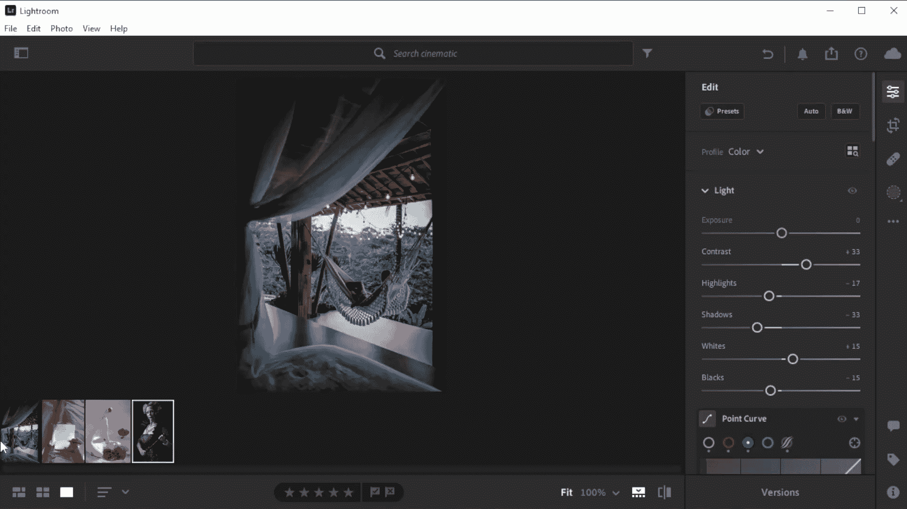

🎬 Adobe Lightroom 零基础到专家级修图全教程：第73课：阴郁电影风格后期调色

在本节课中我们将要学习如何在Adobe Lightroom中打造阴郁电影风格的照片。这种风格在历史剧或戏剧性动作电影中非常常见，整体氛围暗沉严肃，给观众一种压抑和沉重的感觉。我们会通过两张实例图片，完整拆解从明亮温暖的照片转变为冷色调阴郁照片的全过程。无论是调光、调曲线还是调色分级，每一步都会详细说明，让初学者也能跟着操作。

阴郁电影风格与独立电影风格是完全相反的两种思路。独立电影通常追求柔和边缘、暖色调和褪色的阴影，而阴郁风格需要的是强烈的阴影、锐利的边缘和冷色调。我们可以用下面这个简单公式来理解这个核心区别。

`阴郁风格 = 强烈阴影 + 锐利边缘 + 冷色调（蓝色、紫色、绿色）`

我们先来看第一张图片，开始具体的调色操作。

以下是第一张图片在光线面板中的基础调整步骤，这是决定照片整体明暗的第一步。

- 提高对比度，让暗部与亮部的区别更明显，营造深影效果
- 降低高光，压暗画面中过亮的高光区域
- 降低白点，进一步收敛亮部细节
- 调暗黑点，让最暗的部分更加深沉

完成这些基础光线调整后，照片的氛围已经发生了明显变化，变得更加阴郁。接下来我们进入点曲线面板，对暗部进行更精细的控制。

点曲线的核心逻辑可以用下面这个公式来概括，这也是制作S型曲线的基本思路。

`S型曲线 = 暗部下调 + 亮部上升`

具体操作步骤如下：
- 将暗部进一步调暗，突出主体形象
- 添加另一条控制点，制作S型曲线，适当提升亮部明度
- 进入红色通道，将滑块向青色方向移动，抵消画面中过多的红色
- 将阴影部分偏向紫色，使整体色彩达到平衡

光线和点曲线处理完成之后，我们还需要处理参数曲线，这是针对特定亮度区间的精细调整工具。

参数曲线的作用范围可以简单表示为：

`暗部区间：轻微提亮`
`亮部区间：适当调暗`

具体操作如下：
- 暗部：稍微提亮暗部细节，避免全黑丢失信息
- 亮部：适当调暗亮部，防止过曝
- 仅凭光线面板的这些调整，照片已经呈现出相当阴郁的暗沉效果了

光线部分完成后，我们进入色彩面板，这是塑造画面情绪的核心步骤。

色彩处理的基础逻辑可以用下面这个公式来表达。

`色温 → 偏左（冷色偏移）`
`色调 = -8（紫色偏移）`
`自然饱和度 = 8`
`饱和度 = 降低`

阴郁风格的一个重要特点是去饱和。与其他风格不同，我们不是增加饱和度，而是移除饱和度，让人物看起来不那么生机勃勃，也不那么开心。

具体操作步骤如下：
- 色温调至左侧，使画面偏冷
- 色调设为负8，增加紫色色调
- 自然饱和度设为8
- 降低整体饱和度
- 使用色彩混合器逐个处理颜色
- 红色和橙色涉及肤色，需要谨慎处理，稍微调暗即可
- 紫色、深蓝色、青色等颜色适当降低亮度或饱和度

接下来是色彩分级，也就是为不同亮度区间分配特定颜色的过程。这是营造冷色调氛围的关键环节。

色彩分级的颜色分配公式如下，所有选用的颜色都属于冷色调。

`阴影 = 蓝色 + 降低饱和度`
`高光 = 介于蓝色和绿色之间的青绿色`
`中间调 = 紫色`

具体操作如下：
- 阴影：选择蓝色，降低饱和度
- 高光：选择介于蓝色和绿色之间的颜色，降低饱和度
- 中间调：选择紫色
- 混合这些颜色，调整亮度，降低阴影亮度，中间调保持不变
- 降低色彩平衡，使冷色调更加统一

完成色彩分级后，我们进入效果面板和细节面板，进行最后的画面收尾工作。

效果面板的建议设置如下：
- 去雾：根据需要添加，但此图边缘已经较暗，可以不添加
- 清晰度：增加，增强边缘锐度
- 纹理：适当增加
- 颗粒：不添加
- 锐化：可能不需要，可根据实际情况调整

细节面板的操作如下：
- 放大查看细节，确认边缘足够锐利
- 适当增加锐度
- 降低图像噪点

几何面板的操作如下：
- 返回适应视图
- 稍微向左旋转图片0.6度
- 启用受限裁剪

至此，第一张阴郁风格图片的调色就全部完成了。

接下来我们对第二张图片应用相同的阴郁电影调色风格。但需要注意，这张图片比第一张更暗，因此光线设置需要相应调整。

复制设置的具体步骤如下：
- 选择“复制编辑设置”
- 移除光线设置，因为两张图片的亮度不同
- 移除光学设置
- 仅保留颜色、效果和细节设置
- 可以复制配置文件
- 使用粘贴快捷键应用设置

应用基础设置后，我们需要针对第二张图片自定义光线参数。

具体光线调整如下：
- 稍微降低曝光
- 增加对比度
- 显著降低高光
- 降低白点和黑点
- 降低阴影
- 整体画面变得更加暗沉

接下来处理点曲线：
- 进入点曲线面板
- 进一步调暗阴影
- 制作S型曲线，由三个控制点构成
- 进入蓝色通道，将中间调稍微向黄色偏移，避免画面过蓝
- 将中间调略向绿色偏移，达到更平衡的效果

色彩部分的处理如下：
- 色温整体尚可
- 需要降低饱和度
- 使用色彩混合器处理画面中的橙色和绿色
- 橙色过于刺眼，完全移除，使其变得暗淡深沉
- 绿色作为冷色，保留并加深，使其更绿

色彩分级的操作如下：
- 阴影饱和度可适当增加
- 中间调偏向蓝色
- 混合颜色，降低混合度和平衡值

效果部分的建议设置如下：
- 适当增加去雾、清晰度和纹理
- 可以添加一点 vignetting，因为画面中有角落区域

几何部分的操作如下：
- 画面中有相当笔直的柱子，无需调整几何

经过这些调整，原本看起来像温馨度假回忆的照片，被移除了所有温暖和幸福感，变成了阴暗阴郁的画面。

当我们看到这样的场景，会暗示这次度假发生了不好的事情。冷色调传达出更严肃的情绪，而原本的暖色调则暗示这是一次愉快的旅行，当事人非常享受。通过这种色彩分级，这种愉快的感觉就不再存在了。

本节课中我们一起学习了如何在Lightroom中制作阴郁电影风格的照片。我们掌握了从光线面板、点曲线、色彩面板到色彩分级的完整调色流程，并了解了如何将相同风格应用到不同图片上。

这种阴郁冷色调的调色方式适合扮演严肃冷酷角色的cosplay照片，也可以用于万圣节主题图片，增加恐怖氛围。通过合理运用蓝色、紫色和绿色等冷色调，并降低饱和度，我们可以有效地改变照片的情绪表达，让观众感受到我们想要营造的严肃氛围。

好了，本节课内容就到这里。我们将在下一节课见。
