# Adobe Lightroom 零基础到精通修图教程：p74：冰封风景 🏔️


在本节课中，我们将要学习如何处理下雪天拍摄的风景照片，打造一种被称为“冰封风景”的冷色调视觉风格。这节课适合完全没有修图经验的新手，也适合已经掌握基础操作的学员。我们会把整个后期流程拆解成很多小步骤，每一步都会用大白话解释清楚，确保你看完之后能够独立完成类似的调色效果。


## 一、什么是冰封风景


当我们面对一张下雪天的风景照片时，首先要意识到这明显是冬季场景。如果我们想要营造温馨的冬日氛围，就可以使用一种叫做“冰封风景”的后期处理方法。所谓冰封风景，指的是在普通风景修图的基础上，额外增加一种冰冷的质感。它的核心思路可以用下面的公式来理解：

```text
冰封风景 = 普通风景修图 + 增强冷色调 + 突出蓝色 + 制造色彩对比
```

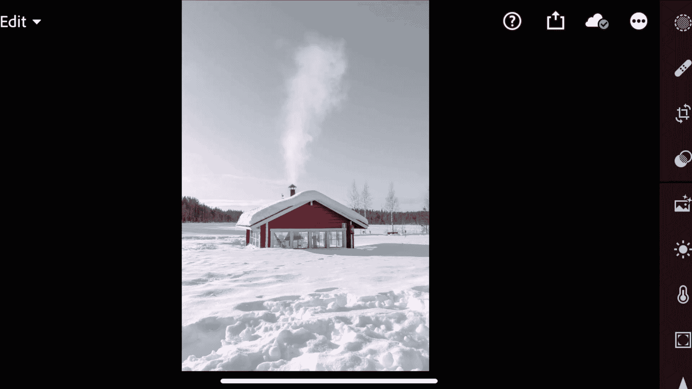

具体操作时，我们不仅要像处理普通风景照一样调整光影，还要刻意强化画面中的冷色感觉，尤其是蓝色部分。我们会尽量让某个颜色脱颖而出，避免相近的颜色挨在一起造成视觉混乱。这样处理之后，照片会呈现出一种干净、清冷又略带故事感的冬日氛围。这个方法不需要复杂的插件，只需要 Lightroom 自带的基础面板就能完成，非常适合初学者快速上手。


## 二、拍摄时的构图思路


这张示例照片非常适合演示冰封风景的风格。在户外徒步拍摄时，不要只拍摄单调的雪地和天空，而应该寻找能够在画面中制造对比的元素。原作者在图片正中央放置了一座红色的房子，这就是利用色彩搭配来吸引观众注意力。

如果没有这座房子，画面可能只有蓝色天空和白色前景，颜色过于单一。而现在，正中央有一个鲜艳的红色主体，这让照片变得很特别，也更容易让观众产生共鸣。下面是我们在后期中要重点保留和强化的几个要素：

- 画面中心有一个鲜艳的红色房子，作为视觉焦点
- 背景是蓝色的天空和白色的雪地，营造冷色基调
- 红色与蓝色、白色形成强烈的冷暖对比

理解了这个构图思路后，我们就知道后期调整时应该保护哪些颜色，以及需要加强哪些对比关系。在实际拍摄中，你也可以多留意画面里是否有红色、黄色或其他暖色主体，这样在后期制作冰封风景时会更容易取得好效果。


## 三、基础光影调整


接下来我们进入 Lightroom 的编辑流程，先对光影进行基础处理。点击右上角的太阳图标，进入“光照”面板。我们的目标是让照片看起来像是在白天拍摄的，并且能够感受到寒冷的天气，同时还原摄影师当时的拍摄感受。

调整原则是不要让画面变暗，也不要去除已经存在的高光部分，而是要平衡整体明暗，尽量保持原貌。具体的滑块操作如下：

```
【光照面板】
对比度：适当增加
阴影：提亮
高光：微调，以获得蓝色天空
白色：稍微降低
黑色：适当增加
```

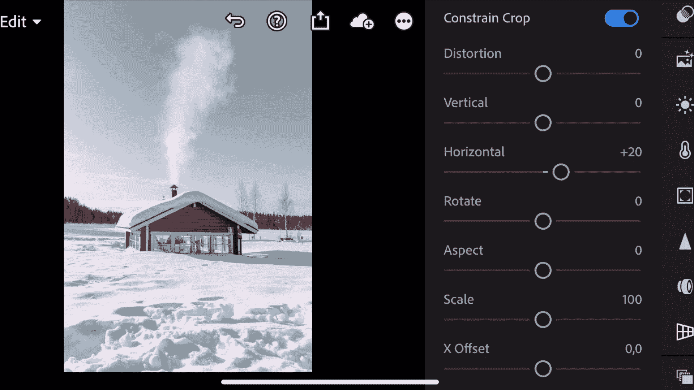

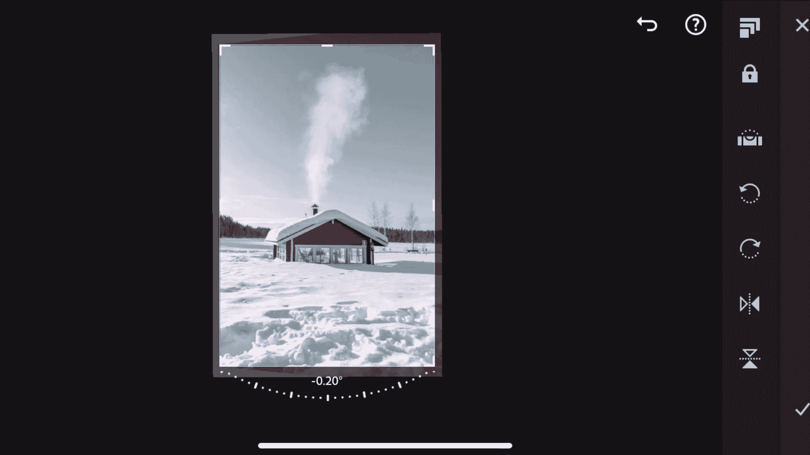

- 对比度：适当增加，让画面更有层次
- 阴影：提亮，让雪地中的暗部细节可见
- 高光：微调，以获得想要的蓝色天空
- 白色：稍微降低，防止过曝
- 黑色：适当增加，增强暗部厚度

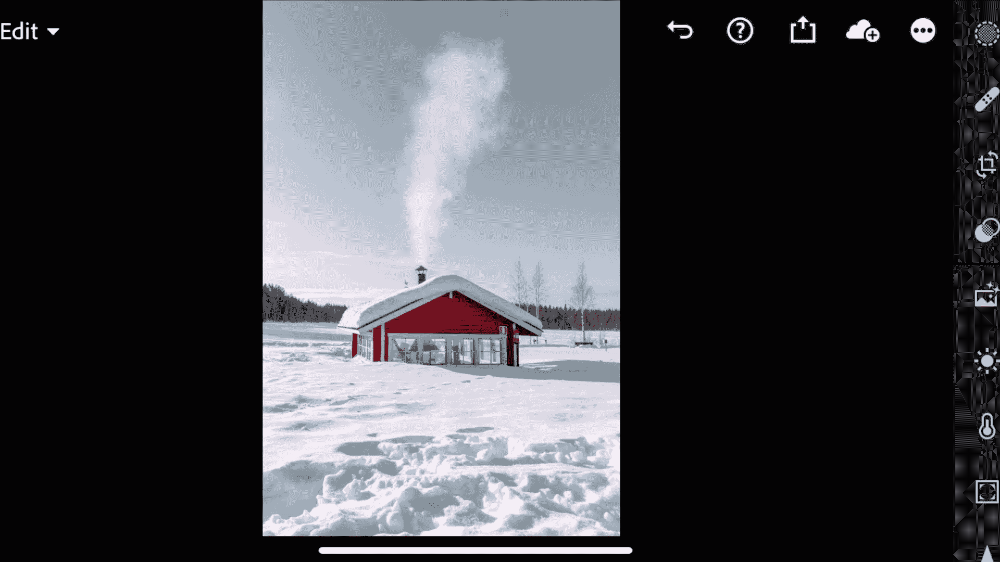

完成光照调整之后，我们进入“效果”面板。你可以看到照片表面有一层轻微的雾气，使用“去雾”工具可以让画面变得更清晰、更鲜艳。将去雾滑块向右拖动，大约调到 22 左右，直到你满意为止。然后再添加少量的清晰度，但不要调得太高，否则会产生不自然的阴影效果，还会影响房子那抹鲜艳的红色。

关于暗角，通常我们会向左拖动滑块来制造暗角效果，但这次我们希望照片保持原本的样子。由于图片边缘有一些过暗的区域，我们将滑块向右拖动，创建一个白色暗角，以平衡边缘的暗部。如果需要，也可以调整羽化参数让过渡更自然。


## 四、细节与透视校正


进入“细节”面板后，我们放大图片检查是否需要添加降噪。在这张照片中，细节已经非常锐利，我不认为需要额外处理噪点，因此这一步可以跳过。

接下来是透视校正。点击透视图标，并开启“受限裁剪”选项。开启之后，如果画面边缘有多余的空白区域，可以立即去除。观察原图可以发现，照片轻微向一侧倾斜了。我们使用水平滑块，将其向右拖动，然后启用受限裁剪，就能看到画面看起来更正了。这是调整前的效果，这是调整后的效果，图片整体向我们倾斜了一些。

我们也可以使用垂直滑块来进一步微调，但目前效果已经令人满意，所以我不打算继续修改。接着进入裁剪面板，由于之前启用了受限裁剪，画面已经自动进行了裁剪。点击直尺图标，你会发现图片自动根据屋后的直线进行了旋转，也就是雪地和树木之间的地平线。如果不需要这个自动校正，可以点击撤销自动校正功能。

点击对勾确认后，我们可以继续进行曲线调整。


## 五、曲线与颜色校正


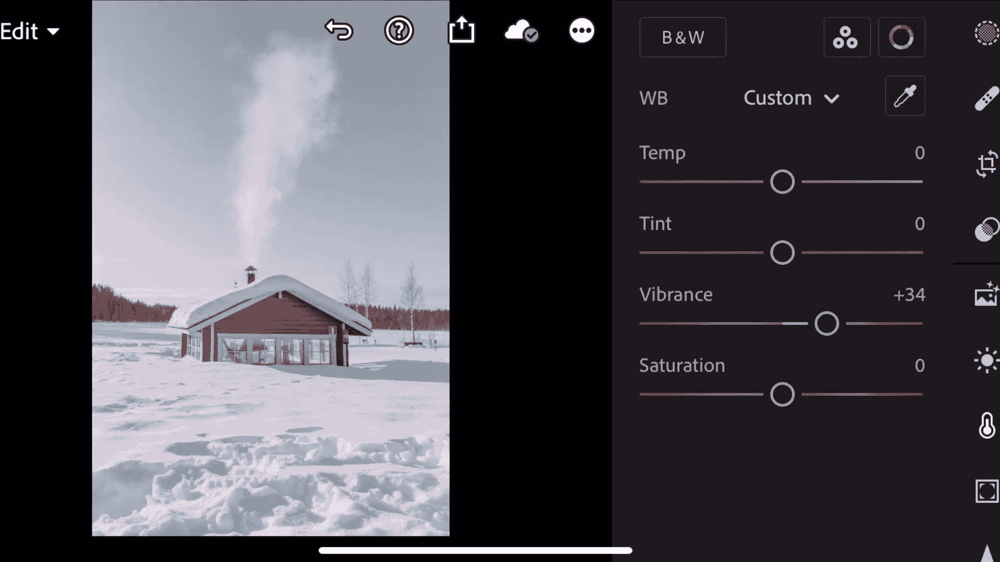

点击太阳图标，进入“曲线”面板。我们先对阴影部分稍微提亮，方法是拖动最下方的圆点向上移动。然后通过调整中间调来增加对比度。如果向上拖动，画面会变亮，但我们希望将其稍微拉回中心，做一点点变暗的处理，同时调暗高光部分，以保持整体画面的平衡感。

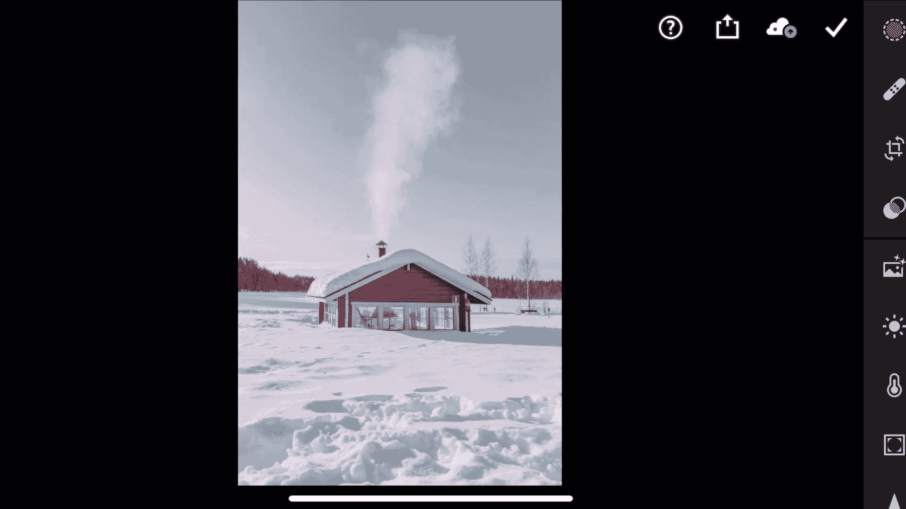

调整完成后点击完成。此时我发现图片偏绿，于是进入绿色通道，通过加入品红色来去除部分绿色，使色彩更中性。

完成曲线调整后，进入“颜色”面板，也就是“光照”面板下方的模块。先增加自然饱和度和饱和度。然后进入“颜色混合”模块，我们从红色开始：

- 红色：提高饱和度，色相向红色方向增加八个点，使颜色从偏橙变为更纯正的红色，并稍微降低亮度
- 蓝色：提高饱和度，调暗天空，但不要过度否则会出现画面故障，将亮度提高以获得浅蓝色效果，色相偏向青色，以便与红色房子形成良好的搭配
- 绿色和橙色：背景中的树木原本被识别为橙色，我们先不处理，稍后会使用蒙版工具单独调整

完成这些全局颜色调整后，为了便于后续对树木进行局部润色，我们需要先导出图片，然后重新导入到 Lightroom 中继续编辑。


## 六、局部调整：为树木上色


导出完成后，返回资料库重新导入这张图片，回到相同的编辑面板。现在我们需要对画面背景中的树木进行局部调整。点击修复工具上方的加号，先放大图片，然后调出画笔工具。

虽然 Lightroom 提供自动选区功能，但因为树木的形状比较复杂，使用画笔效果更好。如果是塔之类的简单形状，可以使用其他自动选项。这次我们需要仔细涂抹背景中的树木区域，不需要追求完美，因为后续可以调整羽化参数让边缘更自然。如果不小心选到了其他主体，也不要担心，我们可以用橡皮擦工具修正。

我们的目标是将这些深绿色的树木改成偏红橙色的颜色。之所以这么做，是因为图片另一侧已经存在一些灰色和橙色的树木，这样修改后能与原始场景更协调。如果原始照片本身就是非常清新的绿色，那么强行改成橙色就会显得突兀。

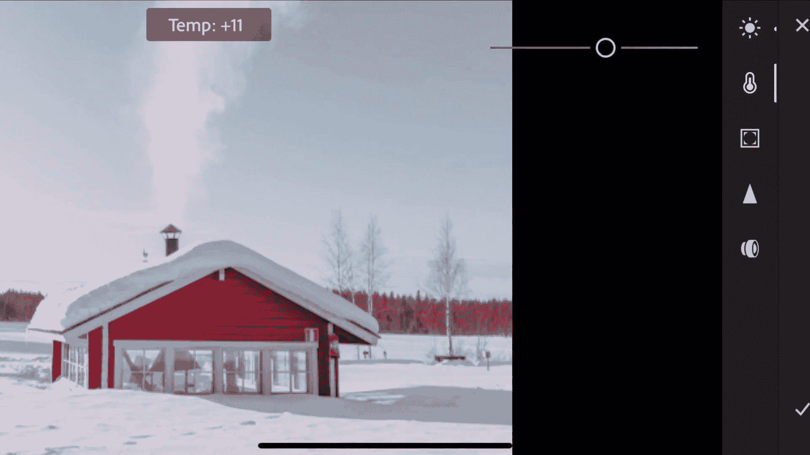

使用橡皮擦工具，我们需要从选区中移除不应该着色的部分，包括挡在森林前面的树木、树顶上的积雪，以及房子的屋顶。我们绝对不希望出现橙色的雪。缩小画笔尺寸，仔细涂抹这些区域，然后擦除掉误选的树木部分。完成一侧后，处理另一侧，轻轻点击几下，选区就完成了。

如果发现颜色溢出到了不应该的地方，随时可以回来用橡皮擦从选区中移除。然后进入温度滑块或颜色滑块，将色相改为橙色。增加饱和度，添加一些橙色或黄色，根据个人喜好选择，然后适当降低或提高饱和度，直到看起来自然。我们还会稍微增加温度，以获得温暖的橙色效果。

完成后点击对勾，放大检查是否有不想要的区域，使用橡皮擦工具去除过于鲜艳的紫色区域，给画笔增加羽化并降低流量，让擦除效果非常轻柔，避免出现大面积的去饱和色块，使整体过渡柔和自然。


## 七、修图清理与细节修补


在这一步，我注意到画面中还有一些不希望出现的物体，于是使用修复工具进行清理。比如画面中的某些小物体比较容易去除，缩小画笔尺寸，涂抹目标区域，然后将参考点拖动到合适的位置，软件就会自动采样周围纹理进行修复。

有些区域可能比较棘手，比如这里有一部分树枝被误选，我们尽量避开树木本身，寻找合适的参考点。如果处理起来太耗时，也可以暂时放弃，先保留原貌。除此之外，我还发现画面中有一个标志牌和一个灯，使用画笔工具做精确选区，点击对勾，然后缩小视野检查整体效果。

接下来使用画笔工具选取需要变暗的区域，进入光照部分，降低曝光度，增加对比度，降低高光和白色。使用同样的轻柔画笔擦除不必要的区域，创建新的修复点，涂抹目标区域并调整参考点，直到选区效果合适。我们还需要再做一个选区，使用下方的参考点，以匹配深红色区域。

为了获得更好的修复效果，我画了一条直线并将其向下拖动。处理完这些点位后，画面看起来已经好很多了。虽然在手机上进行这些精细操作比较困难，但目前效果已经可以接受，我们暂时先到这里。


## 八、全局色彩分级与最终润色


缩小视野，整体效果已经相当不错，我们已经拥有了那种冷冽的质感。进入温度滑块，再增加一点冷色调。因为之前导出过图片，温度滑块的影响现在比较轻微，不如之前强烈。

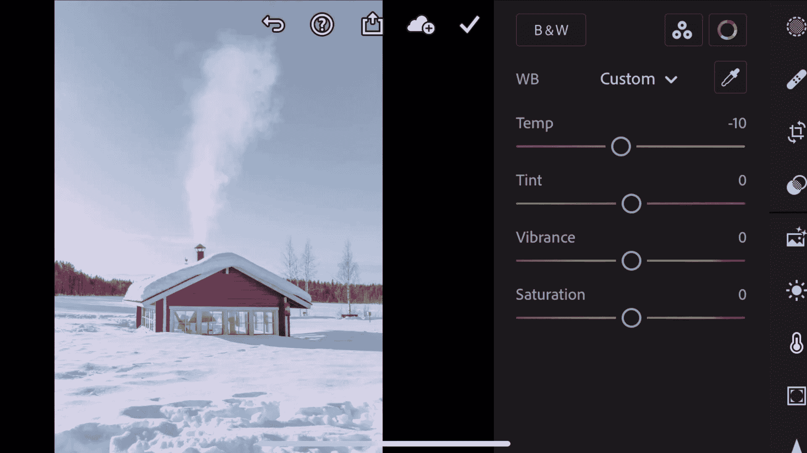

接下来进行颜色分级。在全局颜色分级面板中，我们给阴影部分添加漂亮的蓝色效果，或者可以使用不同的滑块分别调整。我们为阴影添加冷色并调整饱和度。对于中间调，我选择暖色来平衡整体画面，这样可以避免出现单调的蓝色覆盖层。对于高光部分，同样选择蓝色。完成颜色分级后，画面看起来好多了。核心参数可以参考下面的设置：

```
【颜色分级】
阴影：蓝色 + 饱和度
中间调：暖色 + 平衡
高光：蓝色
```

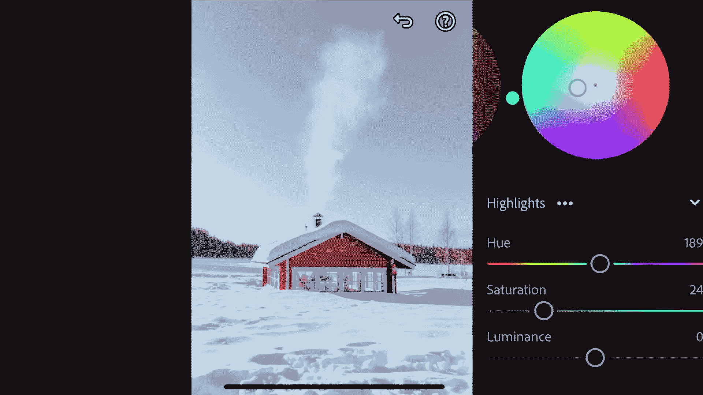

最后再增加一点对比度，然后通审一遍之前的所有调整，确保在完成编辑之前一切完美。我发现图片看起来不够正直，稍微调整一下，效果会更好。

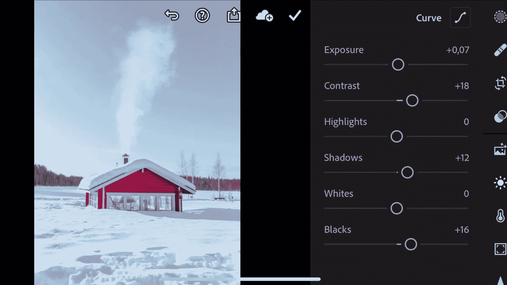

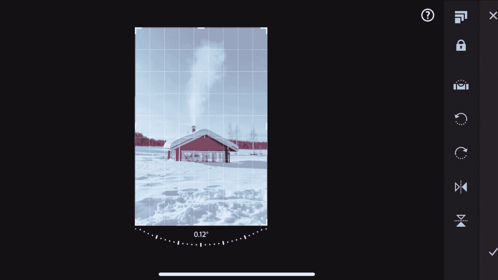

由于画面看起来有点暗，我们再次进入曲线面板，将暗部区域稍微提亮。完成之后，这张照片的编辑工作就全部结束了。


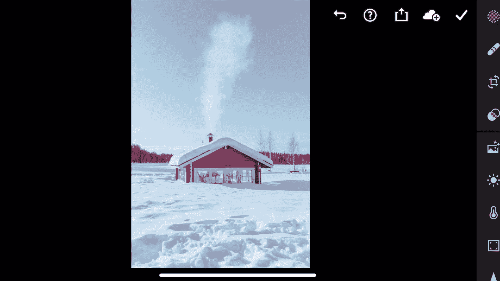

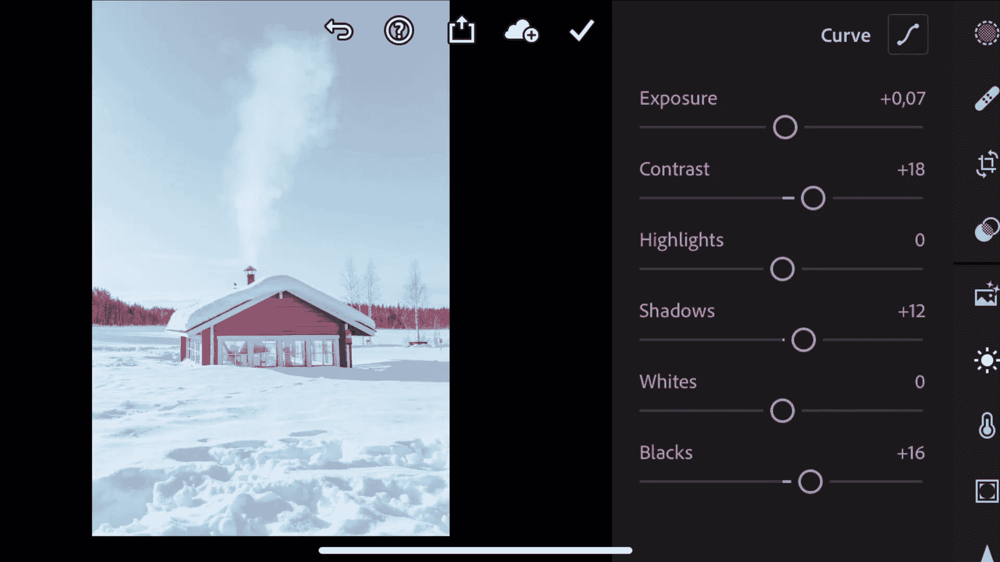

## 九、总结


希望你喜欢这一课。整个流程其实非常简单，我们成功打造了一种温馨的冰封风景效果，同时也加入了一点复古氛围。因为画面正中央有一座小屋，它给人一种来自旅途的美好回忆感，也许是一次家庭旅行。我们让画面稍微有些褪色和温暖，但依然保留了之前讨论的冷色调。

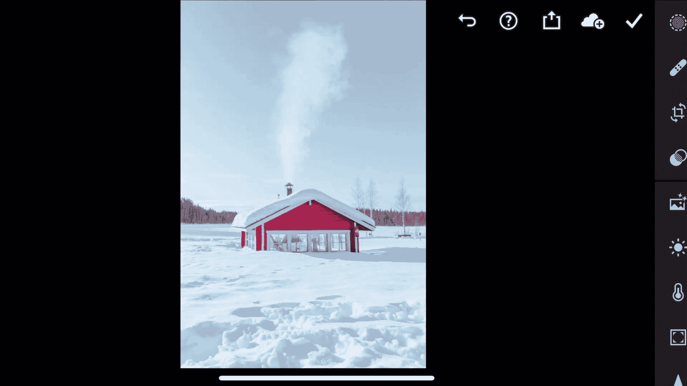

我们的目标是还原摄影师当时所处的场景，展示这是一个寒冷的日子，有大量的雪，天空晴朗，光线明亮。我们已经成功重现了那个场景，希望你喜欢这节课。我们下一课见。


