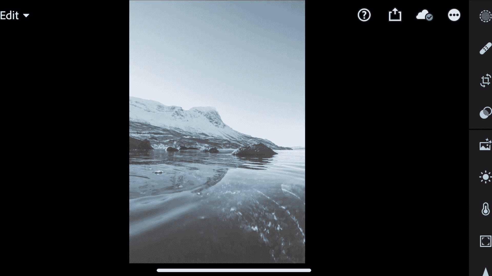
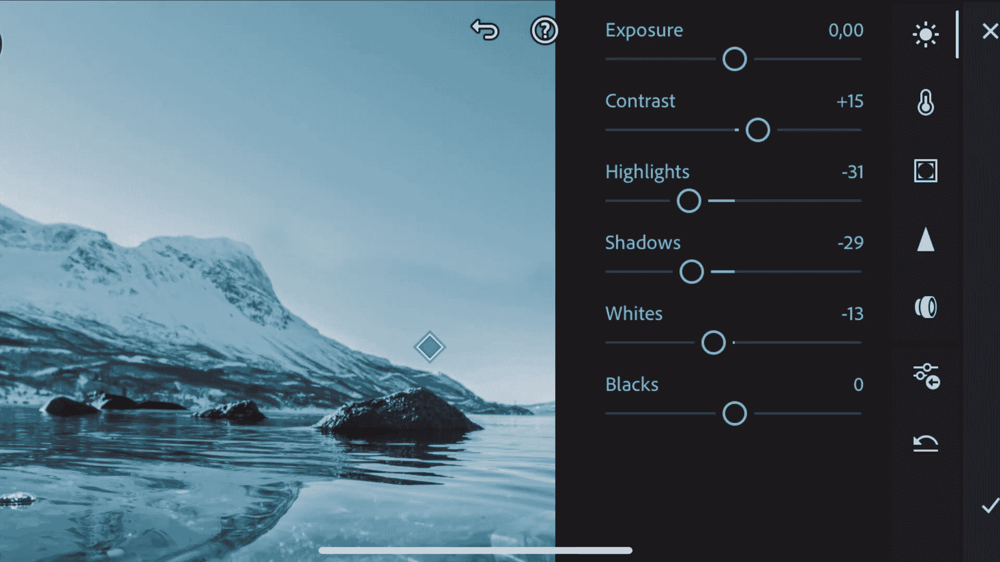
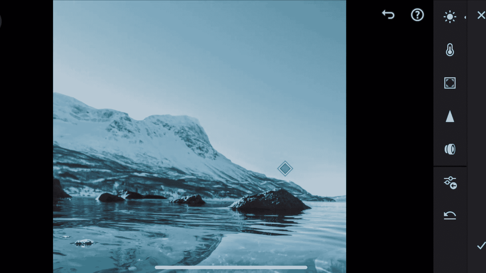
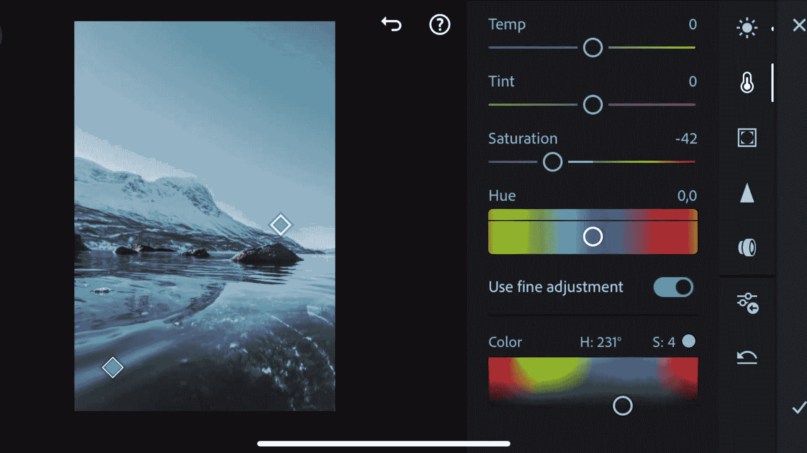
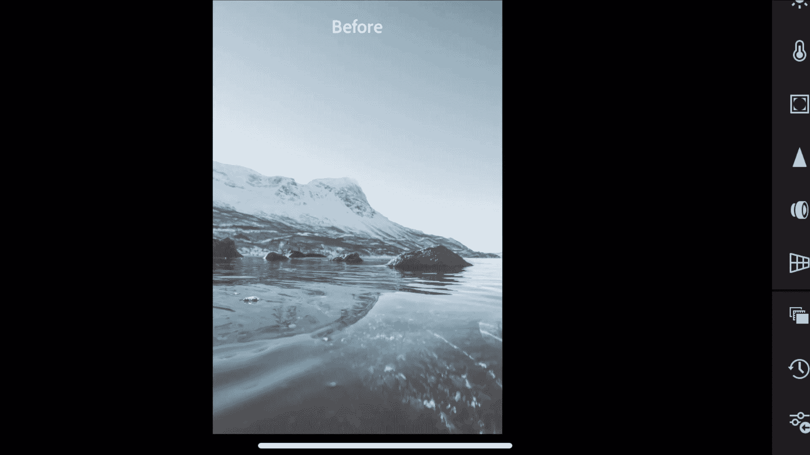
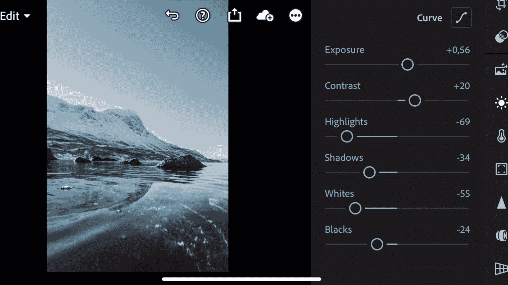

📸 Complete Adobe Lightroom Megacourse： Beginner to Expert Photo Editing：70：冰封风景后期处理（第二部分）


在本节课中，我们将继续学习冰封风景照片的后期处理方法。这是“冰封风景”系列的第二部分，主要面对的是画面中没有特别突出主体、各个部分的颜色和色调都非常相似的照片。我们会学习如何通过调整光影、色温和局部蒙板，在天空、山脉、岩石和水面之间建立清晰的对比关系，让原本看起来平淡、发白的照片变得干净、锐利且富有层次感。无论你是刚接触 Lightroom 的初学者，还是希望提升风景照调色能力的学习者，本节课都会用最直白的语言，带你走完从基础面板到最终导出的完整编辑流程，确保每一个步骤都能听得懂、学得会。




本例中的照片是一张典型的冰封风景图，但和第一个例子不同，这张图里并没有一个非常显眼的主体来吸引观众的注意力。画面中绝大部分区域的颜色都非常接近，天空、山脉、岩石和水面之间缺乏明显的视觉区分度。要想把这张照片调出好效果，唯一可行的办法就是在这些元素之间制造对比关系。也就是说，我们需要分别处理天空、山脉、岩石和水面，让它们在视觉上各自独立、容易辨认。接下来的工作重点将放在图像的光影处理上，而不会像第一个例子那样花太多精力在颜色调整上。因为原本的颜色和色调已经很相似了，如果再随意改动颜色，反而会让画面显得更加混乱。除了修复整体光照，我们还需要还原摄影师当时拍摄时的场景氛围，让观众感觉到那是一个寒冷、明亮、可能是在清晨的时刻。要实现这个效果，关键在于调整图像的色温。下面我们就正式开始操作。


首先我们进入 Lightroom 的“基本”面板，开始进行全局光影调整。以下是具体的调整步骤和操作方向：

- 提高曝光度，让整个画面整体变亮一些。
- 增加对比度，让明暗区域之间的差别更加明显。
- 降低高光和白色阶，这样可以找回天空中的细节，避免天空过度曝光。
- 降低阴影和黑色阶，进一步增强天空的层次感和整体对比。


做完这些调整后，你会发现照片已经不再显得发白或褪色，画面中出现了清晰的对比关系，天、山、石、水之间有了初步的区分度，整体看起来不再是一片模糊的浅色调。


完成基本面板的光影处理之后，我们转到“曲线”面板来进一步塑造画面的明暗结构。以下是曲线调整的具体思路：

- 把暗部压低，让阴影区域变得更深更有质感。
- 稍微降低高光，防止亮部看起来过于生硬或刺眼。
- 同时把中间调也调暗一些，增强整体的收敛感。


我们要追求的是一种干净利落的视觉效果，让照片里的每一个元素都能轻易地被看清，避免出现模糊不清的过渡区，从而为后续的颜色调整打下坚实基础。


光影和曲线调整完毕之后，我们开始处理颜色。由于这张照片本身已经偏冷，如果再把色温往暖色方向推，画面看起来会像是在下午拍摄的，阳光会显得不足，这不符合我们想要营造的清晨寒冷感。所以我们只需把色温保持在大约负六的位置，不需要做大幅度的改动。如果需要，可以加一点品红色调，用来抵消我们刚才增加的蓝色，让画面色彩更自然。接下来提升自然饱和度，让颜色稍微鲜艳一点，但普通的饱和度暂时不碰，先保持原样，避免画面显得过于艳丽。


颜色调整的下一步是使用“颜色混合器”来针对特定色彩进行精细控制。以下是蓝色和青色的处理方法：

- 处理蓝色：把色相往青色方向调，具体做法是把色相滑块向左拖动；同时把亮度降低到负八左右。
- 处理青色：改变色相，增加饱和度，降低亮度。


颜色选择时，左右滑块是在改变色相，上下滑块是在改变饱和度，可以用下面这个简单的逻辑来理解：



```
左右移动滑块 = 改变色相
上下移动滑块 = 改变饱和度
```




这样一来，原来的深蓝色就变成了青色，天空和水面的色调就与山脉和岩石形成了明显的区别，画面不再是单一的蓝色调，各个部分的颜色关系变得更加清晰。


颜色混合器调整好之后，我们进入“效果”面板，进一步提升画面的质感和氛围。以下是需要进行的操作：

- 加一点去雾，让画面整体更清晰、更透彻。
- 处理晕影，这里我选择把晕影调到正十一，也就是给画面四个角加上一点白色，而不是黑色，数值不要设得太高。
- 增加清晰度，把照片里的纹理细节表现出来。
- 适当添加一些锐化，放大图像检查是否需要进一步调整。
- 做一点噪点降低，主要使用色彩噪点降低，数值不需要太大。


缩小视图检查一下，目前的效果看起来已经不错了，各个元素之间的层次感已经初步建立，可以继续进行下一步的构图调整。


效果面板处理完之后，我们来看“透视”面板，调整画面的构图和几何形状。我会把图像稍微向侧面移动，并启用受限裁剪，因为原图有点倾斜，我不希望它看起来太正太呆板。接下来旋转图像，直到出现一条直线，让地平线或山脉线更自然。然后处理垂直透视，把画面稍微向远离观察者的方向推一点，增加空间感。考虑了片刻后，我觉得裁剪不是必须的，所以就不再做裁剪操作了，保留原有的画面范围。




调整完透视之后，我们还需要处理天空部分。你可能会注意到山脉周围有一圈白色光晕，看起来像是太阳发出的光，但问题在于这个光晕同时出现在右侧和左侧，这在光照逻辑上说不通。我们希望光线只从左侧照射过来，这样才符合自然的光照方向。为此，使用蒙板工具先建立一个点，先放大图像方便观察细节。然后选择画笔工具，调整合适的尺寸，沿着山脉轮廓进行涂抹。因为我想让太阳位于左边，所以只在右侧进行涂抹，同时也可以稍微覆盖到山脉上一点，以及其他觉得太亮的区域。涂抹完成后，回到基本面板，对这个蒙板区域提高曝光度，增加对比度，降低高光。如果边缘比较生硬，就用橡皮擦工具轻轻擦除，把画笔调大一点，让边缘更加柔和。最后点击对勾确认，回到蒙板选择界面，完成对天空光晕的局部修正。


蒙板处理完之后，我们还需要调整水面的颜色，因为现在的水面和山脉颜色太相似，视觉效果不太理想。再次启用调整画笔，选择合适的画笔尺寸和羽化程度，然后在水面上进行涂抹。涂抹的时候记得放大图像，把岩石和山脉从选区中排除出去，因为我们不想让它们也变成蓝色。如果你对自己图片的颜色已经满意，这一步其实是可选的，可以直接继续后面的编辑流程，不必强行修改。水面处理完成后可能会看起来有点发红，暂时不用担心。你可以降低饱和度让水面看起来更清澈，或者提高饱和度让它看起来更结冰；也可以增加色温，表现阳光在水面上反射。我决定保持中性，去掉色温，只降低饱和度，这样水面和山脉之间就会有明显的区别。关于色相，如果你想的话也可以改变，但不要让水面变成紫色。找到合适的颜色后，就上下微调来控制该颜色的饱和度。整个调整只有四个点，调整完成后点击对勾确认，完成水面颜色的处理。




颜色调整全部完成之后，我们可以检查一下配置文件，看看有没有哪个预设比较合适。我会翻阅一下列表，找到自己喜欢的风格。比如说我比较喜欢 Mo 系列，于是调整该配置文件的强度。我也试一下其他的，最后决定使用 Mo7，并相应地调整强度。这时候你会发现，水面、岩石、山脉和天空之间的差别变得很明显，照片不再是单一的蓝色调子，我们可以轻松地区分出每一个元素，整体画面的辨识度大大提升。




配置文件调整好之后，我们来看看最终的前后对比效果。按住图片查看原图，这就是修图前的样子，放开就是修图后的样子。由于整体画面稍微偏暗，看起来有点像下午的光线，所以我最后把曝光度稍微提高一点，让它看起来更像白天的明亮光线，使整个场景更符合清晨明亮的氛围。


这就是本节课的第二个冰封风景示例。再次强调，如果画面里有一个突出的主体，比如有人站在岩石上，构图会更好。但即便没有，我们也能通过刚才学到的技巧，把这样的照片调得相当出色。希望大家喜欢这一节课，整个过程非常简单，使用的也是比较容易上手的方法。我们下节课见。


