# Adobe Lightroom 从入门到精通大师班 第一部分：第76节：灰色宝丽来风格照片编辑 📸


在本节课中我们将要学习如何使用Adobe Lightroom制作灰色宝丽来风格的照片。这种风格在社交媒体上非常流行，很多名人也喜欢用这种方式来处理他们的照片。核心思路其实很简单，就是把照片中的阴影部分调成灰色，降低整体颜色的饱和度，最后再叠加一个宝丽来相框效果。即使你从来没有用过宝丽来相机，也不用担心，只要跟着本节课的步骤操作，很快就能掌握这种复古又时尚的调色方法。

## 第一部分：认识灰色宝丽来风格 🎨

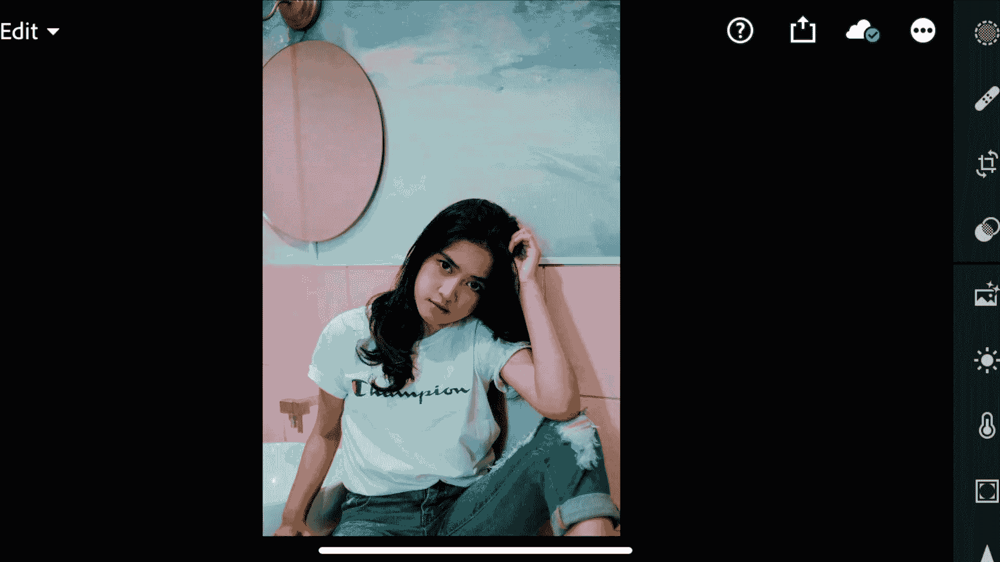

在正式开始编辑之前，我们先来了解一下这种风格的特点。灰色宝丽来风格之所以受欢迎，是因为它能让照片看起来像是用旧式相机拍摄出来的，整体色调偏冷，阴影呈现灰色，色彩不过于鲜艳，带有一种淡淡的怀旧感。我们将通过两个实际示例来学习，第一个示例是一位女士的肖像照，第二个示例则是颜色更少的场景，这样你可以看到同样的风格在不同照片上的表现。

以下是灰色宝丽来风格的核心要点：

- 阴影处理：将阴影调整为灰色
- 颜色处理：降低饱和度，但不完全变成黑白
- 画面效果：添加晕影、颗粒和降噪，模拟旧式相机效果

## 第二部分：第一个示例图片的基础光线调整 💡

上一节我们介绍了灰色宝丽来风格的基本概念，本节中我们来看看如何在Lightroom中实际操作。我们使用的第一张图片是一位女士的照片，素材来源于像素网站。在开始调色之前，我们需要先处理图片的光线部分，因为光线是后续所有调整的基础。

第一步是进入光线面板，找到那个类似太阳的图标，然后进行基础的光线参数调整。

以下是光线面板需要调整的参数：

```text
光线面板调整公式：
对比度 → 增加
高光 → 降低
阴影 → 增加（趋近灰色）
白点 → 增加
黑点 → 降低
```

- 对比度：增加，让阴影更加明显
- 高光：降低，保留更多阴影细节
- 阴影：增加，使阴影颜色趋近灰色
- 白点：适度增加
- 黑点：适度降低

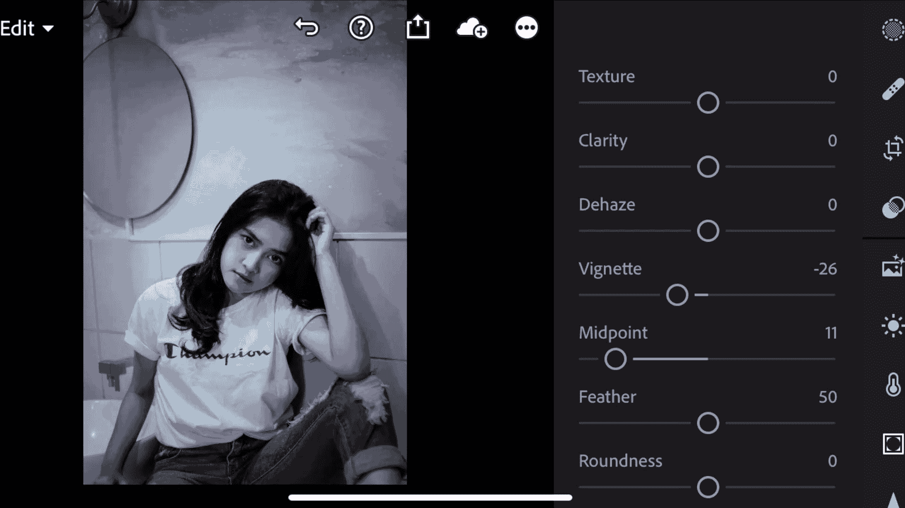

调整完成后，你可以对比一下修改前和修改后的效果，会发现光线对比度明显增强，阴影部分也更加突出，这正是我们想要的结果。

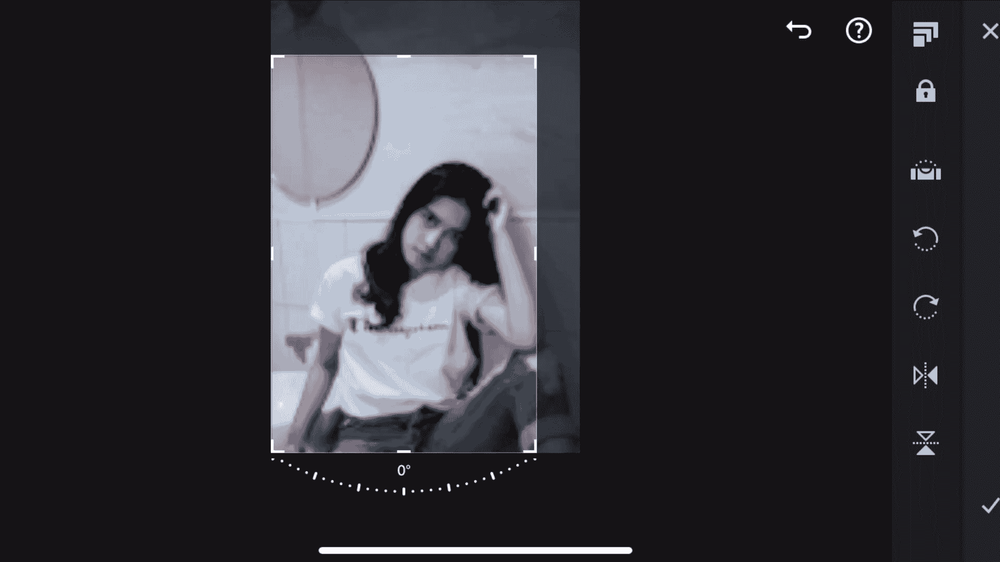

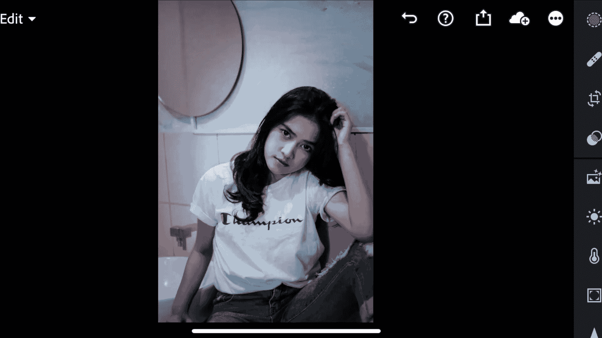

## 第三部分：颜色与色温调整 🌈

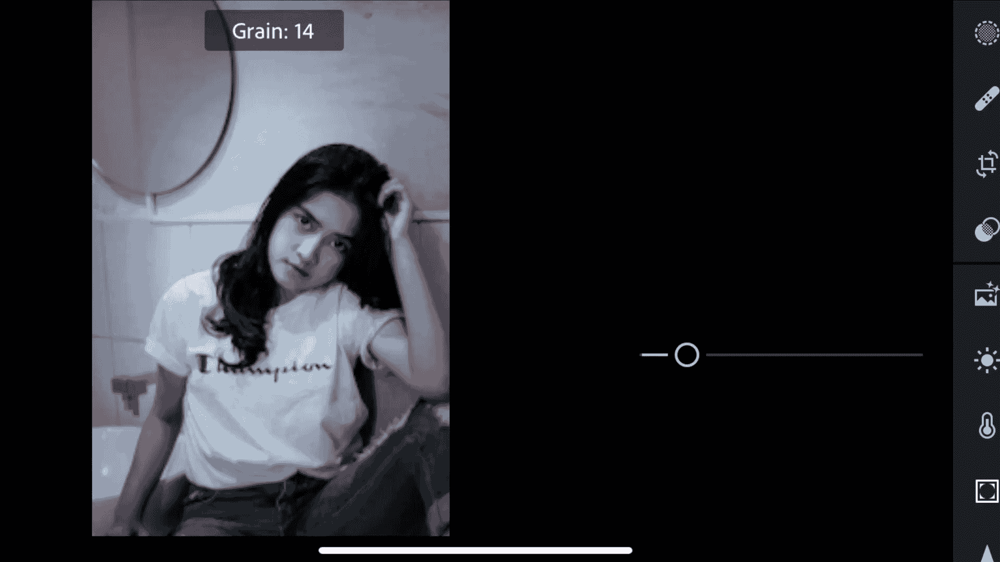

光线部分处理完毕后，我们接下来进入颜色调整环节。颜色处理是决定宝丽来风格成败的关键步骤，因为这种风格讲究的是一种淡淡的、不过于鲜艳的色彩表现。

首先找到颜色面板下方的图标，然后按照以下步骤进行调整：

- 色温：降低，营造冷色调效果。图片中已经有蓝色天空和蓝色衣服，所以不要调得太冷
- 青红：添加一点品红色调，但要小心不要过度
- 自然饱和度：适度增加，提升色彩的活力
- 饱和度：降低至大约-54，让颜色变得非常淡，仿佛不存在一样，但不要完全变成黑白

处理完颜色之后，图片整体看起来会更加柔和，色彩也不再那么刺眼，为后面添加复古效果打好了基础。

## 第四部分：添加晕影与颗粒效果 ✨

颜色调整完成后，我们需要给照片添加一些效果，进一步逼近宝丽来照片的外观。旧式相机拍出来的照片通常边缘会变暗，图片中也会有一些颗粒感，这些都是营造复古氛围的重要元素。

以下是效果面板的调整步骤：

- 晕影：数值大约-26，同时调小中点，让晕影主要集中在主体周围
- 颗粒：先设为22，再调整到5，增加复古质感
- 亮度噪点降低：调到最大，细节设为36，让皮肤看起来更平滑
- 颜色噪点降低：调到最大，进一步减少噪点干扰

需要注意的是，这张示例图片是压缩的JPEG格式，像素较少，所以在降噪时需要比平时更强一些。理想情况下，我们应该尽量使用高质量的照片，但这里只是为了演示编辑效果，所以我们直接忽略图片本身的质量问题。

## 第五部分：使用曲线打造灰色阴影 📉

完成基础光线、颜色和效果调整之后，最关键的一步就是使用曲线工具来打造灰色阴影。曲线是Lightroom中非常强大的调色功能，通过调整曲线上的点，我们可以精确控制图片的明暗分布。

进入光线面板后，点击最上方的曲线选项，并确保选择的是点曲线模式，而不是RGB通道模式。

以下是曲线调整的核心逻辑：

```text
点曲线调整逻辑：
高光点 = 下移（降低高光）
阴影点 = 上移（阴影变灰）
点数上限 = 4~5 个（避免曲线失真）
```

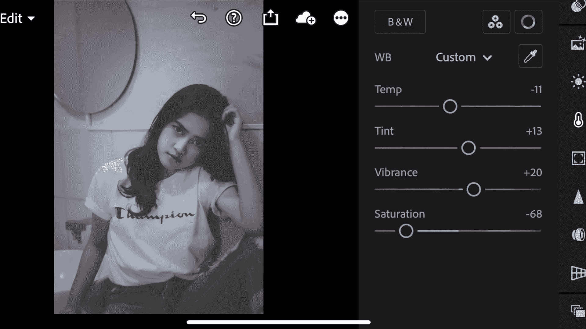

- 高光点：下移，降低高光部分的亮度
- 阴影点：上移，让阴影立刻变成灰色
- 中间调：可以稍微调整，让过渡更自然
- 点数控制：点的数量尽量保持在四到五个以内，点太多会让曲线变形，产生不自然的失真效果

使用曲线时要记住一个原则，添加的点越多，对图片的影响就越强，但也更容易让画面出现畸变。除非你特意想要那种失真的艺术效果，否则建议点数保持最少。调整完成后，照片的阴影部分就会呈现出标志性的灰色，整体看起来就越来越像宝丽来照片了。

## 第六部分：分级调色与最终微调 🎭

曲线调整完成后，我们还可以添加分级调色来增强照片的氛围感。分级调色位于右上角色轮旁边的三个点图标中，进入后你就可以分别调整阴影、高光和中间调的颜色了。

以下是分级调色的建议设置：

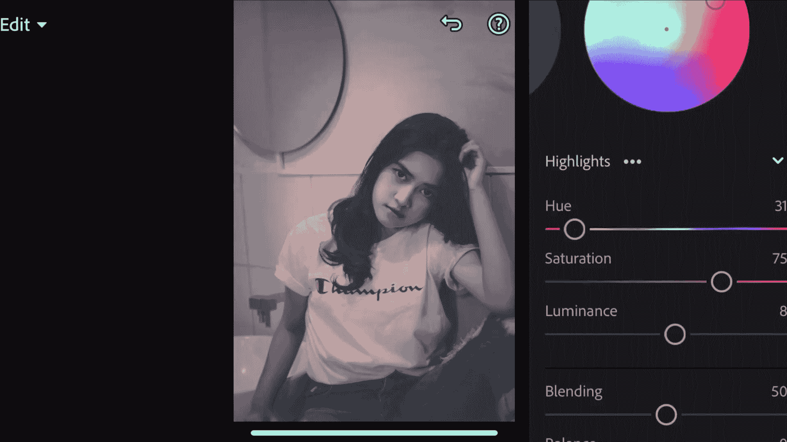

```text
分级调色设置：
阴影色调 = 蓝色，饱和度 = 低，亮度 = 降低
高光色调 = 黄色或橙色
```

- 阴影：色调选择蓝色，饱和度设得较低，亮度也可以适当降低，营造冷色调阴影
- 高光：色调选择黄色或橙色，饱和度和亮度根据实际效果微调，形成冷暖对比

分级调色完成之后，建议你回头检查之前做过的所有设置，确保每个参数都处在最佳状态。如果发现图片颜色偏蓝、偏红或偏绿，可以回到曲线面板，在不同的颜色通道中进行修正。比如在蓝色通道中添加黄色可以去除多余的蓝色，在红色通道中添加青色可以减少多余的红色，只需轻微调整即可。

最后还要稍微降低一下对比度，并启用色差移除选项，以防照片中有不可见的色差问题。

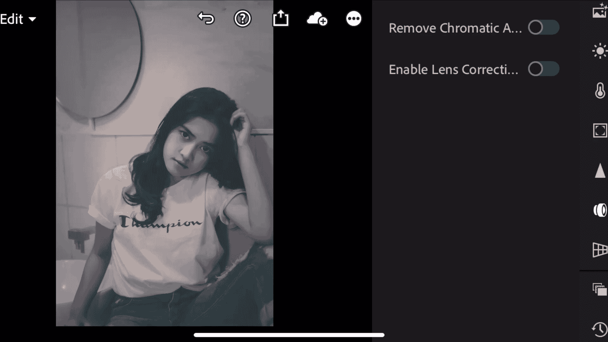

以下是最终检查与微调项目：

- 曲线：再次检查，强化复古风格
- 色通道：蓝色通道加黄色去除多余蓝色，红色通道加青色减少多余红色
- 对比度：适度降低
- 色差：启用移除色差选项

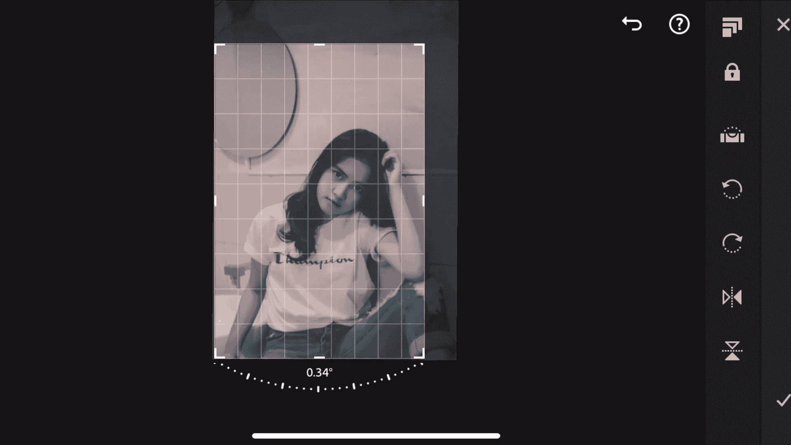

## 第七部分：构图矫正与最终检查 🔍

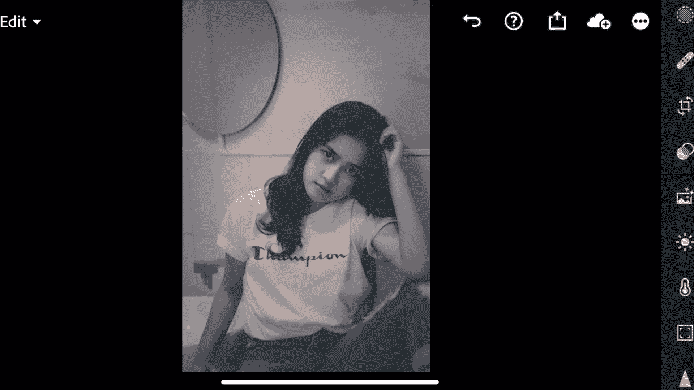

所有调色参数设置完成后，我们需要对照片的构图进行最后的微调。首先使用矫正工具让图片变直，找到锁图标下方的尺子工具，点击一次后沿着图片中的直线进行矫正，这样背景的水平线就会变得笔直。

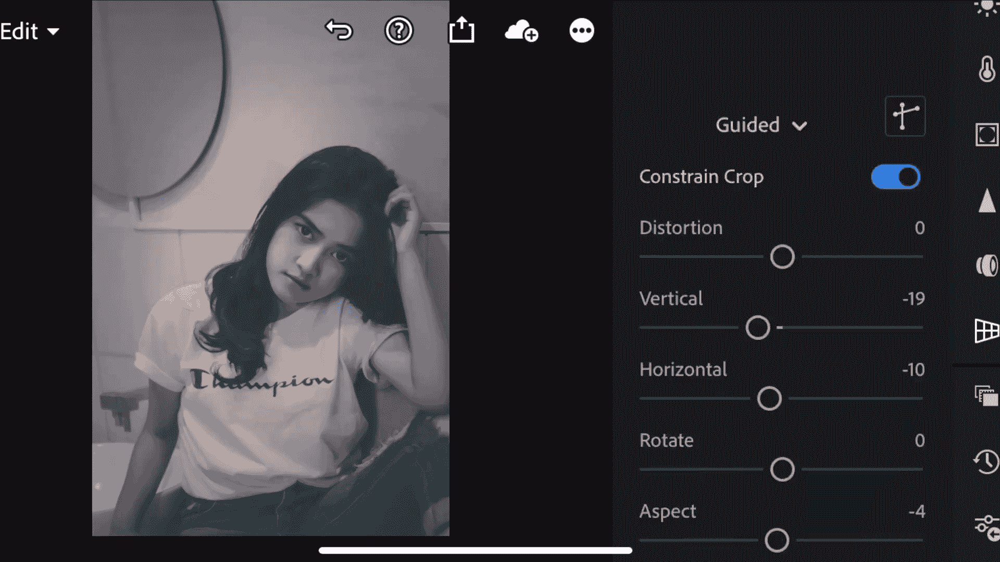

你也可以尝试调整透视，让水平线看起来更舒服。如果想要低角度拍摄的效果，可以调整垂直滑块；而在这里我们通过减小垂直滑块来制造稍微高一点的角度效果，然后启用受限裁剪去除画面中的空白部分。


构图完成后，我们再来检查一下颜色。你会发现图片现在几乎没有鲜艳的颜色，一切都已经去饱和，只剩下淡淡的灰色阴影，这正是灰色宝丽来风格的精髓。如果还有让你不舒服的粉色或紫色，可以进入颜色混合面板，把这些颜色的饱和度再降低一点，蓝色也是同样的处理方式。

以下是最终颜色清理步骤：

- 粉色/紫色：降低饱和度
- 蓝色：降低饱和度
- 结果：颜色非常淡，不完全黑白，呈现灰色阴影

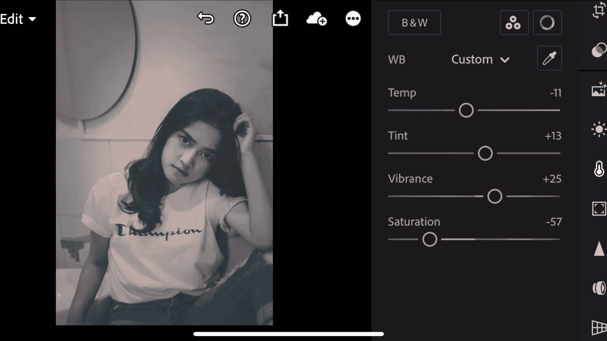

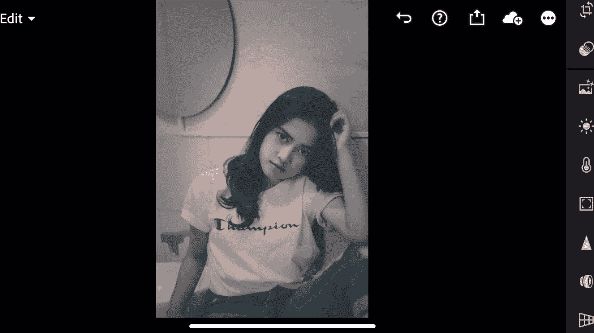

## 第八部分：前后对比与总结 📊

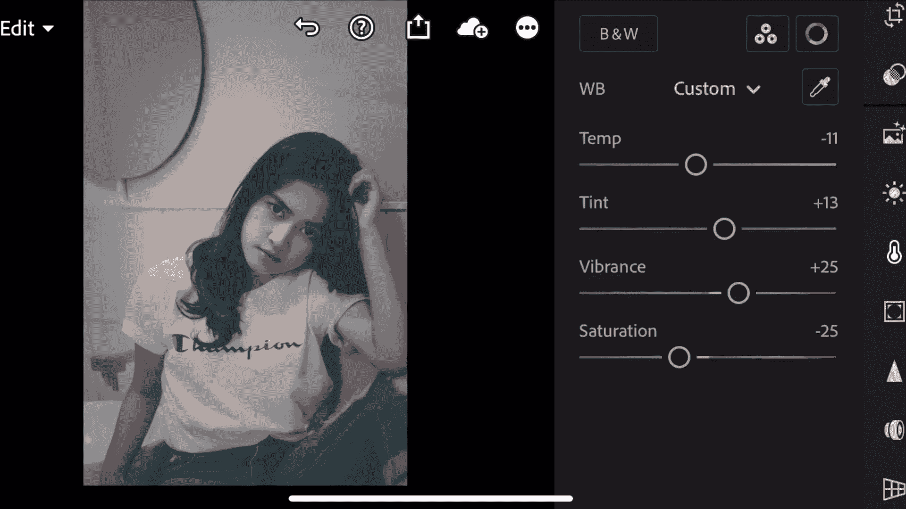

调色全部完成之后，我们可以按住图片查看修改前和修改后的对比。一开始的照片带有较强的复古风格，而编辑之后的照片则呈现出去饱和的宝丽来风格，颜色被大幅度降低，阴影变成了灰色，整体氛围完全不同。

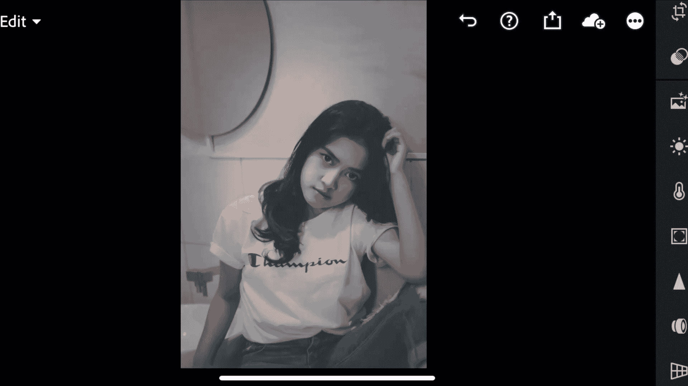

本节课中我们一起学习了如何在Adobe Lightroom中制作灰色宝丽来风格照片，包括光线对比度调整、颜色温度与饱和度处理、晕影和颗粒效果添加、曲线打造灰色阴影、分级调色设置、最终参数微调以及构图矫正。希望你喜欢这一节课的内容。下一节课我们将处理第二个示例，同样的风格但场景和颜色都会有所不同，敬请期待。
