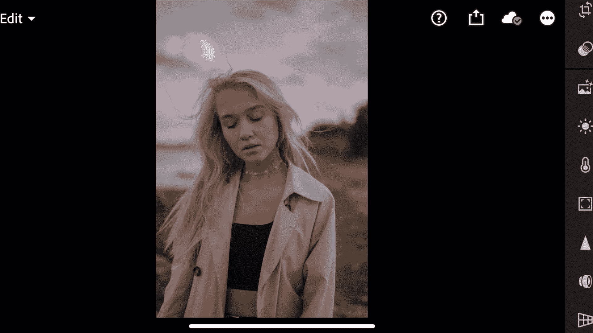
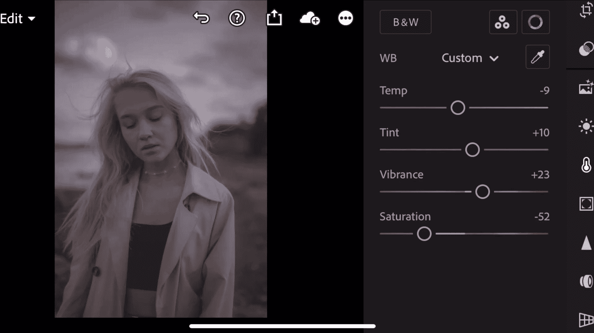
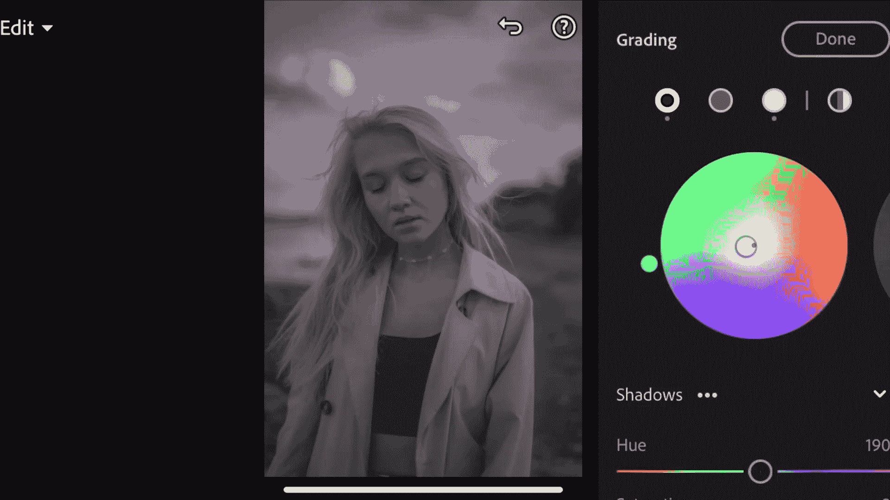
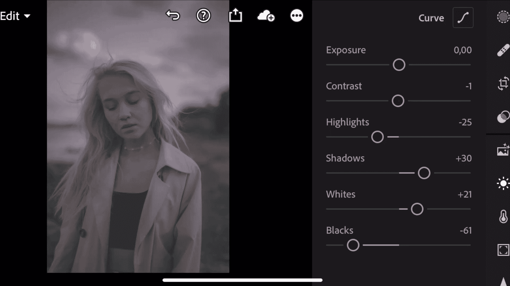
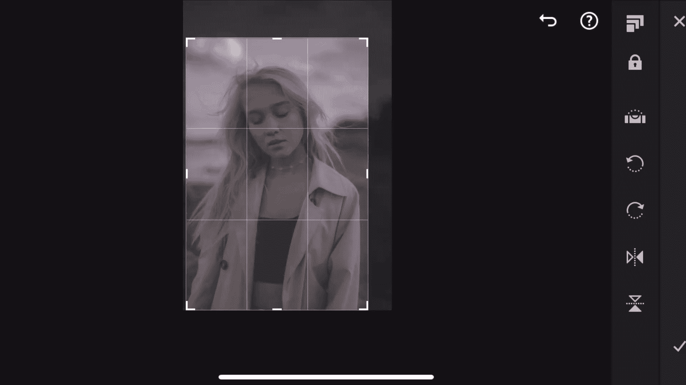
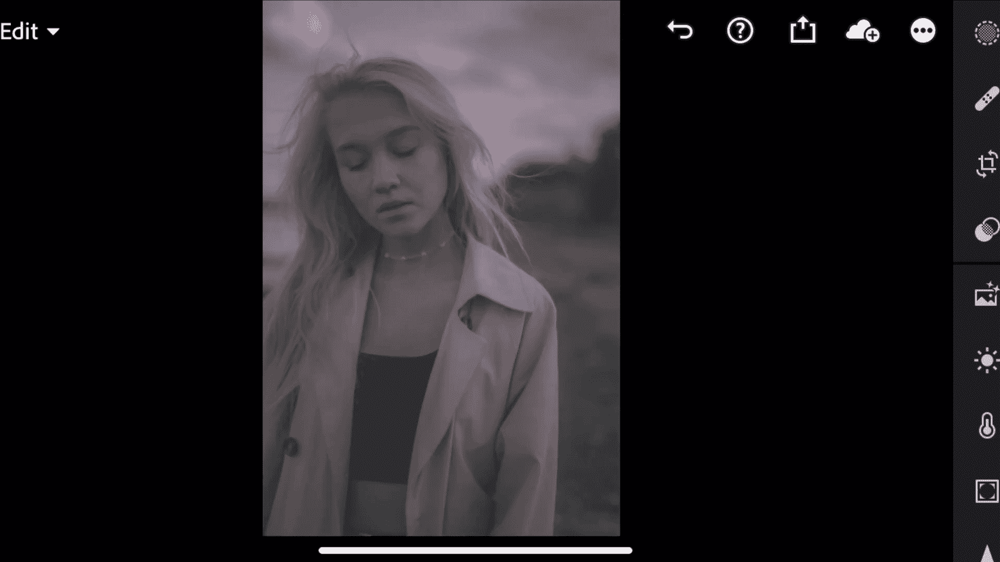
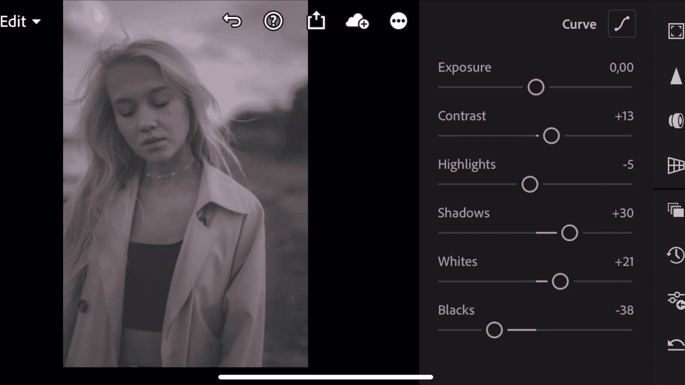
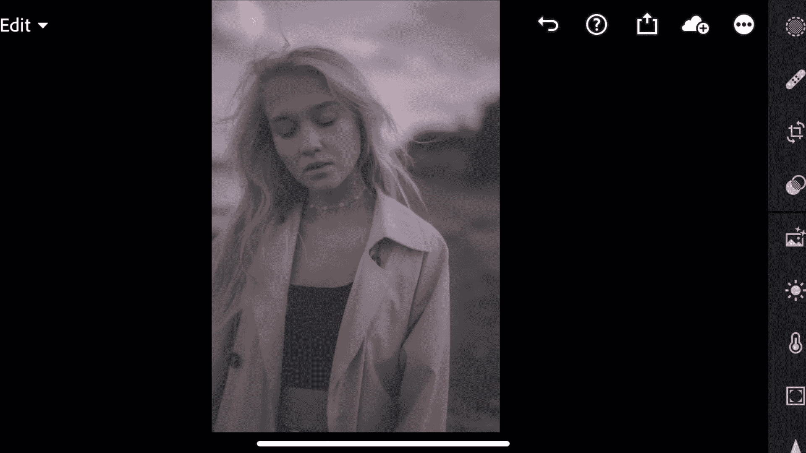

# Adobe Lightroom 入门到专家修图教程：第77课：灰色宝丽来风格编辑（第二部分）📷


在本节课中，我们将学习如何使用Adobe Lightroom制作灰色宝丽来风格的照片效果。这是本课程的第二个示例，通过这一节，你将掌握如何把一张普通照片转变为带有冷色调、低饱和度和复古质感的灰色宝丽来风格图像。我们会一步步讲解光线、颜色、效果面板以及曲线调整，确保即使是初学者也能跟着操作，做出既和谐又富有情绪的修图效果。


在开始具体调整之前，我们先来看看这张图片本身的特点，这有助于理解接下来要做的操作。和第一节课使用的那张图片相比，这张照片的颜色本来就比较少，整体并不太鲜艳，属于那种比较柔和、不那么刺眼的颜色。背景里带有一些蓝色，这种色调非常适合用来尝试宝丽来风格的编辑。因为颜色不多，我们在后续处理时不需要做太激进的去饱和操作，只需要在合适的位置稍微收敛一下，就能让整张图片看起来更协调，也更符合宝丽来那种安静、复古的感觉。




接下来，我们进入最关键的光线调整部分。光线是决定照片整体氛围的基础，我们要先在这里打好基础，再去处理颜色细节，这样后续的颜色处理才会更顺畅。


### 光线面板调整步骤

以下是光线调整的具体操作顺序：

- 降低高光：把天空或亮部的细节保留下来，避免过曝失真。
- 提亮阴影：让暗部不再那么死黑，显露出更多暗部细节。
- 增加白色：针对模特外套、头发和脸部等亮部区域，适当提升白色级别。
- 降低黑色：让暗部更有引力，但不要压得太死，保留层次感。

完成这些调整之后，你会发现图片的对比度明显增强，光影之间的差异变大，整体看起来更有立体感，也为后面的颜色处理做好了铺垫。


光线调整完成之后，图片的骨架就搭好了，接下来我们要处理的是颜色，让画面从温暖色调转向冷色调，营造出宝丽来那种淡淡的忧伤感。


### 基础颜色调整

在颜色面板里，我们要先降低整体的饱和度，让颜色变得克制一些。同时适当增加自然振度，这样可以在不让画面过于灰暗的前提下，保留一些必要的色彩活力。我们希望图片比原来冷那么一点点，但不要冷得太明显，否则会失去自然感。接着，我们给画面添加适量的紫色或品红色，这个颜色能帮助营造出一种神秘、复古的氛围。最后，再稍微再降低一点饱和度，直到整体色彩达到你满意的平衡状态。


整体颜色定调之后，我们还需要检查各个颜色是否和谐，特别是天空部分，避免出现某个颜色过于突兀，破坏整体氛围。


### 颜色混合调整

进入颜色混合面板，我们重点处理天空里的蓝色。你会发现天空的蓝色可能比较突出，和画面其他比较柔和的部分不太搭。这时候，我们只需要稍微降低蓝色的饱和度，让天空和照片其他区域融合在一起，避免出现“天空很鲜艳，但其他部分却很灰”的不协调情况。我们的目标是让整张图片的颜色保持和谐，各个部分看起来都协调统一，不出现突兀的色块。


颜色混合调整好之后，画面的色调已经比较统一了，接下来我们可以进入效果面板，给图片增加一些复古照片特有的质感，比如暗角和去雾效果，让画面更有味道。


### 效果面板设置

在效果面板里，我们可以先对图片做轻微的去雾处理，数值大概设在5点左右，不要太强。然后我们要调整清晰度，其实这里是要稍微降低一点清晰度，让图片看起来更柔和，更像旧照片。接着是添加暗角，把暗角的中点改成画面中间一个很小的圆圈，如果你喜欢，还可以给边缘加一点羽化效果，让暗角过渡更自然。这些设置完成后，图片已经有了明显的复古宝丽来质感，整体氛围也初步形成了。


效果面板的调整让画面有了氛围，但宝丽来照片还有一个重要特征，就是照片表面的颗粒感，这也是接下来我们要处理的内容，能让照片更有真实的胶片质感。


### 细节处理与颗粒添加

在细节面板里，我们要让整张图片看起来更平滑，模仿普通宝丽来照片的质感。建议放大图片，仔细查看调整效果，确保没有调得太过头，也没有处理不足。放大之后，这是一个添加颗粒的好时机。我们要在模特身上添加适量的颗粒，让效果看得出来，但不要产生过于粗糙的硬边缘，否则会让图片看起来很差。添加好颗粒后，记得双击或再次点击缩小图片，回到正常视图检查整体效果，确保颗粒分布均匀，不喧宾夺主。


颗粒添加之后，图片的质感已经差不多了，但还缺少一个能让整张照片“融合在一起”的关键工具，那就是曲线。接下来我们就进入曲线面板，这是制作灰色宝丽来风格最核心的步骤之一，能决定最终的色调走向。


### 曲线调整与灰色阴影效果

进入曲线面板，选择点曲线。在继续之前，我们可以先把图片里的蓝色和绿色稍微降低一点，这样后续的曲线调整会更纯粹，不会带来多余的色偏。曲线图中的顶点代表高光，底部代表阴影。我们要把阴影部分抬高，从而形成灰色的阴影效果，同时稍微变暗画面，但要保持高光部分的亮度，不要让高光丢失细节。



灰色阴影效果的核心逻辑如下：

```
阴影提升 + 高光保持 = 灰色阴影效果
```



和第一张示例图片相比，这张图片的阴影本来就比较少，所以调整出来的效果可能看起来不太一样，这也是正常的。这就是为什么我们在课程中准备了两个示例，让你了解同一种风格在不同照片上会呈现出不同的表现，避免死板地套用同一组参数。


曲线的大致调整完成后，天空可能还是显得有点鲜艳，这时候我们需要回头再做一些微调，确保每个细节都符合我们想要的灰色宝丽来风格，不要有任何突兀的地方。






### 微调与颜色分级

回到颜色混合面板，再次降低蓝色，让画面更平衡。如果这时候发现画面偏绿，不用太纠结，先不管它。然后点击完成，回到基础面板。在基础面板里，我们可以再次微调：增加阴影，减少黑色，增加对比度。之前开启的白色级别现在看起来有点奇怪，所以我们可以把它移除，或者留在大约11点的位置，不要太强烈。接着，我们把去雾效果也移除掉，因为我们希望图片呈现一种褪色的感觉，而不是过于清晰锐利。

颜色分级也是很重要的一步，我们要给画面添加蓝色。可以先提高饱和度，方便看清蓝色的具体色调，选好合适的蓝色之后，再把饱和度降下来。这样一来，图片就是我们想要的冷色调了。如果你愿意，还可以调整亮度，或者给高光部分加一点黄色，同样先提高饱和度看清效果，再调整到合适的位置。最后再回到曲线面板，移动几个控制点，看看哪种组合效果最好，直到你对图片满意为止，不要急于下结论。




所有的调整参数都设置好了，最后我们可以对构图做一点小改动，然后对比修图前后的效果，直观感受风格的变化，确认是否达到了预期。


### 裁剪与前后对比



我们可以对图片进行裁剪，去掉一些不需要的多余空间，把模特适当移到画面的一侧，让构图更紧凑。裁剪完成后，我们就可以快速查看修图前后的对比了。按住图片，就能看到原来的样子，那是一张充满橙色和黄色调的温暖记忆，看起来像是一个快乐的时刻。而修图之后的图片，因为加入了冷色调并且降低了颜色，看起来变得暗淡而悲伤，带有明显的冷色调底色。这正是我们想要的灰色宝丽来效果。你可以再花一点时间微调，确保最终效果符合你的审美，不留遗憾。


基础的灰色宝丽来效果已经完成了，如果你想让这张照片看起来更像复古照片，还可以尝试一些进阶的处理方法，这些方法可以让画面更有故事感。


### 进阶复古美学建议

如果你想进一步增强复古风格，可以考虑把图片导出到Photoshop里添加模糊效果，不过在Lightroom移动版中做这个操作不太容易，所以我们在这节课不深入展开。其实，稍微模糊一点在复古风格中能起到很大的作用，它能增加画面的美感，让照片看起来更接近旧式胶片的效果。如果你想尝试，可以把图片带到其他平台，比如把两张副本叠在一起，模糊其中一张，然后用遮罩把不需要的部分遮掉，这样处理出来的图片会更有复古质感。这节课的主要内容就讲到这里了，希望能给你带来启发。




本节课中，我们一起学习了如何在Adobe Lightroom中制作灰色宝丽来风格的照片效果。从光线调整到颜色混合，再到效果面板、颗粒添加和曲线处理，每一步都帮助我们把一张温暖明亮的照片，转变为一张冷色调、低饱和度、带有复古质感的悲伤图片。这种风格能够改变图片的主题，把温暖快乐的时刻变成相当悲伤的场景，所以使用时要谨慎，确保它与你正在处理的主体和构图相匹配。比如，就不建议把这种风格用在生日照片上，否则会让原本欢乐的照片变得很悲伤，不符合场合。希望你喜欢这节课，我们下一节课见。
