# 🍎 Adobe Lightroom 从入门到精通全教程：第78章：忧郁黑色调编辑

在本节课中，我们将要学习一种名为“忧郁黑”的艺术照片编辑风格。这种风格的核心思路非常直接，就是在照片中只保留一种颜色，而把画面里所有其他的颜色都变成黑白。我们会用一张带有苹果、绿色背景、碗以及双手的示例图片来演示，目标是让苹果保持绿色，而周围的一切都变成黑白色调。这不仅是一个练习颜色饱和度和蒙版操作的好机会，也能帮助你理解如何通过颜色隔离来吸引观众的注意力。即使你之前从没尝试过这种编辑方式，跟着步骤一步步操作，很快就能掌握其中的要领。

上一节我们可能聊过一些基础的色彩调整，本节中我们来看看什么是忧郁黑风格，以及它适合在什么场景下使用。

### 什么是忧郁黑色调风格

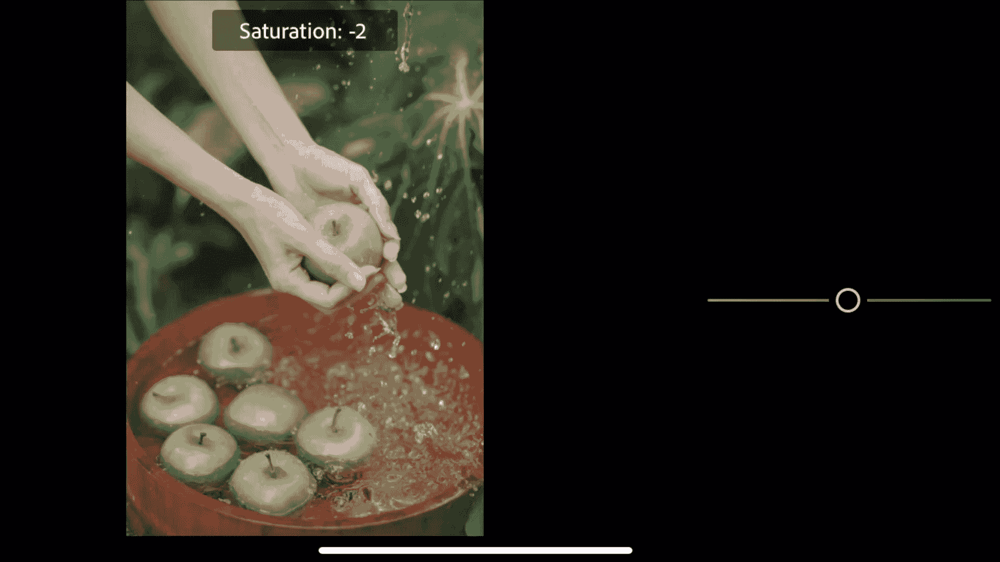

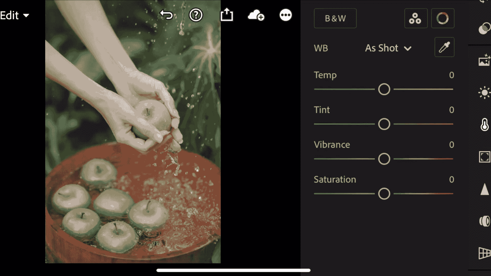

忧郁黑本质上是一种艺术化的后期处理手法。简单来说，就是挑选画面中最重要的一种颜色保留下来，其余部分全部去色，变成黑白。在专业摄影中，这种风格通常用来传达某种特定的信息。比如红色可以代表爱情，也可以代表鲜血，从而表达严肃而重要的主题。如果你不是为了专业用途，也可以随便找一张照片，把其中一种颜色隔离出来，做成一张有艺术感的作品。

**核心概念公式：**

```
最终图像 = 目标颜色保留 + 所有其他颜色转为黑白
```

或者用伪代码表示处理逻辑：

```text
如果 像素颜色 == 目标颜色（例如苹果绿色）:
    保持原色
否则:
    饱和度 = 0（变为黑白）
```

了解了风格的基本原理之后，我们进入实际操作。下面是我们需要打开的面板和使用的工具。

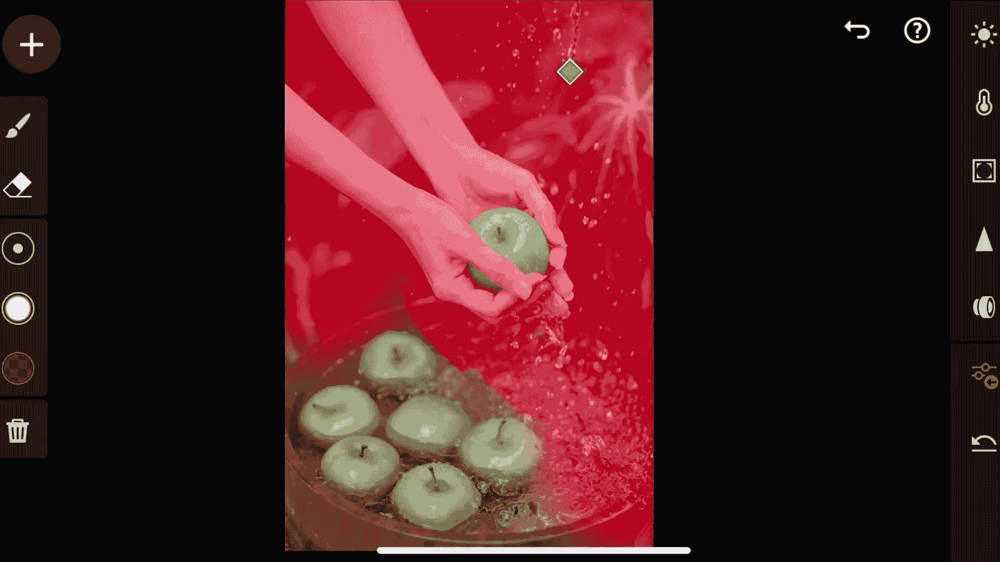

以下是进入颜色面板的步骤：

1. 找到右上角的恒温器图标，点击它。
2. 在打开的界面中，点击颜色轮。
3. 此时会出现颜色混合面板，这里可以分别调整每种颜色的饱和度、亮度和色相。

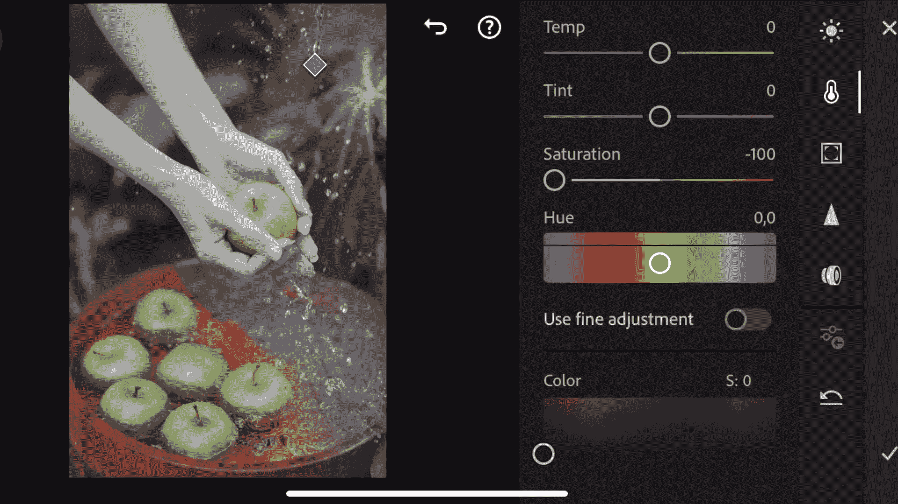

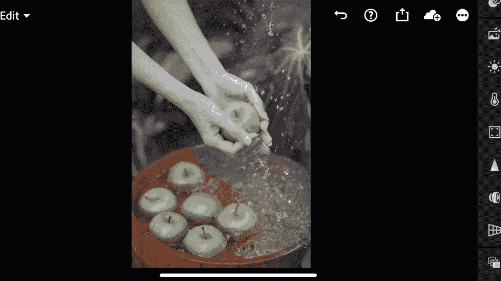

面板打开后，我们要开始处理图片里的颜色了。不过这里有一个小陷阱，稍微不注意就可能把苹果的颜色也去掉，所以我们需要用到蒙版。

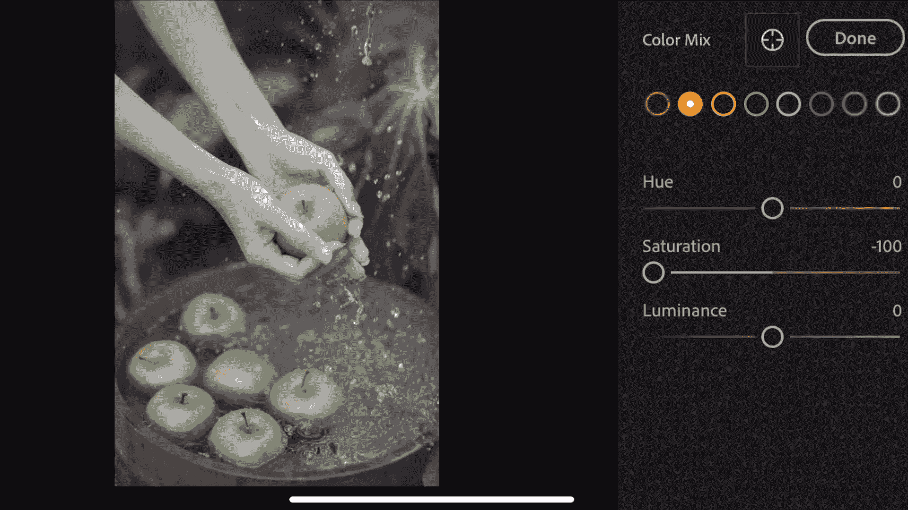

以下是创建蒙版的操作步骤：

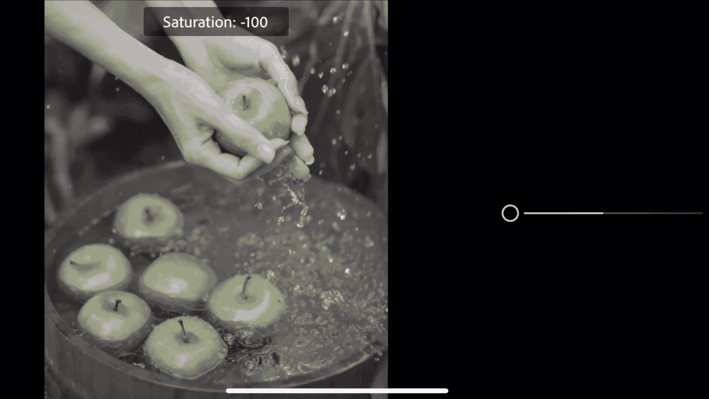

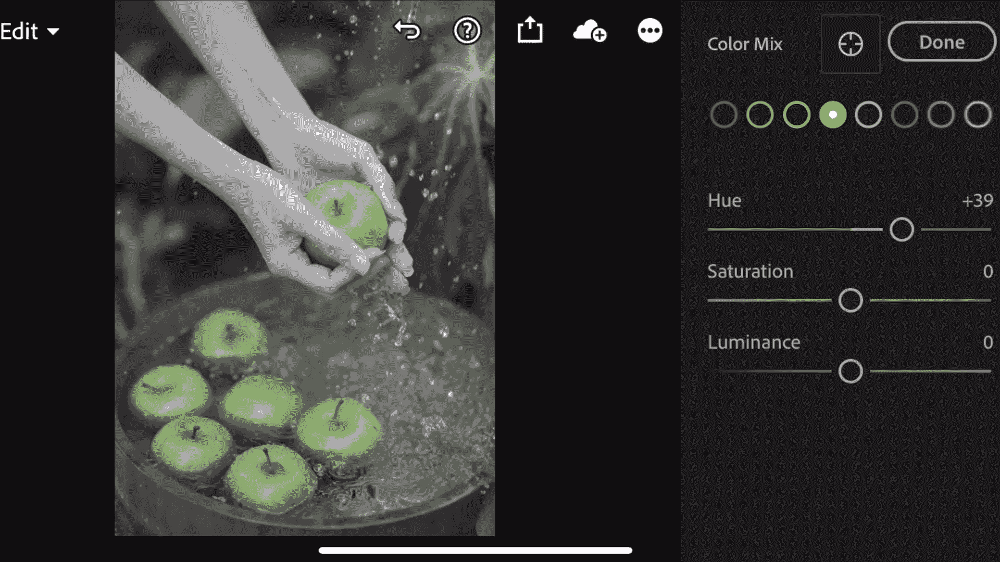

1. 点击加号，新建一个蒙版图层。
2. 选择画笔工具，因为画笔能给你最多的控制权。
3. 用画笔刷过图片中除了苹果以外的所有区域，手部也可以刷，但尽量避开苹果。
4. 点击橡皮擦左侧的小圆点，按住并上下移动可以改变画笔大小。
5. 用白色圆圈调整羽化程度，按住并向上或向下移动即可。
6. 适当降低羽化，这样画笔边缘离苹果远一些，不会误触。

蒙版创建好以后，还需要仔细检查边缘，避免出现不自然的灰色过渡。

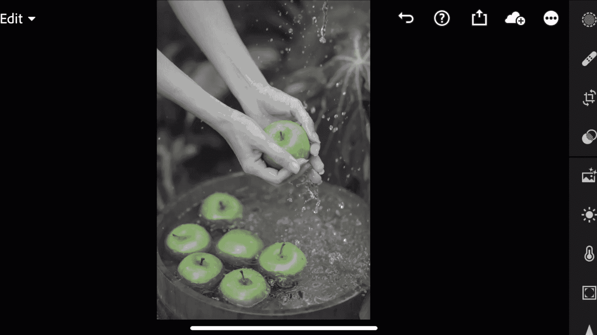

以下是精确调整选区边缘的方法：

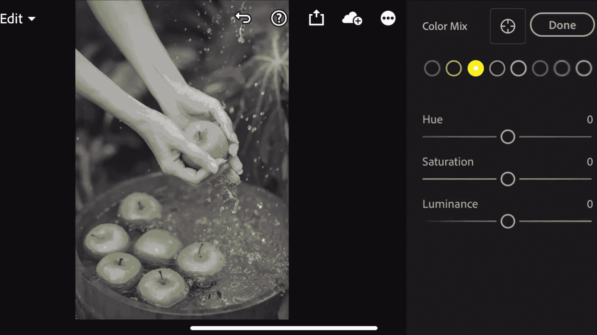

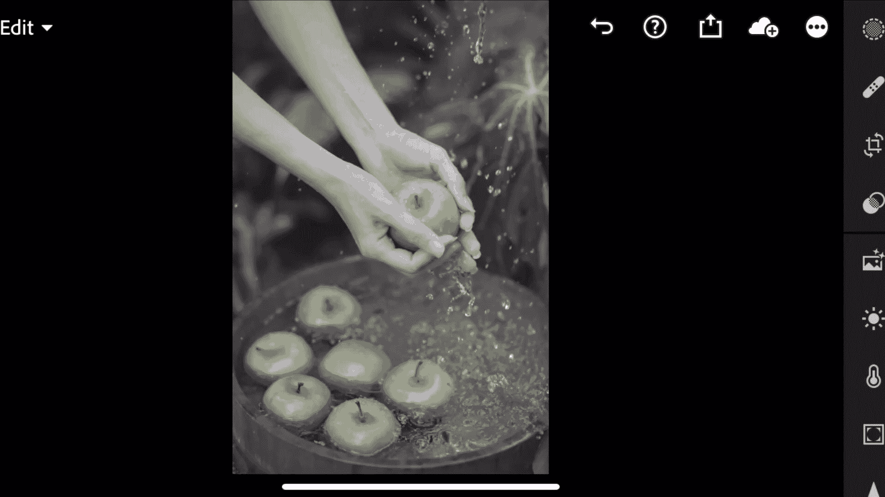

1. 放大图片，用画笔更精细地选定需要处理的区域。
2. 不要太纠结碗的部分，因为我们主要想去除的是背景绿色。
3. 把画笔调大，刷过手里拿着的苹果以外的区域。
4. 如果不小心把苹果也刷进了选区，切换到橡皮擦，调小尺寸，放大图片，把多余的选区擦掉。
5. 特别注意苹果的边缘，如果边缘处理不干净，编辑完成后苹果边缘可能会突然变灰，这就毁掉了整张照片的效果。

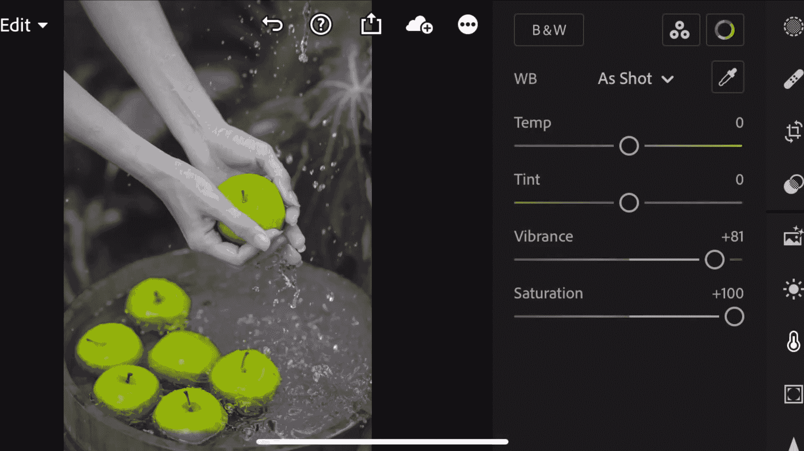

选区边缘清理完毕后，我们就可以开始把背景色去掉，只保留苹果的颜色了。

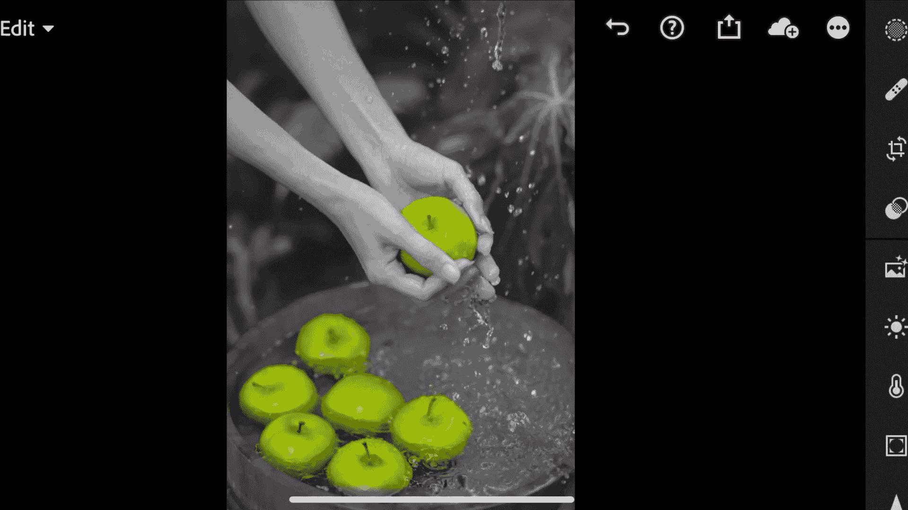

以下是去除背景色彩的具体做法：

1. 回到恒温器图标，再次点击进入颜色混合。
2. 降低整体饱和度，这样除了蒙版保护的苹果，其他所有区域都会失去颜色。
3. 之所以不需要把碗也画进蒙版里，是因为碗的颜色可以在蒙版外面直接处理，这样更省时间。
4. 操作完成后，点击右下角的对勾确认。
5. 如果图片上出现蓝色的菱形标记，点击它可以随时回到之前的选区，继续添加或删除部分内容。

背景色去掉以后，苹果的绿色可能还需要进一步调整，同时也要清理掉剩下的绿色碎片。

以下是细化苹果颜色与清理选区的步骤：

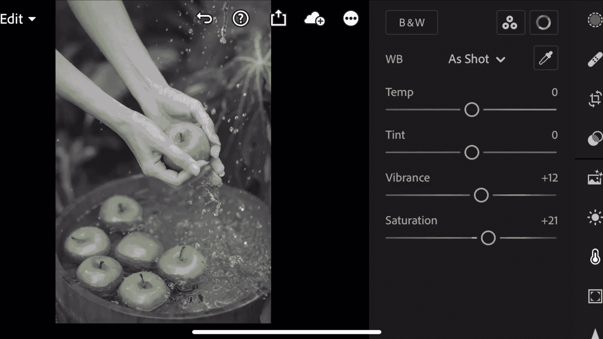

1. 在颜色混合面板中，先不要碰绿色滑块，因为增加绿色可能会把蒙版外的内容也带出来。
2. 把碗的颜色去掉，碗属于橙色系，把橙色滑块拉到负一百。
3. 同理降低红色的饱和度。
4. 可以适当增加黄色，或者把苹果的色调改成更亮的绿色，然后点击完成。
5. 回到蒙版工具，点击那个带虚线的褪色圆圈，再点击蓝色菱形回到之前的选区。
6. 放大图片，把选区里所有残留的绿色部分都移除掉，不要留下任何不想要的绿色碎片。
7. 如果发现苹果边缘变成了橙色，说明在调整图像时需要更加小心。

选区清理干净之后，我们回到颜色混合面板做最终的颜色微调，并检查是否有遗漏。

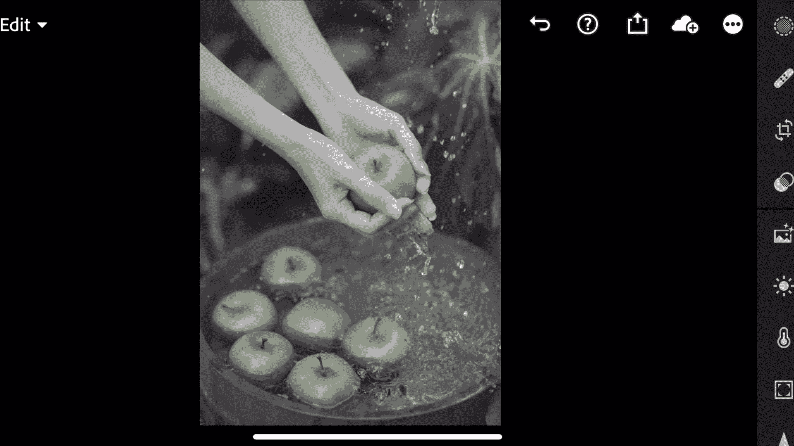

以下是颜色微调与检查的建议：

1. 先把饱和度暂时调回原来的状态，看看选区里是否还有没清理干净的地方。
2. 一个小技巧是把饱和度全部调到最大，这样没清理干净的区域会很明显，比如叶子部分。
3. 发现问题后，回到蓝色菱形选区，把那些部分再去掉一次，避免以后反复修改。
4. 回到恒温器图标，调整饱和度和自然饱和度。
5. 在颜色混合里把绿色调亮一点，让苹果看起来更鲜艳。
6. 针对苹果周围可能出现的黄色或橙色光环，把黄色滑块的饱和度降下去，直到光环不明显为止。
7. 把亮度稍微降低一点，比如设为负四，然后点击完成。

颜色部分基本搞定后，图片现在只保留了绿色苹果，其他都是黑白。不过光影和细节还需要进一步提升。

以下是提升对比度与画面质感的步骤：

1. 像处理黑白照片一样，我们要制造一些对比度。
2. 再次用橡皮擦清理选区，在手、背景、碗、树木等不同元素之间建立颜色对比度。
3. 调整颜色之后，务必再次检查选区，免得提交作品到画廊时才发现有遗漏。
4. 点击对勾，进入效果面板，就在恒温器图标正下方。
5. 加一点去雾，这能立刻制造出我们想要的对比度，同时加深阴影，效果非常明显。
6. 再加一点清晰度，让画面更锐利，苹果上的水珠和手部细节都能看得更清楚。
7. 可以加一点暗角，但要非常轻微，建议设为负五。暗角太重会让照片显不专业，特别是当画面有从角落延伸进来的手臂时，重暗角会让手臂一半发黑一半发亮，效果很不协调。
8. 接着处理锐化，点击效果面板下方的三角形图标，适当加一些锐化，放大检查确保没有引入噪点。

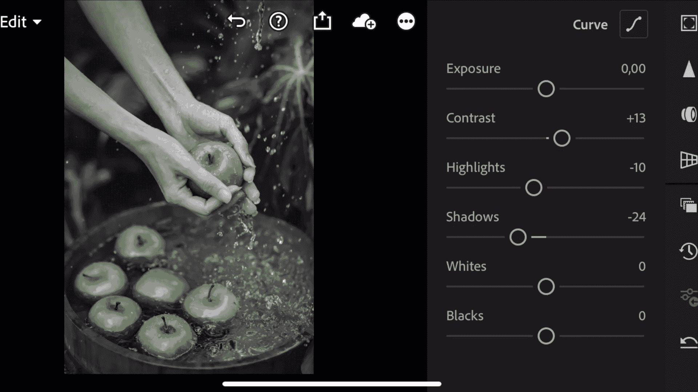

光影和锐化都处理完之后，我们还要修复一些小瑕疵，并检查色差问题。

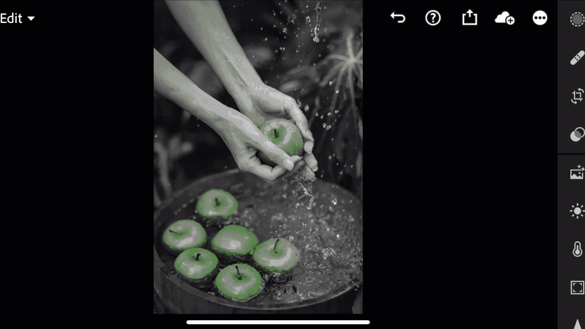

以下是修复瑕疵与最终检查的方法：

1. 进入基础面板，也就是太阳图标，降低高光，适当加深阴影，增加一点对比度，曝光不需要动。
2. 如果想加点艺术风格可以试一下，但如果让苹果看起来更差，就不加了，这取决于你的具体图片。
3. 检查是否需要裁剪，看看画面里有没有想要去掉的元素。
4. 放大图片，找找有没有不想要的昆虫或痕迹，比如苹果上的小黑点。
5. 点击创可贴图标，进入修复工具，放大后用画笔涂抹那个黑点。
6. 把第二个修复点拖到合适的干净区域，如果旁边还有同样的问题，再加一个点即可。
7. 如果还有色差，回到颜色面板，通过颜色混合稍微降低饱和度，直到颜色看起来自然为止。
8. 操作完成后，再次点击图标关闭面板。

所有编辑步骤都完成了，最后我们来看看编辑前后的对比效果。

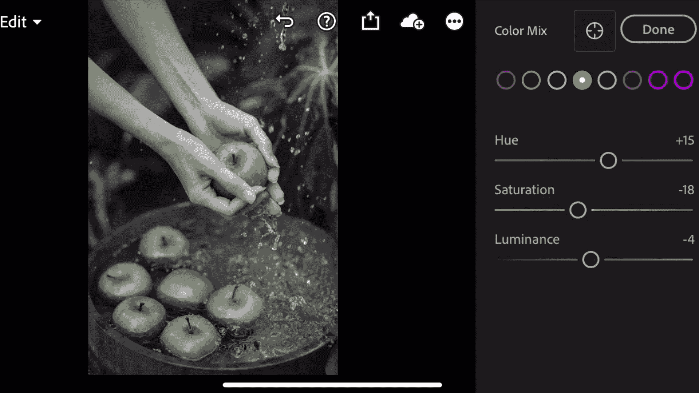

以下是前后对比的总结：

1. 按住图片查看之前的样子，原来画面里颜色非常多。
2. 编辑之后，我们只隔离了一种颜色，去掉了其他所有颜色，同时创建了一张对比度高、细节丰富的漂亮黑白图像。
3. 这就是使用 Lightroom 移动版制作忧郁黑艺术编辑风格的完整方法。

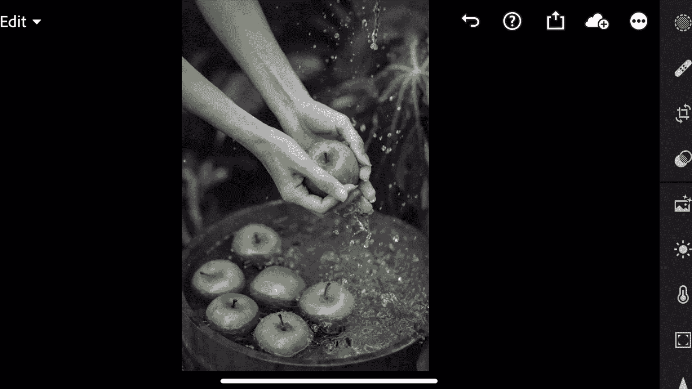

本节课中，我们一起学习了忧郁黑色调编辑的完整流程。从理解什么是颜色隔离，到创建蒙版、清理选区边缘、去除背景色彩、细化苹果颜色，再到提升对比度、修复瑕疵以及最终检查，每一个步骤都围绕着一个核心目标：只保留一种颜色，其余变为黑白。这个过程虽然看起来步骤很多，但实际上非常适合初学者练习饱和度调整和蒙版使用，尤其是掌握羽化和蒙版图层的正确设置，能帮助你做出更精确的选区。希望你喜欢这节课，我们下一课见。

