# 完整Adobe Lightroom大课程：p79：阴郁黑色后期第2部分 📸

在本节课中，我们将学习如何使用Adobe Lightroom制作另一种阴郁黑色风格的照片后期效果。与第一个示例不同，这次的图片不需要复杂的蒙版分离，因为画面中的颜色对比度本身就很高。我们的目标是把图片中大约90%的绿色全部去除，只保留模特连衣裙的红色，同时让头发恢复自然的黄色，最后再配合黑白处理营造出神秘森林般的氛围。无论你是刚接触Lightroom的新手，还是想要提升调色思路的进阶用户，这节课都会一步步带你完成从修图到定稿的全过程。

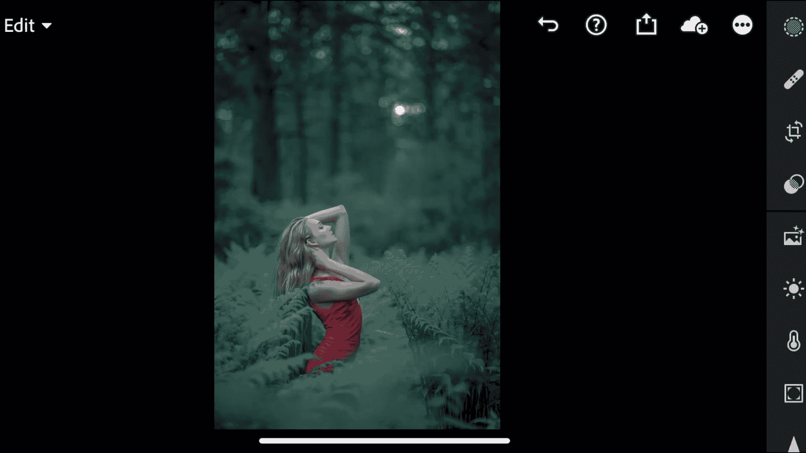

首先，我们需要分析这张图片里到底有哪些颜色，以及我们想要保留哪一种。

打开这张照片你会发现，画面里主要只有三种颜色。第一种是绿色，占据了画面绝大部分区域，是最主要的背景色。第二种是人物的肤色，属于黄色调。第三种是模特身上的连衣裙，呈现出红色。因为这些颜色彼此相差很大，没有相近的色调挤在一起，所以我们想要把它们分开来处理，操作起来会比较简单。第一步就是决定哪种颜色要保留，哪种颜色要去掉。在这个例子里，我们的目标很明确：去掉绿色，只保留红色的连衣裙。不过，单纯去掉绿色之后，画面就会变成一种半黑白的状态，这时候还需要继续调整黑白部分，确保图片有足够的对比度、足够的细节，以及合适的阴影和高光，才能达到我们想要的阴郁效果。

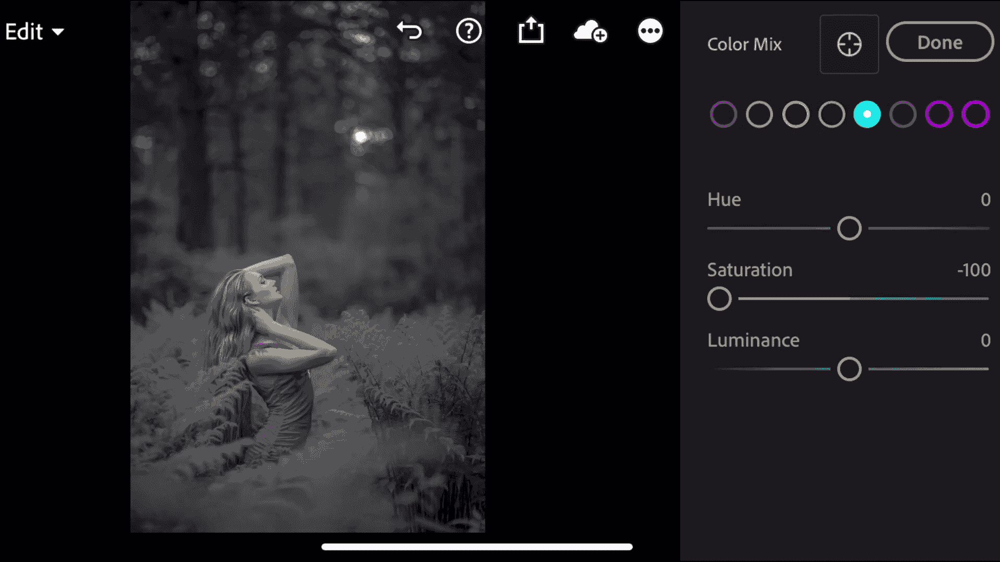

```
保留颜色 = 原始图像 - 去除颜色（绿色）
重点保留 = 连衣裙红色 + 头发黄色
```

以下是本节课我们要处理的三种颜色及其处理目标：
- 绿色：占据画面绝大部分，需要完全去除饱和度。
- 肤色：属于黄色调，在去色过程中要尽量保护，避免被误伤。
- 连衣裙红色：这是全图的视觉重心，需要在后期单独增强亮度和饱和度。

颜色目标已经确定，接下来我们开始实际操作。不过在正式调色之前，先要修复图片里头发颜色不正常的问题。

这张原始图片来自素材网站，制作过程中不小心把模特的头发也染成了绿色。因为头发和背景的绿色混在了一起，如果我们直接去掉所有绿色，头发也会被一并变成黑白或灰色，这就不符合真实情况了。模特实际上是金发，所以我们需要先单独修复头发，让它恢复正常的黄色。具体做法是先撤销刚才对绿色的饱和度调整，进入蒙版选择界面，使用画笔工具仔细涂抹头发区域。画笔大小要设得比较小，因为我们需要放大图片，才能把每一缕头发都涂到。羽化程度不需要太高，大约24%就足够了，这样边缘会比较自然。涂抹的时候可能会觉得比较困难，因为有些头发丝被模糊的叶子挡住了，看不太清楚，不过尽力涂抹即可，不需要追求完美。如果涂错了或者边缘不整齐，之后可以用橡皮擦工具来清理。

```
// Lightroom 头发修复蒙版工作流
进入蒙版面板() {
  点击带虚线圆圈图标
  选择画笔工具
  调整画笔尺寸为较小状态
  设置羽化值约24%
  放大图片涂抹头发区域
  进入温度面板，将色相从绿色改为黄色
  使用橡皮擦删除多余选区
}
```

以下是修复头发颜色的具体步骤：
- 点击修复画笔上方那个带虚线圆圈的图标，进入蒙版面板。
- 选择画笔工具，调整画笔尺寸到较小状态，方便放大后精确涂抹头发。
- 将羽化值设置在24%左右，保证头发边缘不过于生硬。
- 放大图片，在头发区域反复涂抹，必要时切换画笔大小。
- 涂抹完成后，再次进入温度面板，把色相从绿色调整到黄色，让头发恢复本来的模特发色。
- 使用橡皮擦画笔删除多余的紫色或错误选区，确保头发颜色看起来自然。

头发颜色修复之后，我们需要给整个图片再建立一个新的蒙版，用来处理除了人物之外的所有绿色背景。

为什么要再做一个蒙版呢？因为我们刚才对头发做的那些调整属于临时修改，只有等图片导出之后，这些调整才会真正写入文件。在导出之前，如果我们直接在色彩混合器里降低绿色的饱和度，头发上刚刚调好的黄色也会受到影响。所以正确的做法是新建一个蒙版图层，把选区画在除了模特之外的所有区域，尽量避开人物本身。画的时候要不断切换画笔大小，既要照顾到大面积的背景，也要顾及到人物周围的细节。你会发现左上角出现两个菱形图标，蓝色的那个就是当前正在编辑的蒙版。放大图片后，用较小的画笔仔细描画人物周围的边缘。因为我们同时也要处理肤色和已经去饱和的头发，所以即使画笔偶尔覆盖到这些区域，通常也不会造成太明显的视觉差异，因为颜色本身就比较接近。

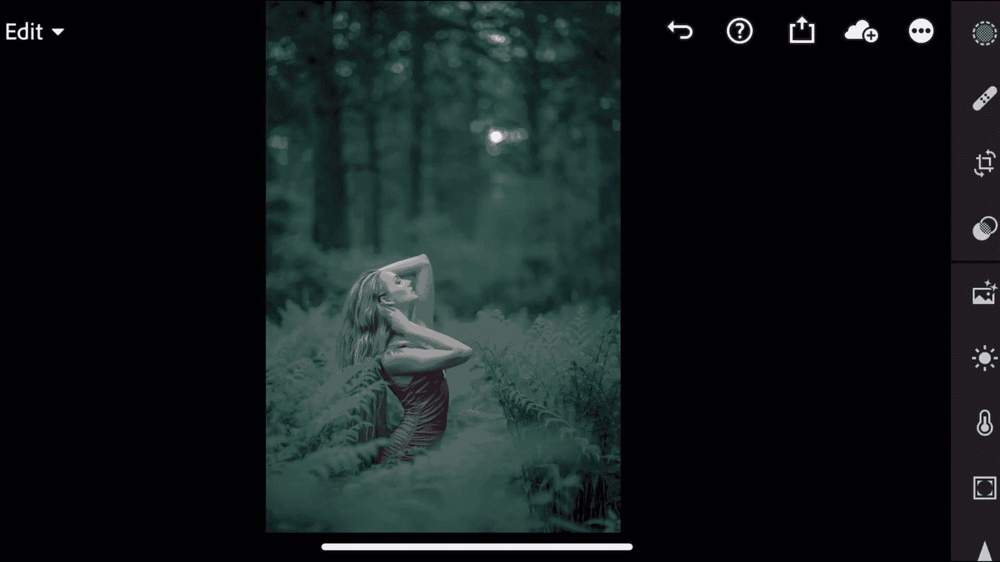

以下是制作大面积去色蒙版时需要注意的几个操作要点：
- 点击加号新建一个蒙版菱形，不要沿用之前修复头发的那个。
- 选择画笔工具，将画笔尺寸调得稍大一些，适合处理大面积背景。
- 尽量避开人物主体，只涂抹背景和周围环境。
- 反复切换画笔大小，兼顾大面积涂抹和边缘精修。
- 确认当前正在编辑的是左上角蓝色的菱形图标。

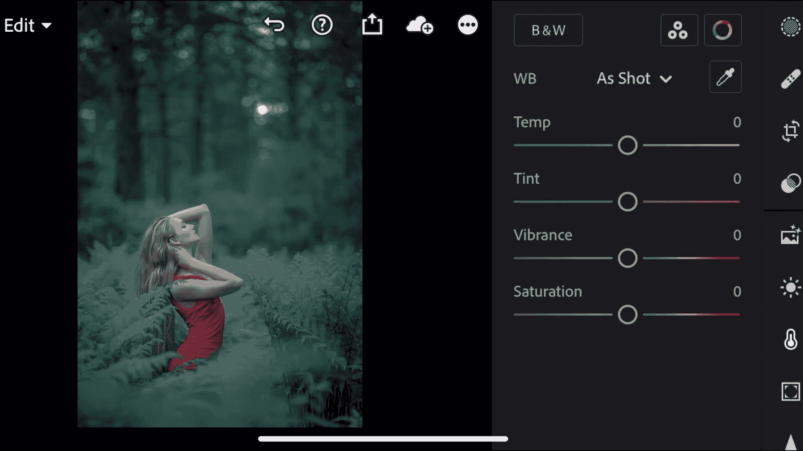

在绘制背景选区的时候，画笔的流量和羽化设置会直接影响最终效果，尤其是连衣裙边缘这种关键位置。

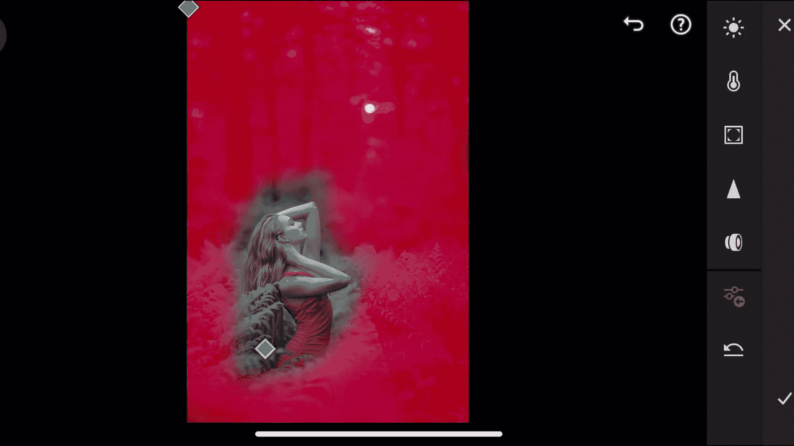

如果你觉得画笔的颜色覆盖得太重，或者想要让调整更柔和一些，可以调整画笔的流量。流量设置在羽化选项的下方，垃圾桶图标的上面，看起来像一个透明背景的方块。流量越低，每次涂抹的效果就越轻，适合只做轻微修正；流量设为100，效果就会非常明显。对于我们现在的任务，因为要把绿色完全去除，所以需要保持较高的流量，比如23左右或更高。但如果你只是想对人物做一点点细微调整，完全可以把流量调低，这样改动会更温和。在绘制连衣裙周围的时候要格外小心，因为红色连衣裙是我们要保留的唯一颜色，选区必须精确。建议先用大一点的画笔大致勾勒，然后切换回橡皮擦工具，把连衣裙边缘不该存在的部分擦除干净。如果边缘很难选得准，可以适当增加羽化值，让画笔边缘的不透明度和流量都降低，这样包裹边缘会容易得多。我个人习惯把羽化值调到77左右，效果比硬边缘画笔要好很多，也省去了之后花大量时间修改的麻烦。

```
笔触强度 = 流量 × 覆盖区域
边缘柔和度 = 羽化值
```

以下是调整画笔参数的具体说明：
- 流量：控制每次笔触的强度，数值越低越柔和，适合轻微调整；数值越高越明显，适合完全去除颜色。
- 羽化：控制画笔边缘的渐变程度，数值越高边缘越柔和，适合处理连衣裙等复杂边界。
- 橡皮擦工具：用于清除选区中不该覆盖到的区域，比如连衣裙边缘多出来的部分。
- 放大检查：经常放大图片查看边缘是否干净，避免留下明显的色差或选区痕迹。

如果在蒙版过程中觉得边缘太难处理，也可以采用一种更简单的变通方法。

当你发现圆形画笔很难处理那些尖锐的边缘，或者涂抹过程变得非常繁琐时，有一个省时的技巧可以尝试。那就是先导出刚刚修复好头发的那张图片，然后再把导出后的图片导入Lightroom中继续编辑。这样做的好处是，之前的所有调整都不再是临时状态，而是直接写进了这张新图片里。这时候头发已经不再是绿色，Lightroom就能更容易识别出颜色差异，去掉背景绿色也会变得简单很多。当然，如果你已经做了一半，不想中途导出导入，也可以继续坚持完成当前的蒙版。反正只要再仔细涂抹几下，把树叶里那些容易遗漏的区域都选上，选区就算完成了。

以下是导出再导入的替代工作流适用场景：
- 圆形画笔无法精确贴合尖锐边缘时。
- 蒙版涂抹过程过于繁琐，想要节省时间时。
- 已经完成了头发修复，希望后续调整不再受临时状态影响时。

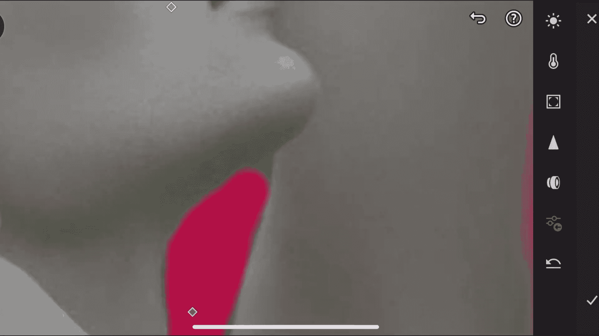

选区画好了之后，就可以开始正式去掉绿色，并增强我们想要保留的颜色了。

进入蒙版面板后，把画笔切换到颜色调节模式，直接把绿色的饱和度降到最低。这时候画面里的绿色背景就会消失，但连衣裙的红色和头发的黄色会被保留下来。为了让黄色头发看起来更有活力，可以进入黄色通道，稍微提高它的饱和度。同时，针对红色连衣裙，我们要让它更加突出，因为这是整张图片的视觉重心。可以适当提高红色的亮度和饱和度，让连衣裙在黑白背景中更加醒目。如果你觉得当前的颜色不太满意，也可以随时更改色相，不过按照模特的姿势和整体氛围，红色通常会效果更好。为了降低红色的亮度，让它显得更深沉一些，可以适当调低亮度值。完成这些颜色调整后，点击完成按钮。接下来，我还会稍微提高一点自然饱和度，注意这里说的是自然饱和度而不是普通饱和度，因为这样颜色会更自然。同时，我觉得整张图片的色温有点偏暖，为了符合神秘森林的主题，我会把色温调得冷一些，大约设置在-4左右，营造出更阴郁的感觉。

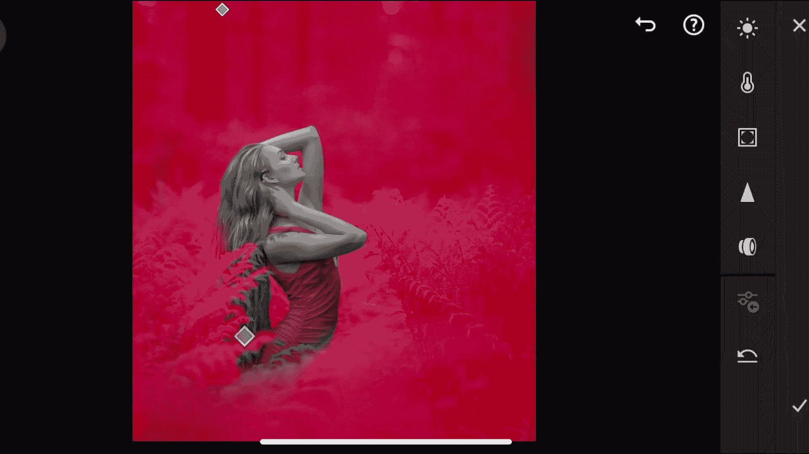

以下是颜色增强阶段的具体调整项目：
- 绿色通道：饱和度降至最低，彻底去除背景绿色。
- 黄色通道：适当提高饱和度，让头发恢复自然金黄色调。
- 红色通道：提高亮度和饱和度，让连衣裙成为画面焦点；如需更深沉可降低亮度。
- 自然饱和度：适度提升，让保留颜色看起来更自然，区别于普通饱和度。
- 色温：整体偏冷，大约-4，强化神秘森林的阴郁氛围。

颜色处理完成后，接下来我们要处理画面中剩下的黑白部分，也就是背景和其他去色区域。

点击太阳图标进入基本面板，我们就可以像处理普通黑白照片一样来编辑这张图片。首先是增加对比度，让黑白部分有更明显的层次感。然后降低高光，避免亮部过曝失去细节；同时也要适当降低阴影，让暗部更有质感。在这个过程中，要时刻记住我们想要营造的主题。如果你追求的是恐怖或神秘的感觉，图片整体应该保持在较暗的一边；但如果你的照片是有趣的生日派对场景，就要注意阴影和高光的差异不要太大，否则气氛会不对。按照我们现在的阴郁主题，我会继续保持较暗的风格，并加入一点除雾效果，让画面立刻具有那种诡异的恐怖氛围，离最终目标更近一步。还可以适当增加一点清晰度，因为原始图片本身就带有一定的细节，不需要过度处理。晕影效果我不打算添加，因为后面还要裁剪图片，画面里有很多空白区域需要去掉。

```
最终效果 = 降低饱和度 + 提升对比度 + 调整高光阴影 + 除雾
```

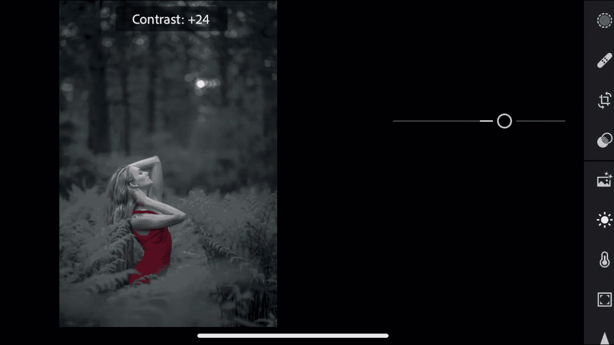

以下是黑白构图处理的基本参数建议：
- 对比度：提高，增加黑白部分的层次分明程度。
- 高光：降低，防止亮部过曝并保留细节。
- 阴影：降低，增强暗部的神秘感和质感。
- 除雾：适度增加，强化恐怖或神秘的画面氛围。
- 清晰度：轻微提升，保留原始图片的细节表现。

整体色调和黑白效果都调整好了之后，最后还要处理画面构图。

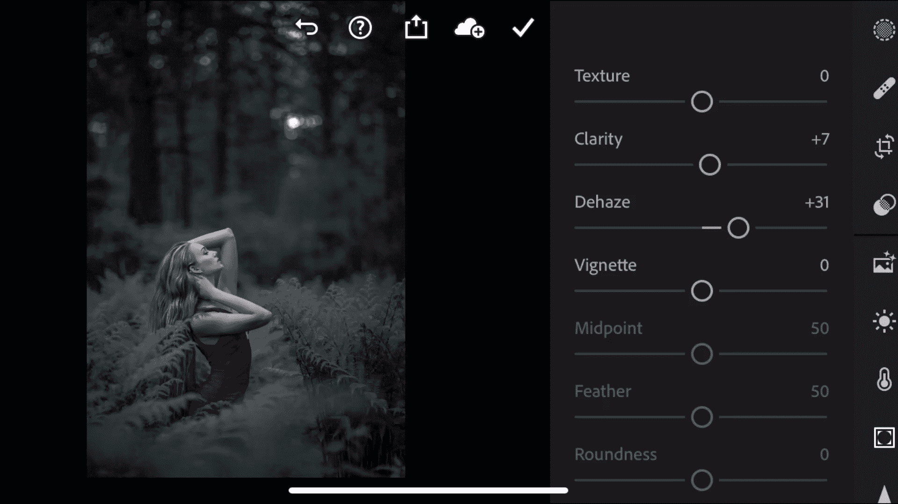

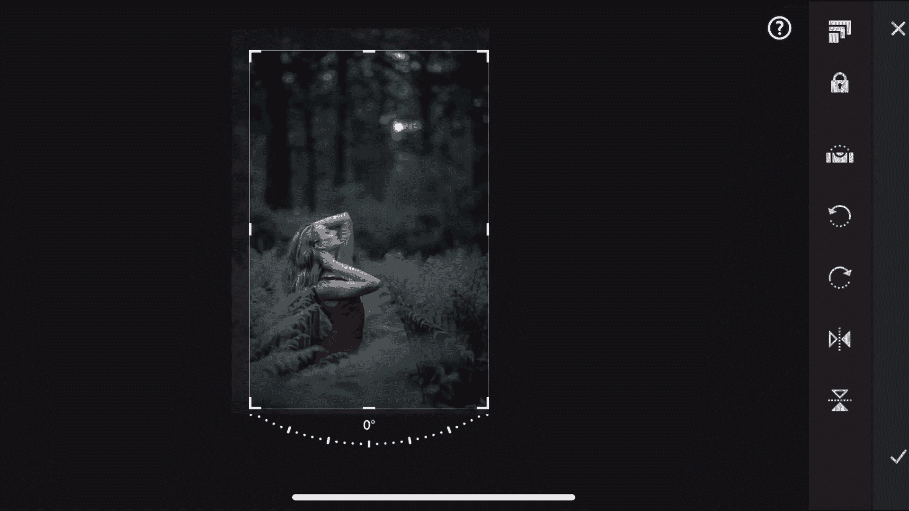

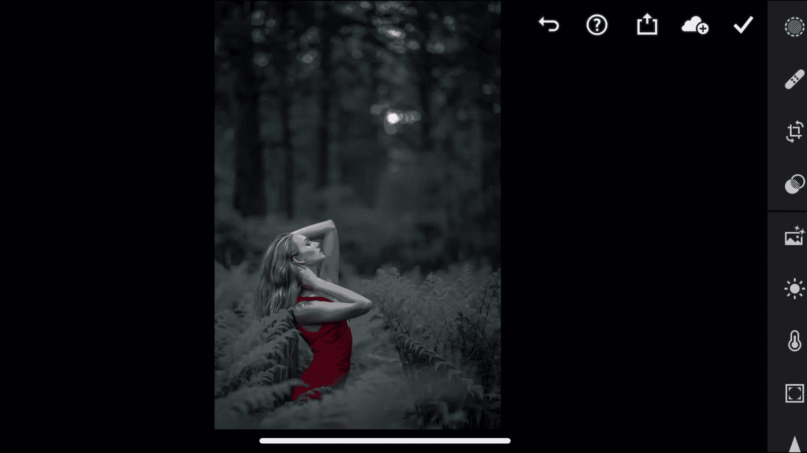

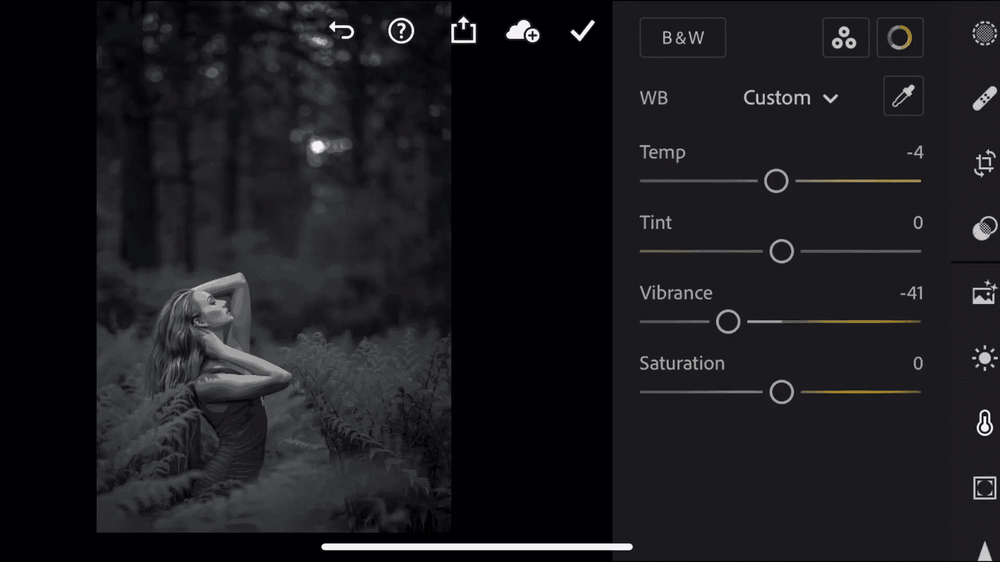

进入裁剪工具，我会先锁定宽高比，这样裁剪时不会把图片拉伸变形。拖动画面角落，把模特放到边缘位置，这样构图会更好看一些。裁剪完成后，我还会稍微把画面往上调整一点，让模特的位置更合适。一切基本完成后，我还想再回头处理一下颜色，稍微降低一点自然饱和度，让整体效果更收敛。如果你愿意，还可以添加一点色彩分级来增加氛围感。不过其实到这里，我们已经完成了一张阴郁黑色风格的构图。如果你想再加一个预设来收尾，也可以，但要小心，因为预设可能会把之前去掉的颜色又带回来。记住，在导出之前，所有的调整都只是临时状态。

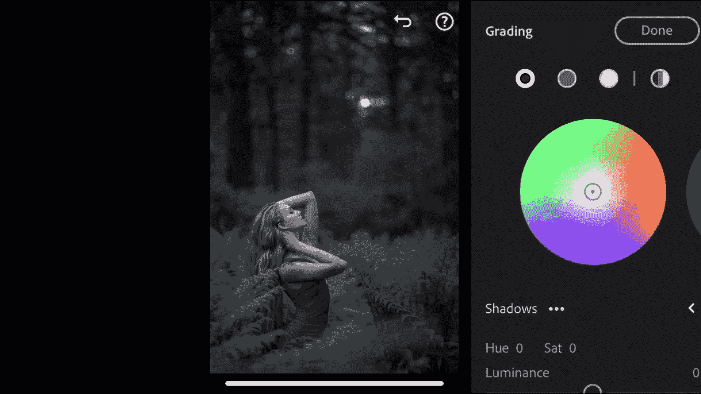

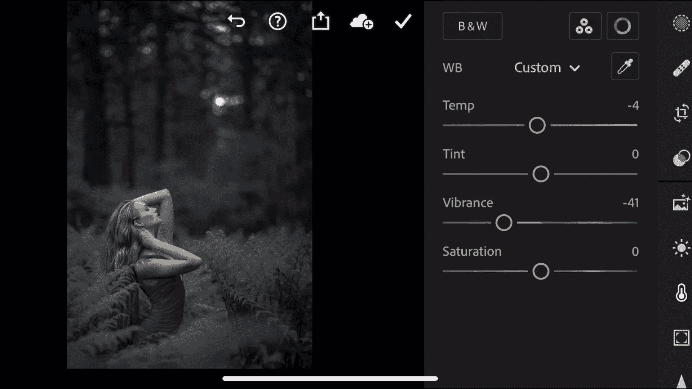

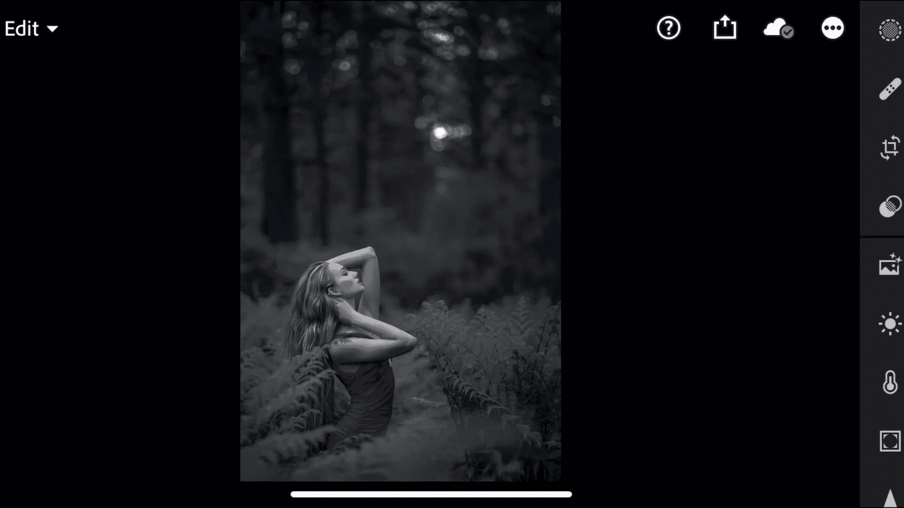

以下是裁剪和最终定稿前的检查步骤：
- 锁定宽高比，避免裁剪时图片变形。
- 拖动画面角落，将主体放置在边缘以优化构图。
- 裁剪完成后微调画面位置，让主体更居中或更符合视觉平衡。
- 返回颜色面板，微调自然饱和度，让整体效果更统一。
- 如需添加预设，注意检查是否会把去除的绿色颜色重新带回画面。

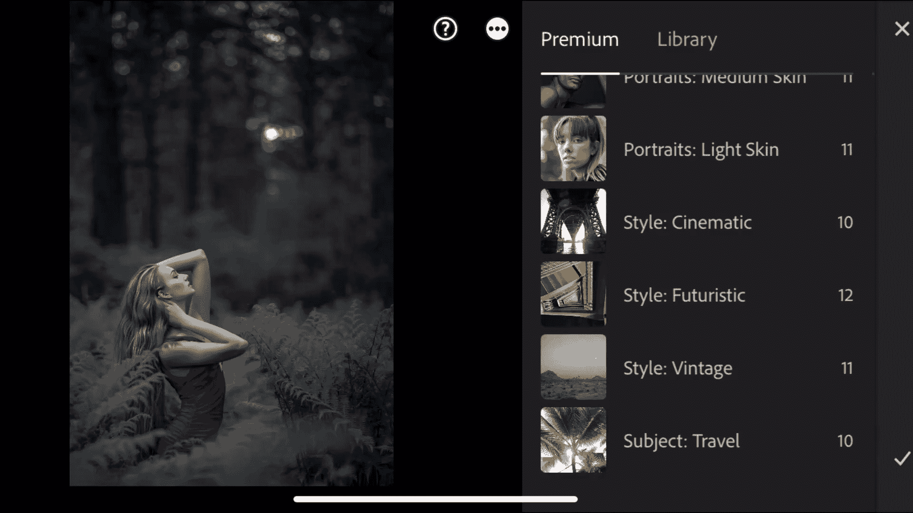

编辑全部结束后，我们来看看修图前后的对比效果。

关闭所有调整面板，按住图片就可以查看修图前的原图，松开手指就是修图后的效果。如果你不想看到面板干扰观看，可以直接点击一次图片，进入全屏预览模式，仔细检查每一个细节是否都处理得当，确认没有问题之后再继续编辑，点击图片一次就可以退出全屏返回编辑界面。最后我还会放大图片，看看是否还有需要去除的瑕疵或多余的涂抹痕迹，如果没有大问题，就可以缩回原始视图了。这就是本节课的全部内容了，我们又学习了一个阴郁黑色风格的后期示例。

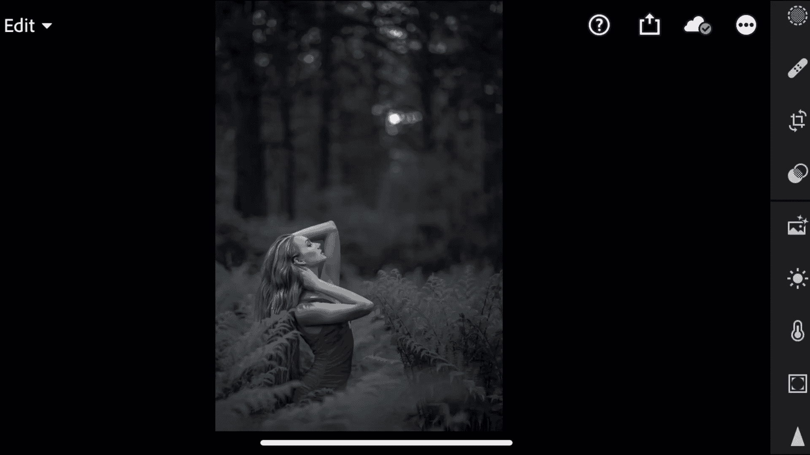

本节课中，我们一起学习了如何在Adobe Lightroom里制作阴郁黑色风格的照片。具体包括分析画面中的三种颜色，决定只保留连衣裙红色；修复原始图片中头发被误染成绿色的问题；使用蒙版和画笔工具去除背景绿色，同时保护人物主体；调整黑白部分的对比度、高光和阴影，营造神秘氛围；最后进行裁剪和最终检查。如果你打算把这类作品用于专业展览，建议图片背后要有明确的表达信息，否则可能会让观众感到困惑或误导；如果你只是为了个人艺术创作或作品集，那么可以完全按照自己的喜好自由发挥。希望你喜欢这节课，我们下一节课见。

