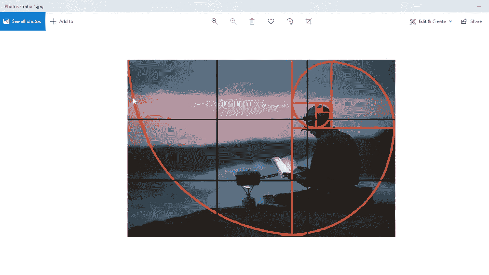

🌄 Complete Adobe Lightroom Megacourse：Part1 P80：风景照构图法则


在本节课中我们将要学习如何使用 Lightroom CC 手机端相机拍摄出色的风景照片。我们会先讨论需要掌握的理论和技巧，再结合真实案例来讲解，这样你在外出拍摄风景照时会更容易理解，也能拍出更好的照片。到目前为止，我们已经知道如何使用 Lightroom CC 手机端相机，操作其实非常简单，不需要复杂的设置。


上一节我们介绍了 Lightroom CC 手机端相机的基本使用方法，本节中我们来看看如何拍摄出吸引眼球的风景照片。风景照片除了拍摄设置之外，还有一些技巧和规则需要牢记。掌握这些规则和技巧，能让你的作品获得更多关注，看起来更专业。之所以不通过相机设置来详细讲解，是因为相机设置之间并没有太大差别，真正决定照片质量的是你为图像创造的角度和构图。我们在前面几节课中提到过一个概念，叫做黄金分割率，下面来看看它具体长什么样。


黄金分割率是拍摄风景照时需要牢记的一条黄金法则。它的样子是一个从某处开始，然后到另一处结束的螺旋，这个螺旋可以翻转，放在这里、那里或另一个位置。你不需要在每一张照片中都使用它，但它能帮助你进行构图，因为理解观众的视线流向非常关键。也就是说，我需要把主体放在这里，再把衬托的背景或其他物体放在周围部分。看到我图片的人，视线会从这里开始，然后慢慢移动到图片的其他部分。理解这一点最简单的方法是看一些例子。


```
黄金分割率螺旋：起点 → 曲线 → 终点
螺旋方向可翻转，可放置在画面任意位置
```


下面我们将通过几组真实的风景照例子，来看看黄金分割率是如何应用的。

以下是具体的案例拆解：

- 案例一：桥梁、山川与鸟类。画面中有桥、水域和山脉，螺旋被放置在这只鸟上。这是因为鸟可能是人们首先看到的东西，其余部分只是背景元素。这就是你应该放置主体的位置。如果是一个人，或者像这样的一只鸟，又或者是一朵花，你都可以把它放在这里，然后把图片中的其他所有物体围绕它布置。这样做能抓住注意力，让人们先看到鸟，因为鸟被放置在纯色背景前。画面中有大量浅紫色，然后是这只鸟，这会真正吸引看到它的人的注意。

- 案例二：狗与夕阳剪影。这里的主体是狗，但是因为太阳位于后面，形成了更多的剪影效果，而不是狗本身。所以这里的主体实际上是太阳，因为它是最亮的部分。太阳非常鲜艳明亮，这就是我们先看到太阳，然后才注意到狗的剪影的原因。这里可以看到规则是以相反方向应用的。如果是白天的场景，没有如此鲜艳明亮的日落，那么狗就可以是主体，螺旋会从这里开始，也许会有一些树木，眼睛的流向也会不同。

- 案例三：人类与山海日落。这里有一个人类主体，背景是山脉、海滩和日落的绝美风景。我们之前在几节课中提到过，你在风景照中能放入的最吸引人的主体就是人类。之所以说有吸引力，是因为这是人类首先会注意到的东西。如果只是一张没有这个人的风景照，我的视线会直接扫过去，没有任何东西能抓住我的注意力，因为我的眼睛会立即寻找人类以便与之产生共鸣，这只是人类的天性。所以如果你想让照片看起来更好，假设你有这样的风景，就在图片中的某个位置放一个人，让照片更有吸引力。例如，如果你和朋友去徒步，可以让朋友站在这里，利用他们的存在来拍出一张出色的风景照。



- 案例四：模糊背景与阅读的人。这张图片背景模糊，视线从头部开始，然后移到模糊背景上。因为我们只有这一个人，所以需要看看我们想要对焦的元素是什么。如果图片没有头部，也许视线会从这里开始，主体和视线流向会从这本书开始。但首先，要立即确定我在看什么。通过保留头部并把它放在这个角落，我会识别出这是一个人类，他在读一本书，也许在露营，天已经黑了，他在山顶上。这些就是黄金分割率在风景照中的应用。


掌握了这些案例之后，我们来看看如何在实际拍摄中运用这个规则。所以，每当你拍摄风景照并且画面中有人类主体时，始终要在相机取景框上想象这个黄金分割率。相机叠加层的一个选项实际上就是黄金分割率，你可以在 Lightroom CC 手机端相机中使用它，也可以在 Lightroom Classic 的裁剪面板中添加这个比例来编辑图片。


接下来，我们来看看作品集中的其他风景照片，了解不同类型的风景拍摄方法。我现在在我的作品集里，将向你们展示可以拍摄的不同类型的风景照片，我们从这里开始。可以看到黄金分割率被应用到了这张照片中，我的主体是这个房子，位于角落，不完全在角落，只是稍微偏一点。如果我们想象螺旋，可以看到它完美契合我们之前讨论的视线流向。


但有时你会面对平坦的背景，没有真正的主体，你希望人们的视线只是扫过图片，而不是停留在某个单一主体上。这就是我刚才说的情况。没有明确的主体，可以说这条直线上没有凸起，而主体就是那个凸起。图片中有不同的地平线，有天空、海滩、岩石和草地。这非常适合用作背景图，因为眼睛不会在任何一点停下去注意不同的东西。如果我从这里开始，整个图片的流向都是一样的。但是在这张图片中，虽然不一定有人类主体，我们仍然有那个螺旋规则被应用。人们首先会看到下面这个区域，然后会继续注意到有一些树，有一些岩石，这是一个瀑布。这是另一个黄金分割率的例子，它从下方开始，也可以从上方开始。你甚至可以按角度放置主体，这样就在给观看你图片的人的眼睛提供一个可以遵循的方向。这张图片有从这里到那里的方向，因为它是剪影，我们会立即关注背后的天空。我使用了一些色调让它看起来更有艺术感，但一般来说，当你的主体背后有强光源时，就会形成剪影，编辑完成后看起来会非常好。


除了黄金分割率，方向感也是构图中非常重要的一部分，下面我们看看如何利用引导线来指引视线。

以下是方向感的应用示例：

- 道路与房屋：这里我们既有方向感，也有黄金分割率规则，方向就是道路。道路从底部开始，引导我们走向这些房屋。我们在另一边也有同样的情况，可以看到云彩池正朝向日落方向。这些房屋会引导我们看向上方的云彩。所以我们从两端都有方向感，这就像是在给人们指示，沿着这个方向走，以到达图片中最大的元素。最后，我们有两条小路通向这片美丽的天空。


接下来，我们来看看另一种常见的构图方式，也就是将主体放置在画面中心。你也可以拍摄直构图，所谓直构图，就是将主体放置在风景的中心位置。如果你觉得风景需要一点点亮点，在前面放一个人类主体会看起来很棒。如果你只是有一些绿色的树木，没有特别突出的元素，那么你可以直接在前面放一个人类主体。这样可以让普通的风景照看起来更好，并在重复的图案之间创造对比。我们可以看到这是海滩，然后看到了这个人，这样会创造出一张更好的照片。本质上，这就是我们之前提到过的，在直线上的那个凸起。这里也有同样的情况，一条通向右侧的单一路径。但是当我们有这个人类主体时，任何看到这张图片的人都会立即识别出人类，然后就会看它走向哪里，或者在这种情况下，会看周围环境。我们可以看到从左到右的方向感，这引导我们走向日落。在这张只有天空和大海的图片中，这样的照片不会让你的追随者停下来仔细看，因为没有元素能抓住看到它的人的注意力，这意味着他们不会再看第二眼。但是如果我水面上有一艘船，它会吸引注意力。但是因为天空和水中都有重复的图案，这不是一张有吸引力的照片。所以，除非你是为了制作像这样的背景图，否则一定要有一个主体。

以下是另一个例子：

- 居中主体：将主体放置在重复背景的中心，会让照片看起来更好。这里也是同样的情况，这是一个细节不多、不足以成为出色照片的背景。所以通过在中心放置一个人类主体，我们让照片变得更有共鸣、更讨人喜欢。


以上就是拍摄精彩风景照片的方法，最后我们来看看如何配合 Lightroom CC 手机端相机进行实操。通过使用正确的技巧和合适的主体，你可以创作出惊人的风景作品，只需遵循我们讨论过的规则，就能让照片更有吸引力。当你想要使用 Lightroom CC 手机端相机时，可以轻松将所有设置改为自动，这样你就不用太担心设置问题，只需专注于构图，因为构图其实比设置更重要。如果你的主体没有放在正确的位置，角度不对，色彩组合也不对，那么花大量时间调整相机设置就没有意义。这就是为什么我没有教你如何用相机拍摄风景照，而是教大家理论和规则，因为这些远比相机设置重要。至于相机，你并不需要使用特殊设置，只是运用你目前所学的内容，也就是对焦、取景等等。风景照剩下的美感在于你的创造力，以及你如何把面前的不同元素以一种能拍出好照片的方式放置，或者说以一种能讲述故事的方式放置。


本节课中我们一起学习了如何使用 Lightroom CC 手机端相机拍摄风景照，重点掌握了黄金分割率、视线流向、主体布置以及引导线等构图规则，并通过多个真实案例了解了如何让风景照更吸引人、更专业。
