📷 完整Adobe Lightroom大课程：76：评分与整理 ⭐


在本节课中我们将要学习如何在Adobe Lightroom移动版中对图片进行评分和整理。我们会详细讲解评分与审查面板的使用方法，了解如何通过旗帜和星级来给图片做标记，还会学习如何添加关键词，以便以后能快速找到想要的照片。此外，我们还会看看筛选按钮是怎么工作的，以及信息面板和活动面板里分别包含哪些内容。整节课会用大白话把每一个操作步骤讲清楚，让完全没有基础的新手也能轻松上手，把自己拍摄的照片管理得井井有条。


进入正文之前，我们先来看看评分与审查面板的基本界面。在Lightroom移动版中，左上角目前显示的是编辑面板，我们之前已经介绍过不同的面板有什么作用。而如果你想要给图片分类，就需要切换到评分与审查面板，因为这里才是专门用来对图片进行标记和分类的地方。一旦进入这个面板，你会发现屏幕下方出现了胶片条，而原来的编辑选项不再显示，胶片条上方则摆放着一些空心的星星和旗帜图标，这就是我们接下来要使用的评分工具。你可以把这里想象成一个照片的筛选台，所有的照片都排在下面等着你来决定哪些值得留下，哪些可以直接跳过。


以下是评分与审查面板的主要功能入口：

- 屏幕下方的胶片条，用来浏览所有待处理的图片
- 胶片条上方的空心星星，用来设置星级评分
- 胶片条上方的旗帜图标，用来标记图片的好坏


有了这些入口之后，我们就可以开始实际操作了。

接下来我们看看具体的评分操作方法。在这里，我可以逐一审查每张图片，决定是否给它加上一颗星，然后滑动到下一张图片继续操作。也可以给某张图片加上星标，或者直接点击图片进行放大，以防我想仔细查看某个特定的细节部分。我可以双击屏幕来放大，再双击一次来缩小。如果按住屏幕并向上滑动，现在屏幕会分成两部分。如果你只是简单地向上滑动，就会给图片加上旗帜；如果你向下滑动，图片上的旗帜就会被取消；再次向下滑动，图片会被标记一个X。如果你在屏幕左侧做同样的滑动操作，就为图片添加星级评分。你可以看到，我只是上下滑动来调整评分，一直向上滑动就是五星评分。之后我再次点击以恢复胶片条。就这样，我可以对每张图片进行评分和审查。这样做能节省大量时间，让我把对焦好的图片和未对焦好的图片分开，只处理那些需要编辑的图片。你不需要再一张张照片地去回忆哪张好哪张不好，所有的标记都保存在系统里，以后编辑的时候直接调用就可以了，非常方便。


为了让你更直观地理解旗帜和星级的操作逻辑，我们可以用下面的伪代码来表示：

```text
如果 用户向上滑动:
    图片.添加旗帜 = true
如果 用户向下滑动:
    图片.旗帜 = 无 或 图片.旗帜 = X
如果 用户在左侧滑动:
    图片.星级评分 += 1
如果 用户滑动到顶部:
    图片.星级评分 = 5
```


评分操作完成之后，我们再看看如何给图片添加关键词。

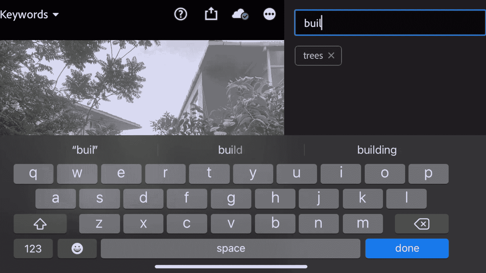

除了评分与审查面板之外，我们还可以进入关键词面板，为图片添加关键词。就像在Lightroom桌面版中一样，当你给图片添加关键词后，就能更快速地找到它们，不需要在成千上万张照片里一个个翻找。所以如果我在关键词框里写入“树木”和“建筑”，这就是我为图片添加的标签。我们回到媒体库，点击筛选按钮，进入关键词选项。我已经为图片添加了很多关键词。现在如果我点击“建筑”，我的图片就会显示出来，因为我添加了“建筑”和“树木”作为关键词。关键词就像是给照片贴的标签，贴过标签之后，你搜索“树木”，所有跟树木有关的照片都会跳出来，搜索“建筑”，所有跟建筑有关的照片也会出现，这样找图片的速度会快很多。


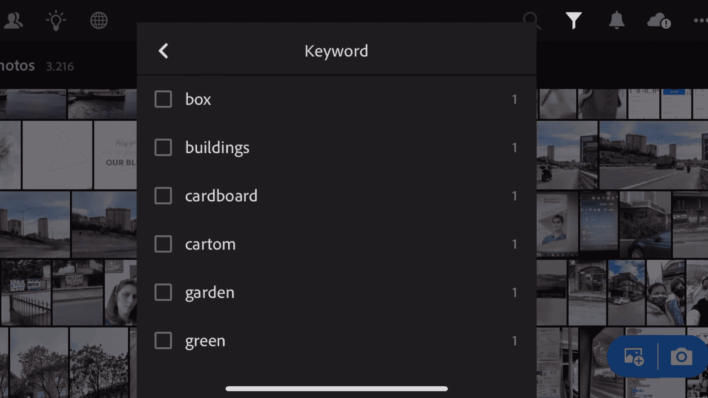

关于关键词的使用，可以用下面的公式来描述：

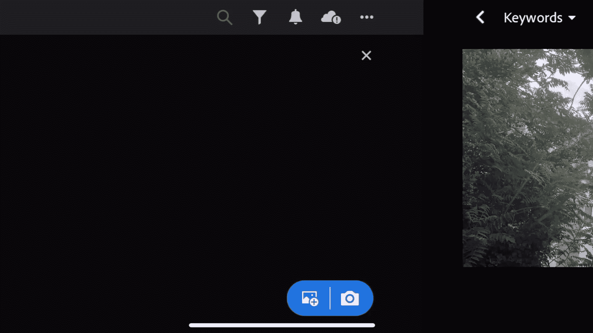

搜索结果 = 图片库 中 包含关键词 的所有图片


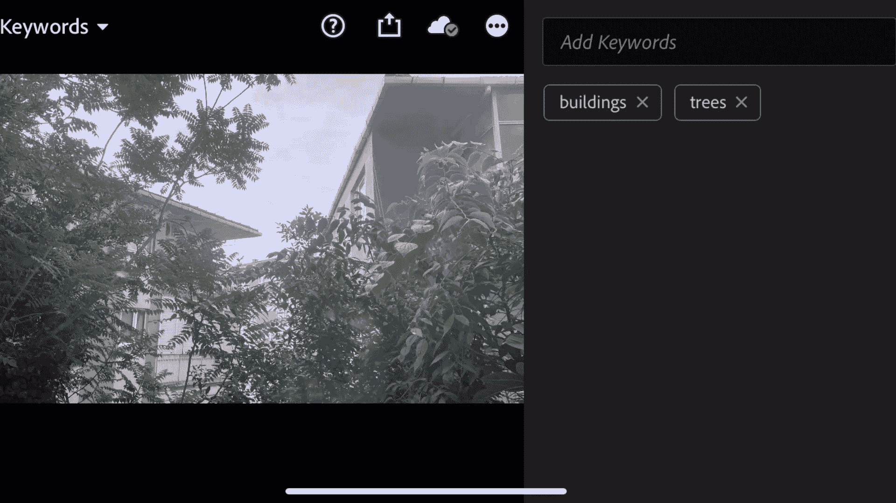

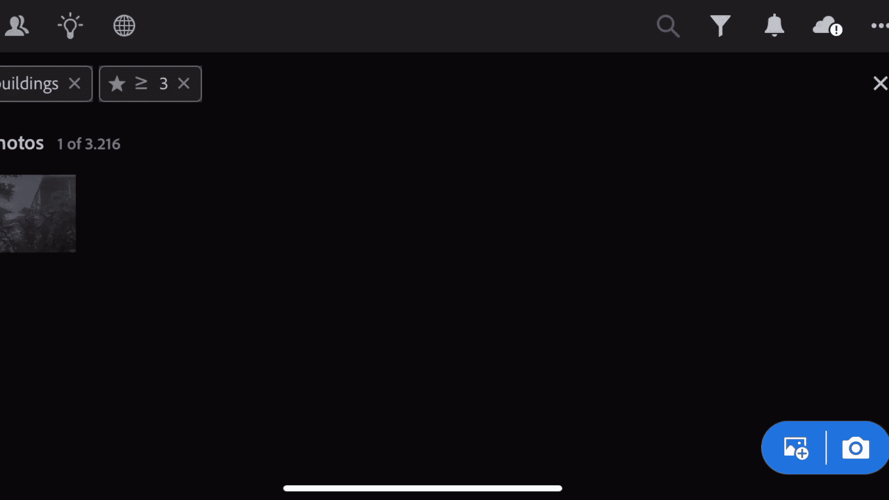

添加完关键词之后，我们可以利用筛选功能来快速定位图片。

我也可以筛选出那些被标记为三星评分的图片，就是这一张。我无法筛选出没有旗帜的图片。我准备移除星级评分，也移除关键词。让我看一下，好吧，没有关键词了。我们选择那些共同的选项。好吧，所有这些图片都没有被加上旗帜，所以它们都显示出来了。好的。我们回到另一个面板。筛选功能的好处在于，它可以帮你把杂乱的图片库瞬间变得整洁，只显示你想要的那一部分，其余的都会被暂时隐藏起来，不会干扰你的编辑思路。


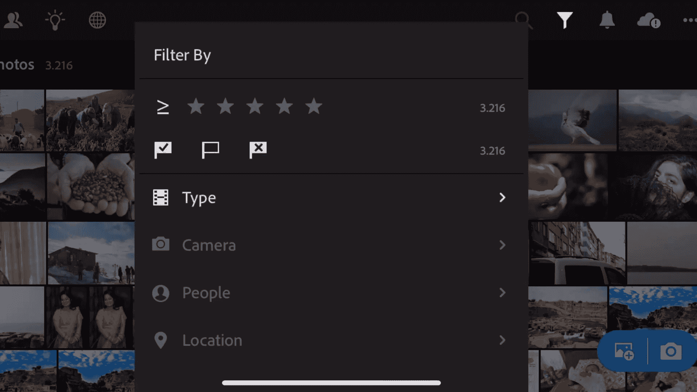

筛选操作的核心逻辑可以用下面的公式表示：

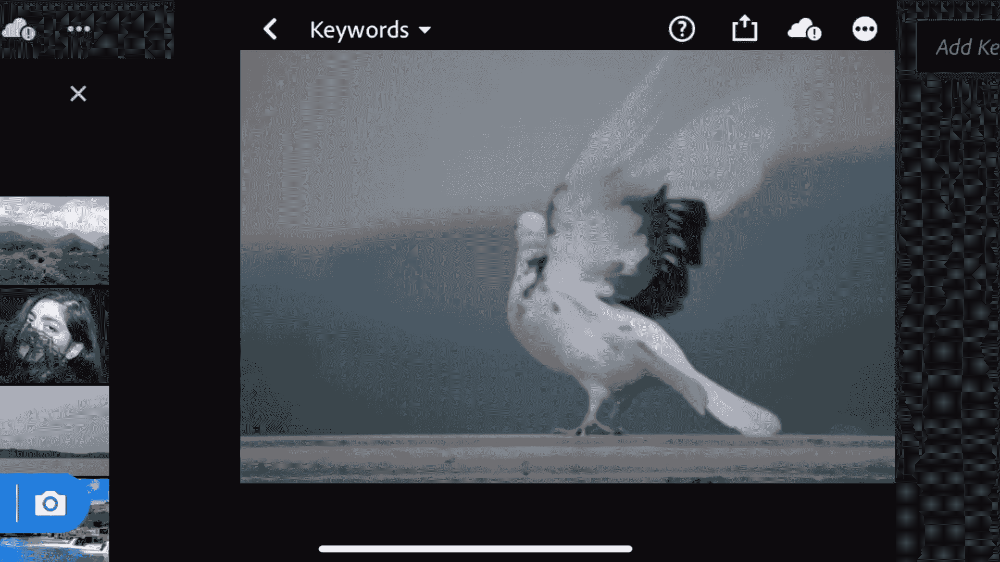

筛选后的图片集合 = 所有图片 ∩ 符合关键词条件 ∩ 符合星级评分条件 ∩ 符合旗帜状态条件


接下来我们来看看信息面板和活动面板。

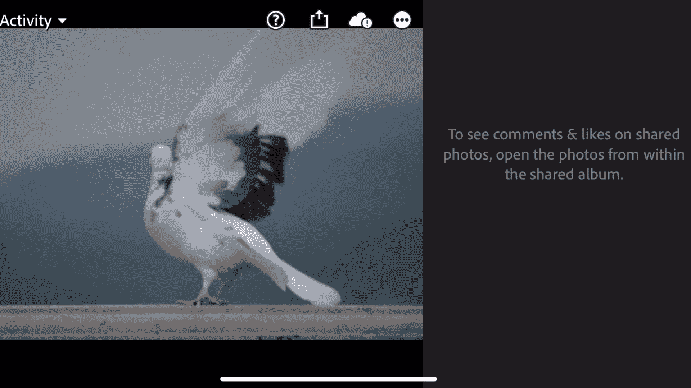

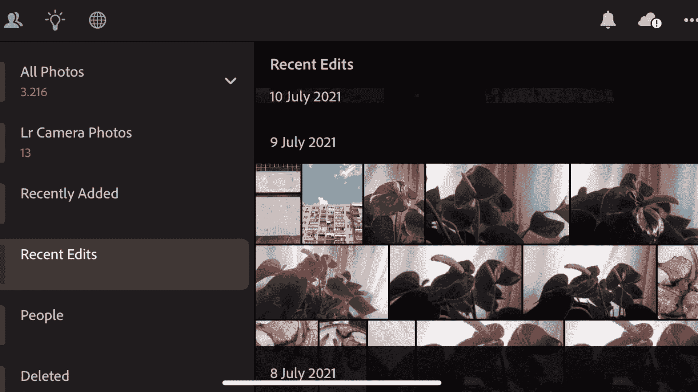

关于信息面板，我们之前已经讲过，你可以为图片添加标题和说明文字。在活动面板中，你可以看到谁点赞了你的图片，谁留下了评论，以及所有这些互动活动。让我打开一张我最近编辑过的图片，我将向你展示，除非你将图片分享到社区，否则这个面板不会显示任何内容，这就是为什么面板里目前是空的。这些是我编辑过的图片。如果我把这些图片与其他人分享到相册中，并且他们对我的图片进行评论，我就能看到他们的评论、点赞以及针对这张图片进行的每一次活动。现在，这些都是空的，因为我没有在任何地方分享这些图片。如果你平时喜欢把作品分享到社交平台或者给朋友看，这个活动面板就会非常有用，因为它能把所有人的反应都集中在一个地方显示出来，你不需要一个一个去回复，直接在这里查看就可以了。


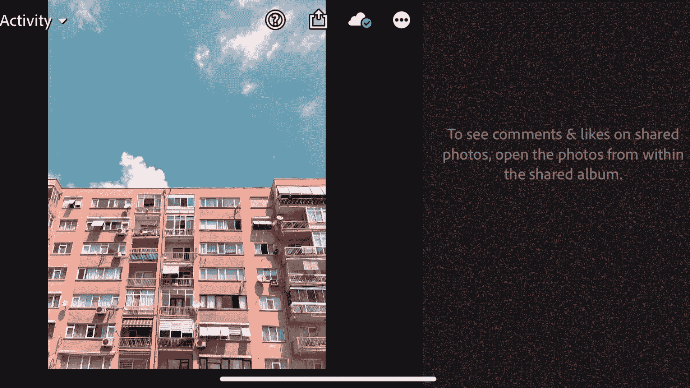

信息与活动面板包含的内容如下：

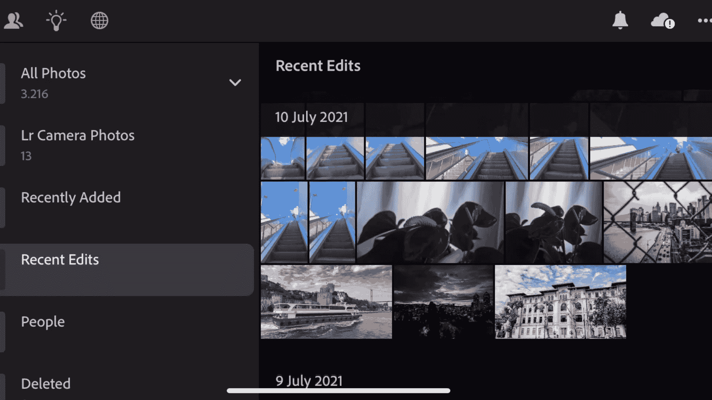

- 标题：用于给图片命名
- 说明文字：用于补充图片的描述信息
- 点赞记录：显示其他用户对图片的点赞情况
- 评论记录：显示其他用户留下的评论内容
- 活动记录：显示针对该图片的所有操作历史


最后我们来总结一下本节课的内容。

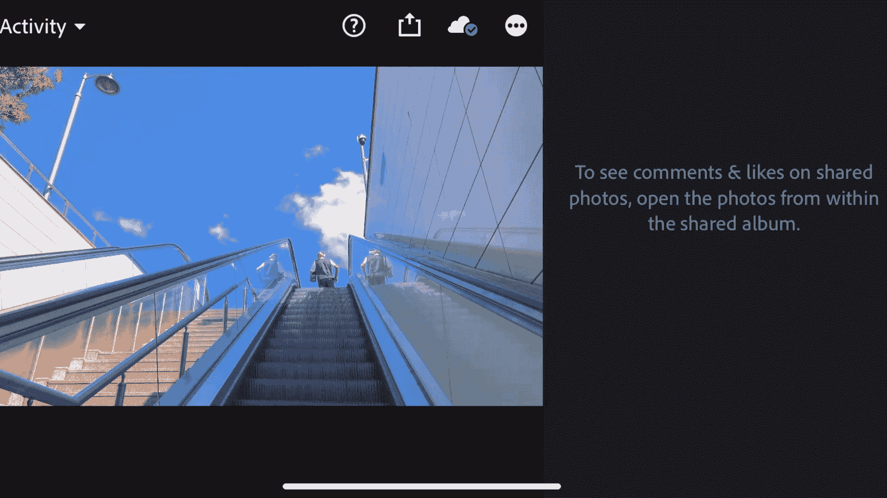

这就是你在Lightroom移动版中评分和审查图片的方法，也是如何使用关键词来组织更有序的媒体库和更有序的编辑时间。通过旗帜、星级评分和关键词，你可以把照片分好类，只挑选出真正需要编辑的图片，大大提高工作效率。本节课就到这里，我们下节课见。

