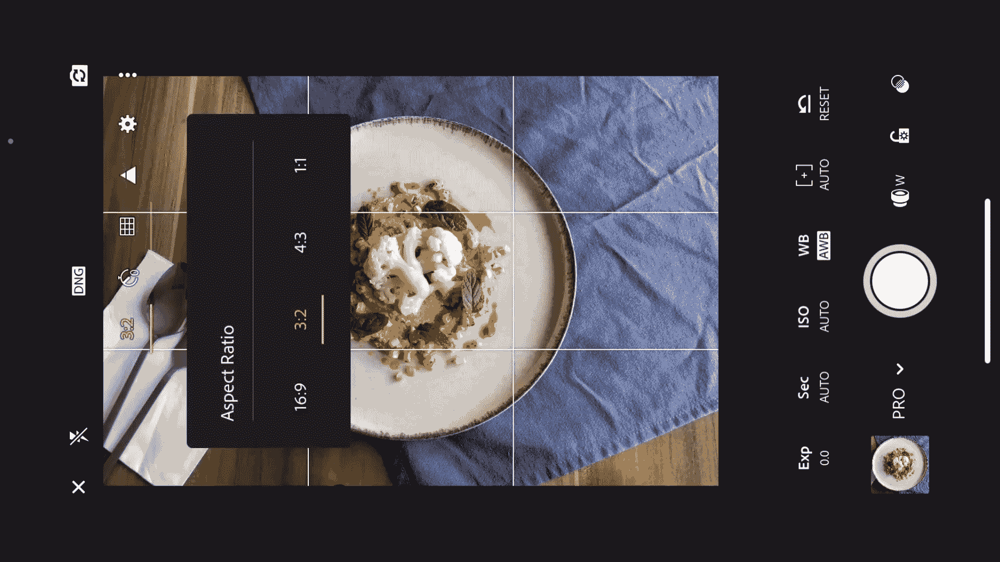
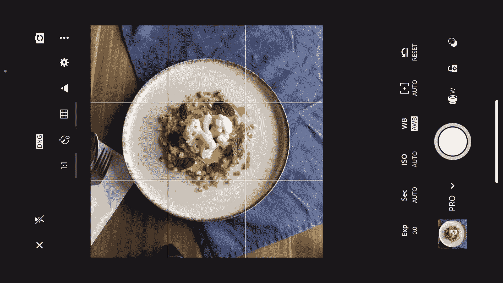
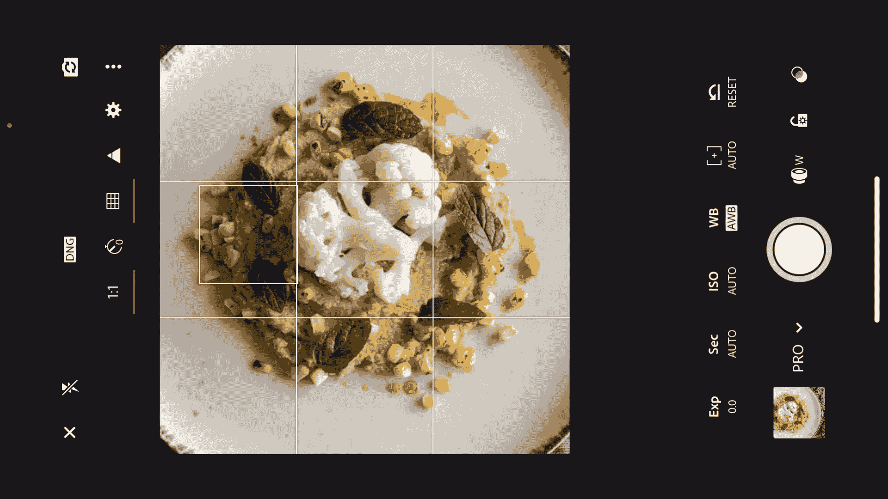
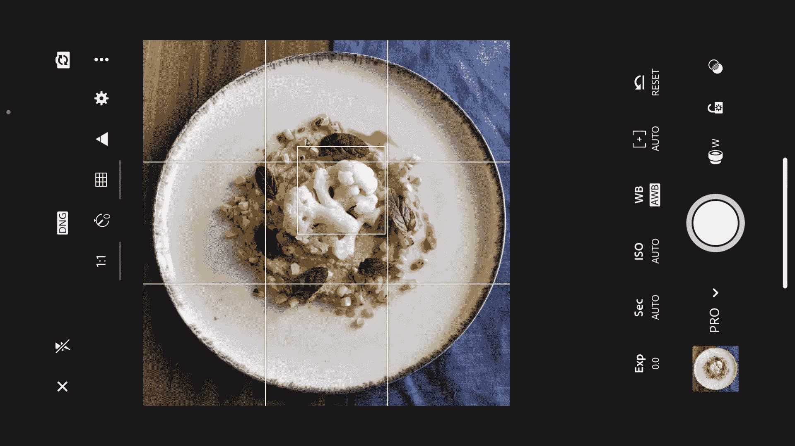
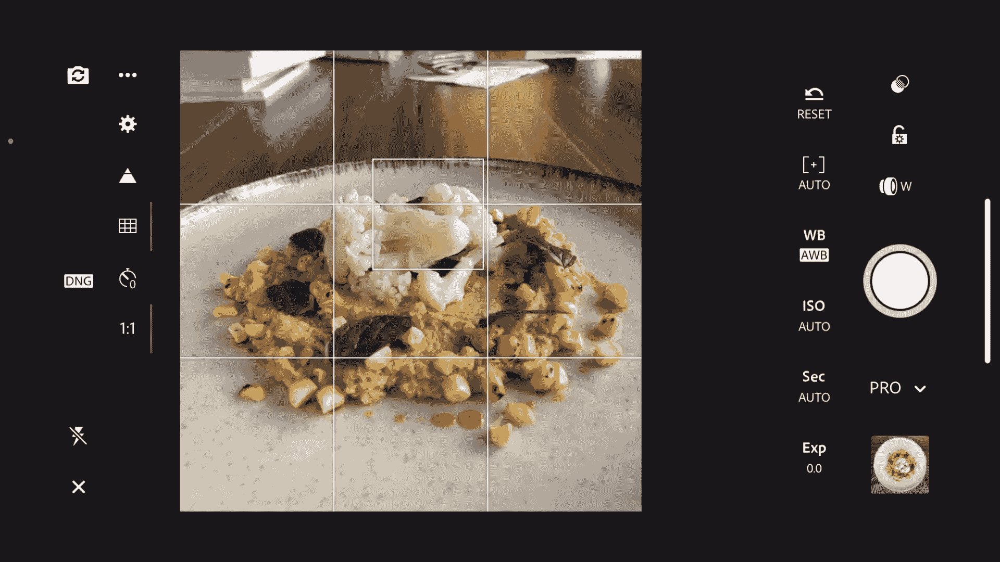
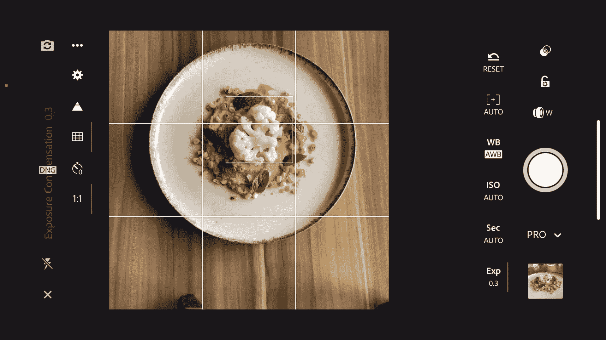

# 📷 Complete Adobe Lightroom Megacourse：第82节：拍摄食物照片


在本节课中我们将要学习如何使用 Lightroom CC 手机端相机拍摄食物照片，并掌握拍摄过程中有用的方法和技巧。


在上一节课中我们介绍了微距摄影的拍摄方法，本节中我们来看看食物摄影的具体操作。我先进入素材库，点击右下角的相机图标，然后准备好本节课要用的那道菜肴。


今天我为这节课摆盘了一道菜，从画面中可以看出这道菜颜色非常丰富。这一点非常重要，盘子里不要出现太多相近的颜色，因为那样会让观看者的眼睛感到乏味，失去视觉吸引力。在这道菜里，我们有绿色、黄色、白色和红色等多种颜色。我把食物放在一张白色或奶白色的盘子里，这样我添加在盘子上的所有颜色都能够凸显出来。盘子下面是一张木质桌面，它在两个物体之间形成了对比，这一点同样非常重要。


## 一、相机设置与光线

以下是拍摄时使用的核心相机设置：

- 输出格式：`DNG`
- 曝光：`Exposure = 0`
- 光源方向：画面右侧
- 快门速度：`Shutter Speed = Auto`
- 稳定设备：三脚架


我把相机切换到专业模式，输出格式设为 `DNG`，就像之前提到过的。如果你想拍出专业级别的照片，选择 `DNG` 格式非常重要，因为这样在后期编辑时不会出现像素化问题。接下来我把所有设置都调为自动曝光 `Exposure = 0`。我的光源位于画面的右侧，快门速度设为 `Shutter Speed = Auto`。其他所有设置都交给 Lightroom 自动处理，这和我们之前微距摄影课程中做的方式类似。我把手机固定在三脚架上，这样拍摄时手不会抖动，同时也能让盘子周围保持均匀的留白，最终构图居中。


## 二、构图与取景

以下是取景和构图的具体步骤，请按顺序操作：



1. 倾斜手机，把菜肴的中心对准网格线的中心。
2. 确保画面中的矩形中心与网格中心保持一致。
3. 稍微旋转图像，让相机取景框的边缘分布均匀。
4. 点击左上角的三个点，更换适合的网格样式，例如两线网格。
5. 根据发布平台选择取景比例，常见选项有 `16:9`、`3:2`、`4:3` 或 `1:1` 正方形。




我倾斜手机，把菜肴的中心对准网格线的中心，画面中的矩形中心与网格中心保持一致。我也会稍微旋转图像，确保相机取景框的边缘分布均匀。现在的拍摄角度已经是一个非常好的居中镜头，可以看到中间的矩形，左右两边以及上下都有均匀的留白。不过这些留白并不那么关键，因为摆盘时很难做到绝对精确。真正重要的是，你要把通常呈规则形状的盘子摆放到合适的位置，并使用相机上的网格线来辅助摆放。


如果你点击左上角的三个点，就可以更换网格样式。你可以选择两线网格，或者其他适合你的网格，选好之后点击确定。我通常使用这个网格，然后就开始拍照。操作非常简单，我们没有做太多调整。但和模特摄影一样，我们是为这次拍摄布置场景。目前画面两侧有很多空白区域。你当然可以保持空白，这没有问题。但是如果你觉得这些空白让你不舒服，想要增加一些颜色，那么可以使用与主体相配的装饰物品来装饰主体周围。当然，你要确保这些装饰物品与拍摄主题相关。比如我先放了一张纸巾，然后放了一些餐具，稍微摆放一下，就是这样。另外，你还可以在盘子下面放一块彩色布料。我现在就演示一下，把布料拿过来，不需要熨烫也没关系。只是为了示范，把它放在合适的位置。你还要确保背景和布料之间形成对比。我就把它放在这里。好了，现在主体位于画面中心，周围不再是单调的桌面，而是添加了一些装饰物品来美化画面。


## 三、自制反光板与光线控制

画面这一边比另一边更亮，这时候可以使用反光板。我会演示一个自制的反光板，因为专业反光板有时价格很贵。在那之前，我先拍一张不使用反光板的照片，让你对比效果，同时要注意不要站在光源前面，否则你会看到自己挡住了光。如果你愿意，还可以在这里放一些花，或者一杯你喜欢的饮料。如果你手头没有足够的装饰物品，可以更改图片的取景比例。点击左上角的三个点，现在你看到的是 `16:9` 的取景框。点击后会出现其他选项，比如 `3:2`、`4:3` 或 `1:1` 正方形图片。根据你想要分享的平台选择合适的取景比例，我就继续使用这个。我也会稍微放大一点，用两根手指像使用其他程序一样进行缩放。我会重新摆放装饰物品，确保看起来美观，把它们放到正确的位置。因为我手头的物品不多，缩小取景框反而成了优势。要确保布料上没有褶皱。这里还有一个空位，你可以留着，以后可以在这里加上文字、Logo 或其他内容。我现在就放一个随机的仙人掌，本来应该放一朵花会更好，但我现在只有这个仙人掌。再拍一张照片，点击菜肴上的花椰菜对焦，然后拍照。


现在说一下光线问题，你可以清楚地看到我菜肴的左侧比较暗，右侧比较亮。这种光线不均匀会影响后期编辑过程，让照片看起来不够专业。所以我们要使用之前提到的反光板。正如我们所说，这里有一些暗区，这是因为我们没有把光线反射过去，从而无法形成均匀的光线。我制作了这个 DIY 反光板，公式如下：

```text
DIY 反光板 = 书 + 锡纸
```

我使用的是哑光的一面，把它贴在书上。如果你的光源从这个方向过来，就把锡纸放在这个位置附近。你可以看到使用前后的区别，我们把光线反射了过去。根据你选择的角度，可以完全照亮那个区域，也可以保持微弱的光线。我们有一个问题，锡纸会在餐具上显现出来。所以我会重新摆放图像，把餐具调整到正确的方向，利用颜色形成对比。就像我们说过的，因为可以把仙人掌放在那里，我就让它露出一半。这只是为了说明那是一个装饰物品。现在如果我把反光板放在食物旁边，你可以看到，我们完全照亮了那个暗区。这是使用前后的对比，很明显这很实用。自己制作一个这样的反光板非常方便，只需要一张锡纸和一个平坦的表面，你可以使用一本不需要的书。这样你就可以轻松制作出反光板。我会点击食物对焦，然后再拍一张照片。


我还会拍摄另一张照片。如果你不想添加所有这些物品，另一种方法是只使用布料，确保是彩色布料。如果你的盘子是深色的，可以添加处于相对两端的颜色。我有浅色和深色，如果反过来，就会得到深色和浅色。我现在要创造一种一半一半的效果，在此之前我要把取景比例改为 `1:1` 正方形，比如说我想把这张照片发布到 Instagram。使用你在这看到的辅助线，我要确保布料是直的，好了，然后把盘子拿过来放置，就这样，把它放下来，让它位于中心。要稍微放大一点。放大时要小心，因为放大会损失一些细节，所以要保留适当的数量。我要拍照，虽然需要把它稍微往下移动一点。拿起反光板，放在食物旁边，然后拍照。好了，这就是另一张照片。




## 四、低角度拍摄与摆盘技巧



现在我要拍摄一个居中的食物镜头，把取景框缩小。确保放置得当，我正在查看辅助线以及取景框边缘周围的空间。显然我没有把菜肴放在中心，但这没关系。盘子和蓝色布料之间，以及旁边的木质桌面之间都有对比度。拿起反光板，点击我希望对焦的主体或其他位置，然后拍照。如果你不喜欢这个布局，还有很多其他拍摄方式。另一种拍摄方法是把相机放得非常低，这样拍摄时能捕捉到盘子中更多细节。这是拍摄食物照片的一个非常好的方法。我要缩小取景框，把盘子靠近一些，这样就不会拍到盘子边缘。让我再缩小一点，因为我想让这里的玉米显示出来。把它放置得当，拿起反光板，放在菜肴旁边。我可能需要在编辑时裁剪掉这些元素，因为可以看到布料的末端，我们实际上可以去掉它们。好了，我打算在编辑时裁剪掉这些。把反光板举起来，点击对焦，然后拍照。


还有一个值得提及的点是摆盘技巧，这更多与烹饪技能相关。但作为食物摄影师，你有责任确保食物看起来诱人，并且使用正确的颜色和正确的艺术风格来制作图片，因为客户会找到你说，这是我的新饼干，帮我拍一张好照片。你的工作可能是在旁边放一杯牛奶，或者在背景中放一个温馨的壁炉场景。总的来说，你要确保食物看起来有食欲，你会通过拍摄技巧和编辑技巧来实现这一点。




这就是一种最简单的摆盘方式，如你所见，我在盘子里有一种网格状的东西。我把它放在中间，用勺子抹平，然后放了辣椒油，在橙色和红色之间创造对比。然后我们有一些烤玉米、一个白色元素和一个绿色元素来凸显。就像我们说过的，我选择了白色盘子，确保颜色在拍摄过程中都能突出，这一点你们也应该这样做。另外，通常无论是微距拍摄还是其他类型的摄影，你都可以让图片看起来冷色调，但食物不同，因为它直接与人的胃产生联系。如果有人看到这张照片，可能会想吃它，也可能不想，但这种联系非常直接。在编辑时，你不希望让食物照片显得冷色调。所有食物图片都需要使用暖色调，公式如下：

```text
食物摄影色温 = 暖色调
```

我们会大量使用暖色调来保持拍摄过程中的一致性。细节当然也非常重要，你要确保图片对焦在你想要的元素上，并且在拍摄时捕捉到所有纹理。


这就是如何使用 Lightroom CC 手机端相机拍摄食物摄影的方法，我们接下来会学习如何编辑这些图片。




本节课中我们一起学习了使用 Lightroom CC 手机端相机拍摄食物照片的完整流程，包括准备与摆盘、相机设置、构图取景、添加装饰物品、自制反光板控制光线、低角度拍摄以及色温和细节处理等核心内容。

