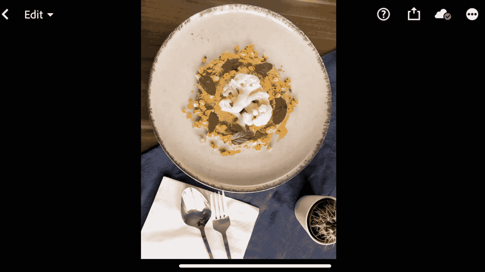
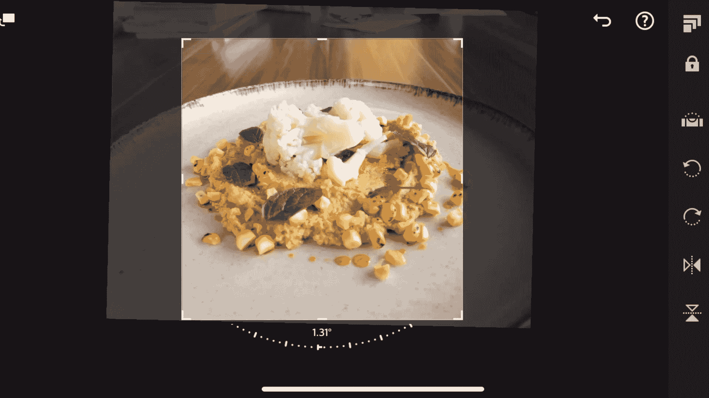
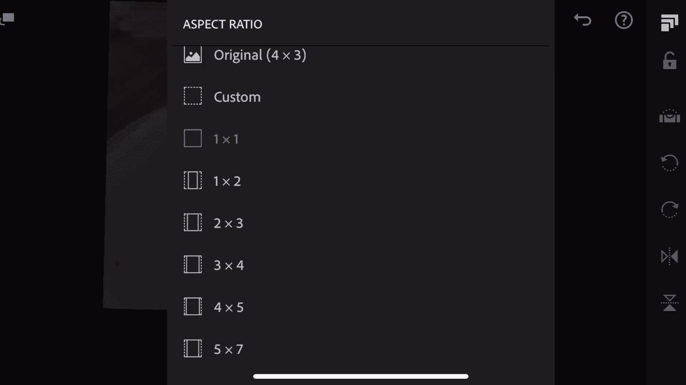
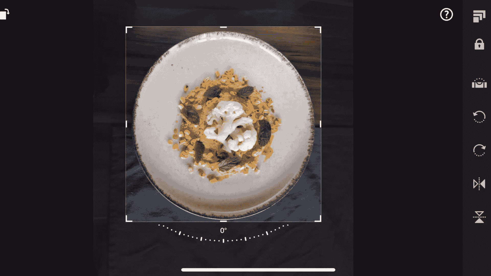
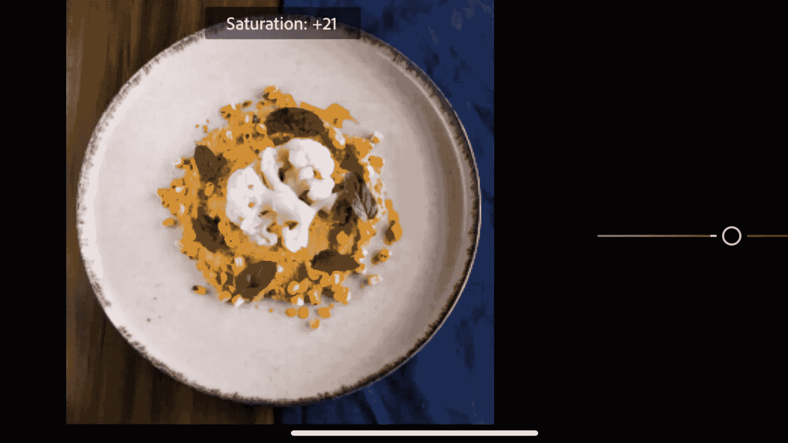
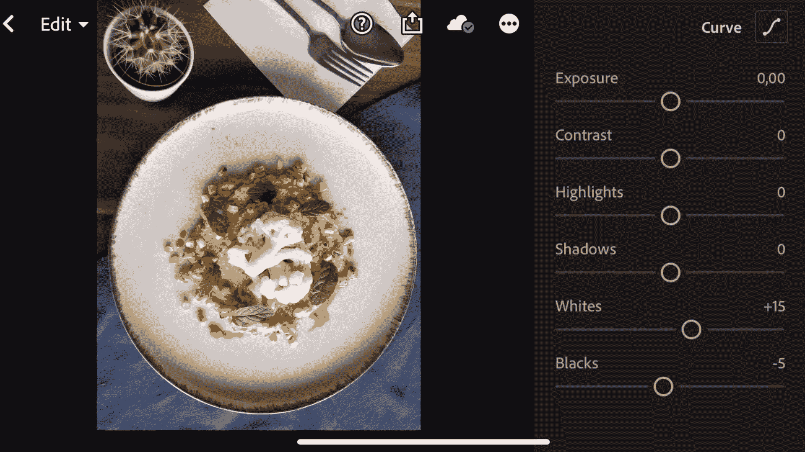
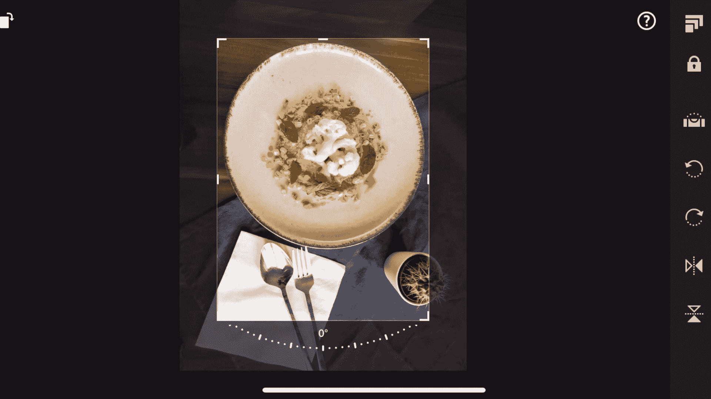
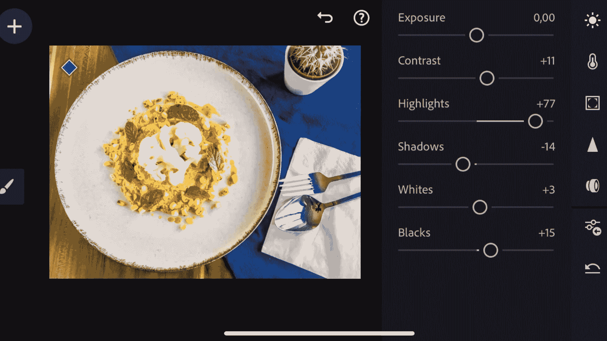

# 完整Adobe Lightroom大师课：第p83节：拍摄食物图片 第2部分 📸


## 课程概述

在本节课中我们将学习如何在Adobe Lightroom中处理食物摄影照片。延续上一节的拍摄内容，我们将把刚才拍摄的几张食物图片导入Lightroom，逐步完成从构图裁剪到色彩调整，再到局部修磨的完整编辑流程。通过这节课，你将掌握让食物照片更具食欲的后期技巧，并且能够把普通的菜肴拍得像专业摄影作品一样吸引人。



---



## 第一部分：导入图片并选择要编辑的照片



在正式开始编辑之前，我们需要先确定哪些图片值得进一步处理。

上一节课我们拍摄了一些食物照片，在拍摄时在食物周围放置了不同的道具，目的是让食物的颜色和整体设计更加协调。那些照片就是我们在这节课要处理的素材。我会先挑选自己满意的几张，然后进入编辑界面。第一张我们先处理比较简单的那一张，等掌握了流程之后再处理其他的。

---

## 第二部分：构图调整与裁剪

接下来我们来看看如何调整图片的构图，让画面更整齐。

第一件事就是旋转图片。你可以看到原图并不水平，所以我们需要使用裁剪工具把它转正。在裁剪工具里，我会先把图片旋转到一个看起来比较舒服的角度，然后点击对勾确认。同时我还要把画面上方那些书本裁剪掉，因为它们干扰了主体。默认情况下裁剪比例是锁定的，但我们可以轻松解除锁定，比如改用三比四的比例。

**核心公式：**
```
裁剪比例 = 宽 : 高 = 3 : 4
```

调整完成后再次点击对勾，这样背景里的书本就不会出现在画面中了，构图就比较干净了。

---

## 第三部分：基础面板与色彩调整

构图好了之后，我们就可以开始调整图片的光影和色彩了。

我通常会先去除雾霾，因为这个选项能把阴影部分更明显地显示出来，让我更清楚地了解接下来需要修哪里。接着进入基础面板，我们可以增加对比度，降低高光，也可以适当调整白色和黑色。曝光量的话如果合适就不需要动。阴影部分可以稍微提亮一点。

色彩方面，因为我们在拍摄时加入了很多彩色元素，所以需要提高自然饱和度让这些颜色更突出。然后进入颜色混合器，分别处理每种颜色。比如玉米的黄色，泥状食物的橙色，蔬菜的绿色。还可以通过改变色相来调整绿色的强度。为了让玉米和泥状食物区分开，我会把玉米调得更黄一些，避免和泥状食物混在一起。如果还有红色，也可以适当提高饱和度。

有时候图片整体会偏黄，这时候可以去调整色温，把画面偏向冷色调。

**核心公式：**
```
蓝色滑块调整 = -当前黄色偏移量
```

因为蓝色是黄色的对比色，这样做可以中和偏黄，让颜色更清晰，不会有一层黄色的遮罩覆盖在画面上。

---



## 第四部分：局部选择与背景虚化

全局调整完成后，我们需要针对特定区域做局部处理。

接下来使用选择性刷子工具。我想把背景里的木桌虚化掉，因为观众的注意力应该集中在菜品上。使用选择性刷子之前，记得先放大图片，这样能更准确地涂抹。调整刷子大小，在木桌区域涂抹，然后降低清晰度和纹理，让桌面变得模糊。不过不要降低得太过分，否则看起来不真实。

我们要记住手机拍摄的景深特点，也就是盘子中间的菜品清晰，周围逐渐虚化，这样能营造出我们之前说过的空间感。处理完之后点击对勾确认。

**操作步骤：**
1. 启用选择性刷子工具
2. 放大图片以便精准涂抹
3. 在背景区域涂抹
4. 降低清晰度和纹理
5. 检查边缘是否自然



---

## 第五部分：锐化、晕影与曲线

然后我们可以给图片添加一些最后的细节效果。

给菜品增加一点清晰度和纹理，让食物看起来更有质感。如果需要，可以加一点晕影，但不要太明显，适度即可。Lightroom在导入照片时会自动添加一些调整，比如锐化和构图建议，你可以接受这些建议，也可以全部重置从头开始。

进入曲线面板，这是我完成光影调整的地方。我会提高高光，稍微降低阴影，然后处理中间调，根据食物的特点让画面更亮或更暗。如果图片还是偏黄，可以进入蓝色通道，把滑块向蓝色一侧移动。这时候通常不需要额外锐化了。

如果某些部分太亮，比如花椰菜发白过度，可以把白色调低一点，避免画面刺眼。最后如果觉得晕影太重，也可以把它去掉，或者把白色调到另一侧来提亮边缘。这样一来，编辑就完成了。

---

## 第六部分：对比前后效果

我们来看看编辑前后的区别。

这张图处理得很简单，但已经看起来不错了。下面是编辑前的样子，这是编辑后的样子。颜色更鲜艳，细节也更清晰，这样的图片完全可以发布到你的社交平台上，展示你的专业编辑能力和摄影技巧。

---

## 第七部分：第二张图片编辑

现在让我们来看看另外几张图片的处理过程。

这张图因为拍摄时放大了，Lightroom自动帮我们把画面裁剪了一些。首先还是要把图片转正，让画面平衡，然后点击对勾。拍摄时我们使用了反光板，所以这张图没有出现一边太暗一边太亮的问题。这就是为什么我建议大家自己制作反光板，在食物摄影、产品摄影或者人像摄影中都非常实用。

接下来我们就像刚才一样，逐个调整滑块，直到满意为止。可以稍微提亮边缘，增加清晰度。然后进入颜色混合器，让画面偏冷一些，提高自然饱和度，可以稍微加一点色调。分别处理每种颜色，比如让绿色更突出，可以提高绿色的亮度。

如果你不喜欢布料的蓝色，也可以把它改成其他颜色，但蓝色和木桌搭配看起来最好，所以我就保持原样。最后让所有颜色都更突出，包括红色部分。处理完之后，色彩看起来不错，但我还会适当增加曝光，然后在曲线面板里提亮阴影和高光，增加中间调的亮度。

---



## 第八部分：第三张图片与局部修复



接下来处理第三张图片，并且解决一些局部瑕疵问题。

这张图是没有使用反光板拍摄的，所以会有一些暗区，而另一些区域比较亮。因为拍摄时放大了，照片被自动裁剪，不过这很容易撤销。首先转正图片，选择合适的区域，如果需要再旋转一下，或者就保持现状。

先去除雾霾，把颜色和阴影带出来，提亮边缘，增加清晰度和纹理。然后进入颜色混合器，把颜色偏向绿色，提高饱和度，降低亮度。绿色部分需要更亮一些，否则几乎看不见。橙色部分也要提高亮度和饱和度。花椰菜太亮的问题我们稍后再修。蓝色部分可以稍微暗一点，这样看起来更好。可以调整色相和亮度，让布料上的皱纹不那么明显。

处理完之后让画面偏冷一点，因为刚才的颜色设置让图片偏暖了。再提高自然饱和度。进入基础面板，降低高光，稍微减少黑色，调整白色，提高阴影，增加对比度，最后适当增加曝光。花椰菜的问题我们稍后处理。

---

## 第九部分：修复布褶皱与过曝部分

然后我们使用修复工具来处理细节问题。

进入修复工具，放大需要处理的区域。也可以调整刷子大小，目前的大小对我来说已经够了。如果选出来的区域看起来不自然，可以移动一下选择范围。同样的问题也出现在其他地方，放大后可以看得更清楚。先点击对勾，稍后再回来处理。

接下来用同样的方法处理花椰菜、蓝色布料和木桌。先选定木桌，涂抹一下，让它呈现深棕色。然后用橡皮擦去除不小心涂到的地方。一定要小心边缘，不要涂过去，否则边缘会看起来不自然。

提高去雾和清晰度，处理光影，逐个调整滑块直到看起来可以。因为我们的刷子带有羽化效果，边缘部分会比其他地方亮一些，所以我需要再做一个精确的选择范围。同样的问题也出现在其他地方。可以稍微提高黑色，避免看起来不自然。



---

## 第十部分：多区域选择与微调

接下来我们还要对其他几个区域做选择性调整。

点击对勾后，我们要再回来做另一个选择范围，这次选定亮部区域，让画面保持平衡。现在看起来好多了。接下来处理布料部分，避开主体周围的边缘。如果不小心涂过了边缘，可以用橡皮擦工具把盘子边缘以及任何需要保持清晰的地方从选择范围里去除。也要处理纸巾的边缘，慢慢地轻轻涂抹。然后进入效果面板，降低清晰度和纹理，甚至可以把这部分调暗一些。再加一点去雾，设为负值。

最后处理花椰菜部分，选定合适大小的刷子，涂抹一下过曝的花椰菜。当主体位于光源前面时，通常会出现过曝情况。大多数时候可以用基础面板里的高光滑块解决，但有时候不行，就需要在这里单独处理。把白色调到一个真实的量级，增加对比度，我们可以提亮阴影，但我想把它们调暗一点。稍微做过了，可以把白色调亮一点。对纸巾也做同样的处理。

如果在拍摄时把物体边缘拍得笔直一些，就能省去很多在Lightroom里修小错误的时间。我们要在橡皮擦和刷子之间切换，避开边缘。回到效果面板，去掉那些线条。

---

## 第十一部分：色温与最终效果

最后我们来调整整体色温并检查最终效果。

图片还是有点偏黄，所以再次进入色温设置，加入适量的冷色调。这样这张图就处理完成了。对比前后效果，你会发现开始的时候颜色比较暗淡，但修正颜色之后，菜品变得更鲜艳。这是展示美食的好方法，会让人产生食欲。当你能以更好的方式展示菜肴时，无论是在摄影还是厨艺方面，都会显得更专业。

---

## 课程总结

本节课中我们一起学习了如何在Lightroom中编辑食物照片。我们掌握了构图裁剪、基础色彩调整、局部选择性虚化、曲线光影控制、修复瑕疵以及最终调色的完整流程。本节课我们编辑了这三张图片，其他的我也不太满意，所以只保留了想要的那几张。希望这些技巧能帮助你拍出更诱人的食物照片，同时展示你的厨艺和Lightroom技能。希望大家喜欢这节课，我们下节课见。

