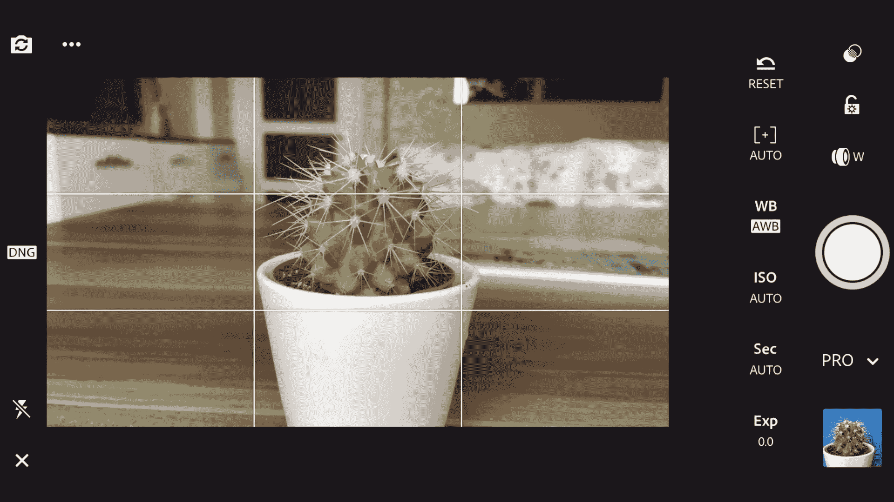

# 📷 Adobe Lightroom 从新手到专家的照片编辑大课：第 79 章：拍摄微距照片


## 课程概述

在本节课中，我们将要学习如何使用 Lightroom CC 移动端自带的相机功能来拍摄微距照片。我们已经在之前的课程里了解过 Lightroom 相机的基本面板和选项卡，但是还没有真正深入地去探讨，如何把这些选项用来拍摄不同类型的图片。所以今天这节课，我们就来聊聊微距摄影这一种风格，看看怎么利用手机里的 Lightroom 相机，拍出专业级别的微距作品。


## 第一节：启动专业相机模式

在我们开始拍摄之前，首先得把 Lightroom 移动端的相机打开，并且切换到专业工作区。只有这样，我们才能使用到所有专业拍摄需要的设置选项。

以下是打开专业相机的操作步骤：

1. 打开 Lightroom CC 移动端的图库界面。
2. 在右下角找到相机图标，点击一次。
3. 在弹出的相机界面中，找到底部的 Auto 按钮，点击它。
4. 将模式从自动切换到 Professional，也就是专业模式。

切换完成之后，你会发现工作区右侧出现了更多的拍摄选项，这些就是我们后续要用到的专业参数了。


## 第二节：选择拍摄主题与构图角度

有了专业相机之后，接下来我们需要决定拍什么，以及从什么角度去拍。本节课我们就拿一盆仙人掌来做示范，把它作为今天的拍摄主体。

在拍摄微距照片的时候，很多初学者会觉得，必须把整个主体都完整地放进画面里。其实完全没必要，有时候我们可以只拍主体的一部分，只要能体现出拍摄对象是什么就行。比如现在我们拍的是仙人掌，那么就不需要把整盆植物全部塞进去，而是可以侧过来，只拍一部分。不过要注意的是，如果你的主体是那个花盆容器，那么构图方式就要换一下，我们先把仙人掌放回原来的位置，不用担心画面里有些小瑕疵，这些在后期编辑的时候随时都可以去掉。

以下是构图时需要注意的几个要点：

1. 不要强行把整个主体都装进画面，局部特写也可以。
2. 注意避免出现尴尬切断，也就是把主体的一半或者重要部分莫名其妙地切掉。
3. 确保画面里保留了跟主体直接相关的全部细节，比如仙人掌的刺和花盆的边缘。

如果你不小心把仙人掌的刺给切掉了，或者花盆只剩下一半，那这张照片看起来就会显得不专业，所以一定要把所有必要的部分都放进去。


## 第三节：设置图片格式与选择镜头

构图思路有了之后，接下来要检查一下相机的输出格式，并且确认现在使用的是哪个镜头。这两个设置直接决定了照片的画质和细节表现。

以下是图片格式和镜头的设置建议：

1. 图片输出格式建议开启 DNG 和 JPEG。
2. JPEG 是压缩过的图片格式，保留的细节比较少。
3. DNG 是 Adobe 的原生格式，相当于相机原始文件，能保留更多的画面细节。
4. 在右上角可以切换手机镜头，不过要注意，超广角镜头通常不支持 DNG 格式，只能输出 JPEG。
5. 如果切换到超广角后发现 DNG 选项消失了，那是镜头本身的限制，不是软件问题，建议切回普通主镜头。

光线方面，我们把仙人掌放在阳光下，但不要直射太阳，这样既能保证足够的曝光，又不会让画面过于刺眼，也不用频繁移动主体。


## 第四节：对焦与避免镜头极限

格式和镜头都设置好了，接下来就是最关键的对焦环节了。微距摄影对对焦要求很高，因为拍摄距离非常近，稍微差一点点就容易对不准。

当你把手机凑近仙人掌的时候，可能会发现无论怎么调整，图片就是对不上焦。这时候不要强行靠近，而是把手机稍微往后移一点，直到画面里的仙人掌边缘变得清晰为止。这时候你可以用手动对焦滑块，告诉 Lightroom 你希望哪个区域保持清晰。

如果把仙人掌举得太高，或者角度不合适，画面里会出现一部分被切掉的情况，这就是所谓的尴尬切断，我们要尽量避免。现在把手机稍微往上调整一下，让仙人掌的刺和花盆的边缘都完整地出现在画面里，这样既没有尴尬切断，照片看起来也更专业。


## 第五节：光圈与景深的替代方案

在微距摄影中，有一个非常核心的概念叫做光圈，简单来说就是进入镜头的光线量。光圈越大，进光越多，景深越浅，背景模糊越明显；光圈越小，进光越少，景深越深，前后都比较清晰。

光圈的基本关系可以用下面这个公式来理解：

```
光圈 = 进入镜头的光线量
景深 = 前景清晰范围 + 背景模糊范围
```

不过 Lightroom CC 移动端相机并没有直接的光圈调节选项，这意味着我们不能像单反相机那样，随意调节光圈来让所有东西同时对焦。移动端提供的手动对焦滑块，只能告诉软件哪个区域要清晰，无法完全控制镜头的光圈。

虽然控制力度没有单反那么强，但依然可以完成拍摄任务。我们可以选择让仙人掌清晰，背景模糊，这样就制造出了微距照片特有的景深效果。需要注意的是，如果背景里的沙发、门或者其他物体离得太远，就很难和前景的仙人掌同时对焦。如果你希望所有东西都清晰，那就需要把它们放在大致相同的距离上。但对于微距摄影来说，我们通常希望背景是模糊的，这正是上一节课我们提到的景深效果。


## 第六节：添加道具营造家居氛围

光圈和景深的问题解决之后，照片可能还是看起来有点平淡，这时候就需要加入一些道具了，让画面有故事感。

仙人掌本身小巧可爱，放在漂亮的容器里，很容易让人联想到家居装饰，是你可能会在办公室或者家里看到的东西。所以我们要根据这个想象，添加跟那个场景相关的道具。

以下是添加道具时的几个思路：

1. 可以在背景里放一些书，摆放得稍微杂乱一点，看起来更自然。
2. 可以在顶部加一些颜色元素，丰富画面层次。
3. 把书放在仙人掌后面，调整位置，避免仙人掌和书之间出现难看的空隙。
4. 道具的摆放可以随意一些，不要太刻意，这样画面会显得更生活化。

我自己就放了一些书作为背景，营造出一个这样的场景：这是我的家，我刚在看书，仙人掌是我工作区的装饰。这样一来，观众看着照片就能明白我想表达的故事了。

在拍摄的时候，还要注意视觉引导，也就是眼流。仙人掌是主体，是观众首先看到的东西，然后视线会移向旁边的书，最后才注意到背景里的其他物品。你可以把拍摄布局想象成一张地图，引导观众的眼睛按顺序在画面里移动。


## 第七节：曝光、快门速度与 ISO

画面布局好了之后，接下来就是微调曝光参数了。如果你拍摄的时候天气比较阴天，光线不足，画面可能会显得有点暗，这时候可以使用曝光滑块来稍微提亮一点。但是要非常小心，曝光滑块每移动一个点，变化都比较大，调多了容易把书本这种纯白颜色过度曝光，反而破坏画面。如果你的主体本身已经光线充足，细节都看得很清楚，那么曝光其实可以不动。

除了曝光，还有快门速度和 ISO 两个参数需要了解。快门速度就在 ISO 选项的下方，它指的是快门打开和关闭的速度。

以下是快门速度的使用规则：

1. 快门速度数值越高，快门开合越快，适合拍摄移动很快的物体，比如赛车或者马拉松。
2. 快门速度数值越低，快门开合越慢，甚至会保持打开一段时间，适合拍摄星空这种需要长时间进光的场景。
3. 对于我们现在的仙人掌拍摄，光线已经足够，不需要传感器太敏感，可以从 1/100 秒这样的数值开始尝试。
4. 如果你想要长曝光效果，通常配合慢速快门使用，并且必须把手机放在三脚架上，否则手抖就会导致整张照片模糊，完全失去长曝光的意义。

接下来是 ISO，ISO 越高，相机传感器越敏感，能捕捉到的细节也越多，但同时画面噪点也会增加。如果在充足光线下把 ISO 调到最高，背景可能会全被过度曝光掉，变得一团白。高 ISO 更适合用在全黑的夜景拍摄，比如你想把夜空里的小星星拍清楚，同时保持天空黑暗，让星星更显眼。

以下是 ISO 的设置建议：

1. 充足光线环境下，ISO 100 通常就足够了。
2. 如果画面开始出现失真或噪点，说明 ISO 调高了。
3. 如果不想手动调整，可以把 ISO 设为自动，让 Lightroom 自行判断。

快门速度我同样建议先设为自动，拍完这张照片之后，我们可以把主体稍微移动一下，看看不同角度的效果。


## 第八节：视觉引导与最终拍摄

参数都设置好了，接下来就可以按下快门，拍出最终的微距照片了。不过在按下快门之前，记得再检查一下画面里的元素布局，确保观众的视线能按照你设计的路径移动。

首先观众会看到仙人掌，这是主体，然后视线会自然地移向旁边的书，最后才注意到背景里的其他东西。这样一来，你就为观众的眼睛画了一张地图，让他们知道该看哪里。拍完这张照片之后，我们就完成了微距拍摄的基础部分。


## 第九节：使用外接微距镜头与后续编辑

如果你希望拍出更专业的微距照片，能看到画面里更多微小的细节，那么建议给手机加一个外接微距镜头。这种镜头通常很小，直接夹在手机摄像头上就能使用，能够提升焦距、光圈表现和画面清晰度。

当然，如果你不想额外买镜头，用手机自带的镜头也完全可以拍出不错的微距照片。主要区别在于焦距、光圈以及额外的锐度，但像我们刚才演示的，自带镜头依然能拍出很好的效果。后面的课程里，我们会继续学习如何对这些照片进行编辑。

如果你想像之前课程里做的那样，给照片换个深色背景，可以随便找一本书，或者找一面墙作为背景。只要注意不要有反光，颜色最好是哑光的就行。如果书本封面反光，可以把书稍微弯一下，或者换个角度，反光就消失了，也可以在后期裁剪掉不需要的部分。

现在我们知道怎么拍微距照片了，接下来就可以进入编辑环节，把刚才拍的照片处理得更好。


## 课程总结



本节课中我们一起学习了如何使用 Lightroom CC 移动端相机拍摄微距照片。我们先启动了专业相机模式，了解了 DNG 和 JPEG 格式的区别，然后学习了怎么选主体、怎么构图、怎么避免尴尬切断。接着我们讲解了手动对焦、光圈与景深的替代方法，以及如何添加道具来营造家居氛围。最后我们还梳理了曝光、快门速度和 ISO 的设置技巧，了解了外接微距镜头的作用，并为后续的图片编辑做好了准备。
