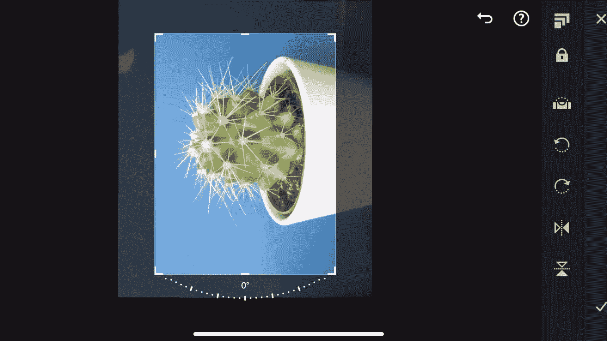
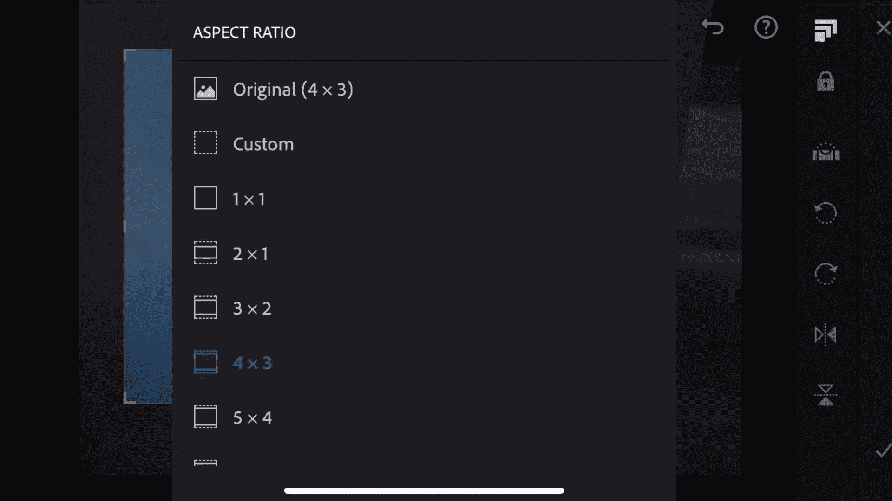
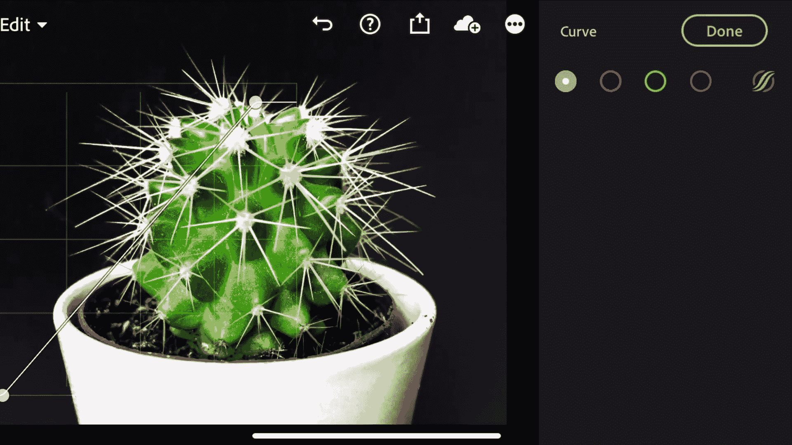
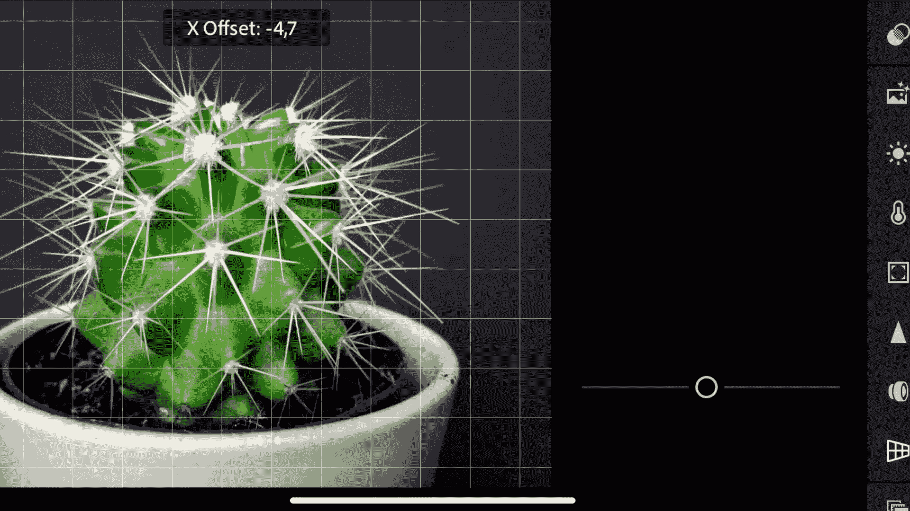

# 完整 Adobe Lightroom 从新手到专家的照片编辑课程：第85节：拍摄微距照片第2部分 📸


在本节课中，我们将学习如何使用 Adobe Lightroom 手机版对微距照片进行后期编辑。本节是拍摄微距照片的第二部分，我们会把刚才拍摄好的仙人掌照片一张一张地调出来，从选图、裁剪、基础光影调整，一直到颜色分级、背景虚化和细节修复，让初学者也能轻松跟上。


## 一、选图与初步检查

上一节我们完成了微距照片的拍摄，本节中我们来看看如何把这些照片调好。

拍摄完成后，我们将使用迄今为止学到的后期技术，对每张照片进行编辑。

首先要做的就是查看你的照片，逐一检查每一张。可以放大观察，确认所有细节是否都对焦清晰。

选好照片后，就可以开始编辑。


## 二、第一张图片：裁剪与构图

刚才我们介绍了如何选图，本节中我们来看看第一张图片的裁剪和构图调整。

我先选择这张照片和开头的那一张。就拿这个仙人掌来说，我先从这张开始，因为这张比较好处理。

以下是裁剪与旋转的具体操作步骤：

- 第一步是裁剪掉不需要的区域。
- 进入裁剪工具，因为之前改过宽高比，所以现在已经是裁剪后的样子。
- 只保留书本和仙人掌，同时旋转照片让画面平衡端正，完成后点击对勾。

裁剪构图的核心思路可以用这个公式理解：`画面 = 主体 + 必要背景 - 冗余区域`。通过去除多余部分，观众的注意力就会集中在仙人掌本身。


## 三、第一张图片：光影与曲线调整

构图完成后，本节中我们来看看如何对光影和曲线进行细致调整。

接下来就可以开始常规编辑，先从光影面板开始。

以下是基础光影调整的参数方向：

- 降低高光和亮部，增加一些对比度。
- 降低黑部和阴影。
- 接着进入曲线面板做进一步调整，确保细节被凸显出来，整体效果看起来不错。

通过降低亮部和提升对比度，可以让仙人掌的纹理更加立体。


## 四、第一张图片：颜色通道与色彩混合器

光影调整完成后，本节中我们来看看颜色通道和色彩混合器的使用方法。

接着进入蓝色通道，因为照片偏黄。将滑块向蓝色方向移动，平衡色彩。

进入效果面板，添加去雾、清晰度和纹理。因为仙人掌和盆土上有很多纹理细节，这些调整能让表面更有质感。

进入色彩面板，调向冷色一侧，平衡整体色调。饱和度还可以，稍微降低一点。

以下是颜色混合器的调整思路：

- 进入颜色混合器，调整绿色，让绿色更深，偏向蓝绿，而不是黄绿。
- 降低亮度，获得深绿色。
- 查看其他颜色，背景中有一些红色，同样降低这些红色的饱和度，并稍微调整亮度，避免背景抢走仙人掌的注意力。
- 如果遇到类似问题，直接去除饱和度也可以。

色彩平衡可以用这个简单公式表示：`最终色调 = 原始色温 + 调整偏移`。


## 五、第一张图片：透视、修复与黑白处理

颜色调整完成后，本节中我们来看看透视修正、斑点修复和黑白艺术处理。

完成后进入透视面板，开启限制裁剪。想把照片水平移动一下，看看效果。移动过多了，向左旋转一点。

进入修复工具，调整修复笔刷大小，轻点需要清理的区域，细小的毛发就不明显了。保持现状，确保仙人掌完美。让 Lightroom 自动选择参考点。

修复工具的基本调用可以参考如下伪代码：





```
healing_tool(brush_size, target_area, auto_reference)
```

完成后进入色彩面板。考虑把这张照片做成黑白，因为原本颜色不多，黑白效果不错，能保留大量细节，黑白呈现效果很好。这只是一种艺术处理，没有特别要表达的含义。

增加去雾，效果已经好很多了。稍微降低对比度，尝试各种参数找到最佳效果。稍微锐化一下照片。


## 六、第一张图片：背景虚化与修前修后对比

修复完成后，本节中我们来看看如何给背景添加模糊效果，并查看最终对比。

还可以尝试另一件事，使用选择工具选中背景，设置羽化。选中所有背景区域，给背景加模糊效果。

使用笔刷，确保开启羽化，避免边缘生硬。选好区域后，进入效果面板降低清晰度，这样就产生了模糊效果，也可以降低纹理。调整滑块，背景现在更模糊了。

背景虚化的逻辑可以这样表示：`背景清晰度 = 原始清晰度 - 遮罩降低值`。



展示修前修后对比，这是修前。背景细节被模糊，帮助我们更接近想要的微距效果。第一张照片编辑完成，细节丰富，甚至能看到仙人掌上的细小刺毛。镜头本来无法虚化背景，现在通过后期实现了。如果背景虚化有困难，可以用遮罩方法，效果很好。这是修前，这是修后，这是第一张图。


## 七、第二张图片：裁剪与纯色背景处理

第一张图完成后，本节中我们来看看第二张图片的处理方法，也就是有背景的那张。

开始前先裁剪掉不需要的区域，解除锁定。选择 4:3 比例，不需要旋转。尝试 5:4 比例，完成后主体背后是纯色背景。



可以利用纯色背景营造专业感，进入颜色混合器。选择蓝色，降低饱和度并变暗。有黑色书本效果会更好，但这个暂时够用。同时让绿色更真实深沉，降低亮度，完成后给照片降温，保持自然饱和度。


## 八、第二张图片：光影、曲线与暗角

背景处理完成后，本节中我们来看看第二张图片的光影与曲线调整。

进入效果面板增加去雾，可以看到立即有很多对比度，仙人掌更加突出，背景颜色差异明显，背景也变暗了。增加一些清晰度，进入光影面板。降低阴影，提高高光、亮部和对比度。

以下是曲线调整的操作要点：

- 进入曲线，使用红色通道旁边的点曲线。
- 暗部变暗，将底部滑块向右移动。
- 高光滑块向左移动，完成。
- 降低对比度，添加暗角，向左调整，按喜好调整中点和各滑块。

效果不错，进行锐化。


## 九、第二张图片：位置调整与色调分级

光影调整完成后，本节中我们来看看位置微调和色调分级。

使用旋转工具调整照片角度。稍微缩放，检查仙人掌是否居中。调整 X 轴偏移量，调整盆栽与图片边缘的间距。

进入色调分级，使用合适的色调分级，先处理阴影部分。给阴影添加蓝色，可调整饱和度或保持原样。保持初始状态，通过降低亮度让背景更暗。背景变暗后降低饱和度，高光部分添加暖色调，调整饱和度和亮度，效果不错。

再做一件事，进入中间调。添加颜色平衡画面，尝试找到最佳效果。重置高光，中间调和阴影保持当前设置，完成。


## 十、第二张图片：修复工具与花盆边缘虚化

色调分级完成后，本节中我们来看看修复工具和花盆边缘的虚化处理。

边缘有一些点，需要用修复工具处理。选择合适笔刷大小，让 Lightroom 自动选择区域。选错了，选择亮部区域，使边缘与盘子边缘匹配，完成。

仙人掌微距照完成，想模糊花盆上的裂痕。使用选择工具加号，选择合适笔刷大小。先放大再选笔刷，选择花盆区域。羽化过多，选更小的尺寸。选中花盆每个边缘，用橡皮擦清理边缘，保持边缘锐利。边缘要大幅羽化，让效果自然，慢慢涂掉多余斑点。可以用圆周运动，用自己舒服的方式。

使用之前的模糊技术，完成后进入效果面板降低清晰度和纹理。调整到满意，回到选择工具添加更多区域。意外选到土壤，但区别不大。如所见，去除了细小绒毛。多余部分可以进入修复面板处理，轻点过于明显的点。完成修复。

仙人掌照片完成，看起来不错，很锐利，我们成功用一本随机书本为仙人掌创建了真正坚固且专业的背景。


## 十一、课程总结

本节课中我们一起学习了如何在 Adobe Lightroom 中编辑微距照片。我们掌握了选图检查、裁剪构图、基础光影调整、曲线与颜色通道调整、色彩混合器使用、透视修正、修复工具斑点清理、黑白艺术处理、背景遮罩虚化、色调分级以及花盆边缘修整等完整流程。

使用这些技巧，你可以轻松使用手机和 Lightroom CC 移动版拍出微距照片。希望大家喜欢这节课，我们下节课见。

