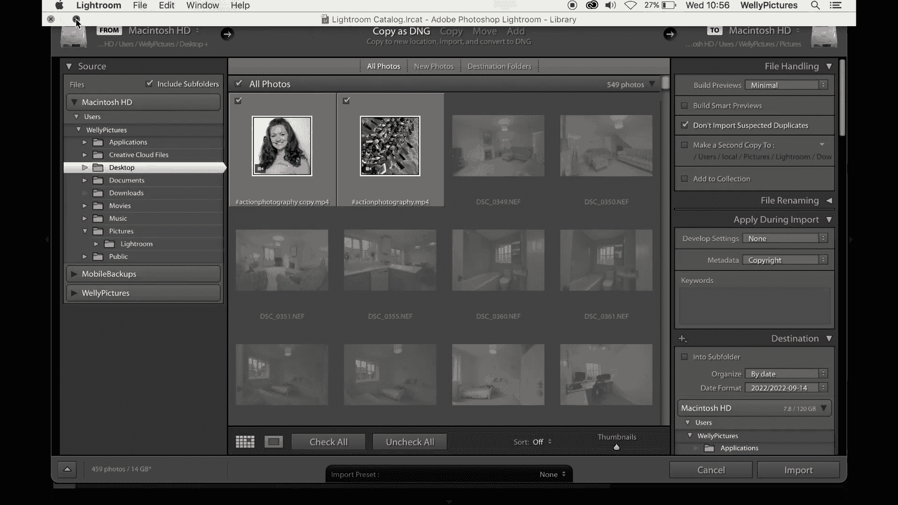
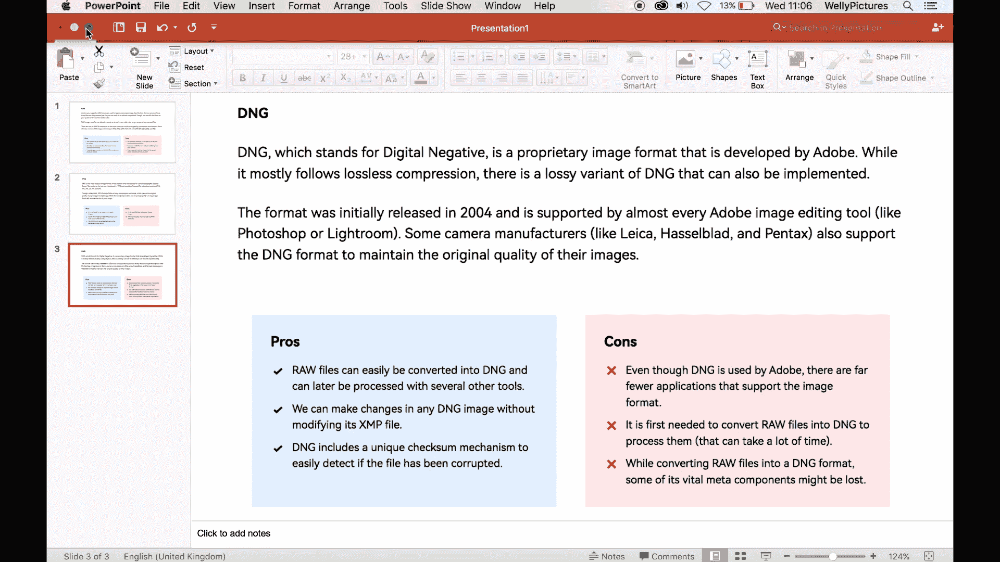
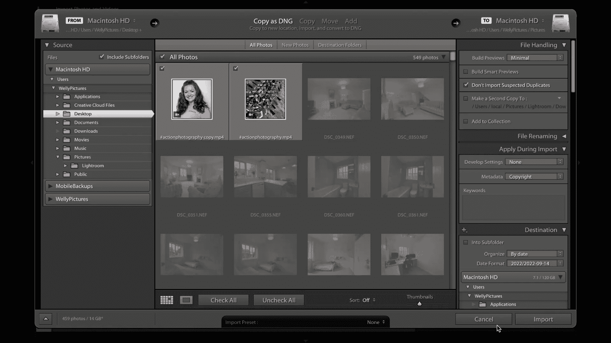
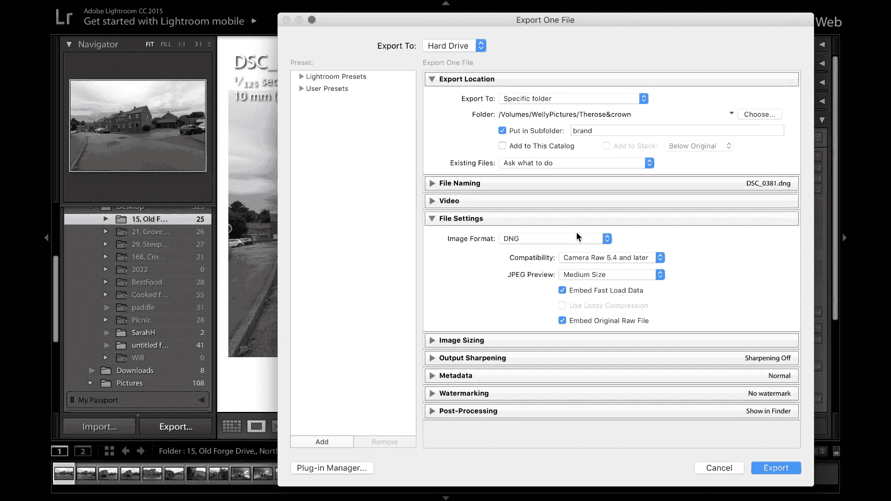
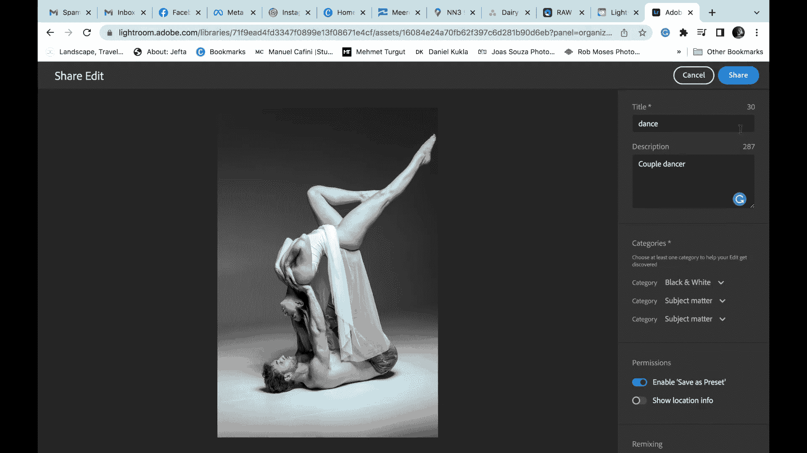
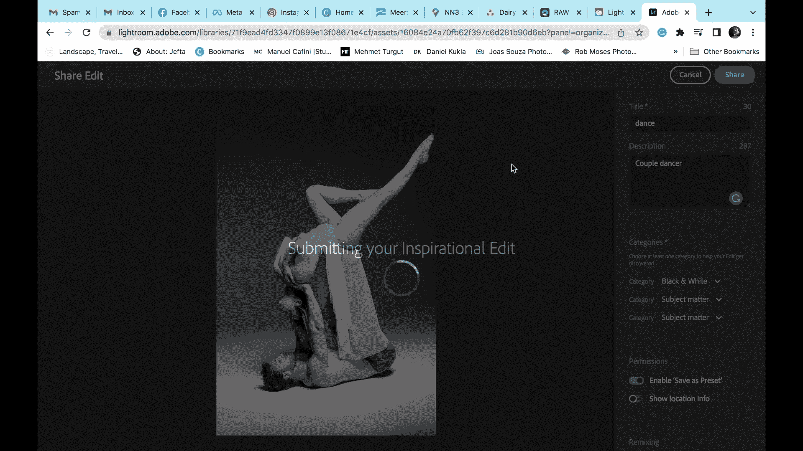
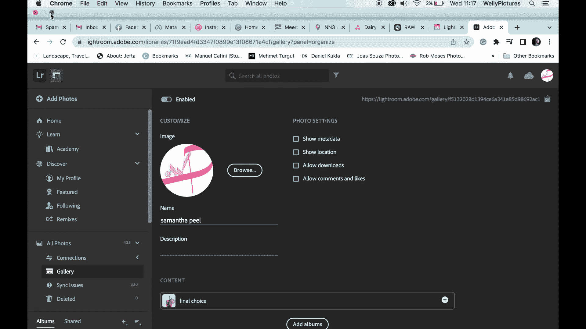

# Adobe Lightroom 从入门到专家：第 86 章：理解 RAW、JPEG 与 DNG 文件 📸

在本节课中我们将要学习 Lightroom 中最常见的三种图片格式，也就是 RAW、JPEG 与 DNG。我们会逐一说明每种格式的定义、优缺点，以及在实际拍摄和后期编辑中该如何选择。无论你是刚开始接触摄影的新手，还是希望提升后期处理能力的爱好者，这部分内容都能帮你建立清晰的文件格式认知，让你在使用 Lightroom 时更加从容。

为什么需要了解图片格式

作为摄影师或后期编辑人员，你拍摄和保存照片所使用的格式，直接决定了图片的画质、文件体积以及后期编辑的灵活性。不同的格式适合不同的使用场景，比如专业人士通常优先选择 RAW 格式，以便获得最大的编辑空间；而日常分享或网页展示则更适合体积更小的 JPEG 格式。了解它们之间的区别，能帮你在导入、编辑和导出图片时做出更合理的决策，避免因为格式选择不当而导致画质损失或存储空间浪费。

以下是本节课将要重点讨论的三种核心图片格式：

- RAW：来自相机的未处理原始图像文件，保留完整画质，适合深度编辑。
- JPEG：经过压缩的图像格式，体积小，适合传输和社交媒体分享。
- DNG：Adobe 开发的数字底片格式，兼容性好，便于在 Adobe 软件之间共享。

在 Lightroom 导入界面中识别图片格式

首先我们来看 Lightroom Classic 的导入界面。当你点击“导入”按钮后，系统会让你选择图片的来源位置，此时界面上会列出你电脑或存储设备中的各种图片文件，并根据文件后缀名显示其格式。比如尼康相机的 RAW 格式通常是 NEF，佳能相机则是 CR 系列，索尼则是 ARW，富士则是 RAF，以此类推。识别这些后缀名能帮你确认当前文件到底属于哪种格式，从而决定后续如何处理。

以下是常见相机品牌对应的 RAW 后缀示例：

- 尼康：NEF
- 佳能：CRW、CR2、CR3
- 索尼：ARW
- 富士：RAF

如果你拍摄的是 JPEG 图片，文件名通常以 .JPG 结尾；如果是 DNG 图片，则以 .DNG 结尾。在导入时，Lightroom Classic 允许你直接将图片复制为 DNG 格式，而不是保留相机原始的 RAW 格式。这样做的好处在于，你可以统一使用 Adobe 支持的 DNG 格式，方便后续编辑与共享，而不必纠结于不同相机品牌的原始后缀差异。

RAW 格式详解

接下来我们详细了解 RAW 格式。RAW 格式本质上是相机拍摄时产生的未处理原始图像文件，它没有经过相机内部的压缩或调色处理，因此保留了最大限度的画质细节。你可以把它理解为数码底片，拍摄后直接记录传感器捕捉到的全部信息，为后期编辑提供最丰富的素材。

RAW 格式与其他格式在画质保留上的关系可以用下面这个简单公式表示：

`画质保留度：RAW > DNG > JPEG`

使用 RAW 格式的优点如下：

- 文件包含相机及拍摄参数信息，例如镜头焦距、快门速度、光圈值等，方便你回顾拍摄设置。
- 因为是未处理文件，你在后期编辑时拥有更大的调整空间，可以回退部分过曝或欠曝区域。
- 只要高光部分没有“过曝”，即光线过强导致细节完全丢失，通常还能通过编辑挽回细节。
- 相比已经处理过的图片，RAW 文件更容易进行预览和编辑。

当然，RAW 格式也存在一些缺点：

- 不同相机厂商的 RAW 格式不尽相同，文件后缀因品牌而异，第三方软件可能不一定都支持。
- 部分编辑软件无法直接编辑特定相机的 RAW 格式，需要专用软件或插件才能打开。
- 文件体积较大，会占用 SD 卡和硬盘更多存储空间，不适合存储空间有限的情况。

总的来说，如果你打算进行大幅面打印，或者需要深入细致的后期编辑，RAW 格式是带入编辑软件的最佳选择。而如果你只想做简单的色彩增强、曝光调整或转黑白，JPEG 也足够应付日常需求。

JPEG 格式详解

接着我们来看 JPEG 格式。JPEG 是一种经过压缩的图像文件，体积通常只有原始 RAW 图像的十分之一左右，压缩比大约在 10:1。正因为体积小，它成为了目前最普遍的图像存储和传输格式之一，几乎所有设备都能直接打开。

JPEG 文件体积与原始 RAW 文件体积的关系可以用下面这个公式表示：

`JPEG 文件体积 ≈ 原始 RAW 文件体积 ÷ 10`

JPEG 格式的优点包括：

- 通用性极强，几乎所有图片查看器、编辑器和工具都支持 JPEG。
- 文件体积小，便于在社交媒体、网站上存储和分享，加载速度更快。
- 可以针对不同用途设置固定裁剪尺寸，方便适配网页或社交平台的显示要求。

不过 JPEG 也有明显的缺点：

- 不支持图层，因此如果你在 Photoshop 中使用了图层编辑，需要先合并图层才能保存为 JPEG。
- 画质在多次编辑后容易下降，出现像素化现象，即图像变得模糊、失去焦点。
- 一旦将图片放大，像素问题会更加明显，不适合大幅面打印或高清展示。

简单来说，JPEG 适合对存储空间有要求、需要快速分享的场景；而如果你需要进行高强度编辑，RAW 格式会是更好的选择，因为它不会在压缩过程中丢失细节。

DNG 格式详解

然后我们介绍 DNG 格式。DNG 的全称是 Digital Negative，即数字底片，是由 Adobe 开发的图像格式。因为它出自 Adobe，所以在 Lightroom 和 Photoshop 中表现良好，适合在 Adobe 软件生态中共享和编辑，是连接不同 Adobe 产品的桥梁。

DNG 格式与 RAW 格式的关系可以用下面这个公式表示：

`DNG = Adobe 开发的通用 RAW 兼容格式`

你可以把 DNG 理解为一种压缩或共享已编辑图片的方式，方便从 Lightroom 或 Photoshop 发送给其他人。DNG 格式的优点如下：

- RAW 文件可以轻松转换为 DNG 格式，保留大部分原始数据。
- 你可以将 DNG 图片转换为修改过的 XMP 文件，这部分内容将在下一节中详细介绍。
- DNG 包含实际的图像机制，可以检测文件是否损坏，具有一定的数据安全性。
- 因为受到 Adobe 支持，你可以将 RAW 图片导入 Lightroom，再转换为 DNG 分享给他人，对方也能重新编辑这张图片。

DNG 格式的缺点如下：

- 尽管 Adobe 使用 DNG，但支持该格式的应用程序较少，主要局限于 Adobe 生态系统。
- 在处理之前，需要先将 RAW 文件转换为 DNG，这个过程比较耗时，不适合急于获取结果的情况。
- 转换过程中，部分重要的元数据组件可能会丢失，需要注意备份原始文件。

因此，如果你希望将 RAW 图片转换为便于共享的格式，DNG 是一个不错的选择，但需要留意转换耗时和元数据可能丢失的问题，建议在重要项目中保留原始 RAW 文件以防万一。

在 Lightroom Classic 中导出图片

了解如何导入后，我们再来看如何导出。当你在 Lightroom Classic 中完成图片编辑，准备保存到硬盘时，需要点击“导出”按钮。在导出设置面板中，你可以选择导出位置、文件命名方式、文件格式、色彩空间、图片尺寸等参数，这些设置决定了最终输出文件的样子。

以下是导出设置中需要关注的主要选项：

- 导出位置：决定保存到哪个硬盘文件夹，也可以创建子文件夹来整理图片。
- 文件名：可以自定义命名，也可以添加日期或编号序列，方便批量管理图片。
- 文件格式：可以选择 JPEG 或 DNG，JPEG 可以选择大写或小写扩展名，根据需求决定。
- 色彩空间：通常使用 sRGB，这是通用的编辑色彩空间，适合大多数显示设备。
- 图片尺寸：可以限制图片的宽度和高度，适配网页或打印需求，避免文件过大。
- 预览图大小：可以选择不生成预览图，或者生成中等尺寸、全尺寸的 JPEG 预览，方便后续查找。

如果你选择导出为 DNG，界面上会显示与相机版本相关的选项，建议确认你使用的 Lightroom 和 Photoshop 版本是否兼容所选的 DNG 相机版本，以免出现无法打开的情况。此外，导出时还可以选择是否将原始 RAW 文件嵌入到 DNG 图片中，供后续使用，这样可以兼顾共享便利性与数据完整性。

在新版 Lightroom 中分享图片

除了 Lightroom Classic，Adobe 还推出了新版 Lightroom，操作界面略有不同。在新版 Lightroom 中，选中一张图片后，你可以直接下载原始 RAW 图片、小尺寸 JPEG 或大尺寸 JPEG。小尺寸 JPEG 适合网站和社交媒体，大尺寸 JPEG 则适合小规模打印，但不建议用于大幅面输出。

如果你点击编辑进入图片详情页面，下方会显示图片的信息和背景，包括相机型号、镜头、ISO、光圈值以及拍摄日期等，这些信息与 RAW 格式中的元数据一致，能帮你快速回忆拍摄时的参数设置。

在分享界面，你有两个主要选择：一是下载图片，二是分享邀请。通过“分享和邀请”，其他人可以查看你的图片并进行进一步编辑；通过“分享编辑”，你可以为图片添加标题、描述、主题，甚至保存为预设。这些标签信息还能帮助你的图片在 Google 搜索中被更容易找到，提升作品的曝光度。

以下是新版 Lightroom 中分享图片的常见方式：

- 下载原始 RAW 图片，保留完整编辑数据，适合专业存档。
- 下载小尺寸 JPEG，适合网页和社交平台，加载速度快。
- 下载大尺寸 JPEG，适合小幅面打印，满足基本输出需求。
- 通过 Adobe 个人资料分享，让关注者查看你的作品，建立个人品牌。
- 导出到本地硬盘，再通过 Instagram、Facebook、Twitter、Pinterest 等平台传播，扩大受众范围。

总结

本节课中我们一起学习了 Lightroom 中三种主要图片格式的特点和使用场景。RAW 格式保留原始画质，适合深度编辑和专业后期；JPEG 格式体积小、通用性强，适合分享和存储；DNG 格式由 Adobe 开发，便于在 Adobe 软件之间共享和编辑。我们还介绍了如何在 Lightroom Classic 和新版 Lightroom 中导入、导出及分享这些格式的图片。希望通过这节课，你能根据自己的拍摄和编辑需求，选择最合适的图片格式，提升工作效率与作品质量。

