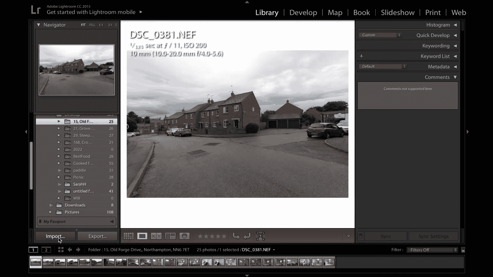
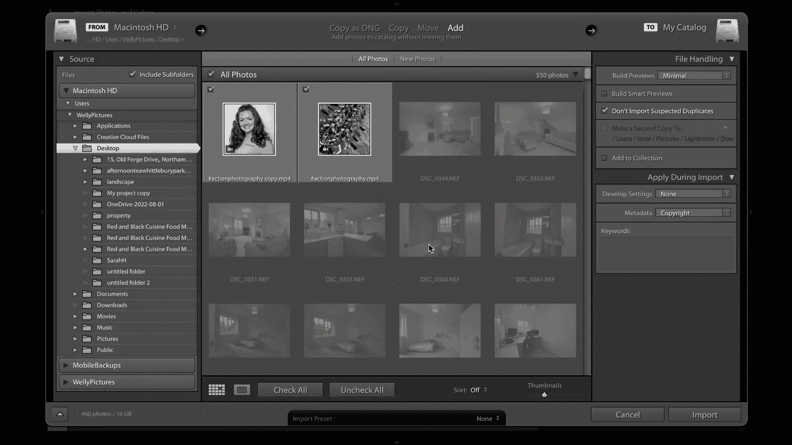
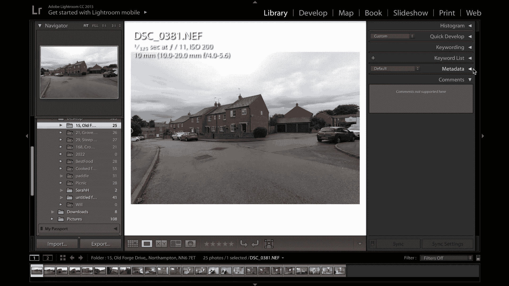
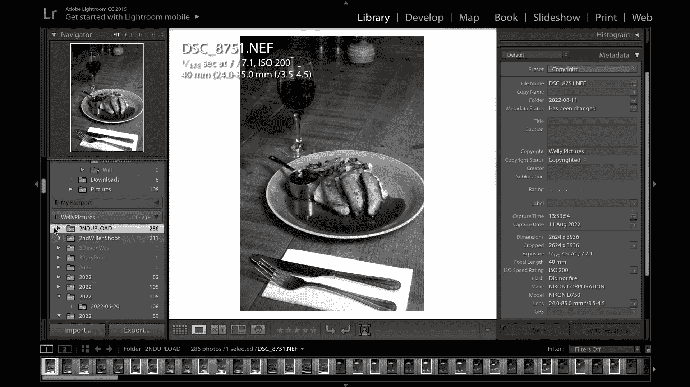

Complete Adobe Lightroom Megacourse： Beginner to Expert Photo Editing part1 p87：82：了解 XMP 文件 📄

在本节课中，我们将学习 XMP 文件是什么，它和 RAW 图像有什么关系，编辑照片时它会发生什么变化，以及如何为你的图片添加版权和作者信息。XMP 文件是 Lightroom 中一个非常重要但容易被忽略的概念，理解它能帮助你更好地管理照片的元数据，也能在后续学习预设时少走弯路。下面我们就从最基础的概念开始，一步步把 XMP 文件讲清楚。

Complete Adobe Lightroom Megacourse： Beginner to Expert Photo Editing part1 p87：82：什么是 XMP 文件 📄

上一节我们介绍了这节课的整体学习目标，本节中我们先来看看 XMP 文件到底是什么。XMP 文件是一种元数据文件，你可以把它理解为照片的“底片”。在过去使用传统相机的时候，摄影师会拥有一张实体底片，里面记录了照片的原始信息。现在数码摄影中，XMP 文件就扮演了类似的角色，它链接到你的数字图片文件，并保存了关于这张照片的所有详细信息。无论你是在 Lightroom 还是 Photoshop 中查看图片，这些信息都来自 XMP 文件，让你知道照片是在什么情况下拍摄的。这个文件本质上是一段文字信息列表，记录了相机在拍摄时生成的各种技术数据，是照片背后的幕后数据。

Complete Adobe Lightroom Megacourse： Beginner to Expert Photo Editing part1 p87：82：RAW 图像与 XMP 文件的关系 📄

了解了 XMP 文件的概念后，本节中我们来看看它和 RAW 图像是如何配合工作的。当你在 Lightroom 中导入一张 RAW 格式的照片时，相机通常会自动生成一个伴随的 XMP 文件。这个 XMP 文件和你的 RAW 图片一起存在，记录了拍摄时的具体参数。比如，你在 Lightroom 或 Photoshop 中查看某张高亮显示的图片时，就可以看到这张照片是以 ISO 200 拍摄的，焦距是 10 毫米，光圈是 F11，快门速度是 1/125 秒。所有这些拍摄细节，都由 XMP 文件连同你的 RAW 格式图片一起提供，任何 Adobe 程序都能读取这些信息。

以下是 RAW 图像通常携带的常见拍摄参数示例：
- 感光度 ISO：200
- 焦距：10 毫米
- 光圈：F11
- 快门速度：1/125 秒

这些参数构成了照片的基础元数据，帮助你了解拍摄时的技术设置。不过需要注意的是，当你查看电脑上的文件列表时，并不总是能看到 XMP 文件和 RAW 文件并列显示，这取决于你使用的相机品牌。例如使用佳能相机时，你通常能同时看到 XMP 文件和单独的 RAW 文件，这让你可以直观地确认相机是否提供了这两种文件选项。

Complete Adobe Lightroom Megacourse： Beginner to Expert Photo Editing part1 p87：82：XMP 文件与 DNG 文件的合并 📄

前面我们看到了独立的 XMP 文件，本节中我们来看看当 RAW 图像转换为 DNG 格式后会发生什么。在 Lightroom 中，如果你导入 RAW 图片并选择将其转换为 DNG 文件，那么原本独立的 XMP 文件可以和 DNG 文件合并为一个文件。这样你就不需要再管理两个分开的文件了，所有的拍摄信息都嵌在单一的 DNG 文件里面。当然，这并不意味着你丢失了 XMP 文件里的信息，只是这两个文件不再以独立形式出现，而是被封装在一起。在 Lightroom 和 Photoshop 中，你依然可以正常查看这些元数据，只是文件形态变成了一个整体。

这个合并过程可以用一个简单的公式来表示：
DNG 文件 = RAW 图像 + XMP 元数据文件

合并后的好处是文件管理更简洁，坏处是你无法再在文件夹里单独看到那个 XMP 文件。不过无论哪种情况，元数据本身都会保留，只是存放方式不同。

Complete Adobe Lightroom Megacourse： Beginner to Expert Photo Editing part1 p87：82：编辑时 XMP 文件如何变化 📄

文件合并的问题讲完了，本节中我们来看看当你开始编辑照片时，XMP 文件会发生什么变化。当你进入 Lightroom 的“开发”模块，调整基本编辑参数，或者给照片添加预设时，你实际上是在修改照片的元数据。这意味着，你一旦开始编辑，Lightroom 就会自动修改关联的 XMP 文件。编辑操作会实时写入元数据，记录下你对照片所做的每一个改动。这不是一件坏事，只是你需要知道，每次编辑都在悄悄更新那个 XMP 文件。

编辑对 XMP 文件的影响可以用下面的公式描述：
更新后的 XMP 文件 = 原始 XMP 文件 + 编辑操作或预设

当你保存更改到磁盘时，Lightroom 会提示你照片的元数据已经发生变化，询问是否要将更新写入文件。你可以选择保存，也可以暂时取消，但无论如何，编辑动作已经反映在元数据里了。

Complete Adobe Lightroom Megacourse： Beginner to Expert Photo Editing part1 p87：82：添加自定义元数据（版权、作者等） 📄

编辑会改变 XMP 文件，本节中我们来看看如何主动为你的图片添加自己的信息。XMP 文件不仅记录相机参数，还可以让你加入个人标识。在 Lightroom 的导入部分，你可以设置标题、说明、摄影师姓名，以及图片是公共领域还是受版权保护。对于正在成为专业摄影师的人来说，这是一个非常重要的步骤。你可以通过在图片上添加版权标志来保护作品，不过有时客户不希望看到明显的版权符号，这时候你可以在元数据中嵌入版权信息，这样即使不在图片上显示标志，法律上这张照片依然属于你或你的公司。

以下是你可以添加到元数据中的自定义信息示例：
- 图片标题
- 图片说明或描述
- 摄影师姓名或公司名称
- 版权状态（公共领域或受版权保护）
- 拍摄地点信息

把这些信息加入图片后，无论是在 Google 上搜索还是在其他平台上分享，别人都能知道是谁创作了这张照片。一旦你开始分享图片，建议一定要把这些信息填进去，因为通过社交媒体上传的照片，在法律上往往会被平台声称拥有权，提前添加元数据可以帮助你保留作者身份。

Complete Adobe Lightroom Megacourse： Beginner to Expert Photo Editing part1 p87：82：分享图片时的元数据管理 📄

添加自定义信息的方法介绍完了，本节中我们来看看分享图片时需要注意的问题。在新版本的 Lightroom 中，当你点击一张图片，可以选择下载图片或者分享这张照片。如果你选择分享，界面会和 Lightroom 经典版类似，允许你添加标题和描述，并标明主题内容，一共有三个选项可以设置。你还可以显示拍摄位置，你在这里输入的所有信息，最终都会被添加到元数据文件，也就是 XMP 文件中。无论你使用的是 Lightroom 还是 Lightroom 经典版，都有办法让你识别自己，并把自己标记为那张图片的摄影师。

分享时建议检查的元数据项目包括：
- 标题和描述是否准确
- 主题内容是否已标识
- 拍摄位置是否需要公开
- 版权信息是否已嵌入

把这些信息整理好后，你的图片就带上了完整的身份标识，无论发布到哪里，都能追溯到原始创作者。

Complete Adobe Lightroom Megacourse： Beginner to Expert Photo Editing part1 p87：82：本节总结 📄

本节课中我们一起学习了 XMP 文件的基本概念，了解了它作为照片“底片”的作用，以及它和 RAW 图像、DNG 文件之间的关系。我们还看到，编辑照片时会自动修改 XMP 文件中的元数据，并且可以在导入或分享阶段添加标题、版权、摄影师等自定义信息。掌握这些内容后，你就能更好地管理照片的技术数据和个人版权信息。在接下来的课程中，当我们开始讲解预设的导入和创建时，还会再次提到 XMP 文件格式，因为预设本身也是以 XMP 文件形式保存和导入的。

