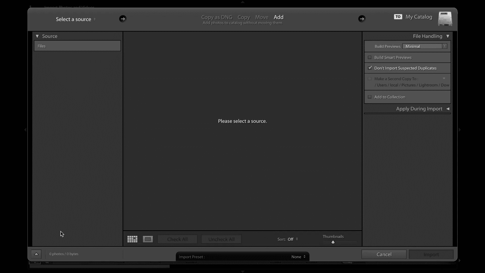
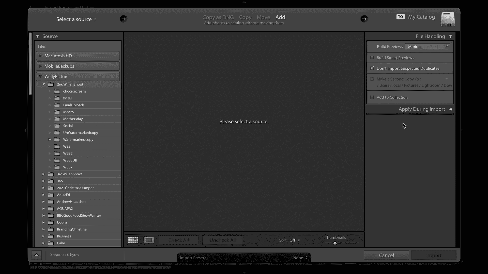

# Complete Adobe Lightroom Megacourse： Beginner to Expert Photo Editing part1：p88 83：Introduction 📸

## 概述 📋

在本节课中我们将要学习 Lightroom Classic 的关键工具部分。这节课属于高级 Lightroom 课程的一部分，我会先给你总结一下你在这一部分会学到什么，并且我们会探讨当你进入 Lightroom 的 Develop 模块时应该关注哪些内容。虽然这些内容看起来比较基础，但它们是你后续进行专业照片编辑的重要基础，建议你在接下来的学习中保持专注，不要跳过任何一个细节，因为每一个工具在实际拍摄和后期工作中都可能派上用场，掌握好它们能让你的照片处理事半功倍。

## 一、照片的形成与整理 📂

在了解了课程概述之后，我们先来看看照片的形成和组织问题。这是管理图片的第一步，做好了之后，后续的编辑工作才会更加高效，不会出现找不到文件的情况，也不会让你的硬盘变得杂乱无章。

以下是照片整理的核心步骤：

- 确保你的照片在硬盘上被妥善选择，如果你把照片存放到硬盘里，就要养成良好的文件整理习惯，这样才不会在海量图片中迷失方向。
- 如果你将照片链接到 Develop 模块左侧的集合部分，你就可以添加集合并为其命名，把相关照片归类在一起，方便统一管理。
- 在 Lightroom 的导入环节，你也可以直接将图片导入到你之前创建好的集合里，省去手动分类的麻烦。

照片整理可以用简单的公式来表示：

```text
照片整理 = 硬盘存储 + 集合管理
```

不过，仅仅拥有集合还不够。当你拥有大量照片时，还需要学习如何对图片进行评分和审查，这将是我们下一部分要讨论的内容。

## 二、照片评分与标签 ⭐





在学习了照片整理之后，我们接下来要讨论在 Lightroom CC 中如何给照片评分和打标签。这一步能帮你快速筛选出值得编辑的照片，避免在大量图片中浪费时间，让你的后期工作流程更加顺畅。

以下是评分和标签的主要方式：

- Lightroom CC 为你提供了两种选择，一种是添加旗帜，另一种是给星级评分，这样你就可以只处理那些适合或已经准备好编辑的照片，把注意力集中在真正重要的图片上。
- 此外，Lightroom CC 还支持颜色标记、贴标签，以及给某些照片添加关键词。
- 在云端存储的 Lightroom CC 中为某张照片添加关键词非常实用，这是一种简单易行的方法，能帮助你在很长一段时间没用过某张照片后，依然能快速找到它。
- 摄影师拍完照后通常会有大量照片，上传到 Lightroom 之后，你就会拥有一个不错的照片集合供挑选和搜索，不再需要一张张翻找。

评分系统可以用简单的代码逻辑来理解：

```text
评分 = 旗帜 或 星级
```

掌握了这些工具之后，你就能更有条理地管理照片库了。接下来，我们将进入本节的另外两个关键工具。

## 三、相机协作与颜色原色 🎨

上一节我们介绍了照片评分与标签，本节中我们来看看相机协作以及红绿蓝原色的使用。这两个知识点分别涉及设备连接和色彩基础，对提升照片质量非常有帮助，值得你认真对待。

以下是相机协作和颜色原色的相关内容：

- 第一个选项是介绍相机协作，让你了解如何将相机与协作功能链接起来，实现设备之间的协同工作。
- 另外，为什么你要在使用其他颜色编辑流程之前，先故意玩玩红、绿、蓝三种原色来增强自己的摄影效果呢？这是一个值得深入思考的问题，因为颜色是摄影的灵魂，掌握好原色调整能让你的照片更加出色。

颜色增强可以用简单的公式来表示：

```text
颜色增强 = 红 + 绿 + 蓝
```

了解完颜色原色之后，我们来看看本节的最后一个重点内容，即如何将相机连接到 Lightroom Classic。

## 四、相机连线拍摄与云端存储 ☁️

在讲解了相机协作和颜色原色之后，最后我们要讨论如何将相机连接到 Lightroom Classic，以及如何使用云端存储。这部分内容能让你在拍摄和后期之间建立更流畅的工作流程，不再需要手动复制文件，节省大量时间。

以下是相机连线拍摄和云端存储的主要功能：

- 相机连线拍摄意味着你可以用相机拍照，照片会自动出现在 Lightroom 编辑程序里，这样你可以在拍摄时直接将照片导入预设，或者一边拍照一边编辑图片，大大提高工作效率。
- 现在的大多数相机都配有可以在手机上使用的应用程序，我会教你如何用手机应用配合相机拍摄照片，将图片上传到 Lightroom Mobile，然后再传回 Lightroom CC 或网页版 Lightroom，实现设备间的无缝切换。
- 以上所有信息和关键工具，都会在这一节 Lightroom Classic 关键工具部分为你讲解，确保你掌握完整的工作流程。

相机连线拍摄的流程可以用简单的代码来表示：

```text
相机 → Lightroom Classic（自动同步）
```

云端传输流程可以用简单的代码来表示：

```text
手机应用拍摄 → Lightroom Mobile → Lightroom CC / 网页版 Lightroom
```

## 总结 📚

本节课中我们一起学习了 Lightroom Classic 的关键工具，包括照片的形成与整理、照片评分与标签、相机协作与颜色原色，以及相机连线拍摄和云端存储。这些知识点构成了你后续使用 Lightroom 进行照片编辑的基础，希望你能把它们牢记在心，并在实际操作中多加练习，熟练掌握每一个工具的使用方法。
