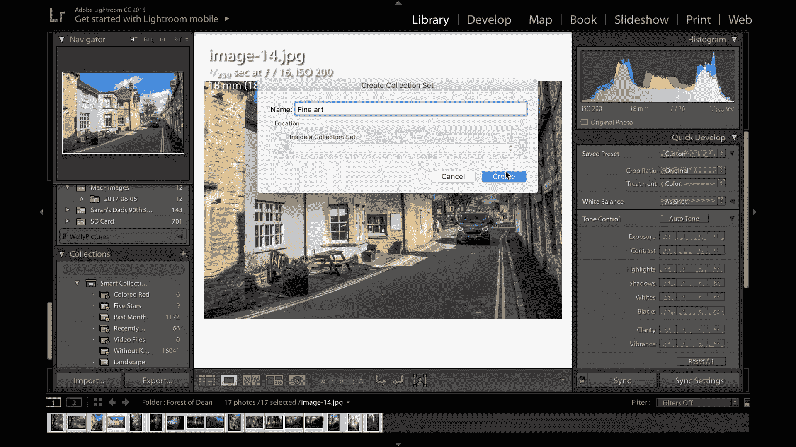
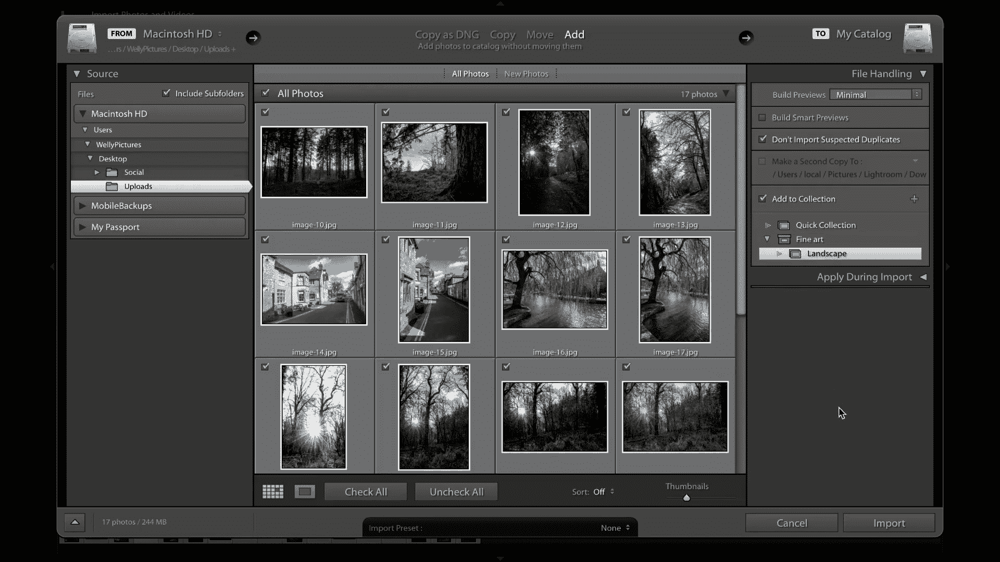
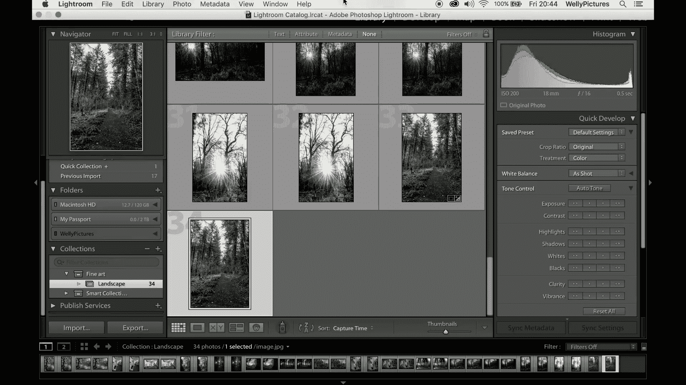

# Adobe Lightroom 完整教程：089：将照片整理到集合中 📸

在本节课中我们将要学习 Lightroom Classic 中的集合功能。你将了解如何创建集合，如何建立集合集，如何使用智能集合，以及如何在导入照片时直接把照片放进指定的集合里。这些内容能帮你把乱糟糟的照片库整理得井井有条，方便以后快速找到想要的图片。

---

### 一、为什么要学习集合功能

Lightroom Classic 是一个很强大的照片管理工具，但如果你拍的照片越来越多，光靠文件夹很快就会找不到东西。这时候集合就派上用场了。集合可以把散落在不同文件夹里的照片，按照你自己的想法聚合在一起，而不会改变照片在硬盘上的实际位置。你可以把它理解为给照片贴标签分类，而不是真的把文件移来移去。

本节课主要会围绕下面这些核心知识点展开：

- 创建普通集合（Collection）
- 创建集合集（Collection Set）来层级管理
- 创建智能集合（Smart Collection）实现自动筛选
- 将已有照片添加到集合中
- 在导入照片时直接指定目标集合

---

### 二、集合的基本概念

在开始实际操作之前，先搞清楚集合到底是什么。集合不是文件夹，它更像是一个虚拟的容器。你可以把同一张照片放进多个不同的集合里，而硬盘上这张照片只有一份。这很适合做主题整理，比如把所有风景照放进一个集合，把所有人像照放进另一个集合。

集合的逻辑关系可以用简单的代码来表示：

```text
Collection = {照片 A, 照片 B, 照片 C, ...}
Collection Set = {集合 1, 集合 2, 集合 3, ...}
```

这意味着一个集合集里面可以包含多个普通集合，而普通集合里面包含具体的照片文件。

---

### 三、如何创建普通集合和集合集

上一节我们介绍了集合的基本概念，本节中我们来看看如何在 Lightroom 中实际创建它们。

在 Lightroom 的左侧面板里，你能找到"集合"区域。这里有两种常见的操作：

1. 直接创建一个普通集合
2. 先创建一个集合集，再把集合放进去

以下是具体的创建步骤：

- 点击集合面板右上角的加号按钮
- 在弹出的菜单中选择"创建集合"
- 给你的集合起一个好记的名字，比如"风景照集"
- 如果你想要更细致的分类，可以先创建集合集，命名为"美术作品集"，然后把普通集合拖入这个集合集中

创建完成后，你会在左侧看到自己新建的集合集和集合。这时候你还没有把任何照片放进去，它现在是空的。

---

### 四、如何创建智能集合



刚才我们学会了手动创建普通集合，但有时候照片太多，手动挑选太慢。这时候智能集合就很有用了。智能集合会根据你设定的条件，自动把符合条件的照片聚集在一起。

以下是创建智能集合的方法：

- 点击加号按钮，选择"创建智能集合"
- 给智能集合起名字
- 设置筛选条件，例如星级评分大于等于4星，或者颜色标签为红色
- 把这个智能集合放入你之前建立的集合集里

智能集合的核心逻辑可以这样理解：

```text
智能集合 = 所有满足【条件 X】的照片
```

比如你设置条件是"评分大于等于4星"，那么以后你给任何照片打4星或5星，它都会自动出现在这个智能集合里，不需要你手动拖动。

---

### 五、将照片添加到集合中

集合创建好了，接下来就是往里面放照片了。这部分非常关键，因为空集合对整理照片没有任何帮助。

你可以使用以下两种方式把照片加入集合：

**第一种方法：在已导入的照片中选择**

- 在图库模块中，选中你想要添加的照片
- 按住鼠标左键，把这些照片拖动到左侧的目标集合上
- 释放鼠标，照片就会被添加进该集合

**第二种方法：全选后批量添加**

- 使用菜单"编辑" → "全选"，或者使用快捷键选中当前文件夹下的所有照片
- 把选中的所有照片一次性拖入集合

举个具体的例子，假设你已经在"风景照集"里放了一张照片，现在你想把另外十几张相关的风景照也加进去。你只需要全选这些照片，然后把它们拖入"风景照集"，集合里的照片数量就会立刻增加。

---



### 六、导入照片时直接添加到集合

除了导入后再手动整理，Lightroom 还支持在导入的同时就把照片分配到指定的集合里。这样可以省去后续拖拽的步骤，工作流会更顺畅。

具体操作如下：

- 点击导入按钮，选择你要导入的照片源
- 在导入窗口中找到"文件处理"部分
- 勾选"添加到集合"选项
- 从下拉列表中选择你要使用的集合
- 点击导入按钮完成导入

导入完成后，这些照片会同时出现在硬盘的目标文件夹里，也会出现在你选定的集合里。这相当于把照片的物理存储和逻辑分类分开了，以后你想看某类照片，直接打开对应的集合就行，不需要在文件夹里一个一个找。

---

### 七、本节课总结



本节课中我们一起学习了 Lightroom 中集合功能的核心内容。我们了解了什么是集合，学会了创建普通集合和集合集，掌握了智能集合的自动筛选逻辑，还学习了如何把已有照片加入集合，以及在导入照片时直接指定集合。希望这些内容能帮你把照片库整理得更清晰，让找照片这件事变得简单高效。

