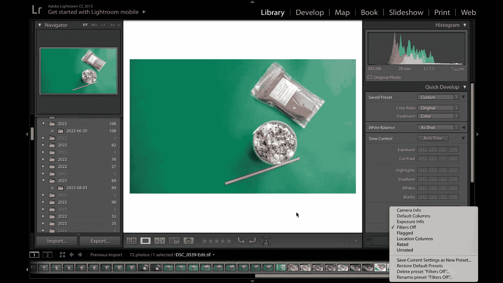
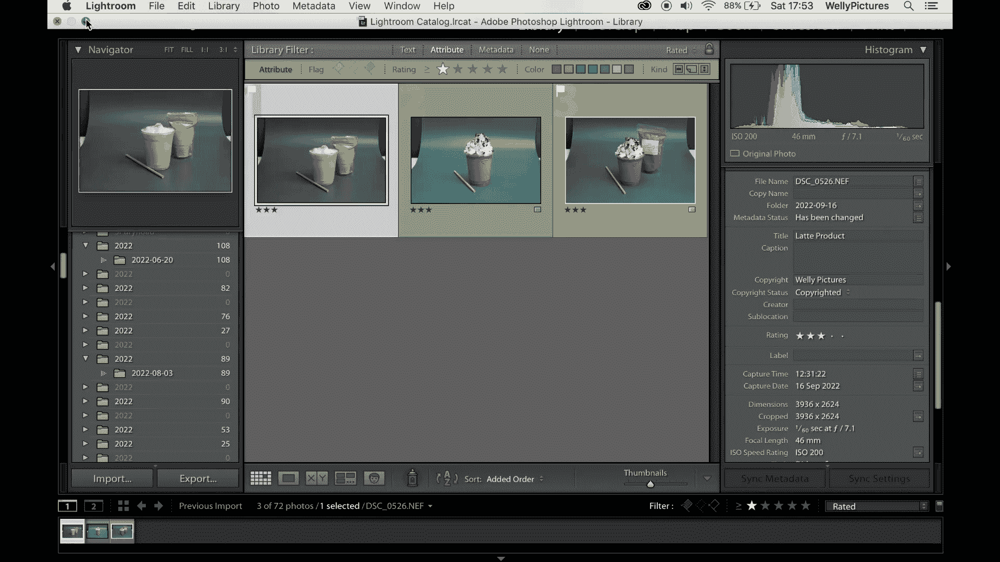
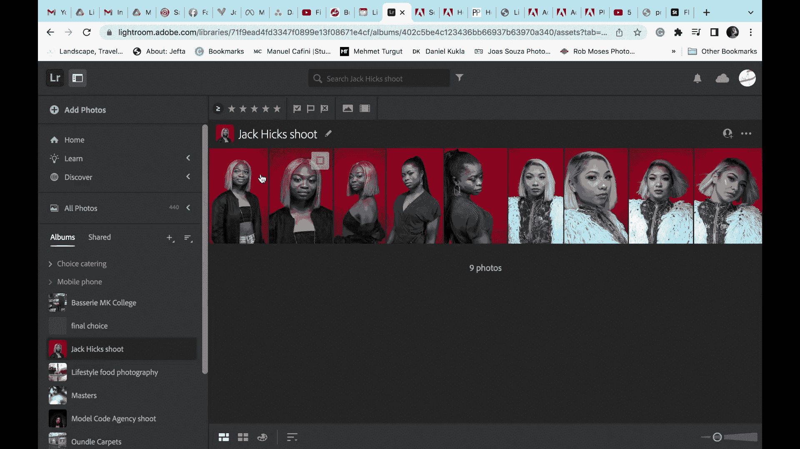
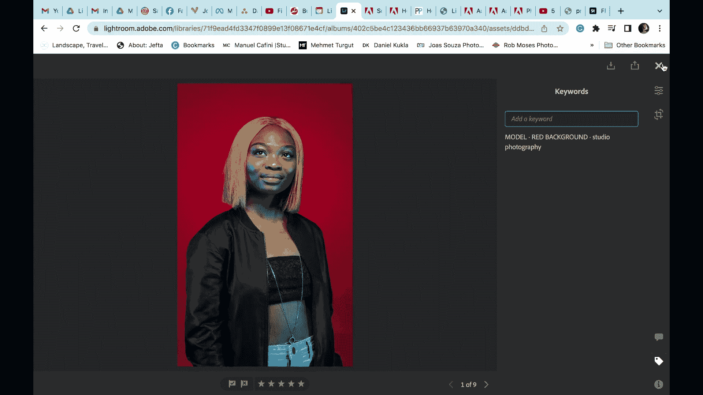
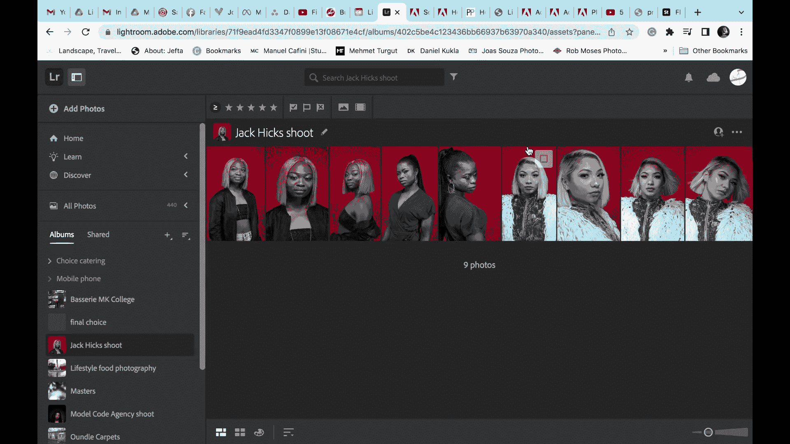

# Adobe Lightroom 照片编辑全攻略：09：查找你的照片（评分、标记与筛选）📸


## 开篇概述

在本节课中，我们将要学习如何在 Adobe Lightroom 中查找、管理和筛选你的照片。无论你是在使用 Lightroom Classic 桌面版，还是在使用 Lightroom CC 移动端和网页版，掌握评分、标记、标签和筛选工具，都能让你在面对大量图片时快速定位到想要编辑或分享的照片。我们会一步步介绍底部筛选器的作用，解释星级评分、旗标标记和颜色标签的含义，最后还会展示如何添加关键词让照片更容易被检索。通过本节课的学习，你将能够建立自己的照片管理习惯，让工作区更加整洁高效。


## 认识 Lightroom 的筛选与搜索工具



上一节我们介绍了 Lightroom 的基本界面，本节中我们来看看如何利用筛选工具快速找到照片。作为 Lightroom Classic 的核心工具之一，筛选功能可以帮助你在图片库中定位特定照片，或者一次只编辑一组选定的图片。现在我们使用的是 Lightroom Classic，在界面底部你可以看到一组筛选器，这些筛选器包含相机信息、默认列、曝光信息，还有标记、位置、评分或未评分等选项。

以下是底部筛选器常见的选项：
- 相机信息
- 默认列
- 曝光信息
- 标记
- 位置
- 评分或未评分

基本上，当你决定识别某些图片时，你可以通过 Lightroom CC 的元数据为该图片添加关键词，或者开始标记你想要用作编辑来源的图片类型。换句话说，这些工具就是为了让你在大量照片中快速锁定目标图片，而不需要逐张查看。


## 使用评分系统给照片定级

上一节我们介绍了 Lightroom 的筛选与搜索工具，本节中我们来看看如何用星星给照片定级。在开发模块中，你会看到一组星星选项，这些星星就是评分系统。评分系统是一种用数字来衡量照片质量的方法，通常范围是从 1 分到 5 分。

```
照片质量评分 = 1 分（最差）到 5 分（最佳）
```

5 分代表最佳质量，1 分代表质量较差。你可以根据实际情况给每张图片打分，方便之后按分数筛选，快速找到高质量的照片。

以下是常见的评分使用场景：
- 5 分：质量最好，优先编辑
- 3 分：一般质量，稍后处理
- 1 分：质量较差，可能不需要编辑

举个例子，我把某张图片设为 4 分评级。如果打开已评级筛选，就只会显示设为 4 分的那一张图片。这样一来，你就能快速找到高分图片，而不需要在海量照片中逐一查找。


## 使用标记系统快速挑选照片

上一节我们介绍了评分系统，本节中我们来看看标记系统如何帮助你快速挑选照片。除了评分，Lightroom 还提供标记系统，用来决定哪些图片是你想要使用的。标记通常包括选中和拒绝两种状态。我个人习惯用标记系统来做决定，比如我看过一张图片后，就把它标记为选中，意味着这就是我要保留并编辑的图片。

```
标记状态 = {选中, 拒绝, 未标记}
选中 = 想要编辑或导出的图片
拒绝 = 不想使用的图片
未标记 = 尚未决定的图片
```

当你更改筛选器后，只会调出你实际标记为选中的那几张图片，方便你直接导出或分享。当然，你不必非要使用筛选器，也可以在不同标记之间自由决定，甚至完全不开启筛选器，照常浏览所有图片。


## 使用颜色标签区分照片状态

上一节我们介绍了标记系统，本节中我们来看看颜色标签如何帮助你区分照片的处理状态。颜色标签是另一种直观的识别方式。你可以把颜色理解为照片的状态标识，比如红色代表不想使用、不想进一步编辑；黄色代表需要稍微处理一下；绿色代表完美且可以直接使用。

```
颜色标签含义：
红色 = 不想使用 / 不想进一步编辑
黄色 = 需要稍微处理
绿色 = 完美 / 可直接使用
```

当你给一张图片添加绿色标签后，在图库视图中你会看到那张图片带有绿色轮廓。这样即使不开启筛选器，你也能一眼看出哪些图片已经处理好了，哪些还需要继续调整。

以下是颜色标签的简单对应关系：
- 红色：跳过或不编辑
- 黄色：需要修改
- 绿色：已完成，可导出


## 添加关键词与标题让照片更容易找到



上一节我们介绍了颜色标签，本节中我们来看看如何通过关键词和标题让照片更容易被找到。标签不仅可以是颜色，更像是一张图片的标题。你可以为图片添加文字标签，比如“拿铁产品图片”。完成后按回车，这张图片就会被贴上这个标签，当你分享图片时，它会显示为“拿铁产品图片”。



除了颜色和评分，你还可以给图片添加关键词。关键词与图片内容相关，方便你日后检索。比如你可以添加“工作室”、“模特”、“红色背景”等词汇，这些都是与图片内容关联的好关键词。

以下是常用的关键词示例：
- 工作室
- 模特
- 红色背景

这样一来，当你想要寻找特定类型的图片时，只需要搜索这些关键词，就能快速定位到目标照片，而不需要在成千上万张图片里慢慢翻找。




## 在 Lightroom 移动端与网页端操作

上一节我们介绍了关键词与标题，本节中我们来看看在 Lightroom 移动端和网页端如何进行类似操作。在新版 Lightroom CC 中，你可以进入一个相册，选择图片，然后在底部进行评分和评审。同样的功能也可以通过手机应用完成。你可以为想要使用的图片添加选中标记，也可以为不想使用的图片点击拒绝标记，并且可以添加星级评分。

以下是移动端可用的标记方式：
- 选中标记：表示想要使用的图片
- 拒绝标记：表示不想使用的图片
- 星级评分：表示图片质量等级

此外，你还可以添加关键词来帮助通过筛选系统找到图片。需要注意的是，如果你只在某一个相册中操作，那么筛选搜索只会在这个相册范围内进行，而不是在所有照片中搜索。这样可以避免搜索结果太多，让你更专注于当前相册里的图片。


## 本节总结



在介绍完各个工具之后，我们来回顾一下本节课的核心内容。本节课中，我们一起学习了如何在 Lightroom 中使用评分、标记、标签和筛选工具来组织和查找照片。无论是在 Lightroom Classic 桌面版，还是在 Lightroom 移动端、网页端和 Lightroom CC 中，你都可以通过星级系统、旗标系统和关键词来帮助找到图片，并分享对其他人有用的关键图片。这样你就能在需要编辑或分享照片时，快速定位到那些有用的图片，让工作流程更加高效。

