Adobe Lightroom 照片编辑从入门到精通: 第91课: 使用相机校准 📸

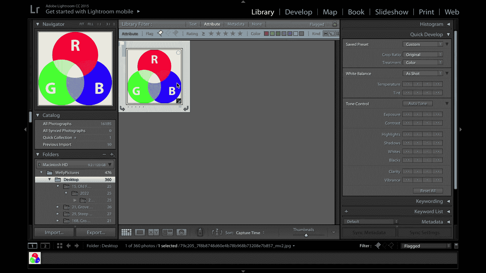

在本节课中我们将要学习 Adobe Lightroom 中的相机校准功能。相机校准位于开发模块的底部面板，它主要处理红绿蓝三种原色。通过本节课，你将了解如何将相机拍摄时的色彩风格同步到 Lightroom，如何使用校准面板中的饱和度与色相滑块来调整画面颜色，以及在编辑流程中什么时候应该先使用相机校准。我们还会通过三个实际案例，分别演示在房屋、风景和动物照片中的应用方法。接下来请跟随我一步步来看。


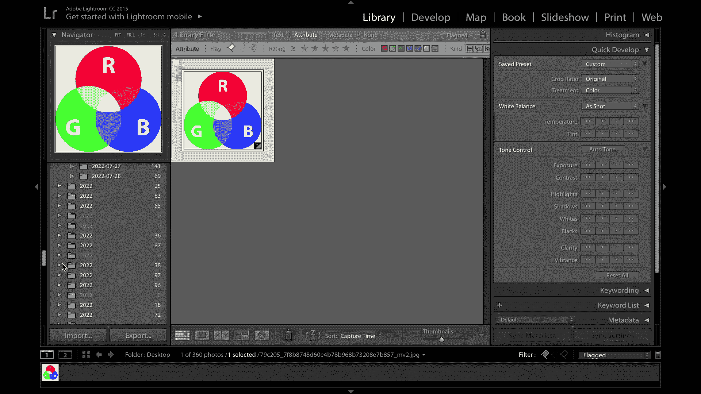

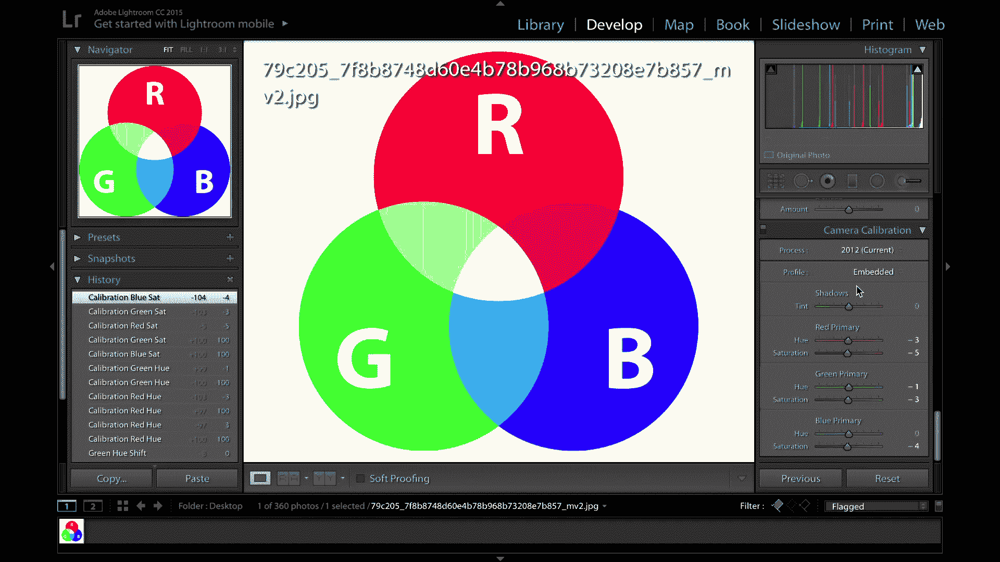

### 相机校准的基本概念

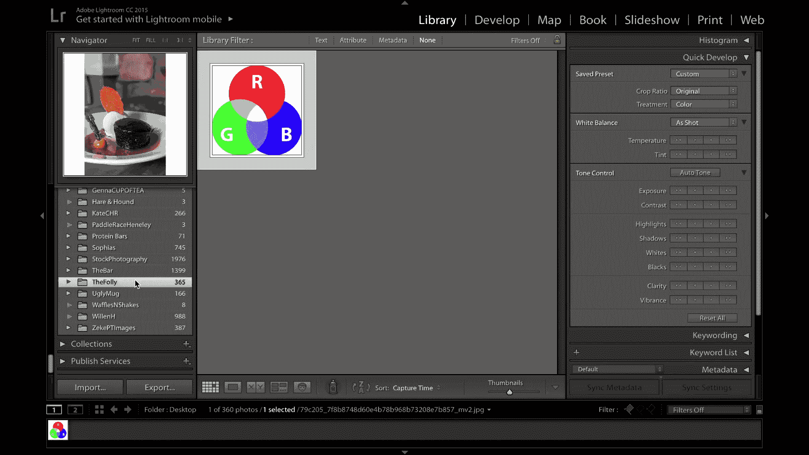

相机校准是 Lightroom 开发模块中的一个核心色彩工具。它的作用是让软件识别并匹配你相机原生的色彩配置文件。简单来说，每台相机对红绿蓝三种颜色的记录方式都不相同，Lightroom 需要知道你的相机使用什么格式，才能正确还原照片中的颜色。

核心概念可以用下面的公式来理解：

```
相机校准 = 红色通道数值 + 绿色通道数值 + 蓝色通道数值
```

这意味着画面里的每一个像素，其实都是由红、绿、蓝三种颜色的不同数值组合而成的。当你改变其中一种颜色的数值时，画面中所有包含该颜色成分的区域都会受到影响。

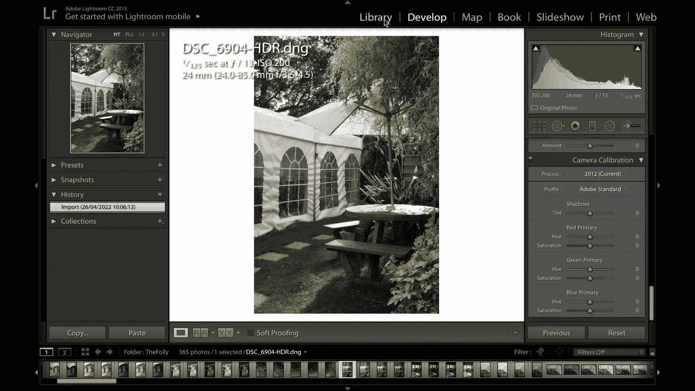

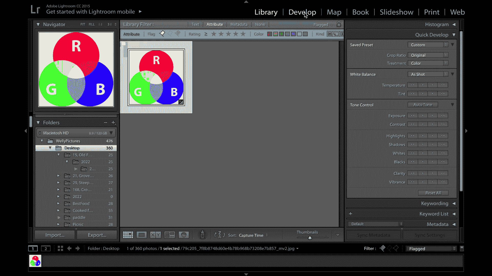

### 相机配置文件与同步

上一节我们介绍了相机校准的基本概念，本节中我们来看看相机配置文件与同步设置。在 Lightroom 中，你可以在库模块或开发模块找到配置文件选项。常见的配置文件包括 Adobe 标准、相机平坦、相机风景、单色、中性、人像、标准和鲜艳等。

以下是常见的相机配置文件列表：

- Adobe 标准：适用于所有 Adobe 程序的默认配置文件。
- 相机平坦：保留更多原始细节，适合后期大幅调整。
- 相机风景：增强绿色和蓝色，适合自然风光。
- 单色：用于黑白或单色调照片。
- 中性、人像、标准、鲜艳：分别对应不同的拍摄场景和肤色还原需求。

如果你使用的是 Lightroom CC，还可以通过云端同步功能，将相机校准设置从相机同步到电脑、手机以及网页端。这样你在不同设备上编辑时，色彩基础会保持一致。

### 像素与颜色值

刚才我们了解了配置文件，本节中我们来看看像素与颜色值的关系。每张照片都是由无数像素点组成的，而每个像素点的颜色都由红绿蓝数值决定。在相机校准面板中，红色并不代表纯粹的一个固定颜色，而是一个可以混合其他颜色的数值。

你可以这样理解颜色值：

```
像素颜色 = f(红色数值, 绿色数值, 蓝色数值)
```

当你降低红色的饱和度时，不仅会减弱画面中明显的红色，还会影响所有含有红色成分的颜色，比如橙色、棕色甚至某些绿色。这就是为什么相机校准对整体色调的影响非常广泛。

### 相机校准面板操作

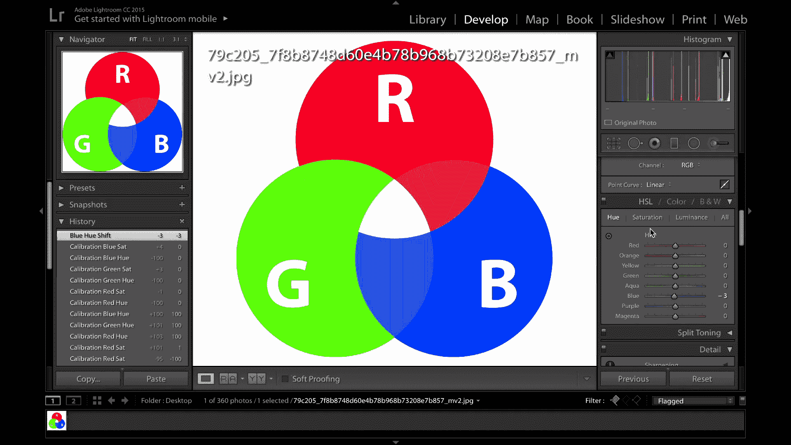

讲完像素颜色值，本节中我们来看看相机校准面板的具体操作。相机校准面板主要包含三组控制，分别对应红、绿、蓝三种原色，每组都有色相和饱和度两个滑块。

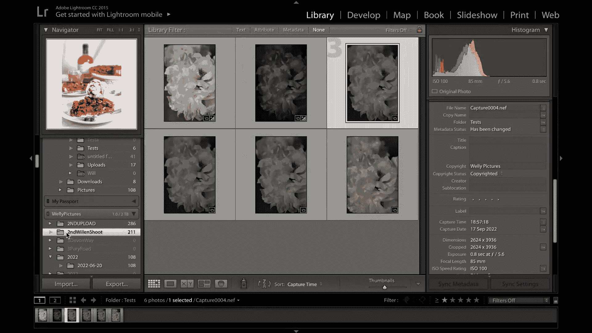

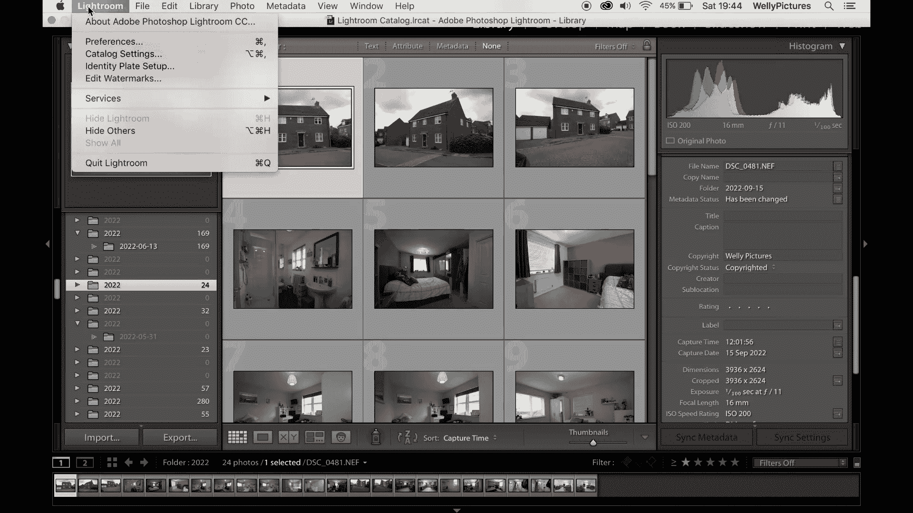

以下是三种原色的调整方向：

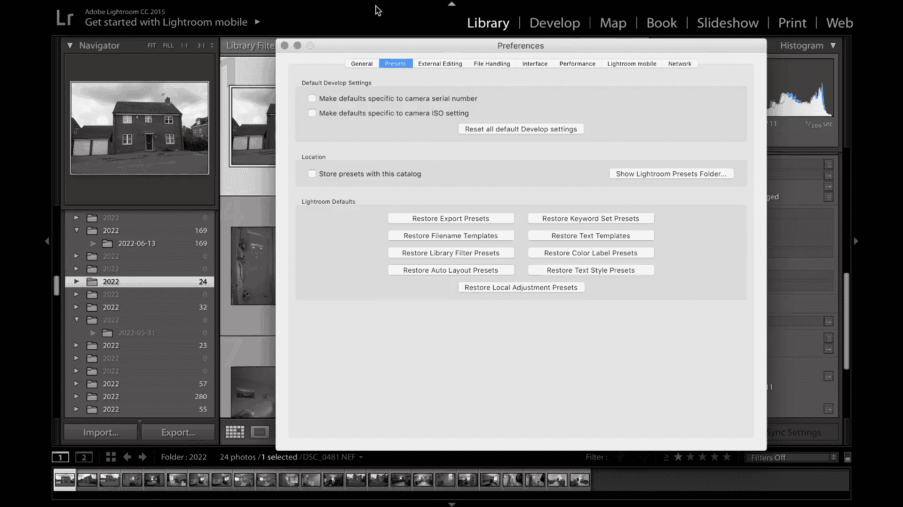

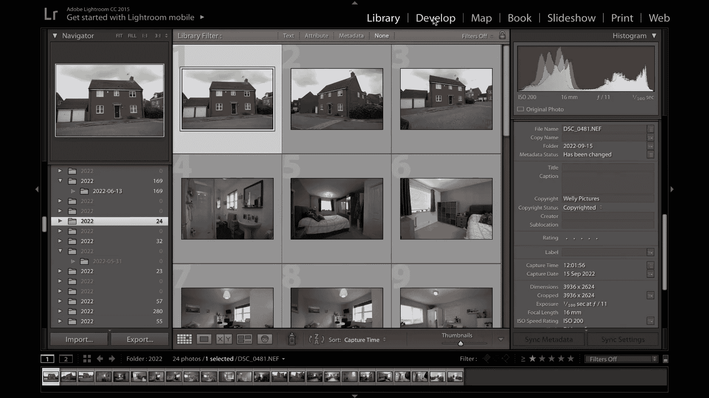

- 红色：色相可在粉红红、纯红和橙红之间切换；饱和度控制红色的强弱。
- 绿色：色相可在黄绿、纯绿和蓝绿之间切换；饱和度控制绿色的强弱。
- 蓝色：色相可在天蓝、纯蓝和紫蓝之间切换；饱和度控制蓝色的强弱。

举个例子，如果你把蓝色的色相向紫色方向移动，画面中原本蓝色的天空可能会变成紫色。如果你把绿色的饱和度降低，画面中的草地和树叶会变得暗淡。这些变化看起来很直接，但因为颜色之间存在混合关系，所以调整一组滑块往往会牵连其他颜色。

### 编辑顺序与注意事项

了解完面板操作，本节中我们来看看编辑顺序与注意事项。在进行后期编辑时，建议你将相机校准作为第一步。也就是在使用 HSL、色彩分级或基本面板之前，先完成相机校准的调整。

原因很简单。相机校准直接关联相机导入 Lightroom 时的原始主色彩。如果你先做了其他色彩编辑，再回来调整相机校准，可能会改变已经编辑好的颜色表现，导致白平衡不准或色调过冷过暖。

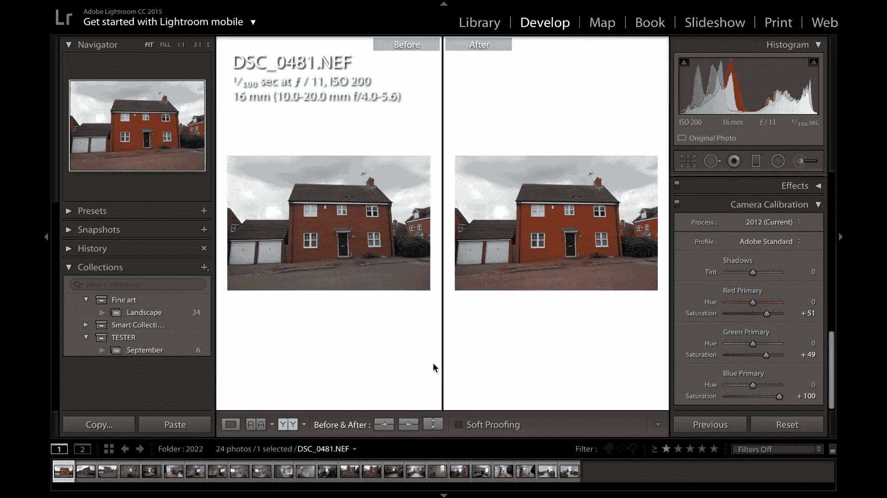

以下是推荐的编辑顺序：

1. 打开照片并确认相机配置文件。
2. 在相机校准面板中调整红绿蓝的饱和度与色相。
3. 完成后再进入 HSL 或基本面板进行局部色彩微调。
4. 最后进行曝光、对比度等基础调整。

请记住，除非你特意想要创作不真实的艺术效果，否则尽量保持相机校准的调整接近现实，避免颜色过度失真。

### 案例一 房屋照片增强色彩

说完理论和顺序，本节中我们来看看第一个实际案例。我们先来看一个简单的房屋照片。这张图片中的关键颜色是红色，因为墙体是砖红色的，同时也包含一些绿色植物和蓝色天空。

以下是具体调整步骤：

- 打开相机校准面板，先将红色饱和度提升，使砖墙颜色更鲜艳。
- 接着提升绿色饱和度，突出画面中的植被。
- 最后适当提升蓝色饱和度，让天空颜色更深邃。
- 如果需要，还可以调整红色色相，将砖墙从偏粉红的红色变为偏橙的红色，使材质看起来更真实。

通过这些简单操作，你只需动用相机校准面板，就能为原本比较平淡的房屋照片增加明显的色彩层次。

### 案例二 风景照片局部增强

讲完房屋照片，本节中我们来看看第二个案例。接下来我们看一张风景图片，画面中有一座桥梁、房屋、天空以及一些绿色植物。为了让画面更突出，我们不打算增强绿色，而是重点处理房屋的砖红色和天空的蓝色。

以下是调整思路：

- 首先裁剪照片，确保桥梁线条水平。
- 在相机校准面板中，只提升红色饱和度，增强房屋砖墙的颜色。
- 同时提升蓝色饱和度，使天空颜色更浓郁。
- 观察画面后发现，提升红色也连带增强了部分绿色植物中的红色成分，这时可以适当降低绿色饱和度，抑制不需要的绿色。
- 提升蓝色后，画面中一些原本不明显的蓝色细节，比如远处的蓝色船只或遮阳伞，也会显现出来。如果这些细节会干扰主体，可以稍微降低蓝色饱和度或调整色相。

最终的效果是，画面中的红色砖墙更醒目，天空蓝色更清晰，而绿色植物则保持适度克制，整体色调协调自然。

### 案例三 动物照片增强毛发色调

讲完风景照片，本节中我们来看看第三个案例。第三个案例是一张动物照片，主体是一只棕色的狗。动物照片往往不像风景照那样色彩丰富，可能只有毛发、鼻子、项圈等少数几个关键颜色。

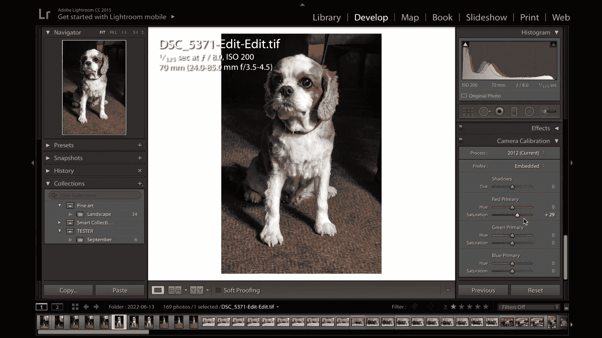

以下是操作方法：

- 观察图片，确定关键颜色。狗的毛发属于棕色调，而棕色本质上包含红色成分。
- 在相机校准面板中，提升红色饱和度，大约提升到 48 左右。
- 你会发现狗毛发中的红棕色调开始显现，毛发看起来更有层次，同时背景中棕色的椅子和地毯也会因为包含红色成分而稍微变暖。
- 如果狗佩戴了红色项圈，提升红色饱和度也会让项圈颜色更突出。
- 你还可以尝试调整色相滑块，看看红色会向粉红还是橙红方向移动，从而决定最合适的色调方向。调整完成后记得将色相归零，除非你有特殊创意。
- 绿色和蓝色通常不需要大幅调整，除非画面中有明显的草地或天空需要处理。

对比修改前后的照片，你会发现只调整了红色饱和度，原本比较平淡的狗毛照片立刻多了一份生动感，但整体依然保持真实，没有过度处理的痕迹。

### 总结

本节课中我们一起学习了 Lightroom 相机校准的基本概念、配置文件同步、像素颜色值原理、面板操作方法，以及编辑时的正确顺序。我们还通过房屋、风景和动物三个案例，分别演示了如何提升红绿蓝原色的饱和度，如何局部增强特定颜色，以及如何在动物照片中挖掘毛发色调。希望这些内容能帮助你更好地理解相机校准，并在实际编辑中先使用该功能，再进行其他色彩调整，从而获得更准确、更自然的照片色彩表现。
