📷 Adobe Lightroom 教程：第 92 节：相机连线拍摄与 Lightroom 教学

在本节课中我们将要学习如何把相机连接到 Lightroom Classic，实现连线拍摄功能。连线拍摄的意思就是把相机通过数据线连到电脑上，这样你按下快门拍下的照片，会立刻出现在 Lightroom 的界面里面，不需要再把存储卡拔出来导入。本节课会一步步讲解如何建立连线会话，怎么给照片命名，照片保存在哪里，如何用图集管理照片，以及拍摄时如何自动套用预设。内容比较多，但每个步骤都不难，初学者跟着做就能学会。

什么是相机连线拍摄

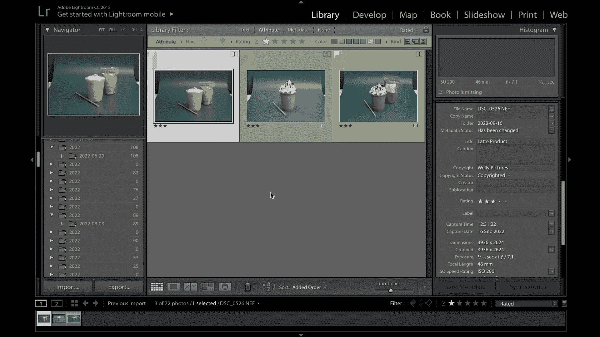

连线拍摄是一种专业的摄影工作方式。你把相机通过 USB 数据线连接到笔记本电脑或者台式机，然后打开 Lightroom Classic。这时候你对着被拍摄对象按下快门，照片会直接传到电脑里，并在 Lightroom 中显示出来。你不需要等待，也不需要手动复制文件，拍一张就能看到一张。这种方式适合棚拍、产品拍摄或者需要即时查看成片的场景。

核心连线关系可以用这个简单的公式来理解：

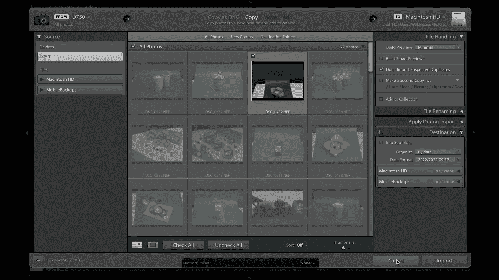

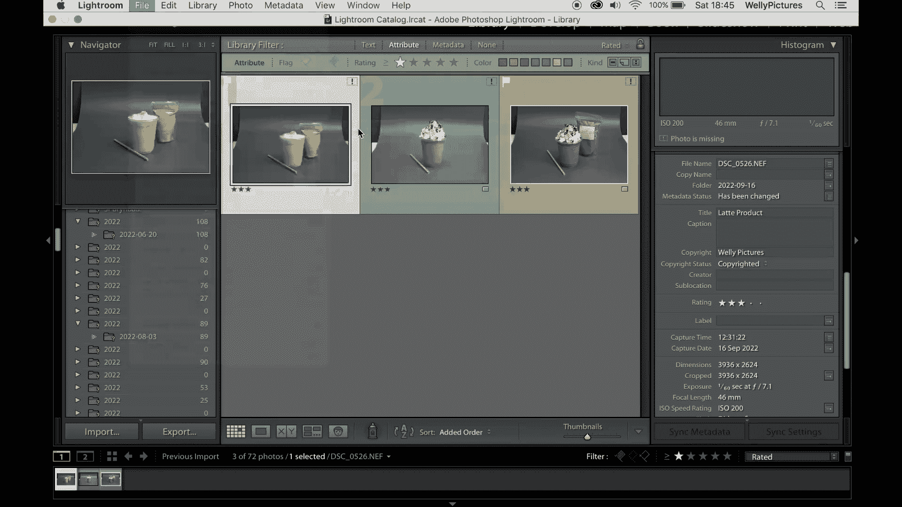

相机 -- USB 数据线 --> 电脑 -- Lightroom Classic --> 照片实时显示

导入与连线拍摄的区别

在 Lightroom 里面，把照片从相机导入电脑主要有两种方法。以下是这两种方法的具体区别。

第一种方法是使用“导入”功能。你先拍好一批照片，照片存放在相机的存储卡里面，然后把相机连到电脑，通过“文件”菜单选择“导入”，把存储卡里的照片批量复制到 Lightroom。这种方法不是实时的，因为照片已经拍好了，你只是用数据线把已有的照片加到 Lightroom 里面。

第二种方法是使用“连线拍摄”功能。你在拍照之前就把相机连到电脑，打开 Lightroom 的连线拍摄界面，这时候你按下快门，照片会立刻传到 Lightroom 里面。这种方法是实时拍摄，适合现场查看效果。

我接下来会取消导入界面，演示如何启动真正的连线拍摄。

设置连线拍摄会话

在 Lightroom 的顶部菜单栏里，你可以看到“文件”、“编辑”、“资料库”、“照片”等选项卡。点击“文件”，然后选择“连线拍摄”，再点击“开始连线拍摄”。这时候会弹出一个设置窗口，让你为本次拍摄起一个会话名称。你可以随便起名字，但建议用跟拍摄内容相关的名字。比如如果是给公司拍产品，就用公司名字；如果是拍某个产品系列，就用产品名字。演示里我暂时用“tester”作为会话名称。

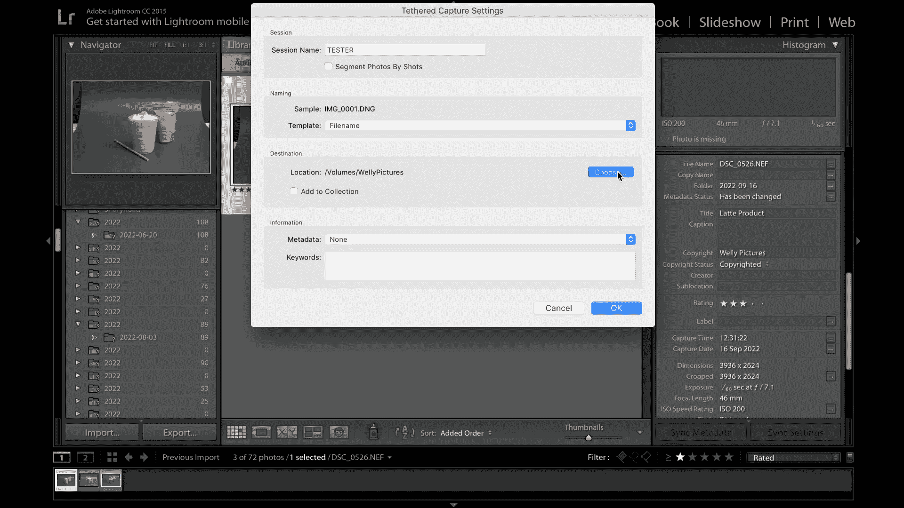

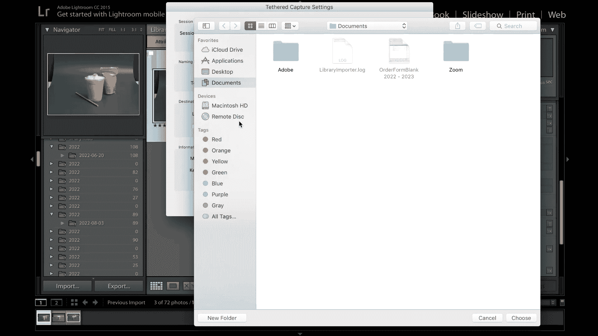

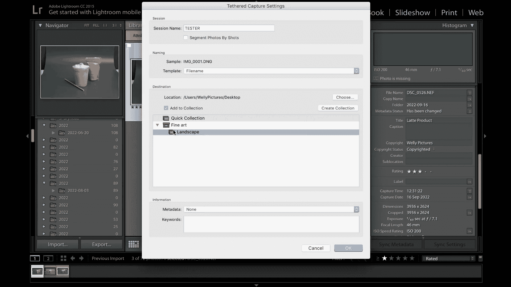

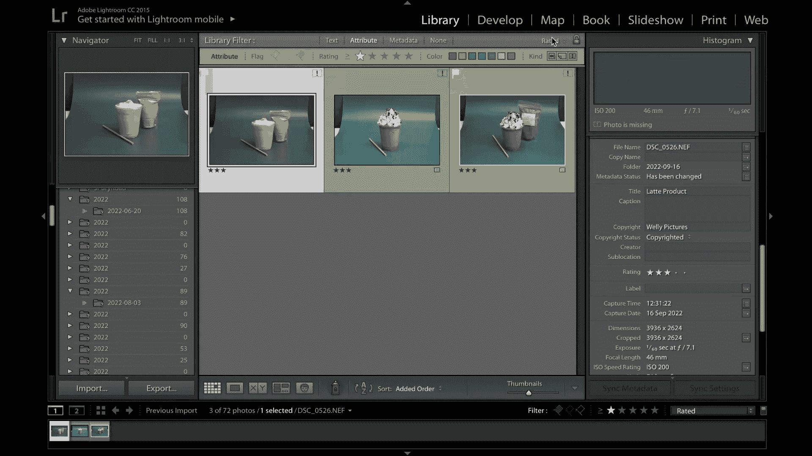

下面是会话设置的关键项：

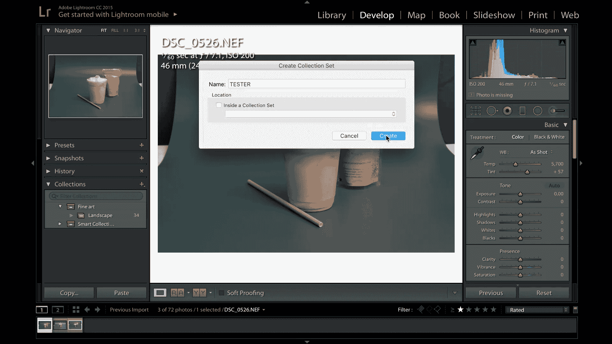

会话名称 = tester
起始编号 = 1
文件名示例 = tester_1.DNG
文件格式 = DNG

文件命名与保存位置

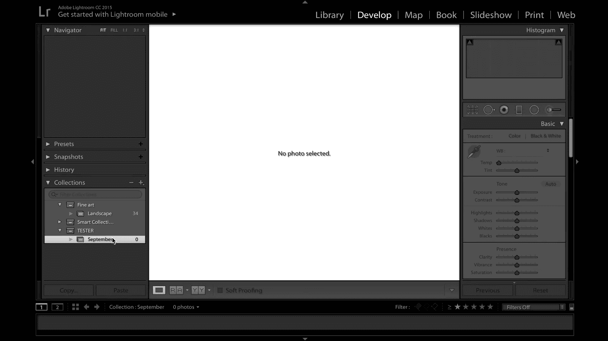

文件命名部分，你可以决定照片的编号规则。Lightroom 会在会话名称后面自动加上数字，比如第一张照片叫 tester_1，第二张叫 tester_2，以此类推。起始编号默认可能是 11，你可以把它改成 1，这样照片就会从 1 开始排列。文件扩展名会显示在数字后面。你也可以选择把日期加入文件名，这也很有用。

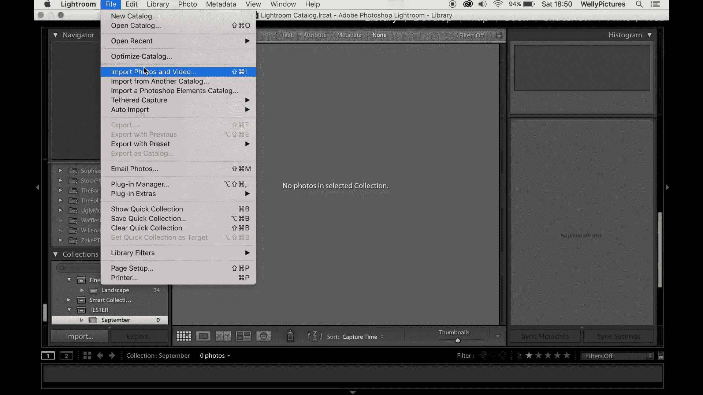

关于文件格式，连线拍摄导入的照片使用 DNG 格式，而不是原始的 raw 格式。这是因为在之前的课程里我们讲过，DNG 是 Adobe 程序认可的文件格式，Lightroom 可以直接读取和处理。

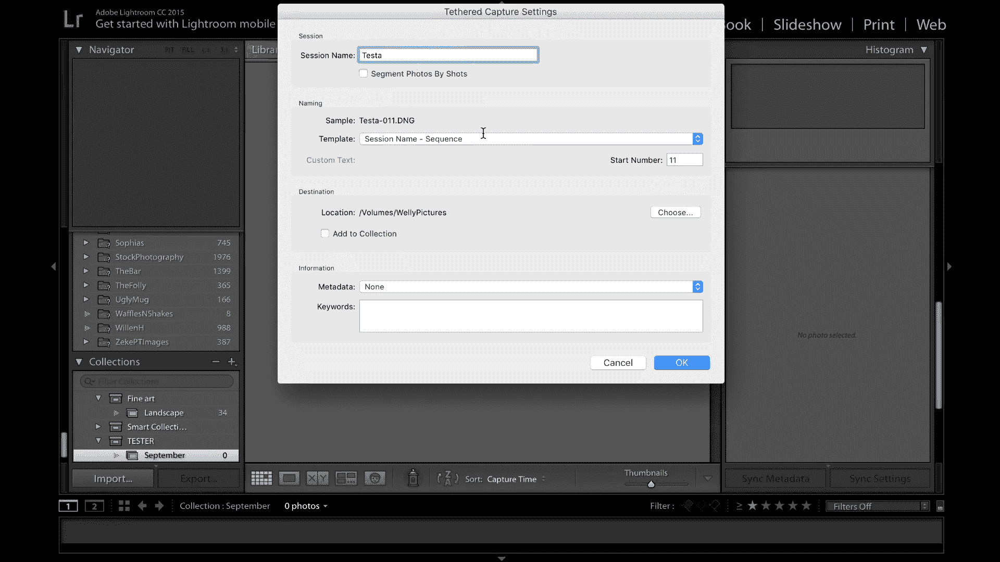

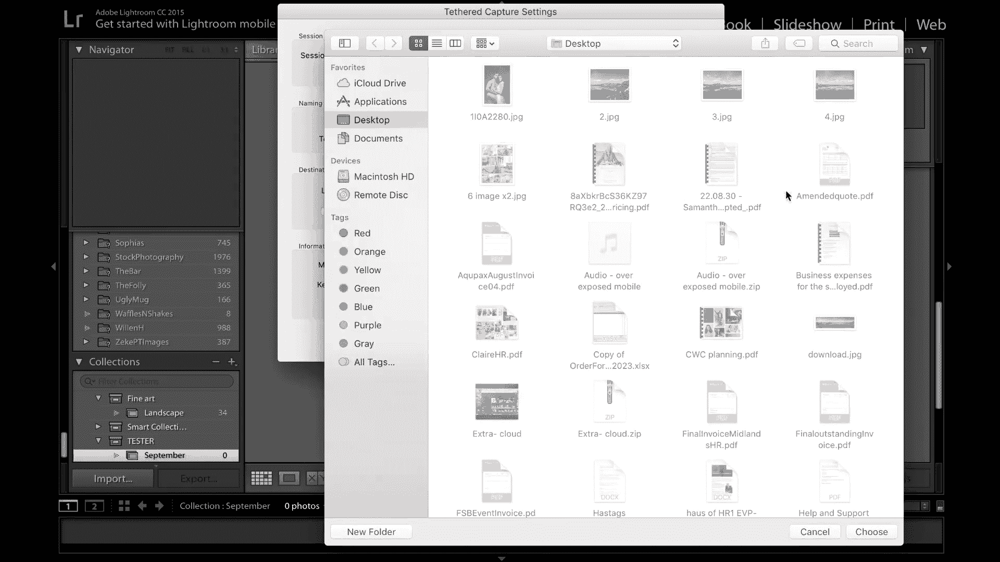

保存位置部分，你有两个选择。一种是把照片存到移动硬盘，另一种是存到电脑桌面。因为演示只是测试，我选择存到桌面。你也可以选择把照片添加到某个图集里面，方便后续管理。

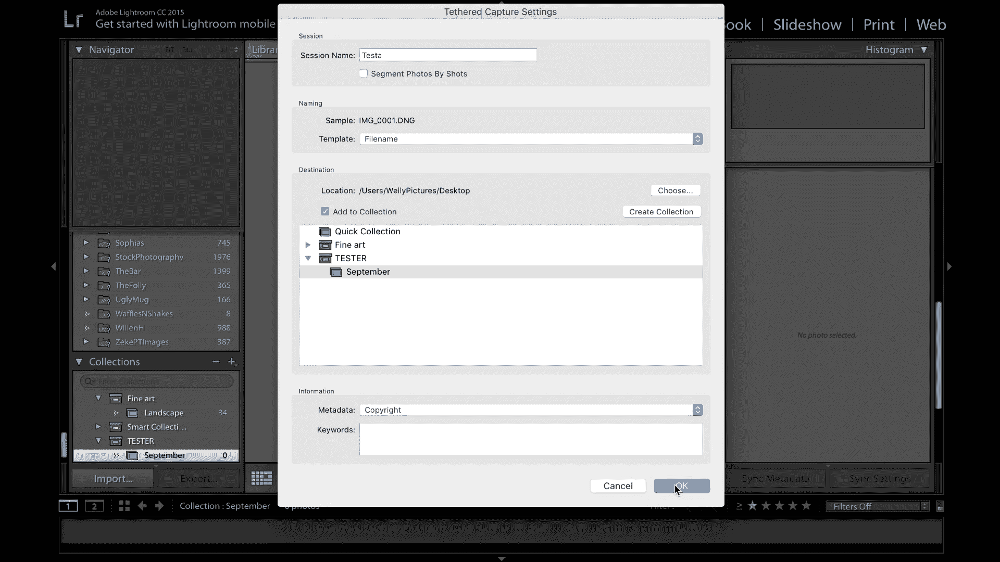

图集管理

图集是 Lightroom 里用来整理照片的工具。你可以创建一个图集合集，再在合集里面创建具体的图集。演示里我先创建一个图集合集叫“tester”，然后在里面创建一个叫“九月”的图集。你不需要把图集放进美术图集或智能图集里面，取消那些选项就行。创建完成后，你会看到图集合集“tester”下面有一个独立的图集叫“九月”。

这样做的好处是，你拍进来的照片会自动放进指定的图集里面，不会散落在图库的其他地方，拍摄结束后找照片会很方便。

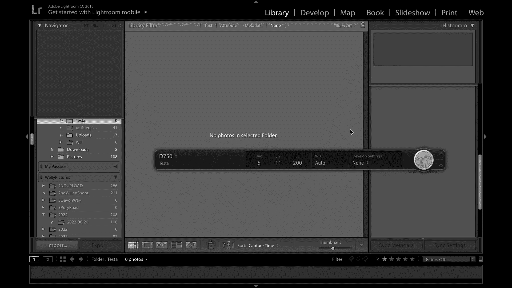

元数据预设

在开始连线拍摄之前，你还可以设置元数据。元数据里面可以包含版权信息，比如摄影师是谁，公司名称等等。如果你之前已经做过预设，导入照片时就会自动带上这些版权信息，不用每次都手动填写。你也可以提前填写关键字，这样以后搜索照片时更方便。

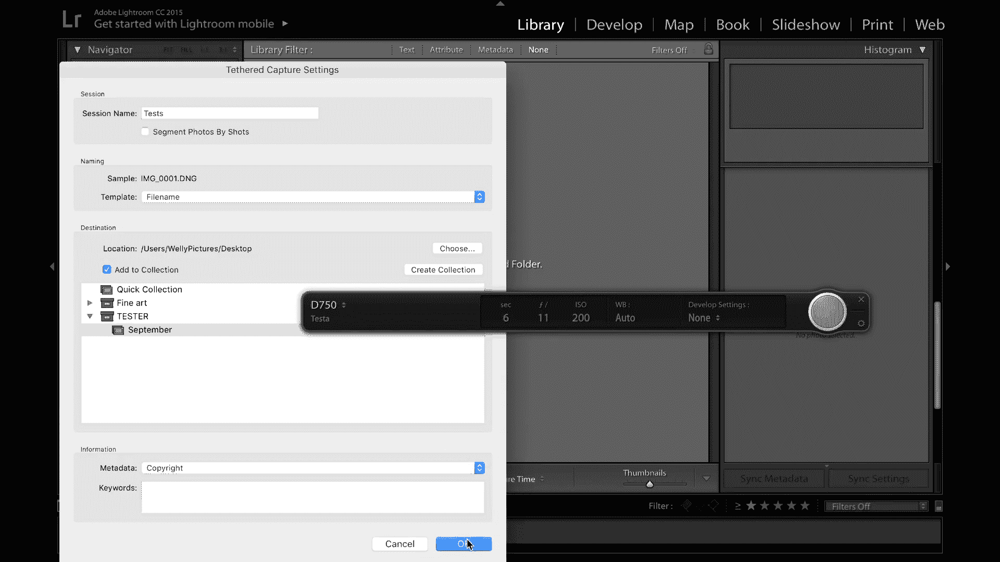

设置完成后点击确定，此时你的相机已经通过数据线连上了笔记本电脑，Lightroom 界面会出现一个小面板。

相机设置与实时预览

这个小面板会显示相机当前的参数，包括快门速度、光圈、ISO。我把 ISO 设成自动，你也可以手动调整。连线拍摄的一个好处是，你可以预先选好一个预设，拍下的照片会自动套用这个预设，省去后期调色的时间。

不过这里有一个需要注意的限制。当相机连线拍摄并连接到电脑的时候，如果你想通过实时取景拍摄静物或者人像，相机背面的屏幕会变黑，看不到画面。你只能通过相机的取景器来观察构图，或者直接看电脑屏幕上的画面。这一点一定要提前知道，免得拍摄时找不到画面。

拍摄与预设应用

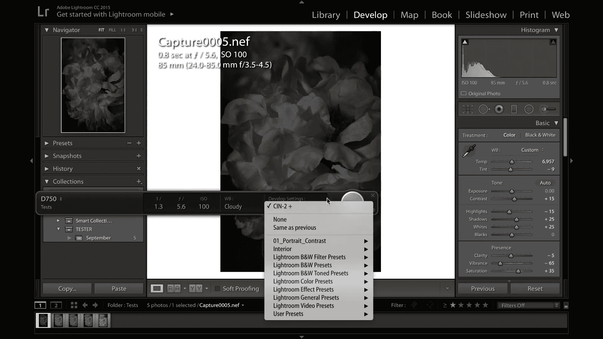

当相机连线好之后，你有两种方法拍照。一种是用相机上的快门释放按钮，另一种是直接点击 Lightroom 界面里的快门按钮。如果你开启了定时器，按下快门后会有倒计时，然后拍摄；如果不开启定时器，按下快门就会立刻拍摄。

我现在把 ISO 调到 100，白平衡调到多云，光圈调到 5.6，想要稍微有一点景深效果。然后我选择一个预设，按下快门拍一张照片。照片传进 Lightroom 之后，你会发现基本的调整已经自动完成了，比如曝光、对比度这些参数都已经有了数值。跟没有套用预设的照片对比，差别很明显。

拍摄结束后，检查一下图集，照片会出现在“九月”这个图集里面，不会跑到别的地方。整个流程就是：连好相机，设置会话名称和保存位置，选好图集和元数据预设，然后按快门拍摄，照片自动进图集并套用预设。

总结

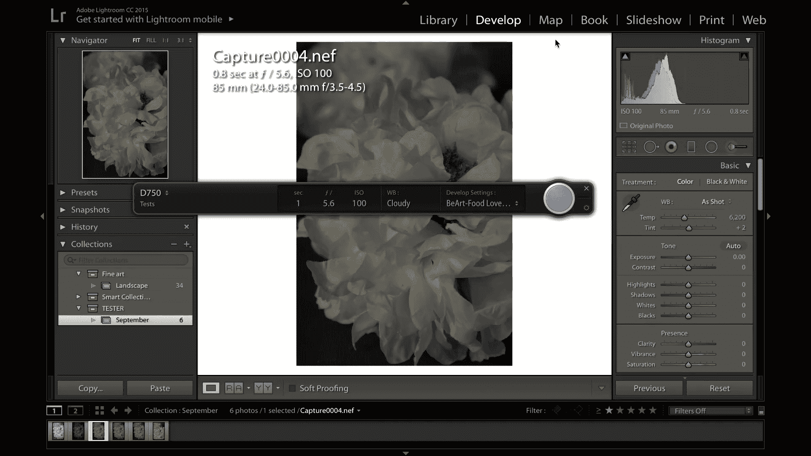

本节课中我们一起学习了如何把相机连接到 Lightroom Classic，实现连线拍摄。我们了解了导入与连线拍摄的区别，学会了设置会话名称、文件编号和保存位置，掌握了用图集合集和图集来管理照片，还知道了如何添加元数据预设。最后我们演示了如何在连线状态下拍摄，并自动套用预设，照片直接保存到指定图集里面。希望这节课能帮助你把拍摄和后期工作流程连接起来，让拍摄效率更高。

