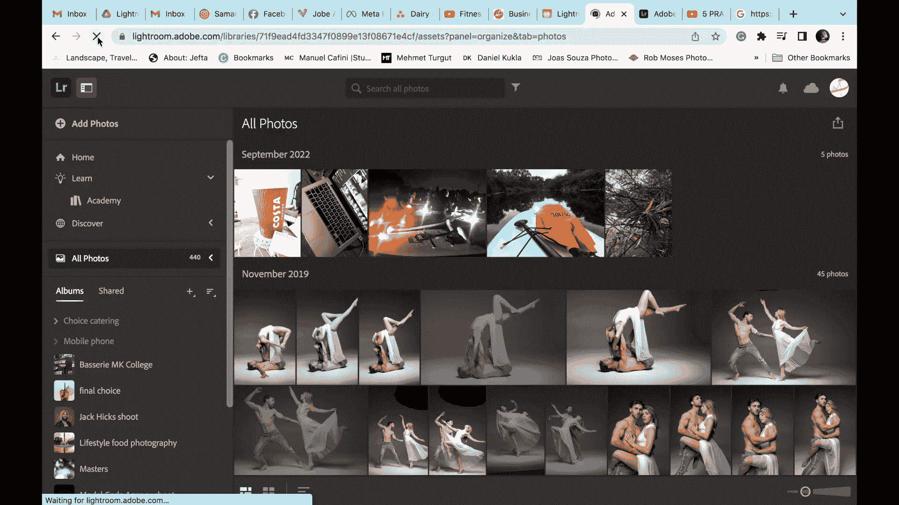
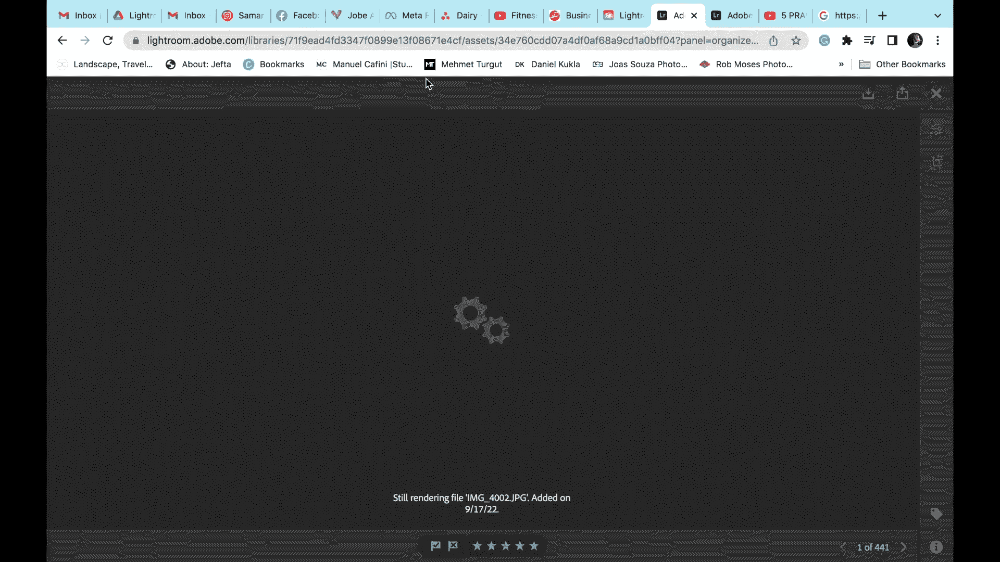
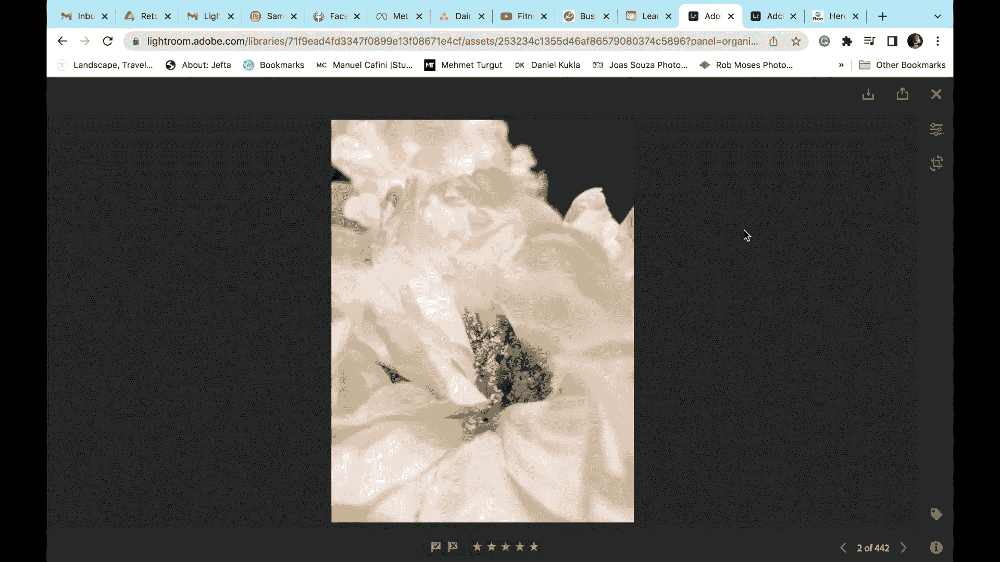
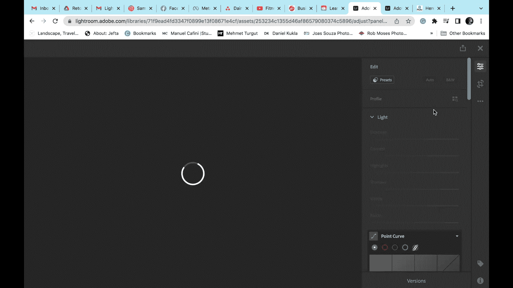
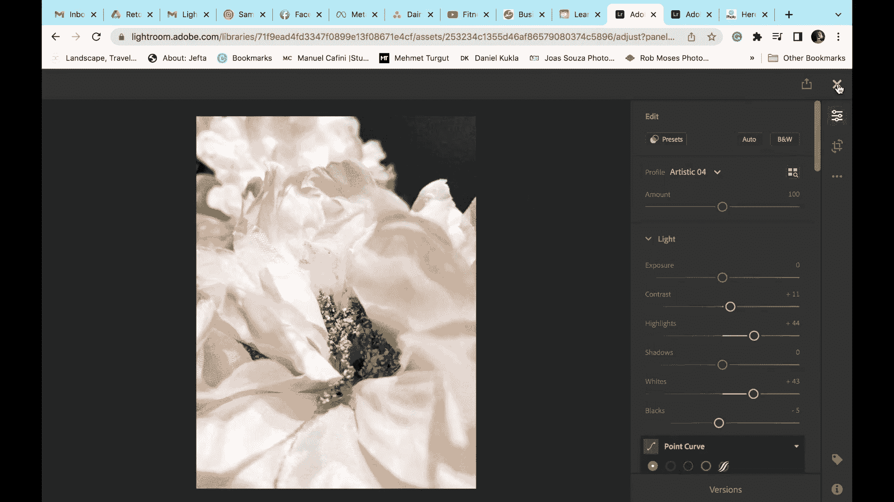
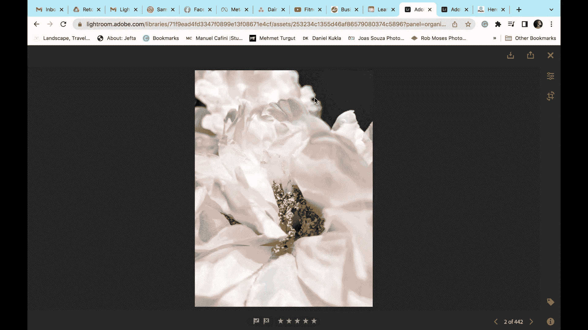

📸 Adobe Lightroom 完全教程：93：相机无线连线与云端工作流（第二部分）

在本节课中，我们将学习如何不使用数据线，而是通过手机和云存储，把单反相机拍摄的照片传输到 Adobe Lightroom 中进行编辑。上一节我们介绍了通过数据线将相机直接连接到 Lightroom Classic 的传统连线方法。本节中，我们来看看另一种无需物理连线的思路，利用手机应用程序和云同步，实现类似的拍摄与导入流程。

这种方法不一定叫传统意义上的“连线”，但它让相机、手机和云存储协同工作。你可以把手机当成相机的远程遥控器，拍完照后通过云存储把图片送到 Lightroom。

核心流程可以用下面的代码块来表示：

相机拍摄 → 手机应用控制 → 图片下载到手机 → 上传云端 → Lightroom 同步 → 桌面端编辑

接下来我们先看看在相机上该怎么设置。

在相机上启用网络连接

以下是相机端的设置步骤。

- 进入相机的设置菜单
- 找到设置菜单中的 Y5 部分
- 找到“网络连接”选项并将其启用

启用网络连接后，相机会发出一个 WiFi 网络信号，供手机连接。对于尼康相机来说，这个设置路径就是设置菜单里的 Y5 部分。

接下来我们看看如何在手机上建立连接。

在手机上连接相机网络

以下是手机端的连接操作。

- 关闭手机的普通 WiFi
- 在可用网络列表中找到相机发出的网络并连接
- 打开相机对应的手机应用程序
- 在应用程序中点击 WiFi 按钮，完成自动配对

连接成功之后，手机就能控制相机了。在应用程序的设置里，你可以检查连接和同步选项，图片尺寸建议使用推荐尺寸。

接下来我们开始拍照并把照片传到手机里。

用手机拍摄并下载照片

以下是拍摄和取图的流程。

- 进入取景界面，如果没有出现实时取景，点击右上角相机设置中的“实时取景”
- 如果需要进行长曝光，可以在此设置自拍定时器
- 在屏幕上移动小方块，将其对准你想要的对焦点
- 按下拍照按钮
- 等待图片下载到手机，然后点击该图片
- 选择上传选项；如果无效，打开 Lightroom 手机应用程序，点击图片加号，从相册中导入

拍摄时的操作就像用手机自拍一样，先对焦再按下快门。完成后，你需要等待图片从相机传输到手机。

接下来我们看看如何把照片从手机同步到桌面端的 Lightroom。

云端同步到桌面 Lightroom

以下是同步到桌面端的步骤。

- 在 Lightroom 手机应用程序中点击刚才导入的图片
- 点击右上角的云图标，开始云端同步
- 建议将手机从相机 WiFi 切换回普通 WiFi，这样可以加快同步速度
- 等待系统提示“已同步并备份”
- 刷新 Lightroom 桌面端或网页版，图片就会出现

这个同步过程可以用下面的代码块来表示：

手机端 Lightroom → 点击云图标同步 → 切换回普通 WiFi → 桌面端 Lightroom 接收图片

等待时间取决于你的设备性能和网络速度，可能很快，也可能需要一段时间。

接下来我们来看看把照片导入后，在桌面端做一些简单的编辑。

在桌面端编辑照片

以下是简单的编辑示范。

- 选择艺术类配置文件，给照片增加风格
- 提高高光，这样可以更清楚地看到花瓣上的光影
- 适当调高白色级别
- 进入混色器，调整色相而不是颜色，将色调偏向青绿色
- 调整饱和度和亮度，注意不要让图片出现像素化
- 微调对比度和色温，避免图片变得过黄或过蓝
- 稍微增加清晰度，让花瓣的细节更加明显

这些编辑步骤能让照片看起来更好，同时也展示了通过云端工作流导入后，照片可以直接在桌面端进行后期处理。

最后我们来看看这种方法的优缺点以及适合什么场景。

优缺点与适用场景

以下是这种方法的优缺点对比。

优点：

- 在外出拍摄时，无需直接按下相机快门，可以用手机远程控制
- 能够把相机、手机和 Lightroom 串联起来，实现无线传图

缺点：

- 传输速度不如使用数据线连线快
- 通过手机导入的图片通常是 JPEG 格式，而不是相机原生的 RAW 格式，也不是 Lightroom 手机应用程序直接拍摄的 DNG 格式
- 图像质量和后期调整空间会有一定损失

如果你对 JPEG 格式可以接受，那么这个流程是可以使用的。如果你需要 RAW 格式，可能还需要研究相机设置，或者使用传统的数据线连线方式。

本节课中，我们一起学习了如何通过手机应用程序控制单反相机，利用 WiFi 和云存储把照片传输到 Lightroom，并在桌面端进行编辑。虽然这种方式不如传统数据线连线快捷，且导入的多为 JPEG 而非 RAW 格式，但在需要远程拍摄或无法直接触碰相机的场景下，它依然是一个可行的备选方案。
