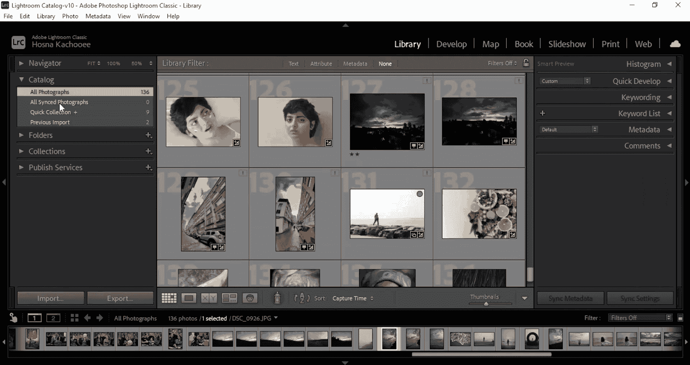
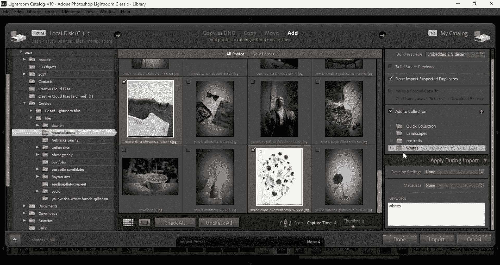
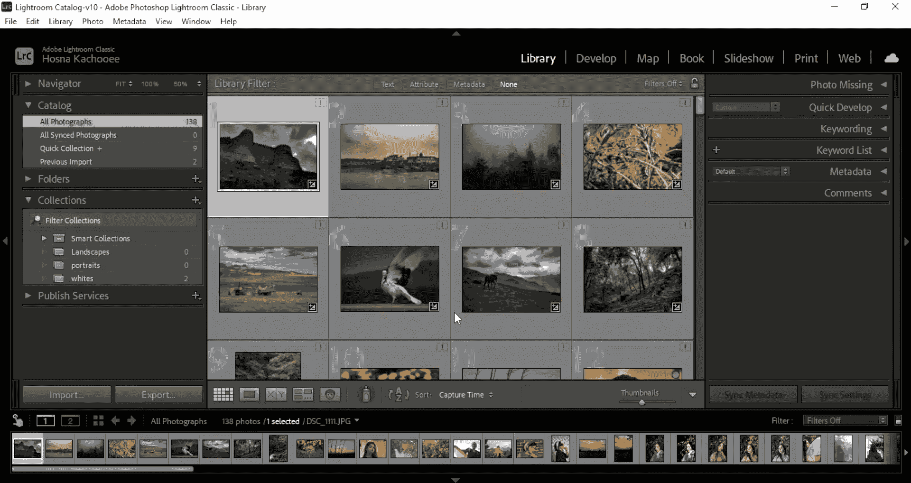
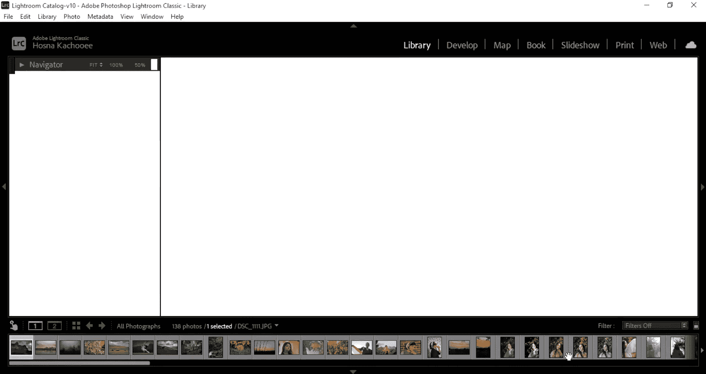
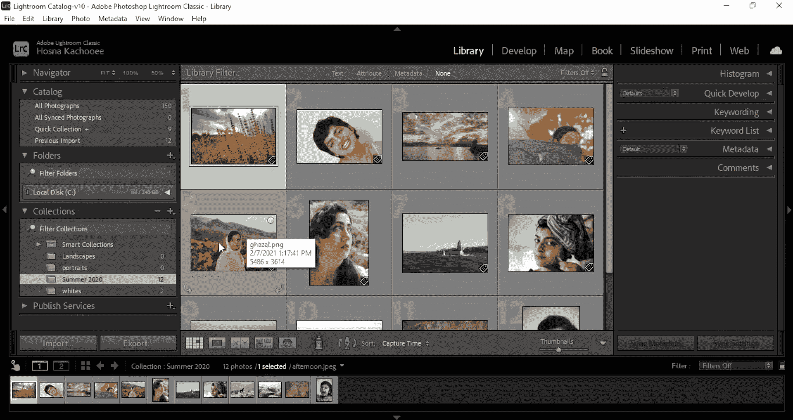

Adobe Lightroom 零基础到专家照片编辑完整教程：094：导入照片 📸


在本节课中，我们将学习如何在 Adobe Lightroom 中导入照片，理解“所有照片”视图与目录视图的区别，掌握智能预览与原始文件丢失的关系，并学习如何添加关键词、元数据和集合，实现对大量图片的整理与管理。无论你是刚开始接触 Lightroom，还是希望系统地掌握图片导入流程，这节课都会为你提供清晰的指导。我们会从软件打开后的初始界面说起，逐步深入到导入设置、重复照片处理、元数据添加以及子文件夹导入等实用技巧。学完之后，你将能够独立完成图片的导入工作，并建立起井井有条的 Lightroom 资料库。


## 1. Lightroom 打开后的初始界面 🖥️

上一节我们简单介绍了 Lightroom 的启动流程，本节我们先来看看打开软件后首先看到的界面。

当你打开 Lightroom 并且目录中已经导入了照片时，你首先看到的内容就是这些已导入的图片。这些照片将同时出现在“资料库”模块的主区域，以及底部的胶片条区域中。目前我处于“所有照片”视图，这就是为什么屏幕上会显示所有图片的原因。这种视图方式让你能够一目了然地看到目录中的全部图片，方便快速浏览和定位。

之前我们讨论过，你可以管理这些照片的显示形式，现在我就来演示如何操作。管理照片显示形式的核心在于理解 Lightroom 如何关联原始文件与预览图，这在后续的导入和编辑过程中至关重要。


## 2. 智能预览与原始文件丢失 📂

接下来我们来看看，当原始图片文件不在电脑上时，Lightroom 会如何处理。

我们来看一张具体的图片。这张图片目前不在我的硬盘上，也不在我的电脑中，也没有出现在任何已连接到电脑的存储设备里。但是它仍然可以在这里显示，只不过只是一个预览图而已。如果我想要编辑这张图片，例如点击它进入“编辑”模块，系统会提示文件找不到，因此我目前无法对它进行任何操作。这种情况说明 Lightroom 保留了图片的预览，但丢失了对原始文件的访问权限。

但是，只要我连接包含这张图片的存储驱动器，我就可以继续编辑它了。有时候你可能会忘记自己曾经导入过某张照片，这时候你需要先找到并连接对应的存储设备，然后才能继续编辑。这就是为什么定期备份和妥善管理存储驱动器非常重要。

再来看另一张目前确实存储在我的硬盘上的照片，Lightroom 可以访问该原始文件的位置，比如这张图片。这是我在去年 2020 年拍摄的，因为原始文件仍然位于我的本地硬盘上，所以我可以正常编辑这张照片。这说明只要原始文件可用，Lightroom 就能提供完整的编辑功能。

我认为这是一种非常好的图片管理方式，你可以随时掌握图片的去向，并且可以将它们放入目录、集合和文件夹中。这些内容我们会在后面详细介绍。合理的组织结构能让你在面对成千上万张图片时依然能够快速找到目标文件。

还有一点我想提到，几年前我使用过 Lightroom Classic，导入了所有这些图片。后来我卸载了程序本身，但仍在使用同一台电脑。等我重新安装程序后，所有的图片、预览图和目录都还在。我觉得这非常好，因为假设你的电脑损坏并恢复出厂设置，只要你的图片有备份，你只需插入包含图片的存储驱动器，在 Lightroom 中定位它们，就可以继续编辑。这体现了 Lightroom 目录系统的稳定性和可恢复性。

注意这里的标记，这个标记表示照片丢失了。如果你想知道哪些照片目前在你的硬盘上，因为很难跟踪所有图片，你可以查看这里，它会显示“照片丢失”。但刚才我们展示的那个使用了智能预览，所以即使原始文件丢失，你也可以对图片进行某些操作。不过对于标记为丢失的照片，你无法进行任何操作，除非你重新定位它们。



核心概念可以用如下公式表示：

```
智能预览可用性 = 原始文件存在 ? 可编辑 : 仅预览
```


## 3. 导入照片的第一步：选择来源 📥

好了，现在我们来学习如何导入新图片，这是如果你还没有图片时首先要做的事情。

假设我想要导入图片，我已经有足够多的图片了，但我还是要添加并导入一些图片。点击这里的“导入”按钮。顺便说一下，我直接将图片导入到我的目录中，你也可以创建一个新目录。如果你是刚开始使用 Lightroom，这是你必须做的操作。

选择来源，找到你存放图片的来源位置。让我来看看我的图片在哪里。我会进入“文件”，然后去“操作”文件夹。我现在有很多图片，这表示我的图片库已经相当丰富。

可以看到，系统默认全选了每一张图片，你可以点击“全选”按钮来选择少量图片。还有“所有照片”和“新照片”选项，“新照片”指的是最新添加的图片。因为我是在同一时间添加这些图片的，所以并没有特别的新图片，因此选择哪个都无所谓。这个选择直接影响导入时哪些图片会被勾选。


## 4. 导入方式：添加、移动、复制与 DNG 🔄

现在我们来看看 Lightroom 提供的不同导入方式，以下是各种导入模式的说明。

目前处于“添加”模式，这意味着让 Lightroom 仅添加图片，不对图片做任何处理，我们只需要创建之前提到的那些表示形式即可。“移动”模式可以让 Lightroom 将图片从一个位置移动到另一个位置。“复制”模式可以让 Lightroom 从某个位置（例如外部硬盘）复制图片到另一个位置，通过 Lightroom 完成。创建副本总是有帮助的，这相当于有一个计划 B，如果你丢失了原始文件，你始终还有副本。所以如果你觉得可能会丢失原始文件，可以创建副本，并确保对它们进行备份，这样就不会丢失这些图片。

还有“复制为 DNG”。DNG 是 Lightroom 自有的相机原始格式，本质上和普通原始文件相同，只是它是 Lightroom 自己的格式。DNG 文件体积较大，分辨率也较高，所以如果你打算以后打印图片或以非常大的分辨率发布，可以使用这种格式。但对于本例中我们只是演示如何导入和编辑，这没有必要。如果你想分享图片、打印图片，或者需要大尺寸输出，那么你会想要使用这种格式。目前我就使用“添加”，并且可以更改图片的查看方式。

导入模式的选择可以简化为以下代码逻辑：

```
导入模式 = 添加 | 移动 | 复制 | 复制为 DNG
```

其中“复制为 DNG”适用于需要高分辨率输出或打印的场景，其余模式适用于日常整理和编辑。


## 5. 调整缩略图显示与排序方式 🖼️

导入前我们可以先调整图片的显示方式，以下是可用的视图和排序选项。

目前图片以网格视图显示，可以将它们设为单独显示，也可以切换回来。你可以更改缩略图大小，目前它们处于最小缩略图尺寸，可以根据需要增大到任意大小。如果你想让图片单独显示，只需点击相应按钮，它们就会变成单独显示。这种灵活性让你可以根据屏幕尺寸和个人偏好来调整浏览体验。

现在我们来选择一些图片进行导入。你也可以对图片进行排序，以下是排序选项：

- 按文件类型排序，例如 JPEG 或 PNG，你可以选择格式。
- 按文件名排序，基本上按名称排序。
- 按捕获时间排序，即图片被拍摄的时间，列表顶部是最早拍摄的时间，底部是最晚拍摄的时间。
- 按检查状态排序，即上次对图片进行任何操作的时间。

这些图片来自像素网站，在这种情况下，它们就是这样分类的。合理的排序能帮助你在导入前快速找到需要的图片，避免重复导入或遗漏重要文件。


## 6. 处理重复照片与添加关键词 🏷️

在导入过程中，我们需要处理重复照片，并可以为图片添加关键词，以下是具体操作。

现在导入这两张图片。如果你插入了 SD 卡、相机 SD 卡或闪存盘，通常会有很多重复照片，这种情况经常发生，Lightroom 有一个功能可以自动分离重复项。例如，如果我这里有三张同一位女士的照片，并且开启了此选项，我只会看到其中一张。如果关闭此选项，我会看到全部三张。这样有助于保持目录和资料库整洁，避免被重复照片填满。

你也可以将图片添加到集合中。让我们开启此选项，假设我目前有两个集合，实际上我需要新建一个。我们将其命名为“白色”，因为这两张图片里有很多白色。创建该集合，并将图片添加到“白色”集合中。集合是一种虚拟分组方式，不会移动或复制实际文件，只是在 Lightroom 内部建立关联。



我不想现在处理元数据，实际上你可以创建元数据，让我们快速看看如何操作。元数据基本上是每张图片背后不可见的数据，可以是版权信息、你的名字、日期，或者任何你想添加的信息，甚至相机信息。可以放很多内容，但我推荐添加基本信息，即你的姓名和个人信息。这样就相当于给图片贴上一个不可见的标签，表明这张照片是你拍摄的，归你所有。当你发送图片、在网上发布或提供下载时，这很有帮助。添加这些信息比较安全，但我不打算现在深入讲解，我们会在另一节课回来讨论，先退出这个界面。

接下来是关键词，关键词是你以后用来整理图片的。比如我写“白色”，因为图片里有白色，我就添加这个关键词。编辑完成后，我可以回到搜索栏搜索“白色”，这两张图片以及所有标记了“白色”关键词的图片都会出现。关键词系统可以用如下方式理解：

```
搜索结果 = {图片 | 图片.关键词 包含 搜索关键词}
```

就这样，点击“导入”。我将导入到我的目录中。


## 7. 元数据与集合的进一步设置 🗂️

导入过程中还涉及元数据和集合的设置，以下是相关说明。

正在导入文件，请稍等，正在生成初始预览。好了，它们来了。注意我们现在处于“目录”视图，不再处于“所有照片”视图中，所以不用担心照片不见了，是因为你在“上次导入”视图中。这里是我最近导入的图片，如果我返回“所有照片”，就回到了原来的位置。



我也将图片添加到了集合中，所以如果我点击“白色”，我就能看到这些图片。这就是资料库的工作方式。集合和目录的区别在于，集合更像是一个动态的播放列表，你可以随意添加或移除图片，而不影响原始文件的位置。


## 8. 导入包含子文件夹的文件夹 📁

我还要展示另一种导入方式，适用于你有大量图片并且希望它们有条理的情况，以下是详细步骤。



例如，如果拍了一场婚礼，拍了很多图片，你可以根据姓名或位置来组织这些图片。也许你有很多某位阿姨的照片，也有叔叔的一些照片，你之前已经在文件中按类别整理好了。Lightroom 的另一个好处是，当你导入包含这些用于分类图片的子文件夹的文件夹时，它会导入相同的结构。让我们看看如何操作。

我回到了我的目录，我将展示一个我用来分类图片的文件，这些文件在我的课程之外。最小化 Lightroom。在这里，我创建了一个名为“我的照片”的文件夹，并对图片进行了分类，有些非常概括，有些非常具体。我也包含了一个视频，只是为了展示 Lightroom 也会识别视频，但你显然不能在 Lightroom 中编辑视频，它们只是在那里，我们只是看看。我有一些风景照，一些随机的照片，还有一个特定表亲的专用文件夹，里面有一些随机人像。现在我将导入这个主文件夹到 Lightroom，并展示 Lightroom 如何按照我分类的方式读取这些文件夹。

让我们回到这里，点击“导入”。选择来源，选择我桌面上的“我的照片”。大家注意这里只有一个视频，因为它在子文件夹之外。我之所以看不到那些子文件夹，是因为我需要单独进入，但如果你想导入所有图片，只需进入“我的照片”，你会看到这里有“包括子文件夹”选项。我点击这个，所有这些图片以及视频都会显示出来。

我希望导入所有这些图片，但不导入视频，所以我取消勾选视频。不过现在我知道视频在那儿，不导入也没关系，视频在这里不重要。我也可以将它们添加到集合，让我们创建一个新集合，命名为“2020年夏季”。不要将它们添加到集合组中，就这样创建。所有这些图片都将进入“2020年夏季”。

我不添加一些，先添加一些关键词，这样以后可以回来查找。关键词是“summer”（夏天）。够了，暂时先这样。同样，不要导入疑似重复项。我就导入所有这些图片，包括子文件夹，然后导入。关键词是“summer”，不添加元数据，添加到集合。命名为“2020年夏季”，点击导入。好了，它们来了，正在获取一些预览，请稍等。


## 9. 查看导入结果与图标含义 🏷️

导入完成后，我们可以查看结果并理解图标含义，以下是具体说明。

在这个过程中，注意每张图片角落有两个图标。第一个图标代表我们添加的关键词，添加到了每张图片上，所以它们都有这个标记。右侧的第二个图标表示这些图片在某个集合中，我们的集合是“2020年夏季”。如果你在图片旁边看到这些标签，就知道它们为什么会出现，因为你之前做了那些调整。这些图标就像是图片的身份标签，帮助你快速识别图片所属的集合和标签。

让我们去“2020年夏季”。好了，预览已经生成，我们知道这些图标为什么在那里。


## 10. 缺失文件夹与元数据筛选 🔍

最后我们来看看缺失文件夹的情况，以及如何使用元数据筛选图片，以下是操作方法。

如果我们查看磁盘，目前有一个本地磁盘，就这些。现在我们有之前创建的那个文件夹，如果我将鼠标移到上面，你会看到它只选择了子文件夹里的图片，比如人像。让我们进入这里选择那两张在该图片文件夹中的图片，风景照也是一样。然后如果你看这里，我有一些缺失的文件夹。

因为我的目录是几年前的，这些文件夹不再位于原始位置，但 Lightroom 保留了它们的数据，所以它知道原始文件在哪里。由于它们不在我的磁盘上，我无法再编辑它们，所以这里有个问号。这提醒我们，如果移动或重命名了存储图片的文件夹，需要在 Lightroom 中重新定位，否则会出现缺失标记。

这就是编辑一批照片的方法。我们关闭这个。如果我选择带有元数据的图片，它会收集所有这些图片的元数据，所以我们有日期、相机类型、镜头，它甚至知道镜头，目前没有标签，因为我还没有添加任何标签。如果我有很多图片，也许上传了整个硬盘，我可以回到某个日期、某个相机类型，甚至某个镜头，按元数据进行排序。如果有好的文本，我们可以在这里搜索副本名称、文件名，以及关键词。如果我选择关键词，因为它们都使用相同的关键词命名，只会显示那些。如果我有一张图片没有关键词，它就不会在这里显示。

元数据筛选的逻辑可以表示为：

```
筛选结果 = {图片 | 图片.元数据 匹配 筛选条件}
```

让我们去“属性”。属性类似于标记过的图片，我们这里没有标记任何人，还有我们给出的星级评分，我们后面会讲到这些，但标记和评分会显示在下面，你可以看到五个点。我们后面会详细介绍，但目前这就是你编辑一批图片、添加关键词、导入包含子文件夹的文件夹以及将它们添加到集合中的方法。


## 11. 总结与下节课预告 📚

以上就是本节的全部内容，以下是本节课的核心要点。

如果我们回到这里，我有“白色”集合，包含那两张图片，还有“2020年夏季”。这就是你在 Lightroom 中导入图片以及资料库的工作原理。在本节课中，我们一起学习了 Lightroom 的导入界面、智能预览与原始文件丢失的区别、各种导入模式、缩略图与排序设置、重复照片处理、关键词与元数据添加、子文件夹导入以及图标含义等内容。



在接下来的课程中，我们将了解更多关于这部分的内容，如何为图片添加关键词、添加元数据、给它们评分等等。所以请继续关注，了解资料库的其他部分，因为有很多部分需要学习。我们下几节课见。
