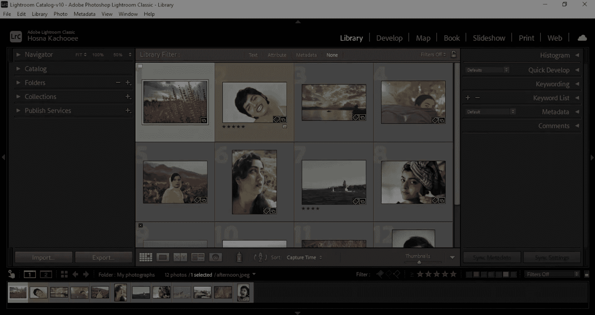

📸 Adobe Lightroom 零基础到专家照片编辑教程：第95课：Navigator 与右侧面板详解 📸


在本节课中，我们将学习如何使用 Lightroom 资料库模块左侧面板的 Navigator 工具，以及如何使用右侧面板中的直方图、快速开发、关键字和元数据功能。这些工具能帮助你在正式编辑前检查照片，并快速整理图片信息。


上一节我们介绍了如何在资料库中导入、分类、标记和处理图片。本节中我们来看看左侧面板最后一个选项卡，也就是 Navigator。

Navigator 的作用很简单。它是用来在你进入开发模块之前，先查看和检查图片的。你可以在这里给照片打分，添加旗标，重命名，甚至绘制人脸区域。换句话说，Navigator 就是一个让你在后期处理前快速筛选照片的工具。

比如，你可能只想编辑那些对焦准确的照片。这时候你可以点击缩放按钮，放大图片来检查细节。你也可以调整缩放比例，或者使用这里的矩形框在图片中移动，查看不同区域。

以下是 Navigator 常用操作：
- 点击缩放按钮放大或缩小图片
- 使用矩形框在图片内导航
- 给图片设置五星级评分
- 添加旗标或重命名照片

当你确认要编辑某张照片后，可以给它打五星级评分，然后退出缩放视图，回到网格模式。


现在我们已经了解了资料库模块左侧面板的全部内容。后面还会讲到导出功能，现在不需要担心。接下来我们转到 Lightroom 资料库的右侧面板。


右侧面板首先展示的是直方图。直方图就是图片数值和色调的可视化表示。简单来说，它显示了图片中亮部、暗部和中间调的分布情况。

当图片出现过曝高光或欠曝暗部时，直方图的角落会出现错误符号。这些符号在后期编辑时非常有用，因为它们能告诉你哪些部分需要修复。你也可以使用裁剪指示器，这个功能我们在开发模块中会详细讲解。

在 Lightroom 中查看直方图，可以帮助你快速判断图片的曝光状态。


接着是快速开发面板。顾名思义，快速开发让你不必进入单独的开发面板，就能快速编辑图片或多张图片。

快速开发面板包含一些预设的编辑选项。比如你想把照片变成黑白，可以直接选择对应的处理方式，这些其实都是已经保存好的预设。Lightroom 自带很多预设，你不需要自己创建，当然也可以自己制作。

比如你有一组风景照片的预设，专门用于多云天气的风景图。你只需要在对应的图片上应用该预设，然后直接导出，而不需要花太多时间在开发面板里调整。

以下是快速开发面板的主要控制项：
- 白平衡：保持自动或手动设置
- 色调控制：调整曝光、亮度、清晰度和色彩鲜艳度
- 自动按钮：让 Lightroom 自动编辑图片
- 重置按钮：撤销你做过的所有调整
- 微调按钮：分为三分之一档和一档两种移动方式，用于逐步或大幅度改变数值

色调调整的核心参数可以用这个公式表示：
```
最终图片效果 = 曝光 + 亮度 + 清晰度 + 色彩鲜艳度
```


接下来是关键字功能。我们之前已经添加过一个关键字“这个夏天”。现在你可以继续添加更多关键字，系统也会给出建议。

关键字本质上是附加在每张图片上的不可见数据。你可以用它来搜索带有特定标签的图片。系统也会提供相关建议，比如如果图片里有白色背景或洁白的牙齿，可能会建议添加“白色”关键字。

以下是关键字使用的要点：
- 添加与图片内容相关的具体关键字，比如微笑、红色口红、短发等
- 避免添加不相关的关键字，否则图片会在大量分类中被淹没，被人看到的机会就会减少
- 可以使用 Lightroom 已经创建好的关键字集，比如婚礼摄影集，包含新娘、婚礼派对、黑白仪式等标签
- 也可以创建自己的关键字集，或者删除不需要的集合


然后是关键字列表。这里和关键字面板差不多，只是以列表形式展示所有已添加的关键字。

比如你想查看所有打上“夏天”标签的照片，可以在这里直接筛选。如果你之前给多张图片添加了“夏天”关键字，列表就会显示这些图片。你还可以搜索带有“微笑”标签的图片，快速定位到特定照片。


接下来是元数据。如前所述，元数据是始终附加在图片上的不可见数据。不管图片在哪里发布、上传或下载，这些数据都会保留。

元数据通常包括图片名称、标题、说明、版权信息等。版权信息尤其重要，因为你希望每个人都知道这是你拍摄的图片。你还可以设置版权状态，比如公共领域或已受版权保护，并添加创作者信息。

以下是元数据中常见的项目：
- 图片尺寸
- 曝光设置
- 相机参数
- 版权状态
- 创作者名称

这些数据在你上传图片到不同平台时，都会随图片一起显示。比如在 Behance 平台上，点击图片信息就可以看到你在 Lightroom 中添加的所有不可见数据。这能让其他人更了解图片，知道是谁拍摄的，以及版权状态。

除了基本信息，你还可以添加位置预设、不同格式、视频等内容。评论区域会显示其他人在你的图片上添加的评论，如果暂时没有评论，这里就会是空的。


这就介绍完了右侧面板的内容。现在你已经知道如何同时使用左侧面板和右侧面板了。

在下一节课中，我们将介绍底部的胶片条面板和顶部面板，我们在那里见。




本节课中我们一起学习了 Navigator 工具的使用方法，包括放大图片、检查对焦、给照片打分和添加旗标。我们还详细介绍了右侧面板中的直方图、快速开发、关键字、关键字列表和元数据功能。这些知识能帮助你在 Lightroom 中更高效地整理和筛选图片，为后续的深入编辑打下基础。
