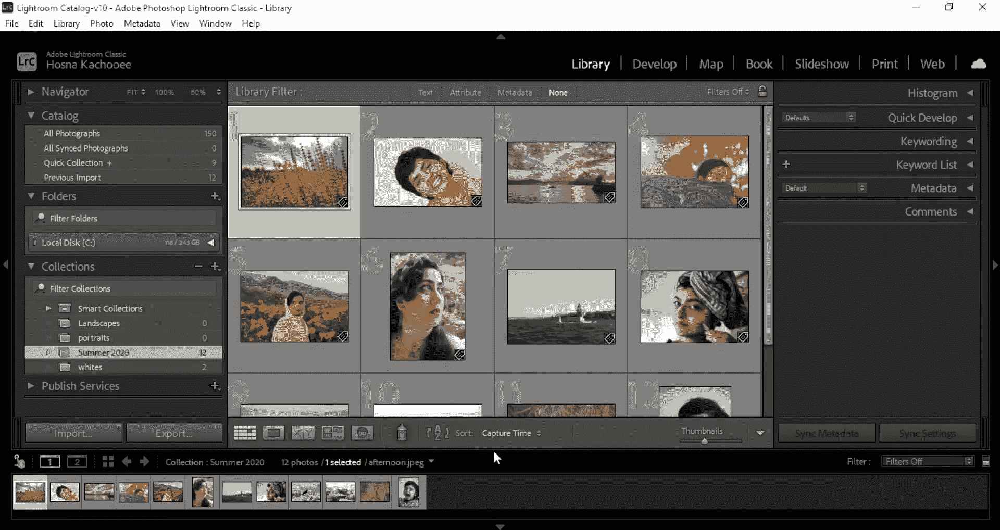
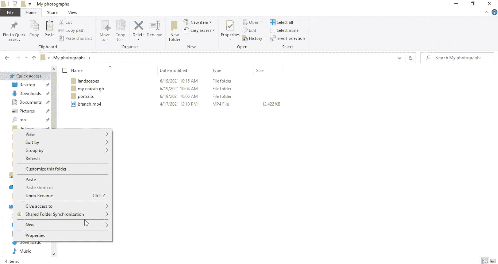
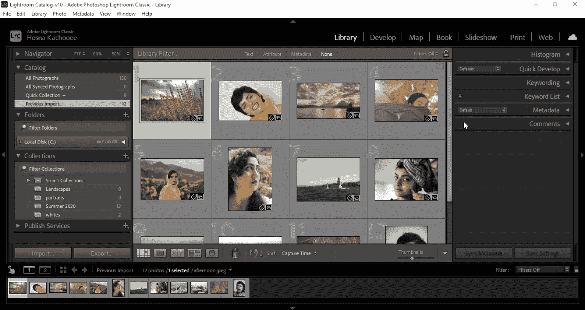
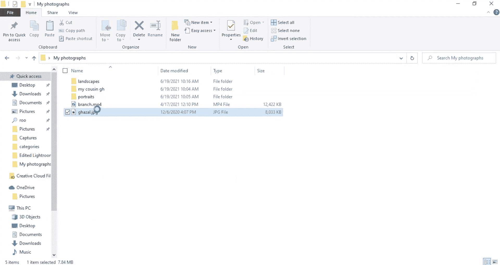
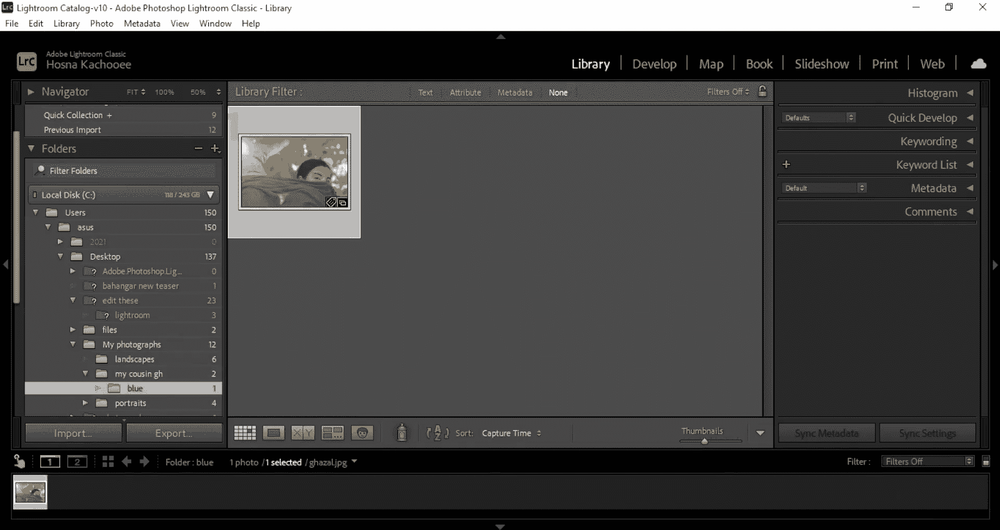
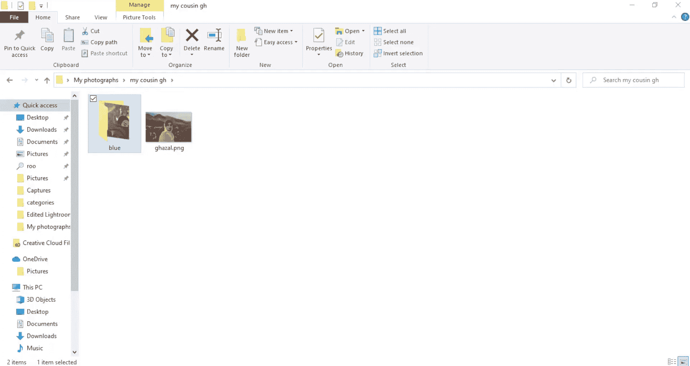
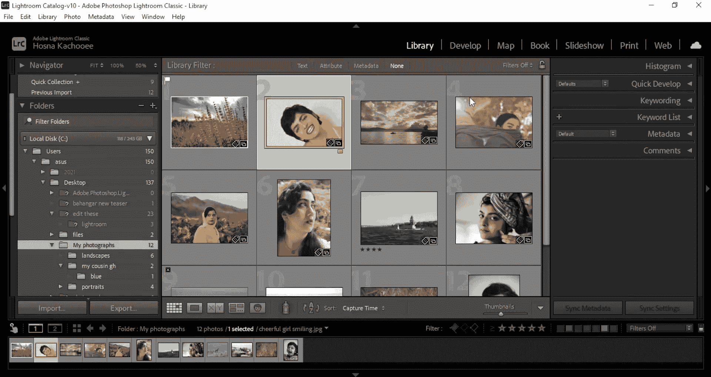

🖼️ 完整 Adobe Lightroom 大师课：第96节：筛选器与丢失文件管理

在本节课中，我们将学习 Adobe Lightroom 中图片管理的核心逻辑，特别是如何处理丢失文件问题，以及如何使用筛选器、星级评分、旗标和颜色标签来整理照片。无论你是刚接触 Lightroom 的新手，还是希望提升工作效率的摄影爱好者，掌握这些功能都能让你在面对大量图片时从容不迫。我们会通过实际操作演示，看看当图片离开 Lightroom 记录的原始位置会发生什么，并学习如何在 Lightroom 内部安全地创建文件夹和移动照片。最后，我们还会结合客户挑片和打印需求，讲解筛选系统在真实工作中的应用场景。

正如我们之前讨论过的，Adobe Lightroom 本质上是一款专门用于图片管理的软件。它不仅仅是一个简单的照片编辑器，更是一个完整的图片库管理系统。当你把照片导入 Lightroom 之后，软件会在数据库中记录每张图片的具体路径、文件名和相关元数据。这意味着 Lightroom 依赖于这些记录来定位你的图片。如果你在电脑的文件资源管理器里直接移动或重命名照片文件，Lightroom 可能会因为找不到原路径而认为文件丢失了。因此，理解 Lightroom 的管理机制是后续所有操作的基础。

上一节我们介绍了 Lightroom 的图片管理特性，本节中我们来看看当图片文件被移动时会发生什么情况。假设你回到电脑的文件夹中，随意挑选一张已经导入 Lightroom 的图片，将它剪切并移动到原来的文件夹之外。这时候，回到 Lightroom 界面，切换到“之前的导入”视图，你会发现这张照片缩略图上出现了一个提示标记，显示“照片丢失”。之所以会出现这种情况，是因为你把图片移出了 Lightroom 最初记录的位置，软件现在不知道图片被存放在哪里了，只能在界面上标记为丢失。核心原因可以用这个公式表示：丢失文件 = 图片在 Lightroom 记录的路径 ≠ 图片在实际硬盘上的路径。如果你把这张图片移回原来的位置，然后在 Lightroom 中刷新一下，丢失标记就会消失，照片重新变为正常状态。这说明只要图片还在硬盘上，并且回到了 Lightroom 认为它应该在的位置，问题就可以轻松解决。

了解了丢失文件的原因后，我们接下来看看如何在 Lightroom 内部正确地组织文件夹，避免在电脑端直接操作带来的风险。当你希望把某张图片放入已有文件夹的子文件夹中时，建议直接在 Lightroom 中完成这个操作，而不是在电脑的文件夹里手动移动。以下是具体的操作步骤。

- 选中目标图片，找到子文件夹旁边的加号按钮，点击它创建新文件夹。
- 把新文件夹命名为“blue”，然后点击创建，此时这张图片就会被放入名为 blue 的子文件夹中。
- 回到 Lightroom 刷新一下，你就会看到图片已经出现在这个新建的子文件夹里了。

通过这种方式，无论是新建文件夹、添加新照片到某个文件夹，还是创建多个子文件夹，都应该通过 Lightroom 来操作。这样既不会触发丢失文件提示，也比直接在电脑文件夹里操作要简单得多，因为 Lightroom 可以帮你统一管理照片，让你把图片放在不同文件夹里，然后进行编辑、导出、打印等所有与图片相关的操作。这也是 Lightroom 与其他图片软件的一个关键区别所在，尤其是在你拥有大量照片需要按照人物、地点、日期、文件名或使用的相机进行分类时，这种内部管理机制非常有帮助。

完成图片的文件夹管理后，我们再来看看 Lightroom 提供的筛选功能，帮助你在海量照片中快速找到目标图片。在 Lightroom 的上方工具栏中，你会看到一系列筛选选项，可以根据图片的属性来快速定位特定照片。常见的筛选维度包括星级评分、旗标状态、颜色标签、曝光信息、默认列以及相机信息等。每一种筛选条件都可以单独开启或关闭，也可以组合使用，从而缩小显示范围，只展示符合条件的图片。

先来看看最常用的星级评分筛选，它能帮助你把照片按喜好程度进行分级。以下是星级评分的操作步骤和筛选逻辑。

- 选中一张图片，右击选择“设置旗标”或“评分”，比如给图片打上四颗星。
- 开启筛选器，选择“未评级”，此时只有没有星级的图片会显示，刚才打了四颗星的图片会被隐藏。
- 切换到“高于一颗星”的筛选条件，四颗星的图片会出现在列表中，而两颗星或五颗星的图片则不会显示，因为筛选条件是精确匹配或范围匹配的。

核心筛选公式可以表示为：可见图片 = 当前图片库 ∩ 星级等级符合筛选条件的图片。

除了星级评分，Lightroom 还提供旗标和拒绝标记，用于更直观地标记照片的去留。以下是旗标和拒绝标记的使用方式。

- 对某张不喜欢的图片，可以右击选择“标记为拒绝”，此时图片上会显示带叉号的旗标图标。
- 对保留的图片，可以标记为普通旗标，显示为白色小旗。
- 开启“未标记”筛选时，只有没有任何旗标的图片会显示。
- 开启“已评级一次”筛选时，只有打过星级的图片会出现，而被拒绝的图片不会出现在普通旗标列表中，除非你专门开启基于拒绝的筛选条件。
- 当你同时开启全部三种筛选条件时，库中所有图片都会重新显示出来。组合筛选的逻辑可以简化为：最终显示图片 = 所有图片 ∩ (旗标条件 ∪ 评级条件 ∪ 拒绝条件)。

掌握了评分和旗标之后，我们再看看颜色标签系统，它为图片管理提供了另一种直观的分类方式。以下是颜色标签的筛选示例。

- 选中一张图片，设置颜色标签为黄色，此时图片会被标记为黄色标签。
- 在筛选器中选择黄色标签，只有带有黄色标签的图片会显示。
- 如果你同时要求图片没有星级评分，那么筛选结果可能会为空，因为黄色标签图片可能本身就带有评分，需要调整筛选条件，比如将评分设为等于一颗星或其他数值。
- 除了黄色，还有红色、绿色、蓝色等颜色标签可选，也可以创建自定义标签组合。自定义标签是由你自己定义的颜色组合或其他标记方式，用于标注特定含义，比如红色代表“拍摄未对焦，不予使用”。几年后当你再次看到带有红色标签的图片，就知道这张照片是因为某些原因被你排除了，而绿色标签可能代表可以使用的优质照片。

了解了各种筛选工具后，我们通过一个实际案例来看看这些功能在摄影工作中怎么用。假设你把一批照片发送给客户，客户喜欢某张图片会给五颗星，不喜欢的给一颗星，然后要求你打印一些照片。如果图片数量较多，你可以直接在 Lightroom 中开启筛选器，选择“大于两颗星”的评分条件，这样所有符合客户要求的高分照片就会集中显示出来，你只需要把这些图片导出或打印即可。这就是旗标、评分和标签系统的工作方式，它们能让你对图片的展示和筛选拥有更多控制权，节省大量导出、冲洗或打印的时间。这对摄影师来说是一个非常实用的省时功能，也能让你在多年后重新翻看旧照片时，迅速明白当年的标注含义。

本节课中，我们一起学习了 Lightroom 中图片丢失的原因及解决方法，掌握了在 Lightroom 内部创建子文件夹和移动图片的正确操作方式，避免了在电脑文件夹直接操作导致文件丢失的问题。我们还详细介绍了星级评分、旗标拒绝标记、颜色标签以及相机信息等筛选器的使用方法，并结合客户挑片和打印场景，演示了如何高效筛选出符合要求的图片。希望这些内容能帮助你更好地管理照片库，提升后期处理的工作效率。

