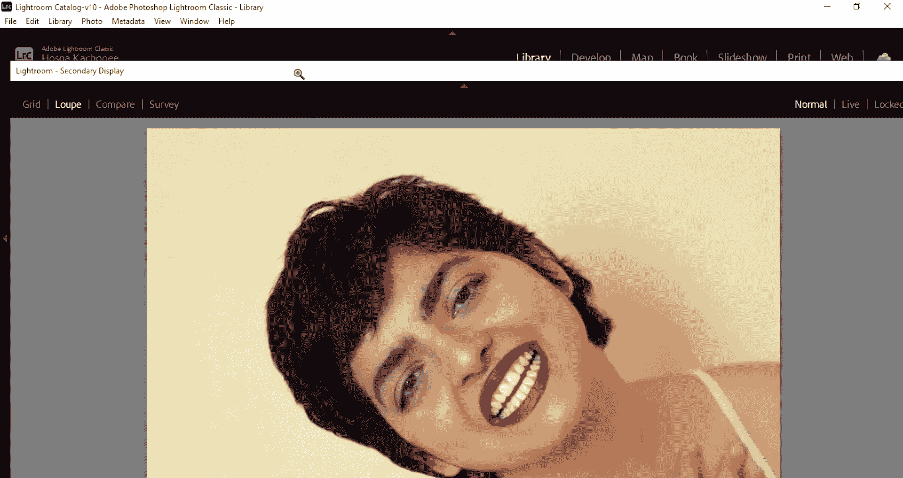
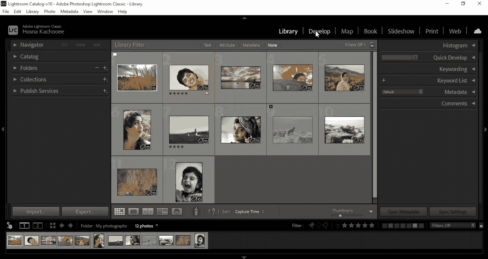

📷 Complete Adobe Lightroom Megacourse： Beginner to Expert Photo Editing：第97课：胶片条（The Film Strip）

在本节课中，我们将一起学习 Adobe Lightroom 中胶片条的工作原理。胶片条位于软件底部，是你浏览和管理照片的重要区域。我们会看看它如何显示图片，如何切换文件夹，如何使用不同的查看模式，以及如何对照片进行打分、筛选和导出。即使你是第一次使用 Lightroom，也能轻松跟上讲解。

胶片条最基本的作用是展示当前文件夹里的所有照片。你可以把它理解为一个缩略图列表，只有当前选中的文件夹里的图片才会出现在这里。

`当前胶片条显示图片 = 所选文件夹中的所有图片`

如果你想换一个文件夹查看，只需要切换图片来源即可。比如说，你原来在“我的照片”文件夹，胶片条里就显示该文件夹下的全部照片。如果你切换到“人像”文件夹，胶片条里只会显示人像照片，其他照片会暂时隐藏。切换回来之后，所有照片又会重新出现。这样一来，你就能随时控制当前想要处理的照片范围。

了解了胶片条的基本显示逻辑，接下来我们来看看Lightroom提供的几种常见图片查看模式。

以下是常见的查看模式：

- 网格视图：一次性显示多张缩略图，适合快速浏览大量照片。
- 循环视图：一次只看一张图片，适合仔细查看单张照片的细节。
- 对比视图：同时显示两张图片，方便对比同一拍摄对象的不同照片，选出更好的一张。
- Survey视图：从一组相似的照片中挑选出适合导出的那几张，适合照片比较多且很接近的情况。

以对比视图为例，如果你有两张拍摄对象相同的照片，可以把它们放在一起对比，然后决定哪一张更好。假设你更喜欢右边那张，就可以给它打五颗星，或者添加标记，方便之后找到。而Survey视图则更适合从一堆几乎一样的照片里挑出几张代表作，操作起来也非常简单。

除了普通的查看模式，Lightroom还提供了人脸识别功能，帮助你更好地整理人像照片。

在人物视图里，Lightroom会自动检测照片中的人脸。如果你还没有给这些人起名字，界面上可能会显示问号。这时候你只需点击人脸，就可以给它命名，比如“姐姐”或“宝宝”。命名完成后，你还可以根据人名对图片进行分类，找到所有包含某个人的照片变得非常方便。这对于拍摄大量人像的摄影师来说，是一个很实用的整理工具。

掌握了人脸分类之后，我们再来看看如何对照片进行排序，以及如何利用多个窗口提高效率。

以下是排序和多窗口的常见操作：

- 按名称排序：按照文件名字母顺序或中文拼音排列图片。
- 按受欢迎程度排序：根据打分或标记情况排序。
- 按堆叠大小排序：适合将相似照片堆叠在一起后查看。
- 打开第二个窗口：你可以同时打开两个Lightroom窗口，一个用来仔细查看照片细节，另一个用来进行其他操作，实现简单的多任务处理。

打开第二个窗口后，原来的窗口不会关闭，你可以在两个窗口之间自由切换。比如说，在一个窗口里放大查看照片细节，在另一个窗口里调整参数，这样工作效率会更高。用完之后，直接关闭第二个窗口即可，回到单窗口模式也不受影响。

学完排序和多窗口之后，我们来看看如何筛选照片，以及胶片条中图片路径的含义。

当你将鼠标移动到胶片条中的某张图片上时，界面会显示该图片的文件路径。这可以帮助你确认照片在电脑硬盘中的具体位置。

除了路径，你还可以使用筛选器来限制显示的照片。比如，只显示已经打分的照片，那么胶片条里只会出现那些有评分的图片，未评分的照片会被暂时隐藏。筛选条件可以根据你的需求灵活设置，不需要时可以随时关闭筛选，所有照片又会重新显示出来。

了解筛选和路径之后，接下来我们学习如何从胶片条导出照片，以及如何移除不需要的图片。

如果你想删除胶片条里的一张照片，Lightroom会询问你是想把它从Lightroom的库里移除，还是直接从硬盘上彻底删除。你可以根据实际需要选择其中一种。如果只是暂时不想在Lightroom里看到，但又想保留原文件，就选择仅从Lightroom移除。

除了移除，导出照片也非常常用。你可以点击导出按钮，创建照片的副本，添加标记或评分，甚至直接把照片发送到 Photoshop 进行进一步编辑。导出后的照片也可以加入到合集中，方便日后统一管理。总的来说，导出操作可以通过胶片条上的按钮、顶部菜单中的导出选项，或者文件菜单来完成。

学会导出和移除之后，我们最后来看看如何调整胶片条所占的界面空间，以及如何自定义面板布局。

如果你觉得胶片条占用了太多屏幕空间，想要有更大的区域来查看照片，可以选择隐藏胶片条。隐藏之后，可用的编辑空间会变大。需要的时候，再把它显示回来即可。

`可用编辑空间 = 总界面空间 - 胶片条占用空间`

除了隐藏胶片条，你还可以调整缩略图的大小，让它们显示得更大或者更小。你也可以更改工具栏的内容，把导航器等面板移到你习惯的位置，根据自己的喜好调整每个面板的结构。这样一来，整个Lightroom的工作界面就会更符合你的使用习惯。

在本节课中，我们一起学习了Lightroom胶片条的核心用法。我们了解了胶片条只显示所选文件夹里的图片，学习了如何切换文件夹来源，掌握了网格视图、循环视图、对比视图和Survey视图的区别，也学会了如何使用人物视图给人脸命名并分类图片。此外，我们还了解了排序方式、多窗口多任务操作、图片路径显示、筛选器使用，以及如何导出照片、移除图片和调整界面布局。掌握这些内容之后，你已经可以比较熟练地在Lightroom的库模块中管理照片了。下一节课，我们将继续学习Lightroom的其他部分。

