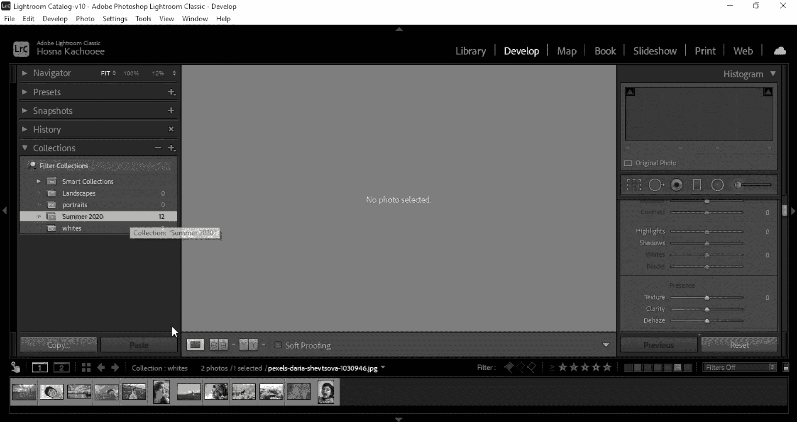

# Adobe Lightroom 零基础到专家照片编辑教程：第99课：左侧面板功能详解 🖼️

## 本节课概述

在本节课中，我们将一起学习 Adobe Lightroom 左侧面板的具体功能。在之前的课程里，我们已经了解了如何把照片导入软件，把图片放进不同的集合，创建文件夹，还可以把照片从一个文件夹移动到另一个文件夹。大家也学过怎么用 Navigator 标签页更仔细地查看照片，怎么给图片添加关键词，怎么打标签和评分，以及目前为止学过的其他所有操作。这些基础内容是后面编辑工作的前提，大家在开始正式调色之前，最好先把图片整理好，这样后面找起来更方便，不会把图片找不到。本节课我们会把目光转向 Develop 模块的左侧面板，详细看看 Navigator、Presets、Snapshots、History 和 Collections 这几个部分分别怎么用，并且在最后简单预告一下下一节课的内容，让大家对整个学习路径有个大致的印象。

## 回顾库模块的基础操作

库模块的基础内容我们已经讲完了，接下来要进入下一个模块，也就是 Develop 模块。在库模块里，我们主要做的是图片的整理和管理工作，比如导入照片、建立文件夹、创建集合、添加关键词、设置评分和标签。这些操作看起来比较简单，但实际上非常重要，因为图片多了之后，如果不做好分类管理，后面想找某一张特定的照片会非常麻烦。大家在日常使用 Lightroom 时，建议养成导入后立即整理的习惯，这样才能让后续的编辑流程更加顺畅，不会在成千上万张照片中迷失方向。

## 进入 Develop 模块

Develop 模块的名字本身就说明了它的用途，就是对图片进行开发和处理。在这个模块里，我们可以调整光线，调整颜色，可以裁剪图片，还可以改变色调。在把照片导出之前，Develop 标签页里能做的事情非常多，几乎所有的后期调整都可以在这里完成。大家可以把 Develop 模块想象成一个数字暗房，里面准备好了各种调节旋钮和工具，你可以按照自己的想法，把一张平淡的照片调成自己喜欢的风格。接下来我们就会在这个模块里展开讲解，先从左侧面板开始，逐个介绍每个面板的作用和操作方法。

## 左侧面板整体介绍

这里我们能看到一些和库模块很相似的面板，比如集合和导航器。这些面板的工作方式和在库模块里完全一样，所以如果你之前已经学过库模块的相关内容，这里会觉得非常熟悉，不需要花太多时间去适应。我打算先选第一张图片来演示，图片正在加载预览，在等待的期间，我们先来看看这些面板分别是什么，以及每个面板在实际编辑中能起到什么样的作用。

### Navigator 导航器

第一个是 Navigator。Navigator 的作用和我们之前提到过的一样，就是方便我们更仔细地查看图片，并且可以放大。我们可以用来检查图片里有没有不想要的物体，检查颜色是不是准确，看看对焦是不是正确，有没有分散注意力的元素，还有图片里有没有噪点。

以下是 Navigator 的主要使用场景：
- 放大查看图片细节，检查是否有不需要的物体或噪点
- 确认图片的对焦情况和颜色是否准确
- 调整缩放比例，既可以放大到最大，也可以缩小到最小，具体取决于你想要多大的视图范围

在编辑照片的时候，建议把 Navigator 打开，这样一直有用。你可以调整放大的倍数，既可以放大到最大，也可以缩小到最小，具体取决于你想要多大的视图范围。把它设置为适应窗口，就是我想要在查看图片时看到的效果，这样既能看到全貌，又不会错过局部细节。

### Presets 预设

关闭 Navigator 面板之后，接下来是 Presets 标签页。预设这个东西非常庞大，我们会在另一节完整的课程里专门讲解，因为跟预设相关的内容实在太多了。相信大家也听说过，在 Lightroom 里制作预设是一个非常热门的市场。你可以看到很多网红或者 Instagram 账号在卖他们自己的预设。你可能也很好奇自己怎么能做到同样的事情。其实 Lightroom 自带了很多预设，这些预设根据人像、风格、颜色、黑白等进行了分类。如果你想快速编辑，可以直接使用 Lightroom 自带的预设，我选一个来举例。

以下是关于 Presets 的核心说明：
$$
\text{预设} = \text{一组保存好的调整参数集合}
$$
- Lightroom 自带多种分类预设，包括人像、风格、颜色、黑白等
- 你可以从 Adobe 或其他平台下载更多预设，下载后会自动显示在这里
- 每个分类下又有不同风格，比如黑白分类里包含黑白风景、高对比度、低对比度等
- 应用预设后，如果需要，还可以在右侧面板继续手动微调，比如调整亮度
- 这里有加号按钮，可以添加从其他网站下载的新预设，请确保网站可信，避免下载到病毒
- 你可以管理已有预设，也可以创建自己的预设，相关内容会在另一节课详细讲解

你还可以从 Adobe 或其他平台下载更多预设，下载后它们就会显示在这里。比如如果你打开黑白分类，里面有不同风格的黑白预设，有黑白风景，有高对比度，有冲击力强的，有低对比度的，还有其他风格。加载预设列表可能需要一点时间，请耐心等待。如果你选了某个预设，还想再做一些微调，可以先保留这个预设，然后再手动调整，比如把图片变亮之类的。这些预设设计得非常好，很多时候你都不需要再做额外的调整。而且选项非常多，有时候你甚至根本不需要去右侧面板继续调整图片，直接套用预设就能得到不错的效果。这就是预设列表，这里有一个加号按钮，就像我刚才提到的。你可以把从其他网站下载的新预设添加进来，不过要确保网站是可信的，避免下载到病毒。你可以管理自己的预设，也可以创建新的预设，我们会在另一节课里详细讲解。现在先关闭预设面板。

### Snapshots 快照

接下来是 Snapshots，也就是快照。快照是你在编辑过程中创建的不同图片版本。预设和快照的区别在于，快照不能用于其他图片，而预设可以，因为预设保存的是一组调整参数，而快照保存的是带有调整的图片本身。你可以通过快照回到之前编辑过的某个版本，比如你可以给一个快照命名为黑白，这样就不用在历史面板里一个一个找之前的版本了。

以下是 Snapshots 的特点与用法：
$$
\text{快照} = \text{图像} + \text{当前所有调整参数的副本}
$$
- 快照只能应用于当前图片，不能像预设一样复制到其他图片上使用
- 你可以给快照自定义名称，方便以后快速定位到某个编辑版本
- 适合在尝试不同编辑方向时保存中间状态，随时切换回之前的版本

你可以点击这个按钮删除选中的快照，我现在不需要这个，先关掉。快照的概念初学者可能需要花一点时间理解，但它其实很简单，就像给当前的编辑状态拍一张照片存起来，以后想回去就直接点开这个快照即可，不需要手动撤销一堆步骤。

### History 历史记录

History 面板记录的是你到目前为止对图片做过的所有操作。比如我导入了这张图片，添加了一个预设，又多次更改了预设，还调整了曝光，面板甚至会告诉我欠曝或过曝了多少，用负数或正数表示，也可以重置调整。从导入图片开始，我对图片做的每一个调整和每一个操作，都会显示在这里。

以下是 History 面板的主要功能：
- 记录从导入图片开始的所有编辑步骤，按时间顺序排列
- 显示每次调整的具体数值，比如曝光欠曝或过曝了多少
- 可以向下滚动找到之前做过的某个调整，直接回到那个状态
- 支持删除或清空所有历史记录

历史面板和快照面板的主要区别在于，快照需要你手动创建，而使用历史面板你可以直接回到之前的某次调整。我可以回到我之前做过的某个调整，而不需要反复按撤销或者重置调整，只需要向下滚动找到想要的那个调整即可。你甚至可以删除或清空所有历史记录。不过我建议初学者最好保留历史记录，以免搞砸了一些东西，想要回到起点的时候能够找回来。现在先关闭历史面板。Collections 面板和库模块里的一样。

### Collections 集合

Right now， we're in summer 2020， if I go in whites。

Theres going to be these two images that we imported in the start of the lessons。

So let's go back here。

现在我们处于 2020 夏季这个集合里，如果进入白色分类，会看到我们在课程开始时导入的那两张图片。我们回到刚才的位置。集合的操作和库模块里完全一致，你可以在这里对图片集合进行复制、粘贴以及进一步的管理工作，帮助你更好地组织大量的照片素材。

以下是 Collections 的操作说明：
- 可以复制集合，也可以粘贴集合
- 可以进行额外的集合管理操作，比如重命名、删除或移动图片
- 与库模块中的集合功能完全相同，切换模块后集合内容保持不变

## 下节课预告

这就是 Lightroom 左侧面板的使用方法。下一节课我们会讲解如何使用右侧面板，介绍每个面板的工作原理和用途，让大家把左右两侧面板的功能都掌握清楚。在后面的课程里，我们将学习如何编辑人像、风景以及其他类型的摄影作品，还会在另一节课里学习不同的编辑风格，让你只需要按照我讲解的步骤，就能打造出自己喜欢的风格。大家如果对本节课的内容有任何疑问，建议多动手练习，在实际操作中加深印象。

## 本节课总结

本节课中我们一起学习了 Lightroom 左侧面板的各个部分，包括 Navigator 导航器、Presets 预设、Snapshots 快照、History 历史记录和 Collections 集合。我们了解了怎么用 Navigator 放大检查图片细节，怎么套用和管理预设来快速编辑，怎么用快照保存不同的编辑版本，怎么通过历史记录回退到之前的调整步骤，以及怎么在集合里组织和管理图片。这些知识点是后续进行专业照片编辑的重要基础，希望大家多加练习，熟练掌握每个面板的操作方法。本节课就到这里，下一节课见。

