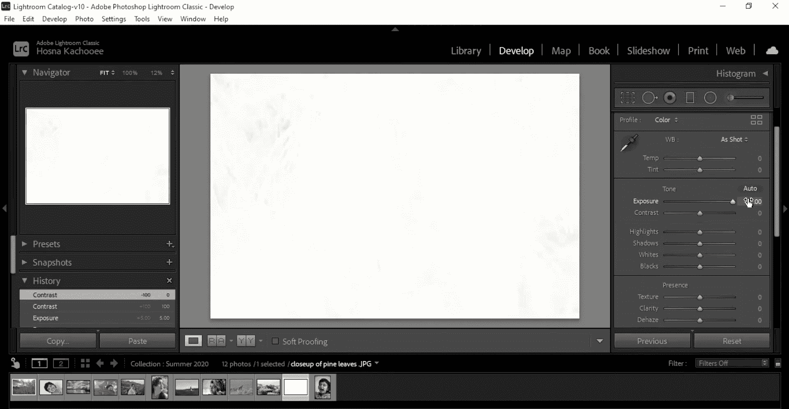

Adobe Lightroom 照片编辑教程：01：基本面板详解 📸


在本节课中我们将要学习 Adobe Lightroom 中的“基本”面板。基本面板是图片编辑的起点。如果一张照片里没有光线，我们就无法看到任何细节，也无法看清照片中的拍摄对象。所以，基本面板在决定照片最终效果方面起着至关重要的作用。当照片出现欠曝或过曝，高光被烧掉或者阴影变得太暗时，图片就会失去第一次用相机拍摄时原本的质量。接下来我们将逐一讲解每个部分代表什么，各自的功能是什么，以及如何使用这些部分来提升图片质量。

第一个需要了解的选项是处理方式，英文叫做 Treatment。在这里你需要问自己一个问题：这张图片是要保留颜色，还是要变成黑白？一旦你做出了选择，就可以选择对应的模式，然后继续后续的编辑步骤。如果你想要黑白效果，就把它调成黑白，再基于这个选择继续操作；如果你想要彩色效果，就选择彩色模式，同样继续操作。为了演示方便，我们在这张图片上保持彩色，后面也会展示如何处理黑白图片，这样就可以让你看到基础调整对两种图片类型都有效。

```text
处理方式 = 彩色 | 黑白
```

无论图片是彩色还是黑白，接下来我们都要从色温开始调整。色温决定的是图片的冷暖色调。你希望图片呈现冷色调，还是希望呈现暖色调？这个选择直接影响图片的情绪，也就是你想要向观众传达的氛围。目前这张图片偏向暖色调，你看到的感觉就像是在晴朗的夏日里拍摄的，会让人联想到美好的回忆。如果把色温调冷，感觉就会像是在冬天或者清晨拍摄的，氛围会显得有些忧伤。在电影里，色温在传达信息时也起着重要作用。比如男主角的母亲去世，紧接着出现一段回忆镜头，通常会使用冷色调，因为那是悲伤的记忆。但如果角色回忆的是儿时在公园玩耍的快乐时光，就会使用暖色调，因为那是珍贵的温暖记忆。所以色温非常关键，你要确保为自己的图片选择正确的色温，这个决定应当基于你想要向观众传达的情绪。

```text
情绪 = 色温决定的冷暖氛围
```

接下来是色调，英文叫做 Tint。色调为图片添加一种色调，你可以选择洋红色系或者绿色系，这种选择实际上会互补图片中已有的颜色。比如往绿色方向调整，就是在增强树叶本身已有的绿色；往粉色方向调整，就是在增强图片中已有的黄色。再次强调，具体该怎么用，取决于你的图片里包含什么颜色，你可以使用色调工具来增强图片中已有的颜色。

接下来是白平衡部分。如果你点击自动，Lightroom 会为你选择一个白平衡，你可以保留这个设置，也可以根据自己的喜好进行自定义。这里还有一个白平衡选择器，你可以在图片中选择一个区域，这里会显示预览效果。同样取决于你想要什么样的氛围，你可以去寻找一个中性色作为参考。现在这个颜色就是一个中性色，我不打算选择黄色，因为黄色是这张图片的主要颜色之一。如果选择某个特定颜色，在追求冷色调时这可能是一个不错的白平衡选择。我们这里不打算深入编辑照片，只是想要解释每个选项的含义。

在上方区域，我们还有一个叫做配置文件的选项，英文叫做 Profile。你可以把它想成图片的滤镜，或者说是一种色彩分级。点击颜色选项后，首先可以决定要不要颜色，可以选择单色模式或者彩色模式，然后浏览你拥有的配置文件。就像我们之前说的，这些配置文件就像滤镜一样，里面已经有很多预设可供选择，包括黑白、现代、复古、艺术、基础等类别，你甚至可以将某个配置文件加入收藏夹。这里有一个星形图标，点击后就能将其添加到收藏夹，下次就不需要再去查找，直接进入收藏夹选择即可。

配置文件与预设是不同的。预设是你已经做过的一组调整，而配置文件更多是针对颜色的调整。看这个例子，你可以看到色调有些不同，绿色的色相也有些不同。最简单的解释就是，配置文件就像滤镜，可以快速给图片做一次编辑，选定颜色后就完成了，可以导出结束。你也可以调整想要的强度，如果完全不想要，或者想要强度较弱，都可以调整配置文件的应用比例。配置文件有分类，包括彩色、黑白等，你可以打开黑白分类，选择自己想要的，然后点击关闭。我这里要通过历史记录把刚才的操作重置，回到导入时的状态，也就是把我们刚才做的所有内容都重置。



刚才那个区域讲完了，接下来我们要进入色调部分，英文叫做 Tone。图片的色调主要涉及亮度、高光、阴影中有多少细节，以及是否需要修复被烧掉的高光。简单来说，这基本上就是关于图片呈现感的调整。

以下是色调面板中的主要滑块及其作用：

- 曝光（Exposure）：控制整张图片的亮度，而不是只关注某一点，而是整体来看。这个调整非常强烈，最大数值只能到 5，而其他滑块最大值是 100。这是因为在使用曝光时，你不想添加太多，必须非常缓慢地添加。哪怕只调到 0.18 已经算是很多的曝光了。我们要避免图片欠曝或过曝，必须找到中间值。
- 对比度（Contrast）：控制图片中明亮部分和暗部之间的差异。增加对比度时，如果图片里有颜色，颜色也会变得更强烈，颜色会有更多深度，黄色和绿色会更饱和。如果去掉对比度，我们会失去很多颜色的深度，以及高光和阴影的层次。
- 高光（Highlights）：针对图片中高光部分，通常只影响少数几个区域，也就是那些拥有最多高光的地方。你可以移除高光，也可以改善高光，根据需要进行调整。
- 阴影（Shadows）：是高光的对面，指图片中最暗的部分，也就是阴影区域。
- 白点（Whites）：控制图片中所有白色区域，不局限于某个特定空间。调高白点时，你会看到每个部分都变亮，每个部分也会变暗。不要把它和曝光搞混，因为曝光会同时照亮暗部和亮部，而白点只会让图片中的白色区域变亮。
- 黑点（Blacks）：是白点的对面，处理图片中的黑色部分。如果把白点和黑点都调到最低，图片会变得非常没有生气，因为亮度和颜色方面都没有细节，几乎就像是在黑盒子里拍摄的一样，没有任何特色。

```text
曝光 = 整张图片的整体亮度
对比度 = 亮部与暗部的差异
```

如果你不知道从哪里开始，也可以直接点击自动，Lightroom 会为你选择一个合适的色调。你可以从自动开始，然后根据 Lightroom 为你做的调整进行微调。

接下来是基本面板的最后一部分，叫做存在感，英文叫做 Presence。如果没有存在感，我们的图片就没有一个可以立足的基础。这就好比你进入一个聚会，希望让别人注意到你的存在，这意味着你身上有很多细节，穿着得体，头发整齐，这样人们才能注意到你，并对你形成印象。没有存在感，你甚至不会被注意到，图片也是同样的道理。

以下是存在感面板中的主要滑块及其用途：

- 去雾（Dehaze）：我建议在图片中永远优先处理去雾，因为现在图片里有很多雾霾感。如果把雾气增加，你甚至什么都看不见了。当你第一次导入图片时，尤其是 RAW 格式，图片里通常会有很多雾霾，你要确保通过去雾功能把这些去掉。去雾之后，图片会好看很多。刚开始学习时，我建议先对图片去雾，然后再进行其他调整。
- 清晰度（Texture）：针对图片的纹理，也就是边缘部分。放大后调高清晰度，你会看到这些尖锐的边缘都被锐化了，这是没有清晰度时的样子。现在图片的边缘比之前更锐利了。如果去掉清晰度，图片里就没有任何锐利的地方，所有东西都变得模糊。清晰度的本质就是把真实物体，也就是真实拍摄对象本来该有的纹理带出来，在这里就是锐利的边缘，并增强这个元素。
- 纹理（Clarity）：针对图片的细节。调高纹理后，甚至能把背景里的细节都表现出来。如果调低，我们会失去所有细节，一切都变得模糊。你可能会想，为什么要把这些滑块向左调，因为它们只会让细节流失？Lightroom 里的每个功能都存在是有原因的。对于清晰度和纹理，你大多数时候会在想要平滑纹理时使用它们。比如拍摄人像时，特别是商业拍摄或时尚拍摄，你可能需要平滑掉所有毛孔和皱纹，这时候就会使用清晰度和纹理。

接下来是自然饱和度和饱和度。自然饱和度（Vibrance）显示的是颜色的强度，而饱和度（Saturation）显示的是图片里颜色的数量。如果把饱和度完全去掉，图片里没有任何颜色数量，那就变成了黑白图片。但如果你只降低强度，你会发现还保留了一些绿色，虽然它们已经非常去色了，所以你不能用自然饱和度来制作黑白照片，必须使用饱和度，因为黑白图片里没有任何颜色。

以下是使用自然饱和度和饱和度的建议顺序：

- 如果你想要增强颜色，首先应该使用自然饱和度，确定你想要的颜色强度是多少。
- 搞定强度之后，再使用饱和度来决定图片里想要的颜色数量。
- 如果你反过来操作，先决定要多少颜色数量，可能会导致颜色太强烈，看起来不太自然，你还需要花时间找到停止的点，甚至可能还得降低自然饱和度。反过来的话，效果会好很多，你对颜色自然程度的控制也会更强。

```text
自然饱和度 = 颜色的强度
饱和度 = 图片中颜色的数量
```

现在我们已经讲完了基本面板。基本面板非常重要，即使你不知道如何使用其中的任何一个选项，了解基本面板也是非常重要的，因为每一个微小的图片调整最初都是由基本面板完成的。现在你知道如何使用它们了，你已经跨过了一个大障碍，可以使用基础技术来编辑图片，这些技术会出现在任何编辑软件里，不管是什么软件，提供商是谁。如果你知道如何使用它们，你就已经走得很远了。在接下来的课程中，我们将逐一详细讲解每个选项。但今天的课程就到这里了，希望在下一课见到你。

本节课中我们一起学习了 Adobe Lightroom 基本面板的各个部分，包括处理方式、色温与色调、白平衡与配置文件、色调调整以及存在感面板中的去雾、清晰度、纹理、自然饱和度与饱和度。你现在了解了每个滑块的基本含义和作用，也知道了如何开始进行基础的图片编辑。
