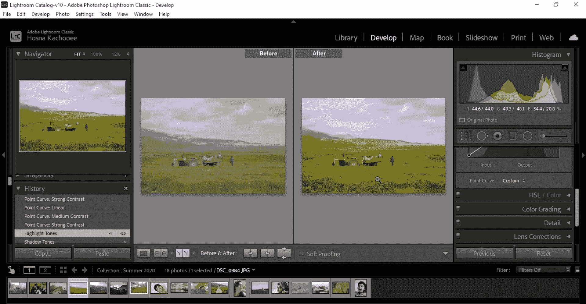

# 📷 完整Adobe Lightroom大课程：第2部分第2课：色调曲线


## 概述
在本节课中，我们将学习Adobe Lightroom中色调曲线面板的使用方法。上一节课我们介绍了如何使用基础面板调整图片的光影与色彩，本节课我们将重点了解色调曲线面板，学习如何通过它更精细地控制图片中的暗部与亮部，并掌握S形曲线、颜色通道及参数曲线的实用技巧。

## 色调曲线面板的基本作用
除了基础面板之外，Lightroom还提供其他面板，用于让图片变得更美观、更富细节。色调曲线面板就是其中之一。

使用这个面板，你可以对图片的暗部和亮部拥有更多控制权。

核心操作逻辑可以用下面的代码描述：
```
点击曲线 → 创建控制点 → 向上或向下拖动 → 调节光影
```

你还可以使用它来创建落地风格的图片，我们将在另一节课中专门讲解这个话题。

## 添加与移动控制点
色调曲线的操作非常简单，就是拖动。当你点击曲线时，会创建一个点，然后你可以把这个点向上或向下移动，以此来调节光影。

你可以创建任意数量的点，例如在这里添加一个点，再在这里添加一个点，还可以再添加一个点，但所有点的排列最终都要符合你想要的图片效果。

通常我们可以从曲线的一侧开始操作，无论是顶部还是底部。底部代表图片中的暗部。

比如把底部的点向上移动，你会看到此时只影响了阴影部分。如果图片中最暗的部分是一只猫，把曲线底部向上移动，只会影响到猫所在的阴影区域。

顶部对应高光部分。如果把顶部向下移动，就会去除高光，也就是画面中的岩石。如果你继续向另一侧移动，就会使整张图片发生失真。这时候可以点击重置按钮恢复默认状态。

要想更好地理解如何使用这个面板，建议你多尝试拖动自己创建的每一个点。

## 观察图片并确定调整方向
现在我们来看这张图片，想想现在想要改变什么。可以看到图片曝光已经不错，阴影部分也存在，高光部分也有。

假设我们想稍微降低高光，就可以抓取曲线上方的一个点，然后向下拖动，这时正在降低高光。当然你也可以选择增强或降低高光，这里我们决定降低它，调整到这个量级。

完成高光处理后，暂时不去碰阴影部分。不过如果要处理阴影，可以抓取对应的点。

## 阴影、中间调与高光的关系
观察色调曲线时，我们可以将其分为三个部分：顶部是高光，底部是阴影，中间则是介于两者之间的中间调。这意味着当你在中间位置创建点并移动时，图片中的每一个中间调区域都会受到影响。

中间调通常是创造图片细节的关键。因此当你移动高光时，会看到比较笼统的整体效果；但当你调整对比度或中间调时，图片细节部分的变化会更明显。

假设我们想稍微提升高光，同时也提升中间调。这里就是中间调所在的位置。我也想给这张图片赋予落地风格。

把这个区域提升后，图片看起来变得平坦、更具落地感。你可能还想再调整高光，正如前面提到的，如果调整过度，会产生不错的失真效果。

如果把曲线往下拉，就能得到一种复古风格。观察直方图，你会发现图片变得几乎平衡。这就是色调曲线的工作原理。

## 用色调曲线增强色彩
当图片包含大量色彩时，色调曲线非常适合用来增强那些颜色。我们来找一张色彩丰富的图片，就用这张吧。这张图片细节丰富，色彩也很多，并且已经做过一些调整，因此具备足够的画面表现力，有不错的高光，主体也已经锐化。

如果想用色调曲线进一步调整，可以简单地做下面几件事：
- 去除高光
- 提升高光
- 降低阴影

仅仅通过微调这些点，画面就会发生很大变化。这样我们就为一张已经编辑过的图片添加了最终润色。

你也可以操作中间调，让它变暗或变亮。在这个例子中，我们希望中间调更亮，因为主体身上有一条亮色围巾，我们希望它更突出。

对比前后效果可以看到，之前画面看起来比较平淡，现在我们增加了立体感，并通过几次点击利用色调曲线为画面增添了良好的光影。

## 找回平淡图片的细节
接下来我们来看另一个例子，一个更平淡的图片。我会故意将一张图片处理得很平，然后展示如何用色调曲线把细节找回来。

这张平淡图片几乎没有细节，细节不够清晰，整体发白，仿佛丢失了大部分色彩，同时也失去了鲜艳度。很多时候，在晴天拍照时如果相机设置不正确，拍出来的照片就会变成这样，需要后期制作来找回失去的鲜艳度和细节。

其实这很简单。正如前面提到的，目前我们只使用点曲线，稍后会讲解参数曲线和不同颜色通道，现在先展示如何从平淡图片中找回细节。

观察这张图片，它缺乏阴影中的暗部，这些阴影很难被分辨出来，因为被过度提亮了。我们首先想要做的就是加暗阴影，可以在曲线底部创建一个点并稍微向右移动，不要动作太快，否则会破坏图片整体效果。

对比开启和关闭的效果，看岩石部分，因为阴影就在那里，现在阴影里有了更多细节。阴影处理完成。

接下来处理高光，也就是岩石顶部和天空。感觉太亮了，适当下调少许。现在我很满意了。

第三步是处理中间调，也就是岩石表面、部分植物，以及介于图片最亮部分和最暗部分之间的所有区域。中间调占据的空间比其他部分更大。

创建一个点，向下拖动会让画面变暗，向上拖动会让画面变亮。对于这张图片，我们只是轻微向下调整一点。

现在图片好看多了。通过简单的几个点，就能对图片产生很大变化。

## 点数与控制精确度
你可以继续创建更多点，创建的点越多，你对光影的控制就越精确。

比如我在这里创建了一个点并提高了白色部分，再在这里创建点来处理黑色部分，适当下调。现在一共有五个点。

当然你可以继续添加更多点，也可以只保留两个甚至一个点。点的数量并不重要，只要你知道想要图片呈现什么样子即可。有时候只需要一个点，有时候可能需要六个点，这完全取决于你想要什么，取决于你拥有什么样的图片，以及图片有多平、需要多少细节。

随着创建的点越来越多，控制变得越来越精确，目前作用于岩石边缘和猫的部分。如果觉得太多，可以撤销一些调整。对这张图片来说，五个点已经足够了。

## 最常用的S形曲线
接下来介绍最流行的曲线样式，让我们用另一个例子来看看，那就是S形曲线。顾名思义，S形曲线就是形状像字母S的曲线。

之所以是最常用的曲线，是因为它是你想要创建的基础。它由阴影、高光和中间调（即图片的对比度）组成，能够在添加颜色和其他细节之前，先对图片的光影进行校正。

制作S曲线的方法是创建三个点，一个在阴影区域，一个在高光区域，一个在中间。现在我们来移动这些点，把阴影点向下移动，增加阴影。

接下来处理高光，提升高光数值。然后来到中点，也就是对比度，创建一条线。

让我们把曲线恢复一下，还可以根据自己的喜好进一步调整，稍微移动这里一点。好了，实际上我们要增加对比度。

这就是S形曲线成为最常见色调曲线线条的原因。仅通过三次点击和几次移动，我们就校正了图片的光影，观察曲线形状，确实像个S。

根据不同的图片，有时候需要让它更像S形，但在这里不需要。所有使用色调曲线的人通常都从S曲线开始，之后再转到不同的通道，或者继续创建更多点。

## 黑白图片上的S曲线示例
我们再看一张图片，这张黑白图片。在这个图片上也创建一个S曲线，看看效果如何。

把阴影调低，再把高光调高，这样就是一个轻微的S曲线。仅通过几次点击，我们就能提升脸部侧面的阴影，并调整光源方向上的高光，适当降低一点。皮鞋。现在看起来更好了，画面比之前那张图片不那么平淡了。

基本上，每次尝试使用色调曲线时都需要这三个点，这就是起点。如果需要，可以继续添加更多点，但我建议逐步进行，因为我刚刚又添加了一个点，你会看到会产生剧烈变化，所以新创建的点要小心。

先从这三个点开始，然后逐步过渡到下一张照片。因为这张图片已经调整过，我让效果更戏剧化了一些，但通常你应该从未调整过的图片开始。关闭这个。

## 颜色通道：红、绿、蓝
现在我们可以进入其他通道，也就是红、绿、蓝。我将导入一张新图片，更好地向大家展示如何使用这些通道。

这张图片里有很多绿色，我们将使用绿色通道，以及一个很快就会介绍的非常有用的按钮。

我们已经知道如何使用点曲线，再做一个例子，调整阴影、高光和对比度，做一些快速调整，不需要太花哨。我们用S曲线调整了阴影和高光，让画面更有活力，看起来有点像个S。

完成这个之后，我们想要进入其他通道，也就是红、绿、蓝。红、绿、蓝是数字媒体的三原色。

如果是颜料，情况不一样，颜料的三原色是红、黄、蓝，但数字颜色不是这样，数字颜色的三原色是红、绿、蓝，也就是RGB值，你会在其他程序甚至Lightroom中经常看到。

因为这张图片有一半以上是绿色，所以我们先编辑绿色通道。绿色通道的作用是改变图片中所有绿色区域。

把曲线向下移动，我正在改变图片中所有绿色的部分，随意移动，为绿色添加不同的调整。

不要关注图片的其他部分，只看草地，让草地更有活力，同时也处理草地的高光部分。这时你会发现图片其他部分变成了紫色。

如何修复，而不花时间去寻找影响该区域的正确点？可以使用这个按钮。点击它，我请求Lightroom帮我找到一个点。

选择这里的天空，Lightroom告诉我这个点会影响上方的天空。测试一下，向上或向下移动，就能改变天空的数值。

假设我想改变这辆卡车的数值，再次请求Lightroom，我点击卡车，这就是那个点。

现在我可以让卡车呈现不同颜色。把它往下调，这样更好。

这就是它的工作原理，你也可以添加与绿色通道无关的随机颜色，改变那个数值，我觉得这个数值不错。

对比前后效果，我们对颜色做了一些调整，让绿色更鲜艳，同时也让山峰和天空更有活力。

回到通道面板，看看其他通道，进入红色通道。红色通道针对图片中的红色部分，所以我们把它向下移动。

可以看到山脉和草地里都有一些红色。你可以向上或向下移动，按自己喜欢的方式改变色调。

双击可以删除刚才的调整。再次建议使用这个工具。我点击山脉，Lightroom会告诉我哪个点与该区域相连，我把它稍微变红一些，我觉得这样不错。

找另一个区域，这辆卡车，要改变卡车的颜色。还可以改变哪里，看看这里的红色部分，或者这里下方的部分。选择那个，让草地更绿。

这就是包含红色数值的高光部分，和之前一样，它会扭曲颜色，让颜色变成不同颜色。阴影部分也是同样的道理，改变阴影，画面就会呈现这样的效果。

这些调整对不同风格的后期处理很有帮助，比如这样调整会呈现出胶片冲印的风格。色调曲线能做很多事情，是一个非常重要且有效的调整面板，适用于任何类型的图片，我建议对每种图片都可以尝试。

红色通道处理完成，再次对比前后效果，注意红色数值的变化。绿色部分之前已经处理过，现在只剩下蓝色通道。

点击蓝色通道。这些点会保留，除非你双击某个点或点击重置，否则不会自动重置。也可以回到历史记录，点击这个按钮，查看应用所有点之前的图片状态。

在蓝色通道中，我们影响的是蓝色。可能看不出来，但每张图片都由这三种颜色及其组合构成。

用公式表示数字颜色的构成：
```
图片颜色 = 红色 + 绿色 + 蓝色及其组合
```

如果移动蓝色通道，你会发现图表上的点也在变化，这是因为绿色中也包含蓝色数值，这就是它们的关联所在。简单理解颜色与RGB数值及其相互关系。

不要以为天空是绿色的，改变蓝色数值就不会影响它，实际上会影响很多。先重置一下，给绿色增加更多饱和度，同时也处理天空。

为什么这里是天空，这里是草地？之前说过，底部是图片的暗部，顶部是亮部。天空是亮部，草地是暗部。

所以我要改变天空颜色，让它更蓝一些，现在看起来不错。使用我们的特殊神奇工具，找到背景里想要影响的山脉，现在可以让它们呈现不同形状，变暗一些。

再对天空做几次调整，现在我很满意了。再稍微增强一点草地。

现在画面看起来饱和度很高，颜色很多。看看仅通过这三个通道，就把图片中本来存在的颜色表现出来了。

回到这里，我可以回到色调曲线，回到点曲线，对颜色和各部分亮度做最终调整，按照我想要的亮度进行调整。现在看起来更好了，饱和度很高。

同样，我可以使用这个工具处理点曲线，但这里是针对亮度的。假设我觉得这两个部分太亮，可以稍微加暗一点。在使用色调曲线面板时，这是一个非常有用的工具，建议多多使用。

现在颜色已经按我喜欢的方式调整好了。之后可以回到基础面板或颜色面板，我们将在下一课讲解，再进一步调整颜色。让我试着让图片稍微落地一点，现在有点落地感了。

## 参数曲线
最后，从这个面板中，我们还有参数曲线。参数曲线类似于Photoshop中的阶梯曲线。

在这里，我可以调整阴影，把它们加暗。鼠标悬停在每个选项上，会告诉你影响哪些区域。加暗暗部，加暗亮部，也许也要加暗高光。

参数曲线与点曲线略有不同，因为你不再创建点。我的点没了，我不再创建点曲线，而是以通用方式调整阴影和高光。向下看，也可以使用这些选项来更好地控制调整区域。

进入高光部分，和上面的操作一样，进入高光，你可以调整下面的杠杆，是一样的。所以你可以在这里操作，也可以在下面操作。

## 预设
最后要考虑一点，可以使用预设。在预设中，选择强对比度，这是一个预设，中等对比度也是。可以重置整个曲线，再选择强对比度。

以后可以为点曲线创建自己的预设，但现在不是我们想要的。回到这张图片的一部分。如果你希望这个点曲线成为经常用于其他照片的设置，可以点击保存。

保存点曲线后，以后可以导入并应用到其他图片，格式是XMP。建议为Lightroom预设创建一个文件夹，这样每次使用自己的预设时就不用到处找了。取消这个操作。

这就是如何使用点曲线来提升颜色并调整图片的光影、高亮和阴影。仅凭这个小小的面板，我们就做了很多改变，甚至还没涉及基础面板或颜色面板。

我已经能够使用色调曲线实现一张细节丰富的好图片。

下一课我们将学习如何使用HSL面板，它允许我改变图片中某些颜色的色相、饱和度和亮度，这就是HSL的含义。如果想让绿色偏红，可以做到，如果想让它偏蓝，也可以做到。

我们将在下一课使用这张图片进一步编辑，按照我们喜欢的方式进行调整。下一课见。



## 总结
本节课中我们一起学习了色调曲线面板的基本操作，包括添加和移动控制点、调整阴影与高光、理解中间调的作用，以及制作最常用的S形曲线。我们还学习了如何使用红、绿、蓝三个颜色通道来精细改变图片中的特定颜色，并简要介绍了参数曲线与预设的使用方法。

