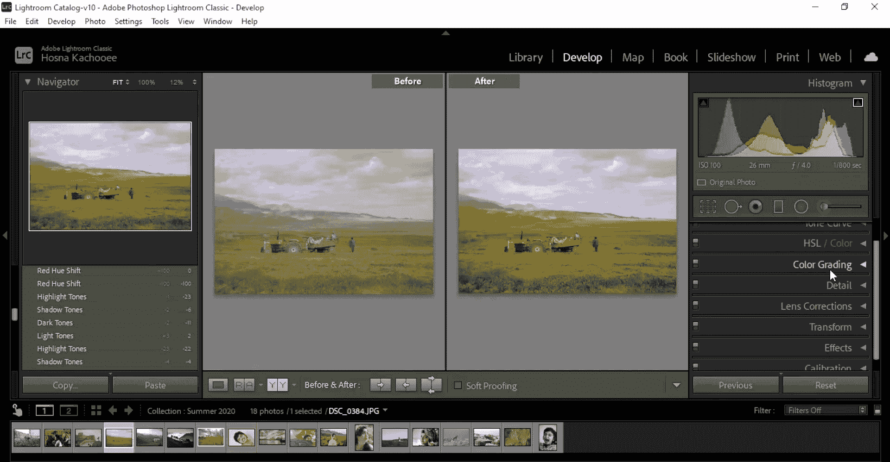

# Complete Adobe Lightroom Megacourse：Beginner to Expert Photo Editing part2：p03：98 - HSL 🎨

在本节课中，我们将要学习 Adobe Lightroom 中的 HSL 面板。HSL 是色相、饱和度、亮度三个英文单词的缩写。通过这节课，你将了解如何使用这个面板来改变照片里的颜色，让图片看起来更符合你的想法。


欢迎回来，在这一节课里，我们要讲解如何使用 HSL 选项卡。这个功能的主要作用，就是调整和改变图片里面的颜色。这里出现的 HSL 面板，也被叫做色彩面板，因为我们正在处理颜色，而不再处理整张图片的整体亮度，也不再处理图片的细节。在这个标签页里，所有的内容都围绕着颜色来展开。


我们先打开 HSL 面板，作为示例，这节课我们继续使用上一节课用过的同一张图片，然后用 HSL 面板把它进一步调整到我们喜欢的样子。正如我刚才提到的，HSL 代表色相、饱和度和亮度，我们还有一个全部视图。那么我们就从这里开始。


以下是 HSL 的核心概念公式：

```
HSL = Hue（色相）+ Saturation（饱和度）+ Luminance（亮度）
```


接下来我们从色相开始。色相就是颜色的偏移，你可以用它来改变选中的颜色。为了更好地理解，我们选一种图片里已有的颜色，比如绿色。我可以改变图片里绿色的颜色，让它变得更干净一些，或者偏黄一点。使用色相标签页，我可以改变绿色的色调。Lightroom 会把颜色抓取出来并进行分类，比如你看到的草地，可能会被归类为黄色而不是绿色，所以现在我可以把这些部分都改成绿色，这样看起来会更有区分度。你可以利用这里提供的不同颜色，去改变图片中很小一块区域的颜色。


色相讲清楚了，我们再来看看饱和度。饱和度指的是图片里某种颜色的多少，也就是颜色的浓度。我们继续拿绿色来举例，你想要图片里有很多绿色，还是完全不想要绿色？如果把饱和度关掉，所有绿色就会消失。在黑白照片里，之所以呈现黑白效果，就是因为没有饱和度，图片里没有任何颜色值，所以才是黑白的。和刚才色相面板一样，这个饱和度面板里也有相同的颜色选项。


除了颜色是什么以及颜色有多浓，我们还得控制颜色的明暗，这就是亮度。亮度决定了颜色是亮还是暗，右边对应更亮，左边对应更暗。我们还是用绿色来举例，你想让绿色变暗，还是想让绿色变亮？把色相、饱和度、亮度这三者结合起来使用，你就能得到想要的完美颜色亮度。


接下来介绍一个很有用的工具。和我们在色调曲线里学到的那个神奇工具类似，你可以直接选中图片里的某个颜色，然后拖动来改变亮度，因为我现在处在亮度标签页里。Lightroom 会自动识别你选中的区域包含哪些颜色，并自动进行调整。你可以看到，它现在同时使用了黄色和绿色，因为我选中的地方同时包含这两种颜色。如果想要重置，双击文本即可。


我们再看另一个例子，就是这辆卡车。把滑块向下移动，再向上移动。因为卡车和山脉的色调非常相似，所以我现在同时影响了这两个部分的颜色。万一你不知道哪个滑块影响了你想改变的部分，就可以直接用这个工具，去改变相应的数值，然后做调整。


重置一下。这就是 HSL 面板的工作方式。如果进入全部视图，所有的滑块就会一个接一个地排列在下面，并不是分散在不同的标签页里，而是全部上下排列。这样我就不用一个一个地切换这些标签页，而是可以把它们全部列在一起，方便操作。


现在我们开始实际调整，先从色相入手。我现在不太喜欢这个绿色，我个人觉得它可以更有秋天的感觉，色调可以更偏黄，也可以更绿一些。我只需要把绿色滑块向左移动，往颜色里加入更多黄色，就这样就完成了。这是调整前的样子，这是调整后的样子。


现在绿色处理好了，我觉得我的绿色可以更亮一些，因为现在看起来太暗了。让我去亮度标签页，先重置一下这些滑块。我可以直接移动面板，把滑块向右拖动，这样绿色就变亮了，就这么简单。


我觉得我的绿色还可以再有更多的颜色。我可以把绿色滑块移到饱和度标签页，搞定，颜色就变多了。我通过在三个不同的标签页里移动三个滑块，把颜色调整到了我喜欢的样子。


大家注意，我们的草地和卡车，或者说卡车这部分，颜色是相近的。所以当我移动亮度滑块的时候，我也会影响到那辆卡车。在这种情况下，你们觉得我们应该怎么做？


如果我想调整图片中某个选择性的部分，大家还记得我们之前讲过的顶部工具栏吗？如果有哪些部分我不希望被颜色变化影响，我可以直接使用这三个工具之一，来把不希望被影响的区域遮罩掉，或者反过来，如果我只希望某些区域被影响，也可以这样操作。我现在不打算深入讲解，因为我们已经讲过如何使用画笔工具了。现在，我们把所有注意力都集中在这个面板上。


先重置一下绿色。在 Lightroom 里了解快捷切换是很有帮助的。现在我要换一种颜色，我们来看看天空，因为我不太喜欢现在的天空。天空里有一些紫色、一些蓝色，还有一些青色。我不知道应该移动哪一个滑块，所以我用这个工具。我要抓取天空的一部分，然后改变色相。如果向上拉，就是紫色，向下拉就是蓝色。我喜欢蓝色，所以我保持蓝色。原来这些其实是蓝色和青色。我们对云朵也做同样的操作，然后重置。接着去处理山脉，我不喜欢山脉现在的颜色。让我选取山脉的一部分，因为我现在在色相标签页里，可以直接改变这个山脉的色相。当你使用这个工具时，你实际上能同时改变多种颜色，就像我刚才移动滑块时，可以看到我在同时移动橙色和黄色。让我把它调低到我选择的颜色，我希望这些颜色保持在红色一侧。还有什么想改变的吗？那就改变一些。好了，现在我对色相，也就是颜色的色调，已经比较满意了。


现在我可以继续处理颜色的多少了，也就是饱和度。我们进入饱和度标签页。我觉得现在的绿色太绿了，让我用工具按压一下。我打算稍微降低一点，你可以看到这同时影响了黄色和绿色。我对这个结果比较满意。接下来我们看看草地的黄色部分，现在你可以看到，这里主要是黄色，相比绿色来说更多。我改变了这部分图片的颜色数量。我也觉得山脉太饱和了，让我稍微降低一点，保持稍微一点饱和度。好了，这样就不错了。我现在也改变了山脉的饱和度。


再看看天空，我觉得太饱和了，让我降低一下。好了。另一边看起来也好多了，因为这边的色调和其他部分不一样。就这样，通过几个滑块，我就可以改变图片的饱和度。


接下来我们去看看亮度。我觉得草地可以更亮，我就把它向上拖动。对黄色也做同样的操作，实际上是降低黄色，让它和绿色融合得更好。然后我会增加这一边天空的亮度，降低另一边的亮度。现在我能更清楚地看到云朵，整体看起来更加平衡了。我们再看看后面的山脉，让我稍微降低一点点。好了，我现在对颜色非常满意。


这就是使用色彩面板，也就是 HSL 面板的基本方法，其实并不复杂。你随时可以回到更改颜色之前的历史记录，就在高光色调那里。等我调整完之后，我会点按完成。好了，现在我再次拿到这张图片，可以看到调整前和调整后的对比。颜色看起来好多了，更加鲜艳了。因为颜色更加丰富，我们能更好地看到细节，卡车更加清晰可见，草地、云朵和山脉也都更有层次感。这就是如何使用 HSL 面板。


下一个面板是色彩分级。我们将在下一节课中讲解，敬请期待，我在那儿见。




本节课中，我们一起学习了 HSL 面板的使用方法，包括色相、饱和度、亮度三个核心概念，以及如何用目标调整工具选择性地改变颜色，还进行了草地、天空、云朵和山脉的实战调整。希望通过这节课，你能掌握在 Lightroom 里调整照片颜色的基本技巧。

