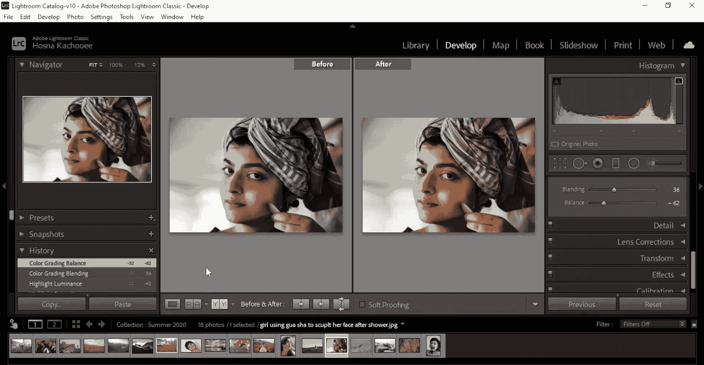

# 🎨 Adobe Lightroom 照片编辑：第 4 章：色彩分级面板详解


在本节课中，我们将学习如何使用 Adobe Lightroom 的“色彩分级”面板来提升照片色彩。色彩分级是照片编辑中非常重要的一环，因为颜色是构成所有图像的基础。与 HSL 面板不同，色彩分级不再针对特定颜色，而是针对图像中的所有颜色，只不过我们会把这些颜色分为三个区域来处理，分别是阴影、中间调和高光。通过这一节，你将掌握每个区域的作用，以及如何组合使用它们来营造电影感或其他想要的视觉风格。


## 认识色彩分级面板

上一节我们介绍了基础面板的调整方法，本节中我们来看看色彩分级面板具体包含哪些内容。

进入开发模块后，你会看到一个叫做“色彩分级”的标签页。这个面板里总共有五个选项，其中第一个选项用来设置面板的布局。通过布局选项，你可以决定下方同时显示三个面板，或者只显示其中一个，比如先只处理阴影，处理完之后再切换到中间调，最后处理高光。除了布局之外，还有一个全局选项。全局的作用本质上相当于在整张图片上覆盖一个颜色滤镜，就像你的相机镜头前放了一片有色塑料，整张照片都会染上同一种颜色。相比之下，其他选项则允许你只给图片的某一部分进行色彩分级。

色彩分级的核心逻辑可以用下面的公式表示：

```text
色彩分级 = 阴影调整 + 中间调调整 + 高光调整
```

以下是面板中各选项的主要作用：
- 布局：控制阴影、中间调、高光面板的显示方式。
- 全局：对整张图片统一添加颜色滤镜。
- 阴影：仅调整图像暗部区域的颜色。
- 中间调：仅调整图像中间亮度区域的颜色。
- 高光：仅调整图像亮部区域的颜色。


## 阴影色彩分级

介绍完面板的基本布局之后，本节中我们来看看阴影部分该如何操作。

阴影是指图像中较暗的部分，比如人物脖子的阴影、毛巾的阴暗处，以及脸部不被光线直接照射的区域。当你在阴影面板中进行调整时，主要影响的就是这些暗部区域，而亮部会保持基本不变。这种局部调整可以帮助你为照片营造特定的氛围，虽然具体的氛围营造我们会在另一节课中详细讲解，但你已经可以通过改变阴影颜色来改变画面的整体感觉了。

在阴影面板中，你还可以使用一些辅助选项。Lightroom 提供了预设功能，可以直接套用一些预设的颜色组合。如果你想自己挑选颜色，可以按住吸管工具，从图片的任何位置提取颜色，甚至可以从直方图中选取。选定颜色后，你可以继续调节色相、饱和度和明度。比如如果你想要一个红色滤镜，但觉得饱和度太高，可以把饱和度降到合适的程度，同时调整红色的亮度，直到达到你想要的效果。完成后，可以关闭面板，或者继续添加其他颜色。

亮度滑块会改变你为阴影所选颜色的明暗程度。把亮度上下移动，就能改变所选紫色或其他颜色的亮暗。融合选项用来把你添加的颜色与主体周围原本的颜色融合在一起。如果原本图片里没有和你选颜色相近的色调，融合起来会比较困难。比如图片里主要是橙色调，你选了紫色，就很难融合自然；但如果你选了橙色，因为画面里本来就有一些橙色，融合起来就容易得多。平衡选项则可以完全移除这个颜色效果，或者让它像一层滤镜一样叠加在上面，你可以根据需要把平衡值调到合适的位置，创造出淡淡的色调。

以下是阴影调整的常见步骤：
- 选择颜色：直接点颜色块，或使用吸管工具从图片中取色。
- 调节色相：确定你想要的基础颜色。
- 调节饱和度：控制颜色的浓淡程度。
- 调节明度：改变颜色在暗部的亮度。
- 调节融合：让新颜色与原有色调更自然地过渡。
- 调节平衡：决定颜色效果的强弱或是否移除。


## 中间调色彩分级

掌握了阴影的调整方法后，本节中我们来看看中间调部分是如何工作的。

中间调是指介于阴影和高光之间的亮度区域，既不是很暗也不是很亮，处于画面的中间状态。在示例图片中，这部分通常对应人物脸部中等亮度的区域。当你调整中间调时，影响的就是这些中间亮度的像素。需要注意，不要把中间调和全局混淆。如果你在全局面板里做同样的颜色调整，颜色会显得更浓重、更明显，而中间调的效果会相对柔和一些。

中间调面板提供的选项和阴影面板基本一致。你可以使用吸管工具从图片的任何地方选取喜欢的颜色，甚至可以直接从直方图中选择，或者从可用的预设中挑选。选定颜色后，同样可以调节色相、饱和度和明度。如果你不希望中间调太暗，也可以把它调亮，完全根据自己的喜好来设定。融合选项可以让新加入的颜色与周围色调融合，但如果饱和度调得太高，融合效果会显得不自然，甚至不太真实。平衡选项则可以让颜色效果完全消失，或者赋予画面一种未来感的色调，这全部取决于你编辑图片时想要达到的效果。

以下是中间调调整的常见操作：
- 选取颜色：使用吸管工具或预设选择基础色调。
- 调节色相：确定中间调的主色调。
- 调节饱和度：控制颜色强度，避免过度饱和。
- 调节明度：设定中间调的亮暗程度。
- 调节融合：让颜色与原有画面更自然地结合。
- 调节平衡：决定是保留还是移除颜色效果。


## 高光色彩分级

阴影和中间调都讲清楚了，本节中我们来看看高光部分该如何调整。

高光影响的是图像中最亮的部分，比如人物脸部被光线照射最明显的区域。当你改变高光颜色时，主要作用于这些亮部区域，而暗部基本不受影响。在使用高光面板时，需要特别小心，不要把亮度调得过高，否则可能会导致图像出现错误提示，或者某些区域的颜色完全丢失。如果不小心调过了，你可以随时关闭或重置，把颜色调回来，保持画面整体平衡非常重要。

融合选项在高光面板中也可以使用，但如果原图里并没有太多与你选颜色相近的色调，融合起来会比较困难，效果可能会像是在图片上加了一层滤镜。平衡选项同样可以完全移除颜色效果，或者保留一种淡淡的滤镜感。你可以根据实际需要，决定是保留、调整还是完全删除高光的颜色调整。

以下是高光调整时需要注意的要点：
- 选取颜色：为亮部区域选择合适的色调。
- 调节色相：确定高光的基础颜色。
- 调节饱和度：控制亮部颜色的浓淡，避免过亮。
- 调节明度：改变高光颜色的亮度。
- 调节融合：让高光颜色与原有亮部色调过渡自然。
- 调节平衡：决定颜色效果的最终强弱。


## 全局色彩分级

三个局部调整区域都介绍完了，本节中我们来看看最后一个选项，也就是全局色彩分级。

全局面板的作用就像是在整张图片上覆盖一个滤镜，同时影响高光、阴影和中间调。你可以改变明度，让画面变暗或变亮，但如果把明度调得太低，可能会出现阴影过于浓重、不够平衡的错误提示。与其他面板不同，全局选项并没有融合功能，因为你已经是对整张图片进行全局选择了。你只能使用面板上的滑块，给画面添加一层轻微的色调。使用完毕后，可以重置全局设置，然后进入实际的色彩分级步骤。

以下是全局调整的特点：
- 作用范围：同时影响图像的高光、阴影和中间调。
- 缺少融合选项：因为已经是全局应用，不存在局部融合。
- 调节方式：主要依靠面板上的明度和色调滑块。
- 适用场景：需要给整张照片统一加一层颜色滤镜时使用。


## 实战演示 - 给图片进行色彩分级

理论部分讲解完毕，本节中我们来看看如何把所学知识应用到实际图片中。

现在我们开始对示例图片进行实际的色彩分级。首先处理阴影，因为我们想要一张偏暖的图片，所以选择黄色。将饱和度调低一点，同时稍微提高阴影的亮度，这样黄色调会比较自然地融入暗部。调整完成后，可以查看之前和之后的效果，此时阴影已经带有一层淡淡的黄色。

接下来处理中间调，为了平衡阴影的暖色，我们给中间调选择一个偏冷的色调，比如蓝色系。调节色相和明度，再适当调整融合，让冷色调与画面其他部分更好地结合。对比调整前后，你会发现中间调部分比阴影更凉爽一些，画面的冷暖对比开始形成。

最后处理高光。先选择红色，调节饱和度和明度，给亮部区域增加更平衡的光照感。如果觉得红色太重，可以把颜色改成青色或蓝色，再调整亮度和融合，直到高光部分看起来自然。完成高光调整后，再次查看之前和之后的效果，此时整张照片看起来明显更好，具有了更电影的感觉。我们在图片中加入了一些橙色和青色调，这正是我们想要达到的效果。当然，你也可以根据喜好，加入更多暖色或冷色，或者使用黄色、绿色等明亮颜色来营造科幻风格。

以下是实际色彩分级的操作顺序：
- 第一步：调整阴影，选择暖色调并降低饱和度，适当提高亮度。
- 第二步：调整中间调，选择冷色调以平衡阴影的暖色。
- 第三步：调整高光，为亮部选择合适颜色并控制强度。
- 第四步：前后对比，确认画面是否达到了预期的电影感或其他风格。

仅通过色彩分级面板，我们就对照片的颜色进行了重大调整。因为颜色是所有图像的基础，所以色彩分级非常重要。


## 过渡到细节面板

色彩分级的内容已经讲解完毕，本节中我们来看看下一步该学习什么。

在完成光影和色彩调整之后，图片还需要进一步处理细节，才能让画面更出彩。下一节课我们将学习细节面板，主要内容包括为图片增加锐化，突出边缘，并在必要时降低噪点。如果你仔细观察，可以看到图片中存在一些噪点，这些都可以在细节面板中进行处理。我们下节课再见。




本节课中，我们一起学习了 Adobe Lightroom 色彩分级面板的使用方法。我们介绍了面板的五个选项和布局设置，详细讲解了阴影、中间调、高光和全局各自的作用与调节技巧，并通过实战演示展示了如何为图片添加暖色阴影、冷色中间调和平衡的高光，最终获得具有电影感的照片。希望这些内容能帮助你更好地理解色彩分级，在实际编辑中灵活运用。
