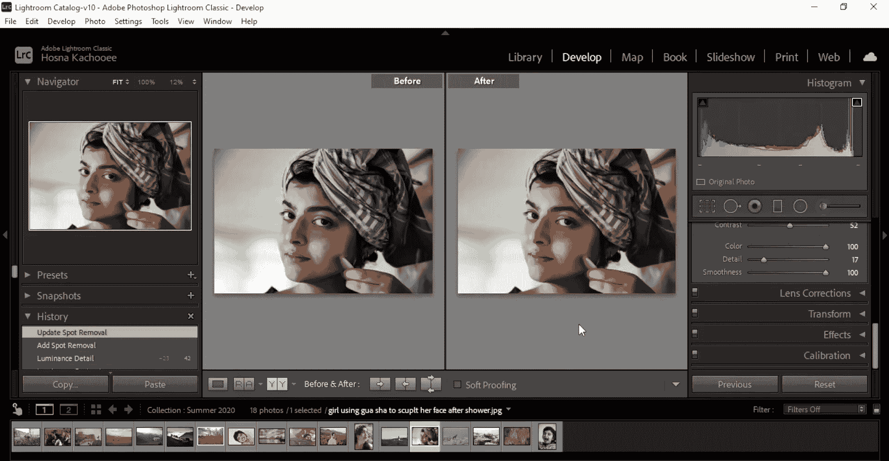

# Adobe Lightroom 精通课程：第05课：细节面板与图像锐化 🖼️


在本节课中，我们将学习 Adobe Lightroom 中“细节”面板的完整使用方法。在上一节中我们介绍了基础面板的常用调整，本节中我们来看看细节面板如何进一步提升图像质量。这一节的内容主要围绕如何让照片看起来更清晰、更有质感，同时又不引入过多噪声展开。我们会从为什么细节对图像至关重要开始，接着讲解预览工具的具体操作方式，然后重点讲解锐化滑块与降噪滑块的作用，最后通过一个人像实例，演示如何在嘴唇、眼睛和皮肤等部位平衡清晰度与平滑度，还会简单说明色彩噪声的处理思路。


## 为什么细节对照片很重要


细节能够把拍摄对象中的每一个元素都展现出来。如果照片缺乏细节，观看者就看不清图像内容，这样会让你花大量时间调整光线和颜色的努力全部化为泡影。换句话说，即使你花了好几个小时来调整光影和色调，只要图片里没有足够的细节，最终效果依然会受损。因此，细节是你使用 Lightroom 编辑照片时必须重点关注的另一个重要方面。


## 如何使用预览面板


在色彩分级下方的面板里，有一个预览选项，并且里面有一个关闭选项。首先出现的是预览，你可以点击这个预览区域，选择想要关注的部分。通常情况下，预览会把画面放得很大，方便你检查局部细节，比如眼球、眼白和睫毛等位置。使用这个预览，甚至可以在这里直接看到我的图像，并观察远处看是什么样子。现在我有三个预览，可以先进行调整，然后回来看它们如何影响了我的图像。


## 锐化功能详解


面板中的第一个选项是“锐化”。顾名思义，锐化的作用就是增强图像边缘的清晰度。当你调整锐化滑块时，远处看可能觉得还可以，但一旦放大画面，往往会发现噪声变多，图像质量受到干扰。你可以看到仅仅移动这个滑块就产生了所有噪声，移除之后才是之前的样子，开启后则确实锐化了边缘，但也引入了很多噪声，所以你需要找到完美的平衡点。

大多数情况下，如果你的原始图像本身已经足够清晰，甚至不需要开启锐化。只有在需要增强边缘时，才适当增加这个滑块的数值，并缩小画面观察整体效果。处理细节时，我肯定建议打开预览，并且要偶尔放大看图像是否平滑。

以下是锐化相关的核心参数：

- 半径（Radius）：控制你看到每个像素的量，也就是像素块的大小。如果锐化设为 100 并增加半径，你会发现小点相比之前放大了。
- 细节（Detail）：增强当前区域中已有的细节，比如睫毛、瞳孔和眼线。提高细节数值会让 Lightroom 尝试突出这些部分，但如果锐化过度，画面可能会看起来像油画，充满噪声。
- 遮罩（Masking）：启用遮罩后，锐化效果会被限制在特定区域，通常是具有清晰边缘的地方。例如在人像中，眼睛、睫毛和眉毛属于有边缘的区域，而皮肤表面平滑、没有边缘，会被遮罩掉，不受锐化影响。

使用锐化时可以参考下面的参数组合：

```
锐化量：适度开启，不建议直接调到 100
半径：根据需要微调，避免像素块过大
细节：保留主要特征，不过度提升
遮罩：仅作用于有边缘的区域，避免影响平滑皮肤
```

每次应用锐化之后，建议缩小画面检查整体效果，确保远处观察时没有明显问题，同时放大确认噪声没有失控。


## 噪声降低功能详解


当你需要一定程度的锐化，例如因为拍摄时对焦不准，可以使用降噪功能来控制副作用。将降噪滑块调到最大，可以尽可能去除画面中的噪声，尤其是在皮肤这种没有细节的平滑区域效果很明显。开关对比一下，你会发现皮肤变得更加平滑，这在人像修图中常用来使肤色更均匀。

在关闭锐化后，如果将降噪调到 100，画面会丢失部分细节，比如眼睛不再像之前那么清晰。这时候你可以适当增加细节滑块，在细节区域保留一定的锐化效果，同时不在皮肤等平滑区域引入噪声。Lightroom 会自动挑选出它认为的细节部分进行处理。

在细节下方还有对比度选项，它的作用类似于基本面板中的对比度，即增加高光与暗部之间的差异。但这里的强度较低，而且对比度常常会带来更多噪声，所以大多数情况下不需要使用，如果需要的话，也要逐渐添加，避免让噪声重新出现。


## 色彩噪声处理


图像中自然存在两种噪声。第一种已经通过前面的降噪标签去除。第二种是色彩噪声，表现为彩色的小斑点，常见颜色包括红色、绿色和蓝色，通常出现在色彩丰富的图像中。

如果你把色彩噪声降低滑块调到 100，但在当前这张图中可能没有明显变化，因为这里的色彩噪声并不多。对于风景或野生动物摄影，可能需要用到这个色彩标签；不过这次我们的示例不需要重点处理。如果你面对的是一张色彩丰富的照片，可以缩小观察云层等区域，看看色彩降噪如何平衡颜色。Lightroom 有时会把主要颜色误判为色彩噪声，进而影响色调。使用色彩降噪可以把这些细节找回来，进一步平滑调整效果，你随时可以回来按自己的喜好修改。


## 实战示例：人像局部细节与降噪


现在回到我们正在处理的这张人像照片。先撤销之前的所有调整，重新从细节面板开始，给图像增加细节并降低噪声。

以下是具体操作顺序：

- 放大画面，观察嘴唇、下巴下方等主要特征；
- 即使不开启锐化，放大后依然能看到嘴唇上的噪声；
- 无论做什么调整，图像大概率都会包含一定噪声，远处看不出来，因此务必放大确认平滑度与清晰度是否平衡。

接下来开始处理嘴唇：

- 稍微开启锐化，降低半径数值；
- 保留细节，并使用遮罩只将锐化作用于细节区域；
- 提高降噪数值，你会看到内唇的噪声被平滑掉了；
- 适当保留细节，不要过度，同时添加一点对比度来调整该区域的光影；
- 缩小画面检查效果，如果觉得合适，就保持当前设置。

然后处理脸部和眼睛：

- 脸部目前看起来比较平，可以适当降低亮度数值，效果会更好；
- 缩小后整体观察，也可以适当提高细节数值；
- 回到眼睛区域，根据需要增大或减小细节，避免调整过度；
- 不需要完全去除所有小像素，否则图像就没有任何细节了，我们只是希望这些像素比之前稍微受限一些。

处理完成后缩小观察，主体看起来既更有细节，同时又保持平滑。


## 修复皮肤瑕疵


如果你在人像皮肤上遇到类似的问题，可以使用点修复工具。先减少羽化值，调整合适的笔刷大小，让 Lightroom 自动寻找与该区域匹配的样本点。如果自动选定的位置不对，可以手动拖动，帮助 Lightroom 找到正确的参考区域。这样就能去除刚才的小斑点。

完成降噪之后，整张图像看起来好多了。你可以对比修图前后的效果，会发现色素沉着等问题已被平滑，皮肤变得更加细腻。当然，人像皮肤修饰还有更多内容，我们会在另一节课中详细讲解。目前，这就是细节标签的使用方法。


## 本节课总结与下一课预告


本节课中，我们一起学习了 Lightroom 细节面板的核心功能，包括如何使用预览工具检查局部细节、如何调整锐化的数值与半径、如何通过遮罩限制锐化范围、如何使用降噪滑块平滑皮肤，以及如何处理色彩噪声。通过一个人像实例，我们还演示了在嘴唇和眼睛等部位平衡清晰度与平滑度的具体步骤。



下一课我们将继续学习其他调整模块的功能，届时你就能完整、不困惑地使用 Lightroom 的开发模块了。我们下节课见。

