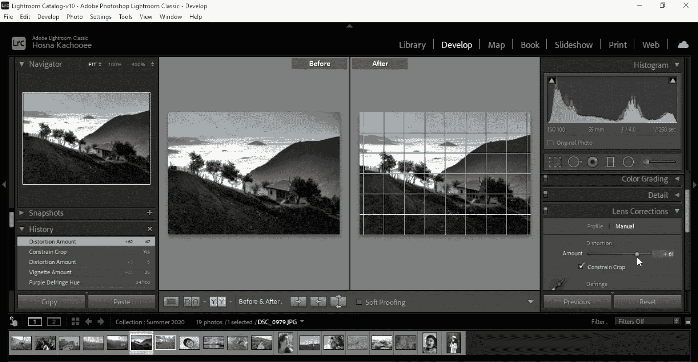

# Adobe Lightroom 照片编辑从入门到精通：06：镜头校正 📷

在本节课中我们将要学习 Adobe Lightroom 中的镜头校正功能。镜头校正位于开发模块的一个专门面板里，主要用于修复镜头在拍摄时带给照片的各种缺陷。常见问题包括鱼眼变形、画面四周的暗角，以及高反差边缘出现的彩色边缘。本节课会分两个部分来讲，先介绍自动的配置文件校正，再深入手动校正的滑块操作，最后通过两张示例图片演示完整的修复流程。

## 一、认识镜头校正面板

镜头校正面板的作用，顾名思义，就是纠正镜头带给照片的错误。不同的镜头成像特性不同，有些镜头会让画面产生凸起或凹陷，有些镜头在四周会变暗，还有一些镜头在对比强烈的边缘会出现紫色或绿色的彩色边缘。这些现象在摄影中非常普遍，不代表你的镜头有质量问题，所以不需要担心。Lightroom 提供了专门的工具来处理这些问题，让你在后期阶段把照片恢复到正常的视觉效果。

核心概念可以用下面的公式来理解：

```text
修复后的图像 = 原始图像 - 镜头畸变 - 暗角 - 色差
```

面板中主要分为自动校正和手动校正两种方式，接下来我们先看看自动校正如何操作。

## 二、使用配置文件进行自动校正

以下是自动校正的主要步骤：

- 展开镜头校正面板
- 勾选“删除色差”
- 勾选“启用配置文件校正”
- 选择对应的镜头品牌和型号

面板中首先是“配置文件”选项，这是一种自动校正方式。你可以把它理解为给 Lightroom 一个预设，让软件根据你的镜头品牌和型号自动修复常见错误。操作非常简单，只需要勾选启用，软件就会自动尝试去除色差并应用镜头配置文件校正。

不过自动预设并不总是完美。如果你不知道使用的是什么镜头，或者软件里没有对应的镜头模型，这种方式可能效果有限。这时候就需要切换到手动模式，自己调节滑块。

## 三、手动校正面板详解

以下是手动校正中常用的调节项：

- **畸变**：调节画面的鱼眼效果。向右滑动可以减少鱼眼畸变，让画面看起来更正常；向左滑动则会增强鱼眼效果。
- **限制裁剪**：启用后，Lightroom 会裁剪掉画面中因畸变修复而产生的空白边缘，避免出现白色区域。
- **色差量**：调节去除暗角的强度。向左可以减少暗角，向右可以增加暗角。
- **中点**：决定暗角修复影响的范围。数值越小，修复范围越集中在边缘；数值越大，修复范围会覆盖更多画面区域。

在手动模式下，你对图像修复的控制力会大大增强。面板里最常用的滑块包括畸变、限制裁剪、色差量和中点等。下面我们逐一说明它们的作用。

核心操作可以简化为下面的逻辑：

```text
手动校正 = 调节畸变滑块 + 决定是否启用限制裁剪 + 设置色差量与中点
```

掌握这些滑块之后，我们就可以用第一张示例图片来实战演练了。

## 四、第一个示例：修复鱼眼变形和暗角

以下是修复该照片的具体过程：

1. 先在手动面板中找到畸变滑块。
2. 向右拖动滑块，直到鱼眼效果减弱，主体看起来比较自然。
3. 勾选限制裁剪，去除因修复畸变而产生的白色空白区域。
4. 使用色差量滑块处理四周的暗角，把暗角变浅或去除。
5. 调节中点滑块，确保修复只影响画面边缘，不会把主体人物也一起亮化。

第一张示例图片明显带有鱼眼效果，而且画面四周有明显的暗角。这些问题都是由镜头本身造成的，而不是后期添加的。我们先来看看如何用手动滑块把它们修复过来。

调整完成后，对比修复前后的效果，你会发现人物离画面边缘更远，鱼眼感明显降低，四周的暗角也消失了。这时候图像已经基本修复完成，可以继续进行其他后期调整。

接下来我们用第二张图片来看看如何处理色差问题。

## 五、第二个示例：去除色差

以下是检查和去除色差的步骤：

1. 使用导航器面板，快速移动到需要检查的区域，比如树叶边缘或建筑轮廓。
2. 放大图片，寻找紫色或蓝色的边缘线条。
3. 在手动面板中，分别找到紫色和蓝色色差滑块。
4. 向左或向右微调滑块，直到彩色边缘消失。
5. 如果发现红色边缘，同样使用红色色差滑块进行修复。

第二张示例图片细节非常丰富，色彩和光线变化也很多，这种照片很容易出现色差。色差通常表现为物体边缘的紫色、蓝色或绿色边框，肉眼在普通缩放比例下很难发现，需要放大查看。

在放大图片时，你可能会注意到一些红色的小点，这些通常不是图像里真正的瑕疵，而是软件放大时产生的临时显示问题，叫做白色剪切。你可以按键盘上的 J 键让它们消失，不用花时间去修除它们。

逐个区域检查完毕后，再次缩放查看，确认没有遗漏的色差边缘。这时候照片的边缘就会变得干净，色彩还原更准确。

除了色差，暗角也是很多照片都会遇到的问题，我们单独来看看怎么处理。

## 六、暗角修复的进阶技巧

以下是暗角修复的操作要点：

- 先调节色差量，决定去除多少暗角。
- 再调节中点，决定修复范围。如果只想修复四周而不影响主体，可以把中点调小。
- 反复对比前后效果，确保主体人物或物体不会被意外亮化。

暗角会让画面四周比中心更暗，影响整体亮度分布。我们可以用之前介绍的色差量和中点滑块来精确控制。

这样处理后，画面四周的暗边就会消失，整体亮度会更加均匀，适合后续打印或发布。

为了把镜头校正变成习惯，我们需要建立一套简单的工作流程。

## 七、使用建议和工作流程

以下是推荐的使用习惯：



- 导入照片时，如果有固定的镜头配置文件，可以直接在导入阶段应用镜头校正。
- 开始后期编辑前，先在镜头校正面板处理畸变、暗角和色差。
- 使用导航器面板放大细节，逐个区域检查是否有遗漏的色差边缘。
- 确认画面没有白边和色边后，再进行色彩、曝光等其他调整。

镜头校正不是一次性的复杂操作，而是建议用于每一张照片的常规步骤。如果你等到照片导出、打印或发布之后才发现镜头问题，就来不及修复了。

养成这个习惯，可以避免后期返工，让照片在发布前就保持较高质量。

## 结语

本节课中我们一起学习了 Adobe Lightroom 的镜头校正功能。我们介绍了自动配置文件校正和手动校正两种方式，重点讲解了畸变、限制裁剪、色差量和中点等滑块的作用，并通过两张示例图片演示了如何修复鱼眼变形、暗角和色差。下一节课我们将学习变换面板，该功能稍微复杂一些，但只要跟着步骤一起操作，也不会太难。下节课见，再见。

