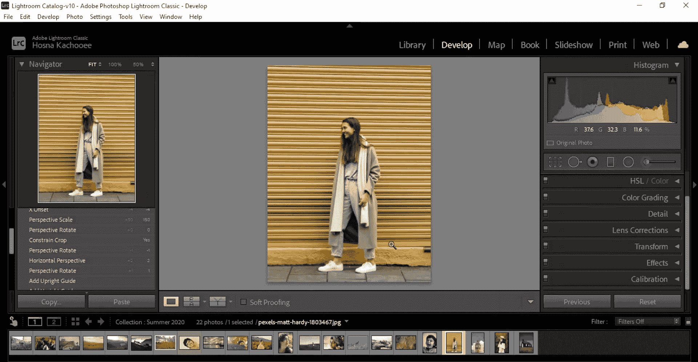

Complete Adobe Lightroom Megacourse： Beginner to Expert Photo Editing part2：07：Transform 透视编辑 📐

在本节课中我们将要学习如何在 Adobe Lightroom 中使用 Transform 面板来调整图片的透视角度。Transform 是 Lightroom 提供的另一个强大编辑工具，它的主要作用就是改变图片的形状和方向。通过这个面板，我们可以移动透视角度，调整倾斜程度，还能处理各种线条问题。这个功能在拍摄建筑、风景和街头摄影时非常有用，因为这些照片经常出现线条不平直的情况。下面我们就来详细看看这个面板具体包含哪些内容，以及如何一步步操作。

Transform 面板在 Lightroom 的编辑模块中可以找到，它和镜头校正面板处于相近的位置。展开面板之后，我们会看到一组滑块和若干预设选项。这个面板允许我们改变图片的透视角度，调整拍摄角度，让画面变得更正，还可以旋转图片，放大或缩小画面。通过这些控制，我们能够更好地决定图片最终呈现给观看者的样子。这个面板最常用于修正建筑物照片，也适用于包含大量建筑的风景照，以及街头摄影作品。如果照片中有街道或其他水平线，或者图片中同时包含水平线和竖直线，使用 Transform 面板就能让这些线条恢复正常。

接下来我们先来看看面板中自带的几个预设选项，它们可以让 Lightroom 自动帮我们完成大部分调整工作。以下是主要的预设选项说明：

 - Auto：自动模式，Lightroom 会自动分析图片并进行校正，适用于大多数轻微倾斜的照片。
 - Guided：引导式模式，需要我们手动在图片上绘制参考线，然后根据这些线条进行校正。
 - Level：水平模式，让 Lightroom 自动把图片中的水平线调平。
 - Vertical：垂直模式，让 Lightroom 自动把图片中的竖直线调直。
 - Full：完整模式，Lightroom 会不受限制地对图片进行各种校正，效果通常最全面。

以自动模式为例，当我们点击 Auto 按钮后，Lightroom 会自动对图片进行处理。如果原始照片比较歪斜，处理完成后画面会变得更加平直。我们可以按下键盘上的反斜杠键，在同一页面里对比修改前和修改后的效果，也可以选择并排显示、分割显示，或者上下分割显示。这种对比方式非常方便，能让我们一眼看出调整前后的差别。不过自动模式并不总是完美，有时候我们需要尝试其他预设来获得更好的结果。

引导式模式是 Transform 面板中比较灵活的工具，它允许我们自己决定校正的依据。以下是引导式模式的具体操作步骤：

 1. 打开 Guided 选项，Lightroom 会提示我们在图片上绘制两条参考线。
 2. 使用鼠标在图片上标记两个点，Lightroom 会根据这两条线自动计算校正角度。
 3. 如果需要，还可以继续添加更多参考线，让校正效果更加精准。
 4. 开启受限裁剪选项，Lightroom 会自动裁剪掉图片边缘出现的空白区域。

引导式模式的核心可以用这个公式来表示：`校正后图像 = 用户指定参考线 + Lightroom 自动透视变换`。这个工具特别适合那些有明显直线的场景，比如建筑物的边缘、地面的界线等。

除了自动模式和引导式模式，面板中还包含 Level、Vertical 和 Full 等预设，它们分别针对不同的校正需求。以下是各个预设的适用情况：

 - Level：专门针对水平线，适合海平线、地平线等需要保持水平的场景。
 - Vertical：专门针对竖直线，适合建筑物侧面、门框等需要保持垂直的场景。
 - Full：综合模式，同时处理水平和竖直线条，适合线条较为复杂的图片。

这些预设可以作为快速起点，处理完成之后我们还可以手动微调，让效果更符合自己的需求。

当我们完成自动校正或引导式校正之后，还可以使用面板中的细节滑块进行进一步调整。以下是各个滑块的具体作用和代码式描述：

 - Vertical：`垂直拉伸或压缩图像`，用于改变图片的竖直透视效果。
 - Horizontal：`水平拉伸或压缩图像`，用于改变图片的水平透视效果。
 - Rotate：`旋转图像`，调整图片的倾斜角度，操作比较简单直接。
 - Aspect：`同时在垂直和水平方向上拉伸或压缩图像`，用于恢复图片的自然比例。
 - Scale：`缩放图像`，效果类似于裁剪，可以放大或缩小画面。
 - X Offset：`左右移动图像`，调整主体在画面中的水平位置。
 - Y Offset：`上下移动图像`，调整主体在画面中的垂直位置。

这些滑块不一定在每张照片中都会用到，但掌握它们之后，在需要微调时就能派上用场。例如，我们可以把主体移动到画面中央，或者稍微放大某个部分来突出重点。

下面我们通过几个实际例子来看看如何把刚才学到的知识应用到真实的照片编辑中。第一个例子是一张建筑参考照片，我们希望让它看起来像是从低角度拍摄的。这时候可以调整垂直滑块，让画面产生从下往上拍摄的感觉。如果调整过度会显得不自然，所以只需要适当调整即可。处理完成后，我们可以使用长宽比滑块把图片拉回自然的比例，让画面看起来更加协调。

第二个例子是一张大垃圾桶的照片，同样可以通过改变透视角度，让它看起来像是从低角度拍摄的。首先调整垂直滑块，让画面产生从仰角拍摄的效果，然后再微调长宽比，让图片不至于过度压缩。之后可以使用水平面板，让画面看起来像是从左侧或右侧拍摄的，接着通过旋转工具找到一个合适的角度。最后使用引导式工具，在图片底部绘制参考线，Lightroom 就会根据这些线条进一步校正图片。处理完成后开启受限裁剪，就能去掉边缘的空白区域，得到一个干净的最终效果。

第三个例子是一张站在街道人行道上的女性照片，原始图片中的水平线明显倾斜。我们可以先使用引导式工具，在水平线上标记两个点，让 Lightroom 自动把画面拉直。如果画面还是不够直，可以稍微旋转一下，再调整水平线让人物看起来更平整。处理过程中如果打乱了之前的角度，记得再次微调旋转角度。对比修改前后的效果，可以看到画面发生了明显的变化。在调整的过程中，建议开启受限裁剪，这样能让校正结果更加整洁。

除了上述操作，我们还可以使用缩放工具来调整人物在画面中的大小，并配合偏移工具把人物移动到画面中央。比如把人物稍微向下移动，或者放大画面来突出主体，最终效果会和原来完全不同。这些简单的滑块操作就能把一张普通的照片变成完全不同的风格。

在进行颜色分级或其他基础编辑之前或者之后，都可以使用 Transform 面板来调整图片的透视。下一节课我们将会学习 Develop 模块中的最后两个面板。学完之后，我们就完成了编辑基础部分的内容，接下来将进入更具体的摄影类型，并把迄今所学的技巧应用到不同的摄影风格中去。下节课见。

本节课中我们一起学习了 Lightroom Transform 面板的使用方法。我们介绍了面板的基本位置和功能，讲解了 Auto、Guided、Level、Vertical 和 Full 等预设选项，详细说明了 Vertical、Horizontal、Rotate、Aspect、Scale 和 Offset 等滑块的作用，并通过建筑照片、垃圾桶照片以及街头人像照片三个实例演示了如何调整透视角度、校正倾斜线条以及使用受限裁剪。希望这些内容能帮助你掌握如何用简单的滑块改变图片，把照片转化为完全不同的样子。

